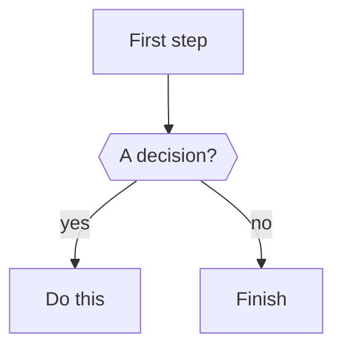

# Sending in an entry

Entries from anyone are welcome. This repository is, on purpose, a collection of programs that run code from places code shouldn't run: regex engines, markup parsers, build tools, a text interpreter's own parse pointer. Because of that, an entry from someone we don't know is treated as untrusted until we have read it, understood it, and run it somewhere it can't hurt anyone. None of this is personal; it is the same review whoever you are.

## What a pull request may contain

- **One new folder under `src/`**, and optionally one new row in the results table in `README.md`. Nothing else: no changes to `sandbox/`, `.github/`, the root build files, the Gradle wrapper, or other entries. `sandbox/scope-check.sh` rejects anything outside that.
- **Text only.** No binaries (compile at check time), no file over 256 KiB, no symlinks or submodules, plain file names (`A-Z a-z 0-9 . _ - /`), and no invisible or direction-changing Unicode characters. APL glyphs and other visible Unicode are fine.
- **A `README.md`** with a **How the stunt works** section: a plain-English walkthrough of the mechanism. This is the most important part. If we can't follow how your entry works, we can't merge it, however clever it is. In that case we will gladly link to it in your own repository instead (see below).
- **Frontmatter and computer-science tags at the top of your `README.md`.** The book ["Learn Programming the Weird Way!"](lessons/README.md) is built from this block, so its tables and chapters always match the code. **Tag your challenge with as many comp sci tags as you can. See your sibling challenges for examples!** The full rules are in [How your entry plugs into the book](#how-your-entry-plugs-into-the-book) below. `scope-check.sh` fails an entry whose frontmatter is missing or incomplete.
- **A check script** that builds the entry, runs it unattended, checks its own rules, and exits non-zero on any failure. Look at any existing `check.sh` for the pattern.
  - `check.sh` for the Linux sandbox. It runs with **no network**, as an unprivileged user, on a read-only system with a writable scratch folder. Write your demo data under `$XDG_DATA_HOME` (or `mktemp -d`), and finish within 15 minutes.
  - `check.ps1` for Windows-only entries (WPF and the like). It runs in Windows Sandbox with no network, and restores NuGet packages only from what we already have.
- **A way for a reviewer to try it safely: a `Dockerfile` or Windows Sandbox instructions.** `scope-check.sh` fails an entry that has neither. Every existing entry has one of them, and it makes your pull request much quicker to review.
  - **Linux entries: a `Dockerfile`** that builds a small image to run your entry and show its results (`sandbox/container/run-image.sh src/your-entry`). Copy the one from the closest existing entry: it builds in a stage from our toolchain image, then copies the finished program onto one of our tiny runtime bases. It is held to strict rules (no `ADD`, no `RUN` in the runtime stage, only `CC_*` variables in its `ENV`; see [`sandbox/dockerfile-lint.sh`](sandbox/dockerfile-lint.sh)). The gate never builds it, so it is a convenience for people who want to try your entry safely, not a way to bring your own packages. Add a "Run it in a container" section to your README, like the other entries.
  - **Windows-only entries (WPF and the like): a "Run it in Windows Sandbox" section** in your README, with the exact command (`sandbox\windows\run.ps1 src\your-entry`) and the toolchain it needs. Copy the wording from [`xaml`](src/xaml/README.md#run-it-in-windows-sandbox). The heading must be exactly `## Run it in Windows Sandbox`.
- Your contribution is under the repository's [MIT license](LICENSE).

## How your entry plugs into the book

This repository is also a textbook, and **your entry's README is the source material for it.** Nobody copies your words into the book by hand. A build script (`lessons/book/build.py`) reads the block at the top of every `src/*/README.md` and generates the computer-science chapters, the comparison tables and the per-concept "In this repo" lists from it. So the block has to be right, and the tags matter: every tag you add puts your entry in front of readers of that concept.

You only edit your own folder. A maintainer then adds the lesson text, regenerates the book and rebuilds the PDF and EPUB. The rest of this section tells you what to write.

### 1. The frontmatter block

The very first thing in your `README.md` is a block between two `---` lines. Copy it from your closest sibling entry in `src/` and change it. This is the one from `src/forth/`:

```yaml
---
name: "Forth"
teaches: "that a stack language needs one `begin ... until` and a pipe to be a whole program."
kind: idiomatic
languages: [forth]
lesson: "languages/forth.md"
loop-by: loop-statement
evaluation: eager
assurance: guaranteed
pairs-with: forth-weird
tags: [control-flow, stack-data-structure, stack-machine, transaction]
---
```

| Key | Required | What to write |
| --- | --- | --- |
| `name` | yes | The language or tool, as a reader would say it: `"Forth"`, `"GNU sed"`, `".NET regex"`. |
| `teaches` | yes | One lowercase `that` clause that says what a reader learns. If your README has a `**Teaches you:**` line, use exactly the same words (the build checks this). |
| `kind` | yes | `idiomatic` (the ordinary way), `weird` (the stunt), or `port` (the same stunt in another language). |
| `languages` | yes | A list of language ids, in lowercase, from [`lessons/cs-source/languages.txt`](lessons/cs-source/languages.txt): `[forth]`, `[c-sharp, linq]`. List every language the entry is written in or runs on (the host language, the query language, the regex flavor). The book's language index and tables are built from this. If yours is missing, use the nearest id and say so in your pull request. |
| `lesson` | yes | The lesson page that covers it, relative to `lessons/`, with an optional `#anchor`: `"languages/forth.md"`. If there is no page for your language yet, use the closest one. A maintainer fixes it when they add yours. |
| `loop-by` | yes | What plays the loop in your entry. Pick one file name from [`lessons/cs-source/roles/`](lessons/cs-source/roles/): for example `loop-statement`, `lazy-demand`, `rewrite-and-rescan`, `self-modifying-control`, `backtracking-search`, `dispatch-and-triggers`, `input-driven`, `document-order`, `bulk-array`. The [comparative chapter](lessons/cs/09-comparative-case-studies.md) shows what each one means. |
| `evaluation` | yes | The strategy that drives the main computation: `eager`, `lazy`, `deferred`, `rewriting`, `search` or `declarative`. Describe embedded operations separately. |
| `assurance` | yes | The *weakest necessary dependency* of the trick: `guaranteed` (a named specification or API documents the behavior), `implementation-permitted` (a particular implementation allows it) or `accidentally-exploited` (the trick requires an unpromised behavior). Explain what supports each individual claim, including the scope of a documented API guarantee. The [intro](lessons/intro.md#three-kinds-of-knowledge) explains the three. |
| `tags` | yes | A list of computer-science concepts. See below. |
| `pairs-with` | no | Your closest sibling entry: the ordinary version of a weird one, or the other way round. |
| `analogies`, `counterexamples` | no | Concept ids (the same vocabulary as `tags`). Use `tags` only for ideas your entry **demonstrates**. Use `analogies` for an idea your entry *resembles* without being an instance of it (a Kotlin `generateSequence` is not a coroutine, but it is a cousin). Use `counterexamples` for an idea your entry shows by *not* being it (a closure is not a continuation). An entry can relate to a concept in only one of the three ways. The concept's "In this repo" table says which. |
| `machine`, `state` | no, but give both or neither | The two sentences from the book's "name the machine" table: *what machine is your entry really?* and *where does its state live?* Give them if your entry is a stunt. |

The block is a small, strict subset of YAML, so no parser library is needed: `key: value`, `key: "quoted text"` and `key: [a, b]`. Put text that contains a colon or a `#` in quotes. Comment lines start with `#`. Nothing else is allowed, and the build tells you the line it did not understand.

### 2. Tags and languages: the book's vocabularies

Tags connect your entry to the book's concepts: control flow, lazy evaluation, backtracking, homoiconicity, transactions, and so on. **Use as many as honestly apply.** A rule of thumb: if you had to understand an idea to write the entry, or if the entry makes a good example of it, tag it.

- The vocabulary is the list of file names in [`lessons/cs-source/concepts/`](lessons/cs-source/concepts/). The [concept index](lessons/cs/README.md#concept-index) shows each tag with its chapter and the entries that already use it. Your sibling entries are the best examples.
- Spell a tag exactly like its file name, without `.md`: `reflection-and-metaprogramming`.
- **Do not edit `lessons/`.** If you need a concept that does not exist, use the nearest tag and say in your pull request which concept is missing. A maintainer decides whether to add it. `scope-check.sh` only prints a note for an unknown tag, but the book build fails until a maintainer adds the concept or fixes the tag.
- Languages work the same way, with one list: [`lessons/cs-source/languages.txt`](lessons/cs-source/languages.txt). A *language* says what the entry is written in or runs on. A *tag* says which computer-science idea it shows. The book's **Index** (the last chapter) is built from both, so an entry with the right languages and tags shows up everywhere a reader would look for it.
- **Do not tag to make a concept look used.** A concept that no entry honestly demonstrates is grounded some other way: an analogy, a counterexample, a statement that it applies to every entry (`applies-to`), or an exercise. `python lessons/book/build.py --orphans` lists how every concept is grounded and fails if one has nothing behind it.
- Each concept page explains *why it exists, why it is used, when to use it and when not to*, with links to Wikipedia and other long-lived, freely reusable sources. Read the ones you tag, and check that your entry really is an example.

### 3. The section headings every README shares

All entries use the **same section titles**, so a reader (and the book, and links from other pages) always knows where to look. Use these titles exactly, as `## ` headings. Do not invent synonyms such as "How it works" or "Fine print".

| Heading | Required | What goes in it |
| --- | --- | --- |
| `# Title` | yes | One title line. Optionally follow it with a `**Teaches you:**` sentence, then a `DEMO ONLY` notice (your data is fictional and never touches a real system) and a short introduction: what the entry does, and the constraint it plays under. |
| `## Run it` | yes | How to run it on your own machine. |
| `## Run it in a container` or `## Run it in Windows Sandbox` | yes, one of them | See the Dockerfile rule above. The Windows heading is checked word for word. |
| `## Program Flow` | yes | One Mermaid diagram of **how this program runs**, and two short paragraphs. See [Program Flow: a picture of the machine](#program-flow-a-picture-of-the-machine) below. Put it just before `## How the stunt works` |
| `## How the stunt works` | yes | The plain-English mechanism, and the most important section. Say where the program's state lives, what plays the loop and what plays the stop rule. If you are a "weird" entry, also say what the ordinary version would look like. Put sub-steps under `###` headings. |
| ``## What `check.sh` enforces`` | yes (``## What `check.ps1` enforces`` for a Windows check script) | The rules your check script tries to break. |
| `## Gotchas worth knowing` | yes | The walls you hit, the parts that depend on one implementation, and anything that surprised you. Mark each trick as guaranteed, implementation-permitted or accidentally exploited, the same words as the `assurance` key. |

These optional headings also have fixed titles. Use them when they fit: `## What it does`, `## Why this is weird` (or `## Why this is idiomatic`, for the ordinary version of a weird entry), `## What you can learn`, `## Layout`, `## Format and lint`. Add any other `##` section your entry needs under its own, specific title.

The order above is the recommended order, but it is not enforced. `sandbox/scope-check.sh` fails a new entry that lacks one of the required headings. The earliest one-statement ports (Go, Java, Kotlin, Python and Rust) have no check script, so they have no check section; a new entry must have both.

### Program Flow: a picture of the machine

Every README has exactly one `## Program Flow` section. It answers **"what is the runtime, interpreter, compiler, scheduler or language feature actually doing that makes this program work?"** It is not a picture of the task (the book’s intro shows the task and lists implementation differences). If your diagram could be pasted unchanged into ten other READMEs, it is not teaching your entry's point.

The section is exactly this, and nothing else (no sub-headings):

````markdown
## Program Flow



**What this shows:** two to four sentences.

**Why this mechanism matters:** two to four sentences.
````

- **Pick the diagram type that fits the machine.** `flowchart` for branches and loops, `sequenceDiagram` for callbacks, dispatch and who-calls-whom, `stateDiagram-v2` for a state that changes (a `GO TO` target, a parse pointer), a flowchart of data and demand for lazy evaluation. Do not draw a `while` loop for a program that has none. The build accepts any diagram family that Mermaid can render.
- **Draw what runs.** Read the source and run it first. Do not depict something the program does not do, and do not copy the task description.
- **Keep it small.** About 5 to 10 nodes or messages, labels under about 60 characters. Draw decisions as hexagons (`{{"text"}}`): a diamond grows too tall around its text. No HTML tags in labels, no colors that carry meaning, no `;` in a sequence-diagram message (it ends the statement).
- **`accTitle` and `accDescr` are required.** The first is the figure's caption and the second is its alt text.
- **Links** to other files are fine (they are re-aimed when the section is copied into a lesson page). Links to a heading in your own README are not.
- **The build checks it.** `python lessons/book/build.py --check` checks the section's structure. `python lessons/book/build.py --check-diagrams` renders every diagram and fails if one cannot be drawn, or would print smaller than about 8.4 pt on a Letter page. If your diagram is too tall or wide, shorten the labels or use fewer nodes. See [`lessons/book/README.md`](lessons/book/README.md#diagrams) for the one-time setup.

### 4. Voice and tone

Follow the [house style](house-style.md) for README prose, lesson text and study guides. Give readers a concrete example and keep the explanation clear for readers who use a translator.

### 5. Check it before you send it

Run `python lessons/book/build.py --check` from the repository root (it needs [pandoc](https://pandoc.org)). It validates every entry's frontmatter and tags, checks that the generated book pages are up to date, builds the book and verifies every internal link. You will see a clear message that names the file and the line. Fix problems in your own folder. If the only message is about a tag or role that does not exist yet, send the pull request anyway and explain, as described above.

## Your language's toolchain

Entries run only with what is already in [`sandbox/linux/Dockerfile`](sandbox/linux/Dockerfile): GNU APL, Gforth, GHC, Perl, PCRE2, sed, Make, CMake, a C compiler, .NET 10 and SQLite. If yours needs something else, say so in the pull request and tell us where its official distribution lives. We add it to the image ourselves, in a separate commit, pinned to a version and checksum. Please don't send install scripts, and don't ask us to install an interpreter from your own repository.

## Before you open the pull request

Set up Docker (and Windows Sandbox, for Windows entries) once, following [`SANDBOX-SETUP.md`](SANDBOX-SETUP.md). Then, from a Linux, macOS or WSL shell (or Git Bash with Docker Desktop):

```bash
sandbox/run.sh src/your-entry                 # the same sandbox the gate uses
sandbox/container/run-image.sh src/your-entry # if you ship a Dockerfile: see what it does
sandbox/scope-check.sh origin/master HEAD     # the same scope rules, plus the reviewer report
```

The reviewer report at the end of `scope-check.sh` lists every line that touches the network, starts a process, evaluates code, or looks like an encoded blob. It's normal for entries in this repository to have some; expect your README to explain each one.

## What happens next

1. `scope-check.sh` runs against your pull request without checking it out.
2. People (and a few AI reviewers, each asked to translate your code into plain English and list everything it can touch) read the code alongside your README.
3. A maintainer runs the gate: your check, in the sandbox, on a throwaway machine.
4. Then one of two things happens:
   - **Merged**, with credit in the results table.
   - **Linked**: we add a row pointing to your own repository at a specific commit. This is not a rejection. It means we enjoyed it but couldn't vouch for every line, usually because the language is beyond what we can read with confidence.

A passing gate means your entry built, ran and behaved in a sandbox. It is not, on its own, why we merge. Understanding it is.
