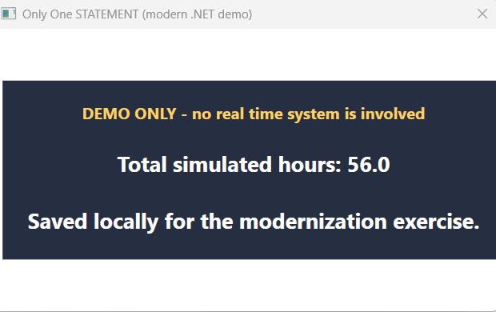
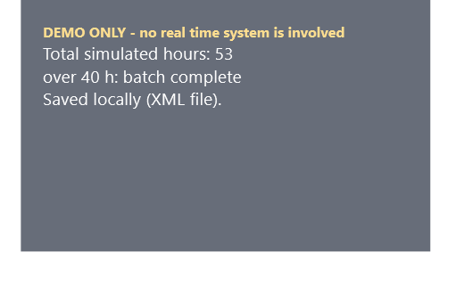

# One Statement, Two Semicolons

> **Obfuscated algorithms.** Like the [old obfuscated C contests](https://www.ioccc.org/), but the thing being obfuscated is the *algorithm*: take a perfectly ordinary little program and force it through an absurd rule until it comes out the other side working, correct, and almost impossible to read.

The rule here: `main` gets **one statement** and it has **no body**. (Or, in the XAML version, a `Main` that does nothing except hand the whole job to a XAML file.) Everything the program does, it does as a side effect of evaluating expressions. The result is emphatically not an architectural pattern. It is a flex, a puzzle, and a very bad idea that happens to run.

## Psst, hey kid

Hey, kids! **Try this at home!** **Don't tell the boss!**

You've spent years writing clean code. Small functions. Meaningful names. Tests. *Boring.* Come over here, there's a van, and in the van there's candy: a `for` loop with an empty body that opens a database, spins up a thread, draws a window and fades it in and out, all before the first semicolon is done being weird.

You know you want to write perversely incomprehensible code. **You know you do.**

It's a trend, too. This started as one C# program. It is now **nine** programs in **seven** languages and counting, written by more than one person (Ken caught it, too). Pick a language. Pick a constraint. Make something terrible that works.

## The family

Every version builds the same demo: generate 10 to 19 random hours at a time for made-up *Meetings / Coding / Debugging / Learning* time cards, save them to a local SQLite file, stop when the total passes 40, and show a **DEMO ONLY** window that pulses until you close it. Nothing here touches a real time-reporting system.

| Version | By | The stunt | Window | Where |
| --- | --- | --- | --- | --- |
| **C# (the original)** | Jim | Empty-body `for`; anonymous object as loop state; runtime XAML; LINQ; EF Core | WPF | [`src/ModernChallenge1`](src/ModernChallenge1) |
| **Rust** | Jim | No `;`, `let`, or `return` in `main` (a test enforces it); iterators and closures | GTK 4 (WSL) | [`src/RustChallenge1`](src/RustChallenge1/README.md) |
| **XAML** | Jim | The program *is* a XAML file, interpreted at run time. No code-behind, no event handlers, no converters | WPF | [`src/xaml`](src/xaml) |
| **Perl regex** | Jim | One `=~` match is the whole program: `(?{ })` and `(??{ })` blocks do the work, then the match returns *false* | terminal | [`src/regex-perl`](src/regex-perl/README.md) |
| **PCRE2 regex** | Jim | One `pcre2_match` call; the pattern's callout strings are opcodes for a bodiless C dispatcher; result: "no match" | terminal | [`src/regex-pcre2`](src/regex-pcre2/README.md) |
| **.NET regex** | Jim | One `Regex.Match`, balancing groups only: no callouts, no inline code. A budget stack is the stop rule, flag groups pick the category. Documents the walls it hits | terminal | [`src/regex-dotnet`](src/regex-dotnet/README.md) |
| **Java** | Ken | One bodiless `for`; an anonymous class holds the loop state | Swing | [Ken's repo](https://github.com/kastl/one-statement-challenge) |
| **Kotlin** | Ken | The same challenge, Kotlin style | Swing | [Ken's repo](https://github.com/kastl/one-statement-challenge) |
| **Python** | Ken | The same challenge in Python | Tk | [Ken's repo](https://github.com/kastl/one-statement-challenge) |
| **Go** | Ken | The same challenge in Go | browser page | [Ken's repo](https://github.com/kastl/one-statement-challenge) |

The C# version is where it all began (a 2008 class exercise, later modernized), so it keeps pride of place below. But the Rust and XAML versions are first-class citizens here, not footnotes.

## It's a trend! Ken Kastl's ports

**[Ken Kastl](https://github.com/kastl) took this and ran.** His repo, [`kastl/one-statement-challenge`](https://github.com/kastl/one-statement-challenge), ports the challenge to **Java, Kotlin, Python, and Go** so you can compare how each language bends (or refuses to bend) to a single bodiless statement. He started with Java and Kotlin, then kept going, because apparently that is what happens when someone catches the bug.

Ken's repo is a great reading list for anyone who wants to see the same perversion expressed four different ways:

- **Java and Kotlin** run from a Gradle wrapper and show a Swing dialog.
- **Python** needs only Python 3 (`tkinter` and `sqlite3` ship with it) and shows a Tk window.
- **Go** serves the pulsing page to your default browser.

Run his with `.\gradlew.bat runJava`, `runKotlin`, `runPython` or `runGo`, and see [his README](https://github.com/kastl/one-statement-challenge#readme) for the details. If you write a new language port, I would love to hear about it.

## Run the original (C#)

This is a Windows WPF application targeting .NET 10.

```powershell
cd src\ModernChallenge1
dotnet restore
dotnet run
```

The window intentionally says **DEMO ONLY**. Generated records are stored only in a local SQLite file under `%LOCALAPPDATA%\ModernChallenge1`; the application has no connection to an actual time-reporting system.



## XAML: the program isn't even C# code

`src/xaml` is the most perverse one yet. The C# in it is a single expression that hands a `.xaml` file to the XAML parser. **All of the logic** (the seeded random draws, the arithmetic, the stop rule, the database writes, the background thread, the animation) lives in the XAML and is executed *while the file is being parsed*.

```powershell
cd src\xaml
dotnet run -- strict.xaml     # only types that ship with .NET and WPF; saves an XML file
dotnet run -- sqlite.xaml     # talks to SQLite directly from XAML
dotnet run -- efcore.xaml     # EF Core: TimeCards.Add and SaveChanges, from XAML
```

Needs Windows and the .NET 10 SDK. Records land in `src\xaml\data`; delete that folder to start fresh (the stop rule counts rows already saved).



### How is that even possible?

XAML is supposed to *describe* things. It turns out the parser will happily *do* things if you ask it nicely and don't mention it to anyone:

- **`XamlReader.Load` is the interpreter.** The XAML file is the program.
- **`ObjectDataProvider` is the instruction.** It can construct any object and call any method, and it runs the moment it is parsed. **Document order is the program counter.**
- **`Refresh` is the goto.** A provider can re-run another one (smuggled through an `x:Array` so XAML doesn't unwrap it).
- **"Carrier" arrays are the variables.** One call fills a `char[]` or `byte[]` in place, the next call reads it. That is how a seeded random number gets from `Random.Next` into a SQL parameter, an XML document, or an EF Core entity.
- **Expression engines are the ALU.** `DataTable.Compute("Sum(h)")`, `DataView.RowFilter`, and SQL itself do the arithmetic and the conditionals. A SQL string inside XAML is still XAML.
- **A `Thread` is built entirely in markup** with `Delegate.CreateDelegate`, started, and joined, and the window's fade animation is a plain old storyboard.

The honest fine print, because obfuscation is not lying: the loop is **unrolled** to four passes (there is no loop construct in here, only copy-and-paste with conviction), conditional *effects* come from the expression engines rather than from triggers, and the three files are three flavors of the same program: `strict.xaml` uses nothing outside .NET (so it saves XML, not SQLite), `sqlite.xaml` adds the SQLite package, and `efcore.xaml` adds EF Core through two small model classes copied from the C# version.

## The fun, the why, the flex

The fun is treating the three expression slots of a `for` statement as a tiny programming language. The why is historical: the original sample was built to exercise the C# 3.0 and .NET 3.x features that were new in class. The flex is not that this is good production code; it is that the code can make a lot of runtime machinery legible while obeying an intentionally absurd syntactic rule.

The two arrow blocks in `Program.Main` are intentional. They point at the first and last semicolons that delimit the three `for` sections.

## What changed in the C# version, and what did not

The project deliberately stays close to the original's shape. A modern idiomatic application would use declarative XAML, view models, dependency injection, short-lived EF Core contexts, and `await SaveChangesAsync()`. Those improvements are intentionally deferred here so each historical construct has a recognizable contemporary counterpart.

| Original construct | Current construct | Rationale |
|---|---|---|
| C# 3.0 / .NET 3.x project | SDK-style `net10.0-windows` WPF project | Current Windows WPF target |
| `[STAThread]` and `Program.Main` | Preserved | WPF still needs an STA UI entry point |
| One empty-body `for` statement | Preserved | The challenge constraint |
| Anonymous object as iterator state | Preserved | Still bundles mixed state into one initializer declaration |
| `XElement` emits a `DoubleAnimation` | Preserved | Still injected into runtime XAML |
| `List<float>` + LINQ `Sum()` | `List<double>` + LINQ `Sum()` | `double` is the usual current default for accumulated values |
| `Environment.GetEnvironmentVariable("USERNAME")` | `Environment.UserName` | Direct typed API for the same value |
| LINQ to SQL / `NorthwindDataContext` | EF Core / `DemoTimeCardContext` / SQLite | LINQ to SQL is not supported by current .NET; SQLite makes the demo self-contained |
| `InsertOnSubmit` / `SubmitChanges` | `TimeCards.Add` / `SaveChanges` | Closest current unit-of-work rhythm |
| Live `TimeCard` records | local, marked `DemoTimeCard` records | Avoids treating generated values as time reporting |
| `new Random()` | `Random.Shared` | Avoids needless short-lived generators |
| `DayOfYear / 7` | `ISOWeek.GetWeekOfYear` | Defined ISO calendar-week calculation |
| Generic `IEnumerator<string>` | Preserved | Keeps the generics example visible |
| Runtime WPF window + `XamlReader.Load` | Preserved | Keeps the source recognizably code-first |
| `Viewbox.Triggers` | `FrameworkElement.Triggers` | Current runtime XAML accepts the inherited property syntax |
| `Bliss.jpg` | color-only panel | Removes an undeclared external asset |
| Named `Mutex` | Preserved | Serializes the intentionally awkward shared-context path |
| Lambda / anonymous delegate | Preserved | Still makes the expression-based loop test possible |
| Background `Thread` | Preserved for comparison | Modern code would normally use `Task`/`await` |
| Reflection to invoke void-returning methods | Preserved for comparison | Retains the original expression-side-effect workaround |

### Caveats, intentionally left visible

`DbContext` is not thread-safe. The mutex is only here to retain the original thread/reflection shape. It should not be read as a recommendation for modern data-access design.

## Rust companion for WSL

[`src/RustChallenge1`](src/RustChallenge1/README.md) translates the challenge into Rust's iterator and closure mechanics: an empty-body `for` with no `;`, `let` or `return` anywhere in `main` (enforced by a test), a GTK 4 window, and local SQLite demo records. The companion README contains Ubuntu APT setup and run instructions, and compares the approach with [Ken Kastl's ports](https://github.com/kastl/one-statement-challenge).

From WSL, run the Rust version and inspect its saved demo records with:

```bash
cd /home/lehmer/repos/code-challenge/src/RustChallenge1
cargo run --locked
sqlite3 data/demo-timecards.db 'select * from demo_timecards;'
```

The SQLite command runs after the window is closed. See the companion README for the Ubuntu packages and setup.

## Regex companions for WSL

Three entries turn a regular expression into the program. In the first two, the loop, the running total, the stop rule and the record writes all happen *inside one regex match*, which then deliberately reports failure after doing all the work. [`src/regex-perl`](src/regex-perl/README.md) uses Perl's executable `(?{ })` and `(??{ })` blocks; [`src/regex-pcre2`](src/regex-pcre2/README.md) uses PCRE2 callouts as a tiny instruction set. Both pulse a **DEMO ONLY** banner in the terminal, from inside the match, and both ship a `check.sh` that asserts the rules.

The third, [`src/regex-dotnet`](src/regex-dotnet/README.md), is the purist's version: .NET balancing groups and conditionals only, no code in the pattern. The pattern does the walk, the accumulation and the stop rule, but its README is honest about the walls: a regex cannot draw random numbers or write files, and a failed .NET match exposes no captures, so the "return false" signature move is impossible there. See [`plans/regex.md`](plans/regex.md).

```bash
perl src/regex-perl/timecards.pl
make -C src/regex-pcre2 run     # needs libpcre2-dev
dotnet run -c Release --project src/regex-dotnet
```

## Repository layout

```text
docs/
  My Code Challenge.pdf       # anonymized source presentation
  images/
    modern-wpf-demo.png       # the C# demo window
    xaml-demo.png             # the XAML demo window
src/
  ModernChallenge1/           # C#: the original, modernized for .NET 10
  RustChallenge1/             # Rust + GTK 4 companion for WSL
  regex-perl/                 # Perl: one executable-regex match is the program
  regex-pcre2/                # PCRE2: callout strings as opcodes, C dispatcher
  regex-dotnet/               # .NET: balancing groups only, and the walls it hits
  xaml/                       # XAML: the program is a .xaml file run at run time
plans/
  pure-xaml.md                # the plan the XAML experiment followed
  regex.md                    # the plan the regex experiments followed
LICENSE
```

Ken's Java, Kotlin, Python and Go versions live in [his repository](https://github.com/kastl/one-statement-challenge).

## Disclaimer

**DEMO ONLY.** Every record any of these programs writes is flagged as demo data in a throwaway local file. None of it connects to, or should ever be used for, a real time-reporting system. And please, for the love of all that is maintainable, do not do any of this at work. (Don't tell the boss.)
