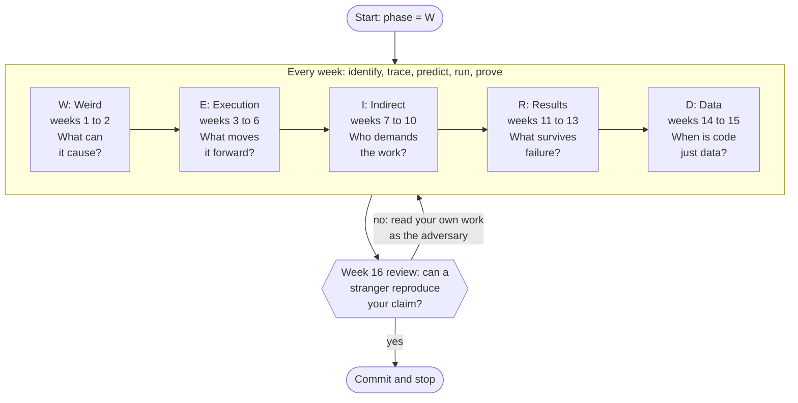

# Curriculum

*A 16-week course built on* Learn Programming the Weird Way!

This curriculum turns the repository into one semester. It teaches computer science through a survey of languages and implementations. Most of them are old, odd or both. The ideas are the subject. The languages are the evidence.

**WEIRD** stands for **Weird Execution, Indirect Results and Data**. The W is recursive. The five letters also give the course its five phases.

## Who this is for

- Senior undergraduates and graduate students.
- Self-taught programmers who write working code and want the theory under it.
- Curious readers who like a puzzle.

You need one language you know well, a shell and a container runtime. You do not need a degree. You do not need to install COBOL, APL or Forth. The [sandbox](../SANDBOX-SETUP.md) supplies them.

## What you will be able to do

1. Name the machine inside a program: what repeats, where state lives, what advances the next step, what stops it and what commits.
2. Read an unfamiliar program and list what it can cause before you run it.
3. Predict a trace, then test the prediction with a run.
4. Label a claim **guaranteed**, **implementation-permitted** or **accidentally exploited**, and give the evidence.
5. Solve one problem under a constraint and compare the designs by more than line count.
6. Say which problem of its time a language solved, and which of its ideas you still use.

## The semester as an algorithm

The course follows the rules it teaches. No counter variable drives it. The phase is the state, as in the programs you will read. A review at the end decides whether to stop. If it fails, the next pass starts at W again.

The W is recursive. In the first pass you read other people's programs. In the next pass you read your own.

## How every week works

A week has the same four steps. They come from the [study guides](../lessons/study-guides/README.md). Plan 6 to 9 hours.

1. **Identify the machine.** Read the book chapter and the study guide. Find the loop, the state, the clock, the decision and the commit.
2. **Trace one run.** Follow the guide's fixed run by hand. Write the state before and after each step.
3. **Predict, then run.** Write your prediction in a file. Then run the verified exercise in the sandbox. Compare the two.
4. **Prove.** Answer the guide's evidence question. A claim needs a test that can fail.

All programs use fictional **DEMO ONLY** data. Read the source first. Run it only in the sandbox. See [Running things safely](../lessons/exercises.md#running-things-safely).

## Week by week

The links go to the book chapters, the study guides and the exercises. This curriculum changes none of them.

| Week | Question | Read | Do |
| --- | --- | --- | --- |
| | **W: Weird** | | |
| 1 | What can a program cause before I run it? | [Ch 1](../lessons/cs/01-reading-an-adversarial-program.md), [guide](../lessons/study-guides/concepts/reading-adversarial-programs.md) | [A1](../lessons/exercises.md#a1-read-the-rows-verified), [F2](../lessons/exercises.md#f2-trojan-source-hide-a-character-then-find-it-verified) |
| 2 | What counts as a machine? COBOL: a jump is the loop. | [Ch 2](../lessons/cs/02-what-counts-as-a-machine.md), [COBOL guide](../lessons/study-guides/languages/cobol.md) | [B1](../lessons/exercises.md#b1-cobol-predict-then-break-alter-verified) |
| | **E: Execution** | | |
| 3 | Where is the program counter? Forth: the parse position. | [Ch 3](../lessons/cs/03-control-flow-and-continuations.md), [Forth guide](../lessons/study-guides/languages/forth.md) | [B3](../lessons/exercises.md#b3-forth-move-the-anchor-verified) |
| 4 | Who chooses the next step? Make and CMake: a dependency graph. | [Make and CMake guide](../lessons/study-guides/languages/make-and-cmake.md) | [B4](../lessons/exercises.md#b4-make-remove-the-no-op-and-override-the-clock-verified), [B5](../lessons/exercises.md#b5-cmake-mutate-the-literal-verified) |
| 5 | Where does state live? ed and Ex: a text buffer. | [Ch 6](../lessons/cs/06-state-beyond-variables.md), [ed and Ex guide](../lessons/study-guides/languages/ed-and-ex.md) | [B18](../lessons/exercises.md#b18-ed-move-the-stop-rule-and-break-the-cleanup-verified), [B19](../lessons/exercises.md#b19-ex-move-the-limit-on-the-tape-and-cut-the-loop-verified) |
| 6 | What replaces the loop? APL: whole arrays. | [APL guide](../lessons/study-guides/languages/apl.md) | [B6](../lessons/exercises.md#b6-apl-the-off-by-one-rewrite-verified) |
| | **I: Indirect** | | |
| 7 | Who demands the work? Haskell: laziness. | [Ch 4](../lessons/cs/04-evaluation-and-demand.md), [demand guide](../lessons/study-guides/concepts/evaluation-demand-and-laziness.md), [Haskell guide](../lessons/study-guides/languages/haskell.md) | [B2](../lessons/exercises.md#b2-haskell-break-the-laziness-verified) |
| 8 | Can dispatch rules be a loop? Lisp. **Midterm.** | [Lisp guide](../lessons/study-guides/languages/common-lisp.md) | [B10](../lessons/exercises.md#b10-lisp-swap-the-method-combination-verified) |
| 9 | What does a closure remember? JavaScript. | [JavaScript guide](../lessons/study-guides/languages/javascript.md) | [B20](../lessons/exercises.md#b20-javascript-read-the-clauses-move-the-limit-and-fail-the-structure-check-verified), [B21](../lessons/exercises.md#b21-javascript-weirder-move-the-stop-rule-in-a-closure-and-watch-the-demand-verified) |
| 10 | Who owns the next turn? Events and callbacks. | [Ch 10](../lessons/cs/10-events-callbacks-and-reactive-control-flow.md), [events guide](../lessons/study-guides/concepts/events-callbacks-and-reactive-control.md) | [B22](../lessons/exercises.md#b22-javascript-event-driven-predict-the-trace-then-remove-the-boundary-verified) |
| | **R: Results** | | |
| 11 | What truly commits? Effects, errors and queries. | [Ch 7](../lessons/cs/07-effects-errors-and-commitment.md), [effects guide](../lessons/study-guides/concepts/effects-errors-and-commitment.md), [C# and LINQ guide](../lessons/study-guides/languages/csharp-linq-xaml-and-ports.md) | [B7](../lessons/exercises.md#b7-linq-enumerate-twice-verified) |
| 12 | What survives a failed match? Regex and sed. | [Regex and sed guide](../lessons/study-guides/languages/regex-engines-and-sed.md) | [B8](../lessons/exercises.md#b8-regex-what-survives-a-failed-match-verified), [B9](../lessons/exercises.md#b9-sed-watch-a-computation-verified) |
| 13 | What does the specification promise? AWK and find. | [Ch 8](../lessons/cs/08-abstraction-leaks-and-implementation-dependence.md), [portability guide](../lessons/study-guides/concepts/portability-abstraction-and-cost.md) | [B13](../lessons/exercises.md#b13-awk-the-missing-rt-verified), [B15](../lessons/exercises.md#b15-gnu-find-move-the-stop-rule-read-the-profile-verified) |
| | **D: Data** | | |
| 14 | When is a notation a machine? Formal languages and m4. | [Ch 5](../lessons/cs/05-formal-languages-as-computational-substrates.md), [formal languages guide](../lessons/study-guides/concepts/formal-languages-and-weird-machines.md), [m4 guide](../lessons/study-guides/languages/m4.md) | [B11](../lessons/exercises.md#b11-m4-quote-the-recursion-verified) |
| 15 | When is data a program? Tcl and tar. | [Ch 9](../lessons/cs/09-comparative-case-studies.md), [Tcl guide](../lessons/study-guides/languages/tcl.md), [tar guide](../lessons/study-guides/languages/tar.md) | [B12](../lessons/exercises.md#b12-tcl-edit-the-program-in-the-database-verified), [B16](../lessons/exercises.md#b16-tar-read-the-program-then-run-it-verified) |
| 16 | Can a stranger reproduce your claim? Capstone. | [Comparative guide](../lessons/study-guides/concepts/comparative-machine-design.md) | [D](../lessons/exercises.md#d-port-the-challenge-verified-reference-answer-in-awk), [F1](../lessons/exercises.md#f1-test-a-claim-of-your-choice) |

## Old languages, real problems

A historical language is not a curiosity. Each one solved a problem of its time. The problems changed shape. They did not go away.

| Language | Era | Problem of the time | Idea you keep |
| --- | --- | --- | --- |
| [Lisp](https://en.wikipedia.org/wiki/Lisp_(programming_language)) | 1958 | AI research needed to process symbols and lists, not only numbers. | Code is data. Garbage collection. |
| [COBOL](https://en.wikipedia.org/wiki/COBOL) | 1959 | Businesses needed programs that auditors could read on many makes of computer. | Declared data as a contract. Exact decimal arithmetic. |
| [APL](https://en.wikipedia.org/wiki/APL_(programming_language)) | 1960s | Mathematicians needed one notation for operations on whole arrays. | Think in arrays, not in loops. |
| [Forth](https://en.wikipedia.org/wiki/Forth_(programming_language)) | about 1970 | Small computers that ran instruments had very little memory. | A stack and a dictionary are enough for a language. |
| [ed](https://en.wikipedia.org/wiki/Ed_(software)) | early 1970s | Terminals printed on paper, so users edited text without seeing a screen. | Commands as a small language. A failed command as a condition. |
| [sed](https://en.wikipedia.org/wiki/Sed) and [AWK](https://en.wikipedia.org/wiki/AWK) | 1970s | Files were too many to edit by hand, so pipelines filtered streams. | Pattern and action. The implicit loop. |
| [m4](https://en.wikipedia.org/wiki/M4_(computer_language)) | 1970s | One source text had to produce code for many targets. | Expansion and rescanning are computation. |
| [Make](https://en.wikipedia.org/wiki/Make_(software)) | 1976 | Rebuilding by hand after each change was slow and error-prone. | Declare the dependencies. Let the tool choose the order. |
| [tar](https://en.wikipedia.org/wiki/Tar_(computing)) | late 1970s | Tape drives wrote data in sequence and could not seek. | Serialization. An archive can carry effects when something interprets it. |
| [Tcl](https://en.wikipedia.org/wiki/Tcl) | 1988 | Tool authors needed a command language to embed in their programs. | Everything is a string. Code is data. |
| [Haskell](https://en.wikipedia.org/wiki/Haskell) | 1990 | Researchers had many lazy functional languages and needed one shared standard. | Laziness. Purity. Demand drives evaluation. |
| [JavaScript](https://en.wikipedia.org/wiki/JavaScript) | 1995 | Browsers needed small programs that react to user events. | The event loop. Closures. Callbacks. |

## How to think about adversarial programs

An adversarial program is written to surprise its reader. Treat every program as if it might be one.

- **Ask what it can cause, not what it says.** Names, comments and README text are claims. The source is the evidence.
- **Separate reading from running.** Read first. Use a passive inspector before you use an interpreter. The tar entries show both roles.
- **Treat text as input that carries intent.** A hidden character, a file name or an archive member can change what a program does. Exercise F2 shows how.
- **Label each claim.** Is it guaranteed by a specification, permitted by one implementation, or accidentally exploited? Give the evidence for the label.
- **Follow the commit.** Find which effects survive a failure. Find what truly commits.
- **Test the boundary.** The shared challenge keeps the first card that takes the total over 40. Exactly 40 continues. Boundaries hide bugs.
- **Switch sides.** Write the program as its author. Then read it as its reviewer.

## How to think about problem-solving differently

- **Use a constraint as a design tool.** Remove the loop, the variable or the clock. Then ask what plays that role. See [Problems overcome](../lessons/problems-overcome.md).
- **Ask five questions of every machine.** What plays the loop, the state, the clock, the decision and the commit? See [By solution pattern](../lessons/patterns.md).
- **Change the representation.** Text, arrays, graphs and archives each make a different problem easy. Pick the substrate before you pick the algorithm.
- **Compare weird with boring.** Judge the pair by representation, testing, debugging, portability and cost. Do not judge by line count. See [Weird next to boring](../lessons/intro.md#weird-next-to-boring).
- **Learn from scarcity.** Old designers had little memory and slow tape. Their limits forced clear ideas.
- **Know when to stop being weird.** Each weird design has a cost. State when you would use it and when you would avoid it.

## Assessment

| Part | When | Weight |
| --- | --- | --- |
| Prediction log: one prediction, one run and one evidence answer each week | Weeks 1 to 15 | 30% |
| Midterm: trace and predict an entry you have not seen, then test the prediction | Week 8 | 20% |
| Capstone: port the challenge to a new language, or prove a README claim with a test that can fail | Week 16 | 40% |
| Peer review: read a classmate's capstone as an adversary and report what it can cause | Week 16 | 10% |

Self-taught readers can keep the same order and drop the weights. Replace the peer review with a post to a friend or a forum. Ask them to find what your program can cause.

## Scope

This document is a plan. It does not change the [book](../lessons/README.md), the [study guides](../lessons/study-guides/README.md), the [challenge](../CHALLENGE.md), the exercises or the solutions. The source and the sample programs are in the [repository's README](../README.md).
