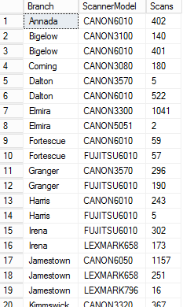

# Where the XAML challenge came from

This was the original inspiration for the [XAML challenge](../src/xaml/README.md). Microsoft never gives up on an idea.

In late 2013, ASP.NET Web Forms had the same promise WPF's XAML still has: markup *describes* things, and code-behind *does* things. The article below is about refusing to write the code-behind. A chart that "obviously" needed C# to build its series turned out to need none: a SQL `PIVOT` put the data in the right shape, and the [ASP.NET Chart control](https://learn.microsoft.com/en-us/dotnet/api/system.web.ui.datavisualization.charting.chart?view=netframework-4.8.1), bound to a [`SqlDataSource`](https://learn.microsoft.com/en-us/dotnet/api/system.web.ui.webcontrols.sqldatasource?view=netframework-4.8.1), did the rest in pure markup.

Same move, years later and on a different stack: once you notice that the markup layer will build any object you name and wire it to anything that hands it data, "no code-behind" stops being a style rule and starts being a dare. The XAML entry in this repo takes that dare as far as it goes. Its `.xaml` file *is* the program.

A few notes before you read:

- **It is reproduced as written.** The prose and the code are unchanged from the original post. The only edits are formatting (headings, code-block languages) and these notes.
- **It has not been re-tested.** It targets .NET Framework 4.x Web Forms and the `System.Web.DataVisualization` assembly. Neither exists on modern .NET, so there is nothing in this repo that builds it. Treat it as history, not a recipe.
- **Two of the three screenshots are gone.** The original post had three images: the "ragged" query output, the pivoted output, and the finished chart. Only the first survived in a backup of the blog. The other two are marked below with their original captions.
- **Further reading** on the pieces it uses: [`PIVOT` and `UNPIVOT`](https://learn.microsoft.com/en-us/sql/t-sql/queries/from-using-pivot-and-unpivot) (T-SQL), [`SeriesChartType.StackedBar`](https://learn.microsoft.com/en-us/dotnet/api/system.web.ui.datavisualization.charting.seriescharttype?view=netframework-4.8.1), and [`Series.XValueMember` / `YValueMembers`](https://learn.microsoft.com/en-us/dotnet/api/system.web.ui.datavisualization.charting.series?view=netframework-4.8.1) (the data-binding properties that do the real work here).

---

## Stacked Bar Charts in ASP.NET with No Code-Behind

*Originally posted December 19, 2013, on the Ed Norton Engineering Society blog. Tags: ASP.NET, SQL.*

This is posted as an intellectual exercise someone else may find interesting or useful.

**NOTE:** This is **NOT** a suggestion of how to implement something in production (although we do have an app like this there).

### Introduction

I am currently working on a project at work that involves among other things gathering metrics for our various scanners across all of our locations. We have a heterogeneous scanner environment (which raises its own issues) with 16 models of scanners from Canon, Fujitsu, Lexmark and Xerox spread across 24 different sites. Some sites only have one scanner, others have two or three. I wanted to show total scanner volume by site, broken down by scanner model at each site. This is a perfect application for a stacked bar chart.

### The Problem

I have been using the ASP.NET charting control for other charts in this project, and purely by chance (not design) I had done everything I needed with each chart in pure markup and SQL with no code-behind for the Web page until I needed this stacked bar chart. Then I had a hard time finding any information on the Internet about how to accomplish a stacked bar chart in pure markup (because I wanted to see if I could).

The issue is that for a stacked bar chart to work, there need to be multiple series (in my case, scanner models), and each series has to have the same number of data points, i.e., in my case each series has to have 24 locations. This is because the stacked bar chart is "dumb" and simply stacks the first column in each series on the first bar, the second column in each series on the second bar, and so on. But the locations each only have one to three scanners, so at most each location only has approximately 20% of the scanner models available. Needless to say, a query something like:

```sql
SELECT
    Branch,
    ScannerModel,
    COUNT (*) AS Scans
FROM ScanMetrics
GROUP BY Branch, ScannerModel
ORDER BY Branch, ScannerModel
```

...is going to produce output like this:



This is not what we need, since the output is "ragged" (each location has a different number of scanner models).

### Pivot Tables to the Rescue

I thought about it some more and finally figured out what I needed was to have my data in a pivot table. Using the output from that, I could then do the stacked bar chart in pure ASP.NET markup. Here is a view I created to give me the pivot output I needed:

```sql
CREATE VIEW BranchScannerScansPivot
AS
WITH Branches AS
(
    SELECT DISTINCT
        Branch
    FROM ScanMetrics
),
Scanners AS
(
    SELECT DISTINCT
        Branch,
        ScannerModel
    FROM ScanMetrics
),
BranchScannerCombos AS
(
    SELECT DISTINCT
        B.Branch,
        S.ScannerModel
    FROM Branches B
    CROSS JOIN Scanners S
),
BranchScannerCounts AS
(
    SELECT
        BSC.Branch,
        BSC.ScannerModel,
        COUNT (SM.ScannerModel) AS Scans
    FROM ScanMetrics SM
    RIGHT OUTER JOIN BranchScannerCombos BSC ON
        SM.Branch= BSC.Branch
        AND SM.ScannerModel= BSC.ScannerModel
    GROUP BY
        BSC.Branch,
        BSC.ScannerModel
)
SELECT
    *
FROM BranchScannerCounts BSC
PIVOT(SUM(Scans) FOR ScannerModel IN
(
    [CANON2200],
    [CANON3080],
    [CANON3100],
    [CANON3300],
    [CANON3320],
    [CANON3570],
    [CANON4035],
    [CANON4080],
    [CANON5035],
    [CANON5051],
    [CANON6010],
    [CANON6050],
    [FUJITSU6010],
    [LEXMARK658],
    [LEXMARK796],
    [XEROX5745]
)) AS Scans
```

Selecting from this view produces a 24-row result set with exactly the output I need:

> *[Screenshot not preserved, captioned "Yup": the pivoted results, with one row per branch and one column per scanner model.]*

It is a "rectangular" grid of values for each combination of location and scanner model.

### The Solution

With that data in hand, then producing the stacked bar chart in pure markup is simply an exercise in copying and pasting 16 series (one for each scanner model). Here is the entire `Metrics.aspx` file:

```aspx
<%@ Page Title="Metrics" Language="C#" MasterPageFile="~/Site.Master" AutoEventWireup="true"
    CodeBehind="Metrics.aspx.cs" Inherits="ScanMetrics"%>
<%@ Register Assembly="System.Web.DataVisualization, Version=4.0.0.0, Culture=neutral, PublicKeyToken=31bf3856ad364e35"
    Namespace="System.Web.UI.DataVisualization.Charting" TagPrefix="asp"%>
<asp:Content runat="server" ID="FeaturedContent" ContentPlaceHolderID="FeaturedContent">
    <section class="featured">
        <div class="content-wrapper">
            <hgroup class="title">
                <h1><%:Title%>.</h1>
                <h2>Scan statistics.</h2>
            </hgroup>
        </div>
    </section>
</asp:Content>
<asp:Content runat="server" ID="BodyContent" ContentPlaceHolderID="MainContent">
    <asp:Chart ID="Chart1" runat="server" DataSourceID="SqlDataSource1" Height="800" Width="800">
        <Titles>
            <asp:Title Text="Scans by Branch and Scanner Model"></asp:Title>
        </Titles>
        <ChartAreas>
            <asp:ChartArea Name="Branch">
                <Area3DStyle Enable3D="true"/>
                <AxisX Interval="1">
                    <MajorGrid Enabled="false"/>
                </AxisX>
            </asp:ChartArea>
        </ChartAreas>
        <Series>
            <asp:Series Name="CANON2200" ChartType="StackedBar" ChartArea="Branch"
                XValueMember="Branch" YValueMembers="CANON2200">
            </asp:Series>
            <asp:Series Name="CANON3080" ChartType="StackedBar" ChartArea="Branch"
                XValueMember="Branch" YValueMembers="CANON3080">
            </asp:Series>
            <asp:Series Name="CANON3100" ChartType="StackedBar" ChartArea="Branch"
                XValueMember="Branch" YValueMembers="CANON3100">
            </asp:Series>
            <asp:Series Name="CANON3300" ChartType="StackedBar" ChartArea="Branch"
                XValueMember="Branch" YValueMembers="CANON3300">
            </asp:Series>
            <asp:Series Name="CANON3320" ChartType="StackedBar" ChartArea="Branch"
                XValueMember="Branch" YValueMembers="CANON3320">
            </asp:Series>
            <asp:Series Name="CANON3570" ChartType="StackedBar" ChartArea="Branch"
                XValueMember="Branch" YValueMembers="CANON3570">
            </asp:Series>
            <asp:Series Name="CANON4035" ChartType="StackedBar" ChartArea="Branch"
                XValueMember="Branch" YValueMembers="CANON4035">
            </asp:Series>
            <asp:Series Name="CANON4080" ChartType="StackedBar" ChartArea="Branch"
                XValueMember="Branch" YValueMembers="CANON4080">
            </asp:Series>
            <asp:Series Name="CANON5035" ChartType="StackedBar" ChartArea="Branch"
                XValueMember="Branch" YValueMembers="CANON5035">
            </asp:Series>
            <asp:Series Name="CANON5051" ChartType="StackedBar" ChartArea="Branch"
                XValueMember="Branch" YValueMembers="CANON5051">
            </asp:Series>
            <asp:Series Name="CANON6010" ChartType="StackedBar" ChartArea="Branch"
                XValueMember="Branch" YValueMembers="CANON6010">
            </asp:Series>
            <asp:Series Name="CANON6050" ChartType="StackedBar" ChartArea="Branch"
                XValueMember="Branch" YValueMembers="CANON6050">
            </asp:Series>
            <asp:Series Name="FUJITSU6010" ChartType="StackedBar" ChartArea="Branch"
                XValueMember="Branch" YValueMembers="FUJITSU6010">
            </asp:Series>
            <asp:Series Name="LEXMARK658" ChartType="StackedBar" ChartArea="Branch"
                XValueMember="Branch" YValueMembers="LEXMARK658">
            </asp:Series>
            <asp:Series Name="LEXMARK796" ChartType="StackedBar" ChartArea="Branch"
                XValueMember="Branch" YValueMembers="LEXMARK796">
            </asp:Series>
            <asp:Series Name="XEROX5745" ChartType="StackedBar" ChartArea="Branch"
                XValueMember="Branch" YValueMembers="XEROX5745">
            </asp:Series>
        </Series>
        <Legends>
            <asp:Legend Enabled="true" Alignment="Center"></asp:Legend>
        </Legends>
    </asp:Chart>
    <asp:SqlDataSource ID="SqlDataSource1" runat="server"
        ConnectionString="<%$ConnectionStrings:ConnectionString1%>"
        ProviderName="<%$ConnectionStrings:ConnectionString1.ProviderName%>"
        SelectCommand="SELECT Branch, CANON2200, CANON3080, CANON3100, CANON3300, CANON3320, CANON3570, CANON4035, CANON4080, CANON5035, CANON5051, CANON6010, CANON6050, FUJITSU6010, LEXMARK658, LEXMARK796, XEROX5745 FROM BranchScannerScansPivot ORDER BY 1 DESC">
    </asp:SqlDataSource>
</asp:Content>
```

And here is the output:

> *[Screenshot not preserved, captioned "Tada!": the finished 3-D stacked bar chart, with one bar per branch and each bar split into colored segments by scanner model.]*

Mission accomplished.

### Conclusion

Now, I am not saying I think this should be a standard approach. For one, I find it "fragile" as a solution since it requires both the SQL pivot and the chart series markup to know in advance the number and names of the scanner models. Thus, adding a new model would require code changes to both the view and the Web page.

However, I did want to publish this because I have found when working with the Microsoft chart control that often there are fairly straightforward markup-only approaches, but most samples on the Web tend to be a mishmash of markup and code with no good discussion about why a given property is set in markup and another is set in the code-behind. Also, depending on your environment, it may be easier to make changes to markup and SQL views in production than to compiled code. It can certainly be easier to "tweak" markup.

And finally, I just thought it was an intellectual challenge, and hope you found it interesting as well.

---

Back to the [XAML challenge](../src/xaml/README.md), or the [root README](../README.md).
