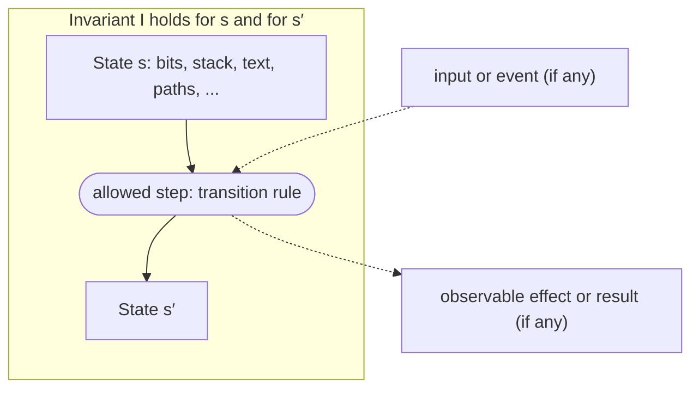

For an advanced reading path with traces and experiments, see the [state and control beyond variables study guide](../study-guides/concepts/state-and-control-beyond-variables.md).

Before you can say that a regex engine, a build tool or a markup file "computes", you need to say what a machine is. The answer is smaller than you might think. A machine has a **state**, a set of allowed **steps**, a way to **represent** its values and some facts that stay true while it runs (**invariants**). If you can say what those four are, you have named the machine.

The picture shows the four parts without naming any hardware: the state and how it is represented, one allowed step and the invariant that holds before and after it. A regex engine's capture stack, a Make dependency graph and an editor buffer all fit this template. The template does not require finite states, explicit input and output or machine instructions.

The first goal of this book is exactly that habit: *name the machine hiding inside the language*. A stack machine, a register machine and a rewriting system can all compute the same things, but they keep their memory in different places. The concepts here are the vocabulary for that: transition systems, operational semantics (state, and one step at a time), Turing machines, Markov algorithms and Turing completeness. One more question goes with them: which part of a design *computes*, and which part only decides what runs next ([[computation-versus-orchestration]])? The chapter "State beyond variables" then returns to the question that matters most for this repository: where does the state live?
