For an advanced reading path with traces and experiments, see the [evaluation, demand and laziness study guide](../study-guides/concepts/evaluation-demand-and-laziness.md).

Is a value computed when you write it, when you first need it or each time you ask? That is the question of **evaluation strategy**, and the same-looking code answers it differently in different languages.

Haskell is lazy: one `span` over an infinite list is the stop rule, because only the needed part is ever computed. LINQ is deferred: a pipeline does nothing until someone enumerates it. APL is eager and works on whole arrays at once, so it draws more numbers than it needs and trims the result. When effects are involved, the choice stops being a detail. If a lazy list performs input and output, then *reading the list* is what does the work. This chapter explains the vocabulary: strategies and short circuits, iterators and generators, first-class and higher-order functions, functors and `map`, monoids and folds (and why `reduce` cannot stop early) and dataflow. The table at the end shows every entry's strategy in one place.

```mermaid
flowchart TB
    accTitle: The same requested prefix can entail different work
    accDescr: Three lanes show a consumer that asks for only the first two elements of a sequence of five. In the eager lane, all five values 1 to 5 are computed first, the consumer takes 1 and 2, and 3 to 5 were computed but unused. In the lazy by-need lane, thunks are built, 1 is demanded, evaluated and cached, 2 is demanded, evaluated and cached, and 3 to 5 are never evaluated. In the deferred pipeline lane, the pipeline is defined and no work happens, then enumerating computes and yields 1 and 2, and enumerating again may repeat the work because deferred is not automatically memoized.
    subgraph DEFER["Deferred, like LINQ"]
        D1["define: no work yet"] --> D2["enumerate: 1, 2"] --> D3["enumerate again: may redo"]
    end
    subgraph LAZY["Lazy, by need"]
        L1["build thunks"] --> L2["demand 1: cache"] --> L3["demand 2: cache"] --> L4["3 to 5: never run"]
    end
    subgraph EAGER["Eager, like an array"]
        E1["construct"] --> E2["compute 1 to 5"] --> E3["consumer takes 1, 2"] --> E4["3 to 5: unused"]
    end
    classDef unused stroke-dasharray: 5 3
    class E4,L4,D3 unused
```

The values 1 to 5 are only a sample. Haskell's call-by-need *remembers* an evaluated value, while a deferred enumerable pipeline usually recomputes it each time you enumerate. APL often evaluates a whole array, so it is closest to the eager lane. The picture compares strategies, and it is not an exact trace of any one entry.

{{table:evaluation}}
