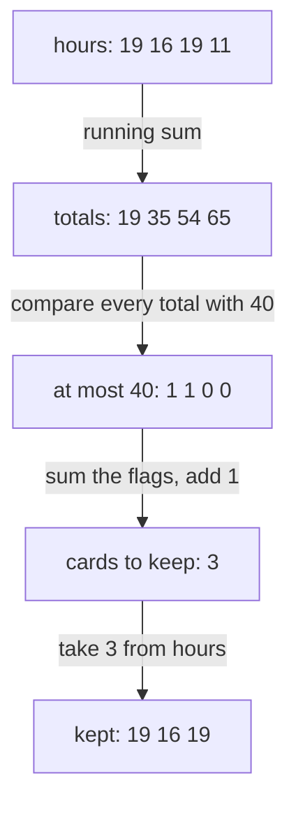

Array programming applies an operation to a whole array at once. Scalars stretch to match, and explicit loops mostly disappear. Kenneth Iverson invented APL for this in the 1960s, and the idea lives on in J, K, R, MATLAB and NumPy. It exists because it makes the code short and because hardware can do many elements at the same time (SIMD, GPUs). [[entry:apl]] shows the style: five random draws, a running sum `+\` and a take-while replace the loop. You describe the full answer, then trim it.

Read the picture from top to bottom. Each step is one operation on a whole array, and no step is a loop. The comparison gives a flag for every total at once. The number of flags that are 1, plus one, is the number of cards to keep, because the card that crosses 40 is kept too. [[entry:apl]] works this way. The numbers here are only an example, and the idea does not depend on APL's symbols.

- **Use it when:** you work with numbers, tables and signals.
- **Avoid it when:** the algorithm is inherently one step after another, or the intermediate arrays are too big for memory. Also remember that a dense notation is hard for a team that does not read it.

**Read more:**

- [Array programming](https://en.wikipedia.org/wiki/Array_programming) (Wikipedia)
- [APL (programming language)](https://en.wikipedia.org/wiki/APL_(programming_language)) (Wikipedia)
- [Kenneth E. Iverson](https://en.wikipedia.org/wiki/Kenneth_E._Iverson) (Wikipedia)
- [Single instruction, multiple data](https://en.wikipedia.org/wiki/Single_instruction,_multiple_data) (Wikipedia)
