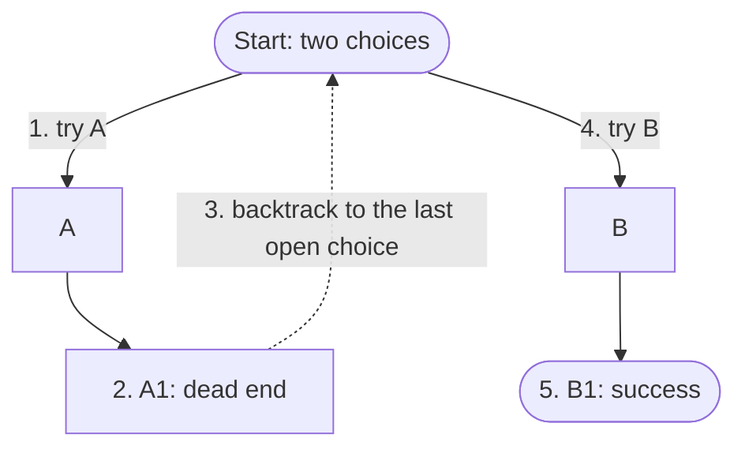

Backtracking is a systematic search. Try a choice, go on, and if you get stuck, undo the choice and try the next one. It exists for problems with many possible answers and some rules to prune them: puzzles, parsing and pattern matching. Perl, PCRE2 and .NET regex engines work this way. The entries in this repository turn it around: *do the work in side effects, then fail on purpose.* The match returns false only after every row has been written. What survives the failure is the whole lesson. Perl's `local` variables are restored, but its `INSERT` and `print` calls cannot be undone. [[entry:regex-dotnet]] cannot play this game at all, because a failed .NET match throws its captures away.

The search remembers the choices that still have untried alternatives. When a path fails, it goes back to the most recent one. Here that is the start, where `B` is still open. Undoing a choice undoes the search's own state, not the outside world. As the paragraph above says, a row written along a failed path stays written.

- **Use it when:** the search space is small, or you can prune it early.
- **Avoid it when:** effects cannot be undone, or when the input comes from an attacker (see [[redos]]).

**Read more:**

- [Backtracking](https://en.wikipedia.org/wiki/Backtracking) (Wikipedia)
- [Regular expression](https://en.wikipedia.org/wiki/Regular_expression) (Wikipedia)
