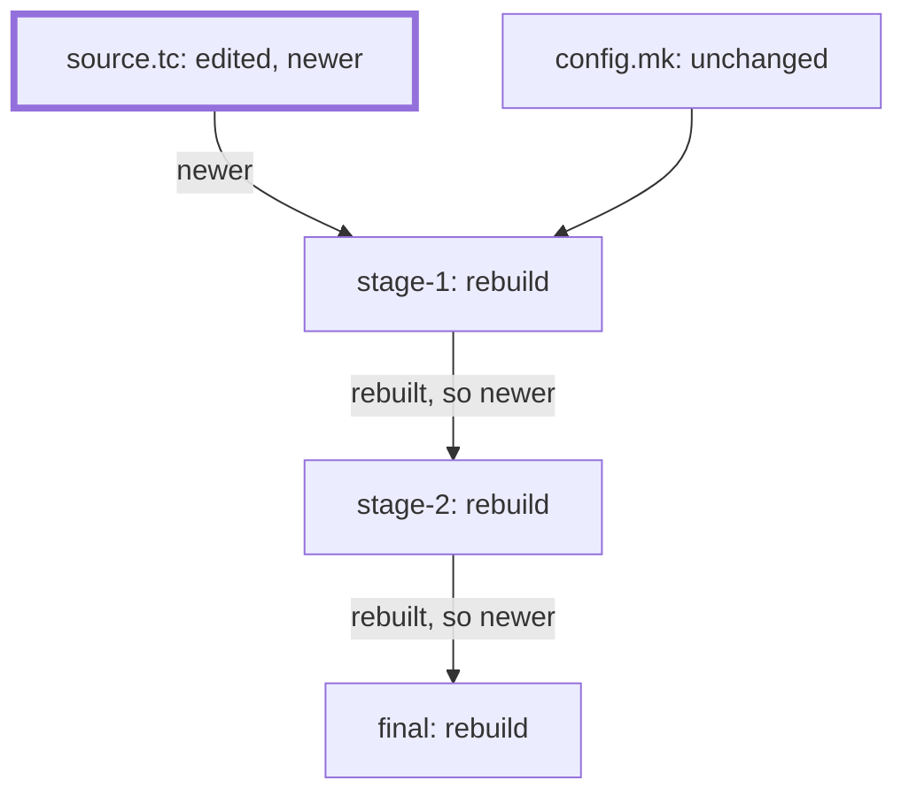

Build automation tools rebuild only what changed, and they do it in dependency order. Make, created at Bell Labs in 1976, is the classic example. CMake and Gradle are modern ones. They exist because compiling everything every time is slow, and building in the wrong order is wrong. The state of a build is *files*: which exist, and which are newer than what they depend on. That makes a build tool a strange computer. [[entry:make-gnu]] counts with files that are created one per pass, and loops by making Make read a generated makefile again. [[entry:cmake]] loops with a `while()` whose regex leaves its results in variables.

The tool compares file dates along the arrows. `source.tc` is newer than `stage-1`, so `stage-1` is stale and is rebuilt. That makes it newer than `stage-2`, and so on down the chain. `config.mk` did not change, so it causes no work. The tool decides what to run and in what order. It does not pass values from step to step as [[dataflow-programming]] does. Some entries use this decision machinery as a loop: [[entry:make-gnu]] remakes a generated makefile and then starts the walk again.

- **Use it when:** you compile, package or generate files from other files.
- **Avoid as a general computer.** Timestamps can be coarse (WSL and some file systems), and a build that depends on hidden state is not reproducible.

**Read more:**

- [Build automation](https://en.wikipedia.org/wiki/Build_automation) (Wikipedia)
- [Make (software)](https://en.wikipedia.org/wiki/Make_(software)) (Wikipedia)
- [Reproducible builds](https://en.wikipedia.org/wiki/Reproducible_builds) (Wikipedia), the idea behind this book's deterministic build
