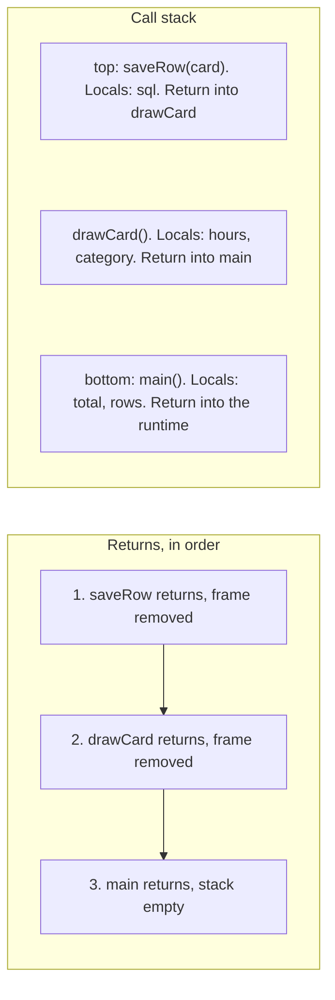

The call stack is a stack of *frames*. Each active function call has one, holding its return address and its local variables. It exists so that functions can call functions, and recursion works. For most programmers the call stack *is* "where am I in the program". Several entries live without it, or work around it. A sed script has no calls at all. m4 and Make repeat by reading text again. The trigger recursion in [[entry:tcl-weird]] is limited by the database, not by a stack you can see.

Each active call owns one frame, and the newest frame is on top. When `saveRow` returns, its frame is removed and execution continues at the return address it stored, which is inside `drawCard`. The names here are examples, and the exact layout of a frame differs between languages and processors. The general idea of a stack is in [[stack-data-structure]].

- **Use it when:** you read a stack trace, or you reason about recursion depth.
- **Avoid:** unbounded recursion. A stack overflow ends the program, and in unsafe languages it can become a security hole.

**Read more:**

- [Call stack](https://en.wikipedia.org/wiki/Call_stack) (Wikipedia)
- [Stack buffer overflow](https://en.wikipedia.org/wiki/Stack_buffer_overflow) (Wikipedia)
- [Tail call](https://en.wikipedia.org/wiki/Tail_call) (Wikipedia)
