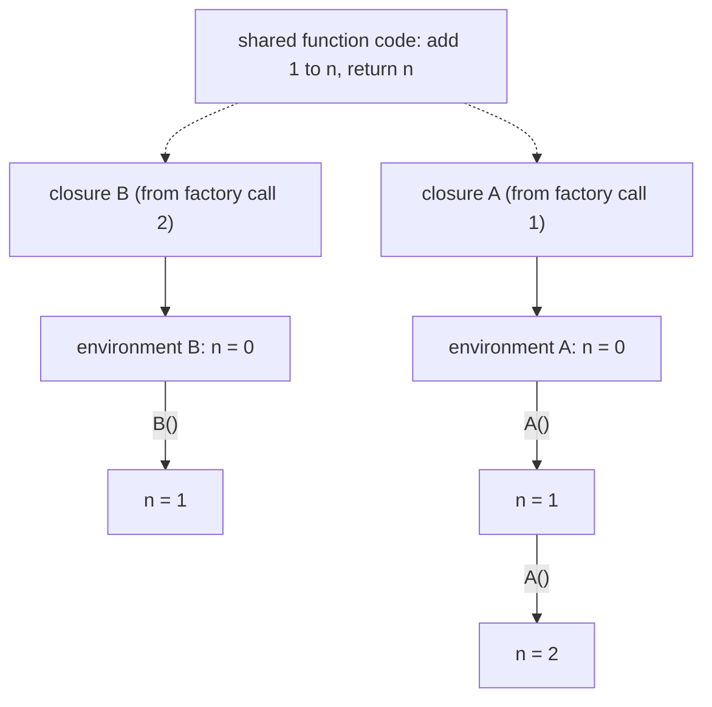

A **closure** is a function together with the variables it was made next to. Those variables are its **lexical environment**: the names that were in scope where the function was written. The function keeps them alive after the code that made them has finished. That is why a function can remember a count, a total or a seed between calls, and why nothing else can reach them.

```js
const counter = () => { let n = 0; return () => ++n; };   // `n` lives on, inside the returned function
const next = counter(); next(); next();                   // 1, then 2
```



Each box under a closure is that closure's *own* environment. The number is not copied into the code when the closure is made. The factory's call frame can return, and the captured variable lives on while the closure can be reached. These are two different factory calls. Two functions made in *one* factory call over the same variable would share it, as described below.

Be exact about three things:

- **A closure captures variables, not values.** Two closures over the same variable share it, and a change made by one is seen by the other. Each call to a factory such as `counter()` makes a *new* variable, so two counters never share state. C# lambdas behave the same way.
- **Lambda syntax is not a closure.** `x => x + 1` uses no outside variable, so there is nothing interesting to capture. An arrow function that updates a variable that outlives the call is a closure that matters.
- **A closure is not a continuation.** You can call it again and it does the *next* step. You cannot hand it "the rest of the computation", resume it in the middle of something or go back. See [[continuation]]. Nor is `this` a captured variable: a method that uses `this.n` loses its `n` when you detach it from its object, and a closure keeps its variable.

The environment lives as long as the function can be reached. When nothing refers to the function any more, the engine may collect it, and its variables with it. [[entry:javascript-weird]] builds its whole algorithm from three closures (a seeded number source, a card machine and an iterator around it), and its check script proves each claim on this page, including the lifetime one, with a `WeakRef` and a forced garbage collection. [[entry:javascript]] uses a closure over the seed for its random numbers. [[entry:RustChallenge1]] and [[entry:ModernChallenge1]] use closures (and a C# lambda) to move work into places that expect a value.

- **Use it when:** you need private state without a class, a function that is configured once and called many times or a callback that must remember something.
- **Avoid it when:** the hidden state makes the program hard to test or to read. Captured variables do not show up in a debugger the way fields do, and a long chain of closures is hard to follow.

**Read more:**

- [Closure (computer programming)](https://en.wikipedia.org/wiki/Closure_(computer_programming)) (Wikipedia)
- [Scope (computer science)](https://en.wikipedia.org/wiki/Scope_(computer_science)) (Wikipedia)
- [Closures](https://developer.mozilla.org/en-US/docs/Web/JavaScript/Guide/Closures) (MDN)
