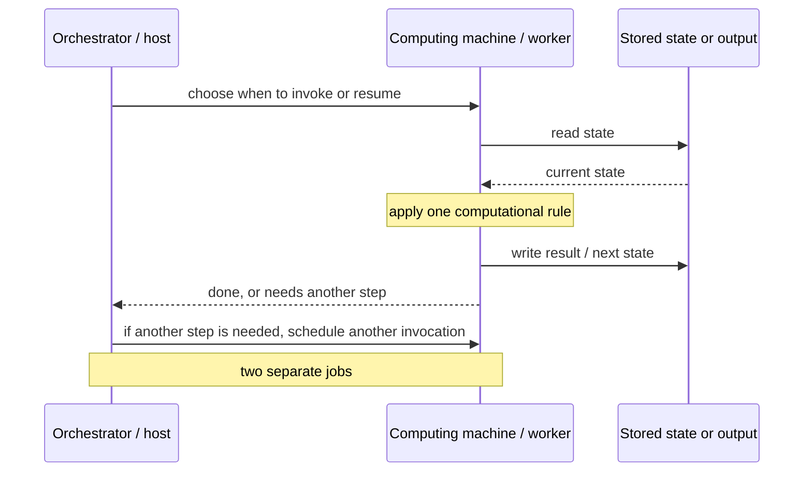

Two jobs hide in every program. **Computation** makes new values: the sum, the stop decision, the next card. **Orchestration** decides what runs next, and in what order: the loop, the callbacks, the dispatch. When an entry says "the regex engine does the work" or "tar is the loop", the useful question is which of the two jobs it means.

The entries answer it differently:

- In [[entry:tar-gnu]] tar *orchestrates*: it walks the members in order. A small dispatcher *computes*: it gives the five record types a meaning. The program's data (the dice, the order, the limit) is in the archive.
- In [[entry:tar-gnu-weird]] tar supplies only *time*: one tick per record. A single SQL transaction computes everything else.
- In [[entry:ed-weird]] and [[entry:ex-weird]] a launcher does the *edges* (five random digits, a database write) and the editor does the computing and the sequencing.
- In [[entry:regex-pcre2]] the regex engine orchestrates by matching and backtracking, and a bodiless C dispatcher computes what each callout means. [[entry:xaml]] lets the parser orchestrate: document order is the order of execution.
- In [[entry:javascript-weird]] the consumer orchestrates (it asks for the next card) and three closures compute. The impure parts, such as the database, the clock and the screen, sit at the edge.

Naming the split tells you where a bug can be, what to test and what an attacker would take over. It also keeps a stunt honest: if the "weird" part only orchestrates while an ordinary program computes, it is a costume change.

The host decides *when*, and the worker decides *what the next value is*. In [[entry:tar-gnu-weird]] tar's checkpoints play the host and one SQL transaction is the worker. In [[entry:tar-gnu]] tar walks the archive and a dispatcher gives each record a meaning. The picture shows two *roles*. One piece of software may play both, and an orchestrator may compute too.

- **Use it when:** you review an unusual design, or write a test that must prove that a named tool does the interesting work.
- **Avoid it when:** the two are the same thing, as in a pure expression. Do not invent a split.

**Read more:**

- [Separation of concerns](https://en.wikipedia.org/wiki/Separation_of_concerns) (Wikipedia)
- [Orchestration (computing)](https://en.wikipedia.org/wiki/Orchestration_(computing)) (Wikipedia)
