A continuation is "the rest of the computation" from some point, treated as a value. If you could pause a program and ask "what will you do next?", the answer is the continuation. In *continuation-passing style* every function takes an extra argument, a function that says what to do with the result. It exists because early exit, exceptions, generators, backtracking and `async`/`await` can all be written as ordinary function calls once "what next?" is a value. The entries here choose "what next?" on purpose. COBOL's `ALTER` rewrites it. Forth's `>in` rewinds it. Make's restart is "the rest of the build, again".

```mermaid
flowchart TB
    accTitle: A continuation names the remaining computation; a normal call merely returns to its caller
    accDescr: Two parallel panels. In an ordinary call, the caller does A, calls B, B finishes, and control returns to the caller, which does C. The caller's stack keeps the return point. With an explicit continuation, the program does A, captures K, the value that stands for what to do next, runs something else, later invokes K, and then does C. K is drawn as a separate box because it is a value that stands for pending control.
    subgraph CONT["Explicit continuation"]
        A2["Do A"] --> CAP[("capture K: what to do next")] --> OTH["run something else"] --> RES["invoke K"] --> C2["Do C"]
    end
    subgraph CALL["Ordinary call and return"]
        A1["Caller: do A"] --> B1["call B: return point stays on the stack"] --> B2["B finishes"] --> C1["Caller: do C"]
    end
```

On the left the return point is hidden in the caller's stack, and the callee cannot name it. On the right it is a value, `K`, that can be stored, handed on and used later (or not at all). COBOL's mutable `GO TO` target, Forth's `>in` and Make's restart state are *analogies* for control that is held outside the call stack. None of them captures a first-class continuation, and an ordinary callback or closure is not one either.

- **Use it when:** you write a compiler, an async library or a web framework with callbacks.
- **Avoid it when:** you write by hand in a language without tail calls. The code becomes callbacks inside callbacks, and the stack grows.

**Read more:**

- [Continuation](https://en.wikipedia.org/wiki/Continuation) (Wikipedia)
- [Continuation-passing style](https://en.wikipedia.org/wiki/Continuation-passing_style) (Wikipedia)
- [Call-with-current-continuation](https://en.wikipedia.org/wiki/Call-with-current-continuation) (Wikipedia)
