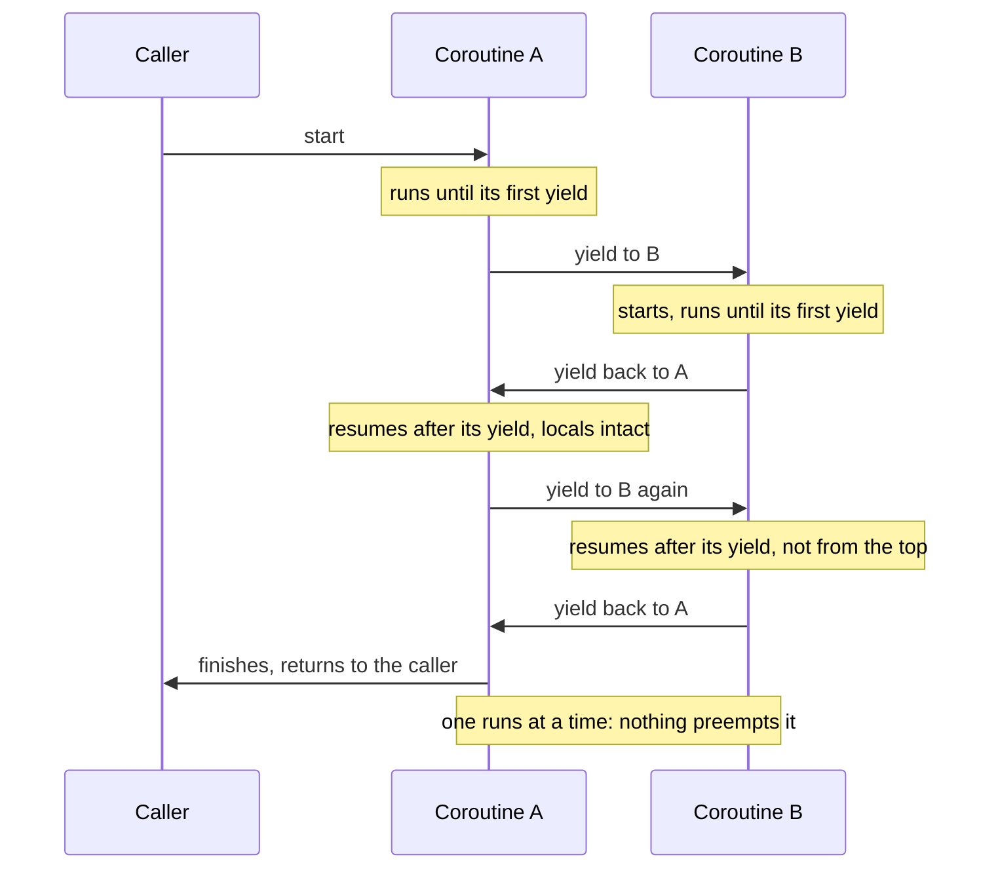

A coroutine is a function that can pause in the middle and resume later, with its local variables intact. Ordinary functions run from start to finish. A coroutine can hand a value to its caller, wait, and carry on when asked. It exists for producers and consumers, for generators and for cooperative multitasking (`async`/`await` is built on the idea). Several entries are coroutines wearing a different hat. A Rust iterator made with `successors`, a Kotlin `generateSequence` and Python's `iter(step, False)` each produce the next value only when the loop asks for it.

Control moves only when a coroutine yields, so only one routine runs at a time. That is the difference from threads: nothing preempts a coroutine, and nothing runs in parallel. A coroutine that resumes continues after its last `yield`, with its local variables as it left them. An ordinary call would start again from the top.

- **Use it when:** you process a stream, or you want two pieces of code to take turns without threads.
- **Avoid it when:** you need real parallelism, or when the many pause points make the program hard to follow.

**Read more:**

- [Coroutine](https://en.wikipedia.org/wiki/Coroutine) (Wikipedia)
- [[generators]] in "Evaluation and demand"
