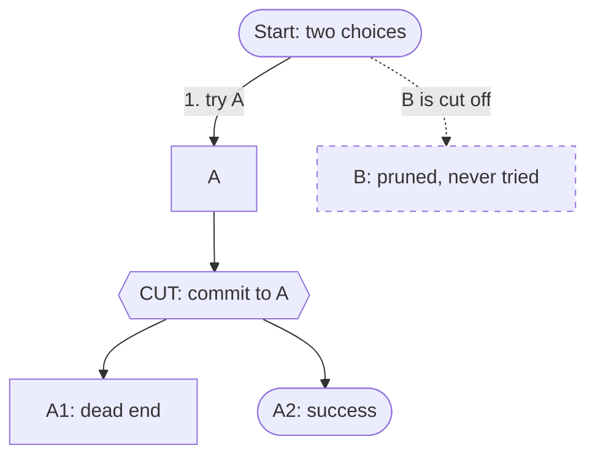

The *cut* is a Prolog idea: once the program has passed this point, commit to the choices made so far and discard the alternatives. It exists for speed and for determinism: you do not want a search to explore, or repeat, work you already know is settled. Regex engines have the same tools: PCRE's `(*COMMIT)`, atomic groups and possessive quantifiers. [[entry:regex-pcre2]] and its siblings end the pattern with `(*COMMIT)(*FAIL)`. Without `(*COMMIT)` the engine would retry shorter loops, and the finalizer would run more than once. Prolog programmers distinguish "green" cuts (only speed) from "red" cuts (they change the answer).

Compare this picture with plain backtracking. There, `B` would be tried after `A` failed. Here the cut commits to `A` first, so `B` is pruned. After the cut the search can still try the alternatives that come *after* it (`A1`, then `A2`). If all of them fail, the whole search fails. It does not go back to `B`. That is what "the cut changes the search space" means. Prolog's cut also discards choices made earlier in the same clause, and the picture shows only the simplest case.

- **Use it when:** you know that later failure should never lead to a retry.
- **Avoid it when:** you are not sure which kind of cut you have. A red cut hides a logic change inside a speed trick.

**Read more:**

- [Cut (logic programming)](https://en.wikipedia.org/wiki/Cut_(logic_programming)) (Wikipedia)
- [Prolog](https://en.wikipedia.org/wiki/Prolog) (Wikipedia)
