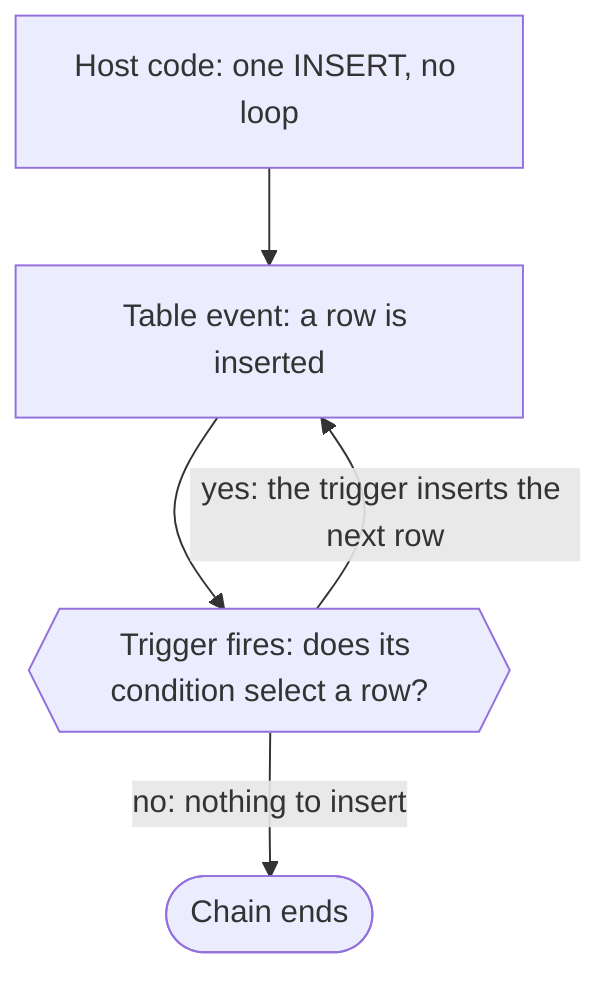

A trigger is code that the database runs by itself when a row is inserted, updated or deleted. It exists to keep rules close to the data: audit logs, derived columns, checks that a `CHECK` constraint cannot express. In [[entry:tcl-weird]] a trigger is the loop. Each insert fires the trigger, which inserts the next row, until a `WHERE` clause finds nothing to insert. The cost is invisible control flow. Nothing in the application code says "this also happens", and the order and depth of triggers can surprise you.

The host code runs one `INSERT` and has no loop. The trigger belongs to the table, so each insert is an event that fires it. The trigger's own `INSERT` is another event, and that is how one change causes the next. A chain like this ends only because the condition finally selects no row. Databases are careful about it. SQLite does not let a trigger fire itself unless `PRAGMA recursive_triggers` is on, and [[entry:tcl-weird]] turns it on on purpose.

- **Use it when:** for audit trails and rules that must hold whoever writes the data.
- **Avoid it when:** you are tempted to put business workflows in triggers, or to use them as a program loop (as this entry does, on purpose).

**Read more:**

- [Database trigger](https://en.wikipedia.org/wiki/Database_trigger) (Wikipedia)
- [SQLite](https://en.wikipedia.org/wiki/SQLite) (Wikipedia)
