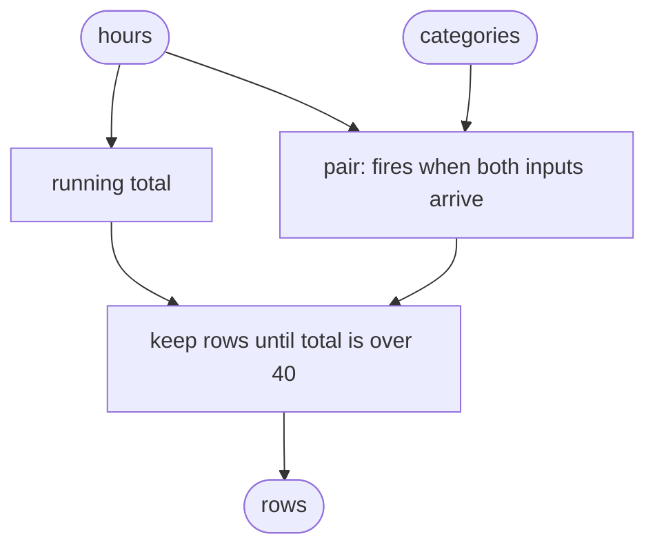

In **dataflow programming** you describe how values flow from one step to the next, and the order of execution follows from the data: a step runs when its input is ready, or when its output is asked for. A spreadsheet is the familiar example. A LINQ query and an iterator pipeline are small ones. The program is a graph of steps, and the machine decides when each runs.

Each arrow is a data dependency: the node at the head needs a value from the node at the tail. The `pair` node has two inputs, so it cannot fire until both have arrived. The picture does not say which node a program calls first. The arrival of values decides. [[dependency-graph]] also draws arrows between things, but there the arrows say what to redo after a change.

It matters here because several entries move control out of statements and into such a graph. In [[entry:LinqChallenge1]] and [[entry:LinqChallenge2]] a query describes the cards, and the final operator asks for them. In [[entry:javascript-weird]] the pipeline `Iterator.from(...).map(...).map(...).toArray()` is a chain of steps, and each card flows through all of them before the next one is asked for. [[entry:make-gnu]] has a related shape: a dependency graph decides what runs and in what order. That is *dependency*, which is not the same as the flow of data, so it is an analogy here.

- **Use it when:** the problem is a series of transformations, and you want the order to follow the dependencies.
- **Avoid it when:** the steps have effects whose order matters. A dataflow graph hides the order, and an effect that depends on it becomes a bug.

**Read more:**

- [Dataflow programming](https://en.wikipedia.org/wiki/Dataflow_programming) (Wikipedia)
- [Pipeline (software)](https://en.wikipedia.org/wiki/Pipeline_(software)) (Wikipedia)
