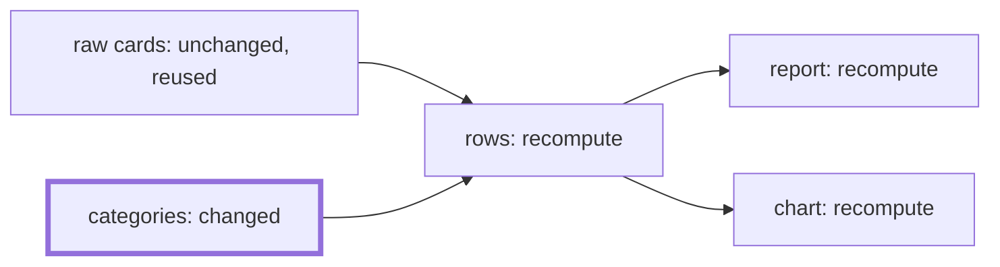

A dependency graph has a node for each thing and an arrow for "this needs that". If there are no cycles, it is a directed acyclic graph, and a *topological sort* gives an order that always works: build the needed things first. It exists so that tools do only the work that is needed, in the right order, and in parallel where they can. Make, package managers, spreadsheets and schedulers are all dependency engines. What is unusual in [[entry:make-gnu]] is that the graph can *change while it is being walked*: Make remakes an included makefile, then starts over with the new graph. That restart is the loop.

Each arrow here runs from an input to the thing built from it, so a change travels along the arrows. (Some books draw the arrow the other way, from a thing to what it needs. The facts are the same.) Only `categories` changed, so only what is downstream of it must be redone. `raw cards` keeps its old result. The graph says what *must* be recomputed, not when values arrive. For that, see [[dataflow-programming]].

- **Use it when:** any problem of the form "A must come before B".
- **Avoid:** cycles, and dependencies that are not declared. A hidden dependency gives wrong incremental builds.

**Read more:**

- [Dependency graph](https://en.wikipedia.org/wiki/Dependency_graph) (Wikipedia)
- [Directed acyclic graph](https://en.wikipedia.org/wiki/Directed_acyclic_graph) (Wikipedia)
- [Topological sorting](https://en.wikipedia.org/wiki/Topological_sorting) (Wikipedia)
