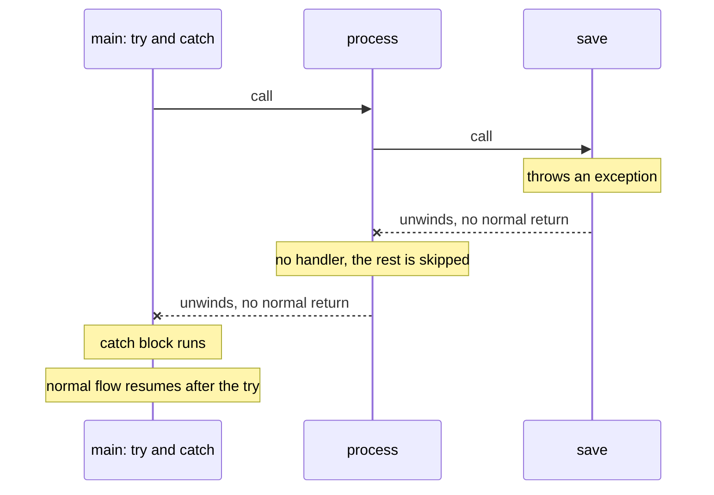

Exception handling is a language feature for errors: raise a signal, unwind the stack and let a handler deal with it. It exists to keep the normal path of the code free of error checks. COBOL has an older, simpler form. `ON SIZE ERROR` runs when an arithmetic result does not fit the field, and the field stays unchanged. In [[entry:cobol-weird]] that overflow *is* the stop rule: a two-digit counter overflows on purpose, and the error branch ends the loop. Errors as control flow work, but they hide the real design from the next reader.

The normal `return` of `save` and `process` never runs. The exception passes outward through each call until a `catch` accepts it, and then normal flow resumes after the `try` in `main`. If nothing catches it, it leaves the program. Unwinding only moves control. It does not undo what the skipped code already did: a row that `save` wrote stays written, unless a transaction rolls it back (see [[transaction]]).

- **Use it when:** something truly unexpected happens, and the caller can recover or must be told.
- **Avoid it when:** the "error" is a normal, frequent outcome (such as "end of input"), or when you catch everything and move on in silence.

**Read more:**

- [Exception handling](https://en.wikipedia.org/wiki/Exception_handling) (Wikipedia)
- [Fail-fast system](https://en.wikipedia.org/wiki/Fail-fast_system) (Wikipedia)
