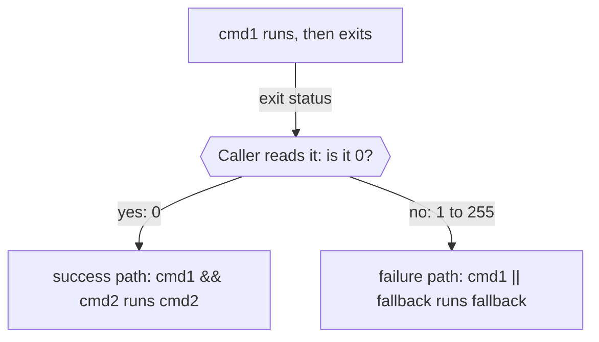

An exit status is the number that a finished process hands back to whoever started it. On Unix, `0` means success and anything else means failure, in the range 0 to 255. It exists so that programs can be glued together: `if`, `&&` and `||` in a shell all read it. It is also a control signal in this repository. In [[entry:regex-pcre2grep]] the exit code of a small program steers the regex match. In [[entry:regex-sed]] the script exits `1` on purpose, and the wrapper maps that back to success. Every `check.sh` exits non-zero on any failure, so the sandbox gate can judge a run without reading it.

The status is one small number. The caller does not learn what went wrong, only which branch to take. In `cmd1 && cmd2` the shell runs `cmd2` after a 0. In `cmd1 || fallback` it runs `fallback` after any other value. A shell `if` reads the same status. A program that needs to say more must also print a message or write a file.

- **Use it when:** scripts and tools that other tools call. Document what each code means.
- **Avoid it when:** you need to return rich data or preserve a number outside the platform's exit-status range.

**Read more:**

- [Exit status](https://en.wikipedia.org/wiki/Exit_status) (Wikipedia)
