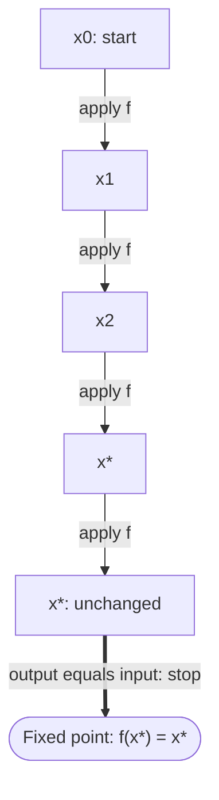

A *fixed point* of a function is a value that the function leaves unchanged: f(x) = x. Fixed-point iteration finds one by applying the function again and again until nothing changes. It exists because many problems are really "keep going until it settles": balance an equation, compute a closure, or simplify an expression. This repository is full of it. [[entry:regex-sed]] applies substitutions until none matches. [[entry:make-gnu]] remakes its own makefile until the makefile is up to date. A compiler's optimizer does the same, passing over the code until no more improvements appear.

Every pass applies the same function `f`. The run stops when a pass returns its own input, so that `f(x*) = x*`. The value `x` does not have to be a number. It can be a line of text (as in [[entry:regex-sed]]), a makefile or a piece of code. A real program also needs a limit, in case the values never settle.

- **Use it when:** each step is a clear improvement and "no change" is a clear signal to stop.
- **Avoid it when:** the process might never settle. It can bounce between two states forever. Always add a limit, or a timeout. The sandbox gives every `check.sh` a time limit.

**Read more:**

- [Fixed-point iteration](https://en.wikipedia.org/wiki/Fixed-point_iteration) (Wikipedia)
- [Fixed point (mathematics)](https://en.wikipedia.org/wiki/Fixed_point_(mathematics)) (Wikipedia)
