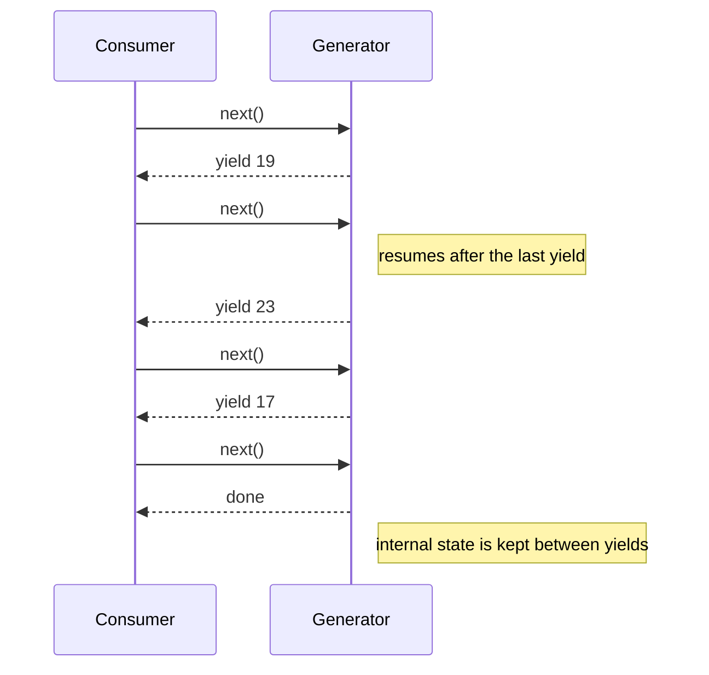

An *iterator* is an object that answers "give me the next one". A *generator* is a function you write as ordinary straight-line code that hands out values one at a time with `yield`. Both exist so that you can handle a sequence that is too big to store, or has no end, and so that the code that produces values stays separate from the code that uses them. Four entries are built on the idea: Rust's `successors`, Kotlin's `generateSequence`, Python's `iter(step, False)` and Haskell's lazy lists. In each one, the loop "stops" because the consumer stops asking. JavaScript spells the idea out as the **iteration protocol**: an iterable has a `[Symbol.iterator]()` method that answers an object with a `next()` method, and `next()` answers `{ value, done }`. [[entry:javascript-weird]] writes one by hand around a closure, and a consumer such as `toArray()` or `take(1)` decides how many values ever exist. It also shows the one-shot trap: a second pass over the same iterator finds it already used up.

The consumer asks and the generator answers. This is *pull*: nothing runs until `next()` is called, and the generator does only enough work to reach its next `yield`. A push design, such as a callback, would draw the arrows the other way (see [[callback]]). The consumer can also stop early by not asking again.

- **Use it when:** you stream data, or describe an unlimited series and take a prefix.
- **Avoid it when:** the iterator has hidden effects or callers expect to reuse a one-shot iterator.

**Read more:**

- [Iterator](https://en.wikipedia.org/wiki/Iterator) (Wikipedia)
- [Generator (computer programming)](https://en.wikipedia.org/wiki/Generator_(computer_programming)) (Wikipedia)
- [Stream (computing)](https://en.wikipedia.org/wiki/Stream_(computing)) (Wikipedia)
- [Iterators and generators](https://developer.mozilla.org/en-US/docs/Web/JavaScript/Guide/Iterators_and_generators) (MDN), a clear tutorial on the idea
