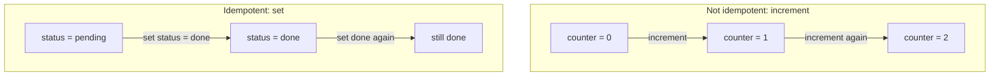

An operation is idempotent if doing it twice has the same effect as doing it once. It exists because networks and machines fail, and the safest recovery is "try again". If a retry is harmless, you can retry without fear. HTTP defines `PUT` and `DELETE` as idempotent (RFC 9110, section 9.2.2) and `POST` as not. In this repository the check scripts delete and recreate their scratch data, so a second run starts from the same place as the first. A build tool is the same: run `make` twice, and the second run should do nothing.

For an operation `f` on a state `s`, idempotence means `f(f(s)) = f(s)`. The question is what the second call does to the *state*, not whether the two return values match. Compare the clock in [[referential-transparency]]: calling `now()` twice can give different answers, but that alone does not make it non-idempotent, because it changes nothing.

- **Use it when:** you design an API, a job queue or a deployment script.
- **Avoid assuming it:** "add one to the counter" is not idempotent. When an operation cannot be, give each request a unique key and ignore repeats.

**Read more:**

- [Idempotence](https://en.wikipedia.org/wiki/Idempotence) (Wikipedia)
- [Idempotent](https://developer.mozilla.org/en-US/docs/Glossary/Idempotent) (MDN glossary)
- [RFC 9110, section 9.2.2: idempotent methods](https://www.rfc-editor.org/rfc/rfc9110)
