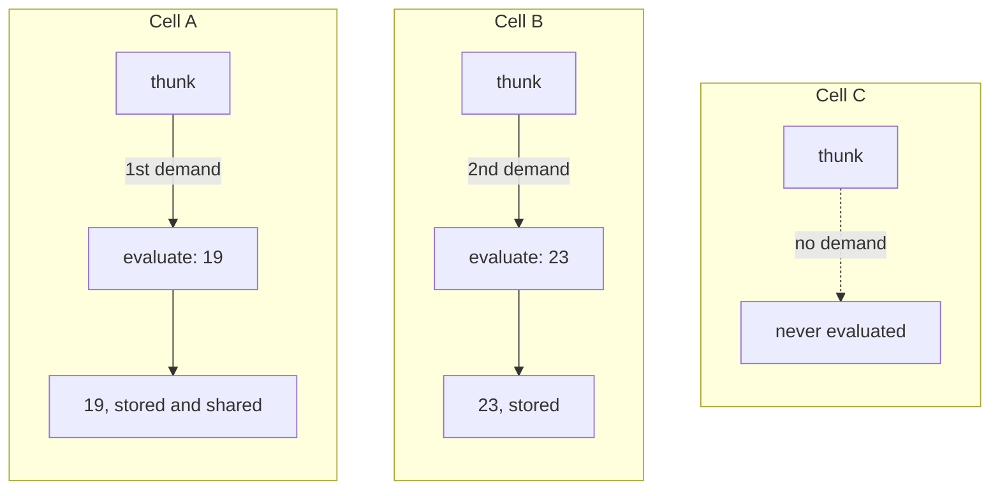

Lazy evaluation delays a computation until its result is needed, and then remembers the answer. The waiting computation is called a *thunk*. It exists so that you can describe the *whole* answer and then take only what you want. In [[entry:haskell]] one `span` over an infinite lazy list is the entire stop rule. The price is that "when does this run?" becomes hard to answer. In [[entry:haskell-weird]] the list elements perform input and output, so *reading the list* is what does the work. Reading too early or too late changes the result.

A thunk is a promise to compute a value. Demanding a cell runs its thunk once and stores the value, so a second demand for `A` costs nothing. Cell `C` is never demanded, so its work never happens. Storing the value is part of lazy evaluation in the strict sense. A pipeline that only delays work, such as a generator, may compute the same value again on each pass. See [[generators]].

- **Use it when:** the code is pure (no effects), you want infinite sequences, or some results may not be needed.
- **Avoid it when:** effects are involved, or when memory matters. A pile of unevaluated thunks can use a lot of it (a *space leak*).

**Read more:**

- [Lazy evaluation](https://en.wikipedia.org/wiki/Lazy_evaluation) (Wikipedia)
- [Thunk](https://en.wikipedia.org/wiki/Thunk) (Wikipedia)
- [Graph reduction](https://en.wikipedia.org/wiki/Graph_reduction) (Wikipedia)
