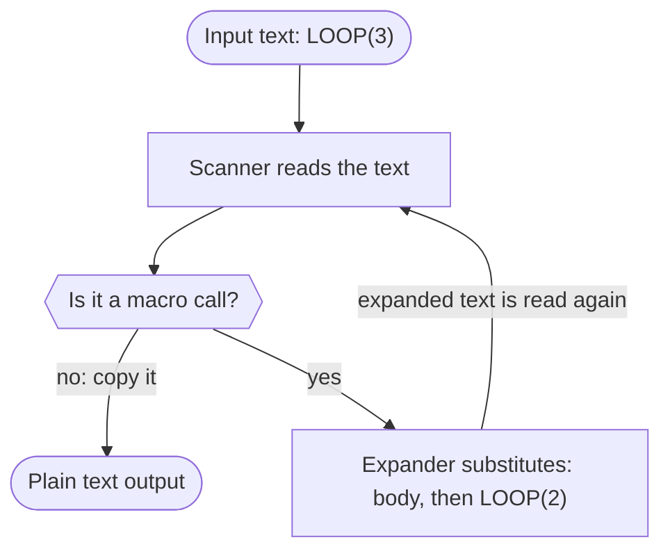

A macro is a name that is replaced by text, or by code, *before* the real language sees it. The C preprocessor is the best-known one. m4 is a general macro processor. Lisp macros work on code as data, not as text. They exist to let you build abstractions that functions cannot: repeated boilerplate, new syntax, code generated at compile time. [[entry:m4]] has no loop statement and no variable. It builds a loop from a macro whose replacement text contains itself, so the output is scanned again. [[entry:lisp-weird]] uses a `defcard` macro to write five similar classes and methods, at compile time.

The important arrow is the one that goes back. The expander does not just print its replacement text. It puts the text back in front of the scanner, so a macro call inside the replacement is expanded too. Here `LOOP(3)` leaves `LOOP(2)` behind, and the process ends when the replacement holds no macro call. [[entry:m4]] works this way. Other macro systems may not read their own output again.

- **Use it when:** you generate repetitive code, or define a small language on top of a bigger one.
- **Avoid it when:** a plain function would do. Macro bugs are hard to debug, and text macros can capture names by accident. Lisp-style *hygienic* macros reduce this danger.

**Read more:**

- [Macro (computer science)](https://en.wikipedia.org/wiki/Macro_(computer_science)) (Wikipedia)
- [M4 (computer language)](https://en.wikipedia.org/wiki/M4_(computer_language)) (Wikipedia)
- [Hygienic macro](https://en.wikipedia.org/wiki/Hygienic_macro) (Wikipedia)
