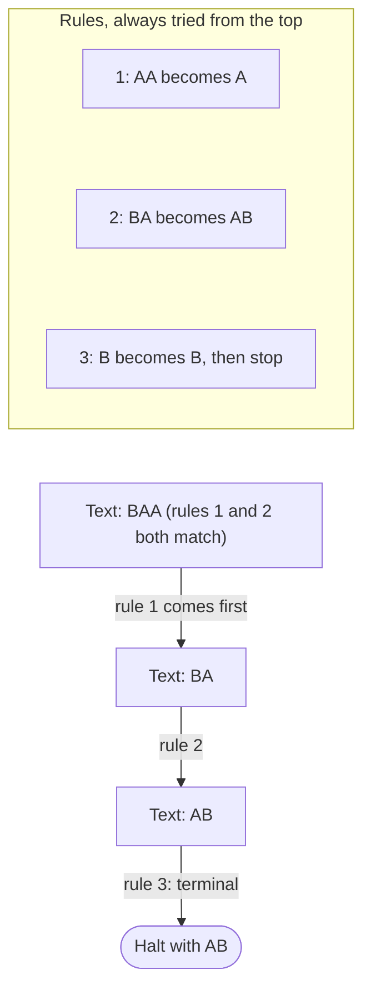

A Markov algorithm is a list of find-and-replace rules, in order. Look for the first rule whose pattern appears in the text, replace it, and start again from the top. Stop when no rule applies (or when a rule says "stop"). The Russian mathematician Andrey Markov Jr. described it in the 1950s, and it can compute anything a Turing machine can. It exists to show that *rewriting text is computing*. [[entry:regex-sed]] is exactly this: one line of text, and a script of substitutions that rewrite it until nothing matches. The line is the whole memory.

The order of the rules decides, not the place in the text. `BAA` matches rules 1 and 2, and rule 1 wins because it is first. After each rewrite the search for a rule starts again at rule 1. The run ends when a terminal rule applies (rule 3 here) or when no rule matches. Other rewriting systems, such as those in [[term-rewriting]], do not all pick rules this way.

- **Use it when:** you transform or normalize text, or when you want to teach that a program can be "just rules".
- **Avoid it for large programs:** rule order *is* the control flow, which is hard to reason about, and speed is hard to predict.

**Read more:**

- [Markov algorithm](https://en.wikipedia.org/wiki/Markov_algorithm) (Wikipedia)
- [[term-rewriting]] in "Formal languages as computational substrates"
