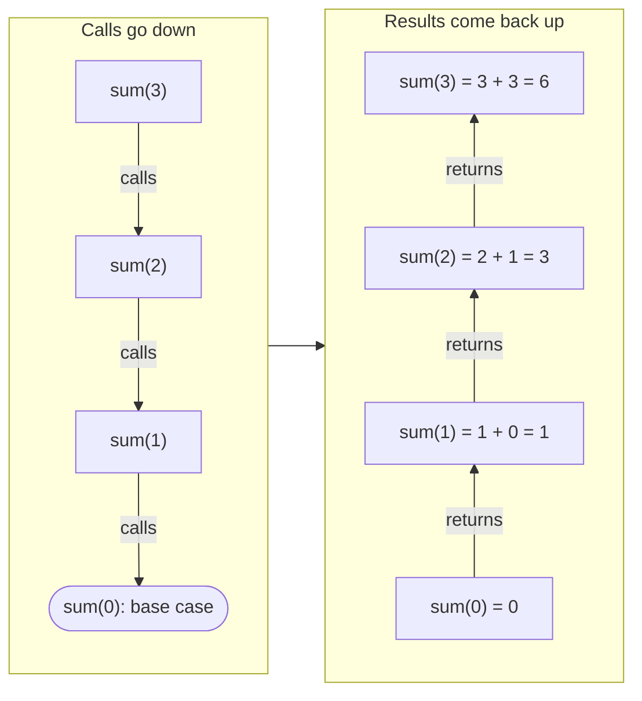

A recursive definition uses itself. A function calls itself on a smaller problem until the problem is so small that the answer is obvious. It exists because many things are naturally nested: trees, folders, grammars, arithmetic expressions. Loops and recursion are equally powerful, and functional languages use recursion instead of loops. Several entries here recurse in disguise. In [[entry:m4]] a macro whose replacement text contains itself is read again, which makes a loop. In [[entry:tcl-weird]] a database trigger inserts a row, which fires the same trigger again. The stop rule is a query that finds nothing.

On the way down, each call hands a smaller problem to the next call. The base case, `sum(0)`, is the only call that answers without calling again. Without it the calls never stop. On the way up, each call finishes the work it was waiting to do. [[call-stack]] shows where those waiting calls are kept.

- **Use it when:** the data is nested, or the problem splits into smaller copies of itself.
- **Avoid it when:** the depth is unbounded and the language does not remove tail calls. The stack can run out. Always know the stop rule, and know what happens if it never fires.

**Read more:**

- [Recursion (computer science)](https://en.wikipedia.org/wiki/Recursion_(computer_science)) (Wikipedia)
- [Tail call](https://en.wikipedia.org/wiki/Tail_call) (Wikipedia)
- [Recursion](https://developer.mozilla.org/en-US/docs/Glossary/Recursion) (MDN glossary)
