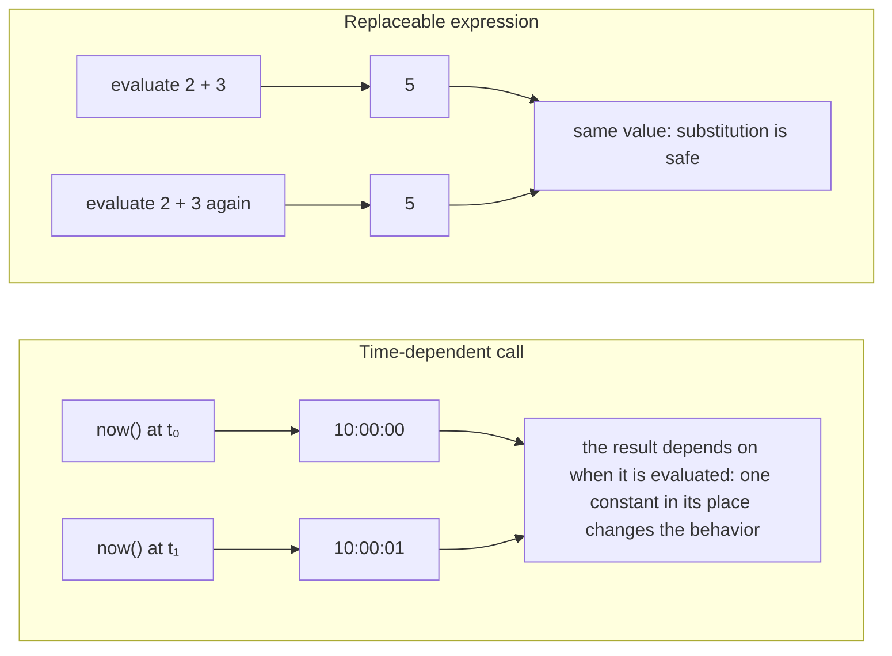

An expression is referentially transparent if you can replace it with its value and the program does not change. `2 + 3` is. `readLine()` is not, because it gives a different answer each time. It exists as the rule behind *pure* functions: they are easy to test, to cache, to run in parallel and to rearrange. Effects break it. That is the whole point of [[entry:haskell-weird]]: it hides input and output inside a list, so a list that looks like plain data is not plain data. Where it is allowed to be violated, the code must say so loudly.

The left side can be replaced by `5` anywhere. The right side cannot: the call's value depends on *when* it runs, and the times shown are only illustrative. This is about referential transparency, which is the same as repeatability here, and not about [[idempotence]]. A function that reads the clock changes nothing, so it is not "non-idempotent". It is just not repeatable. [[idempotence]] is about what an operation does to state.

- **Use it when:** as much as you can. Keep the pure core large and push effects to the edges.
- **Avoid pretending:** random numbers, clocks, files and networks are not transparent.

**Read more:**

- [Referential transparency](https://en.wikipedia.org/wiki/Referential_transparency) (Wikipedia)
- [Pure function](https://en.wikipedia.org/wiki/Pure_function) (Wikipedia)
- [Functional programming](https://en.wikipedia.org/wiki/Functional_programming) (Wikipedia)
