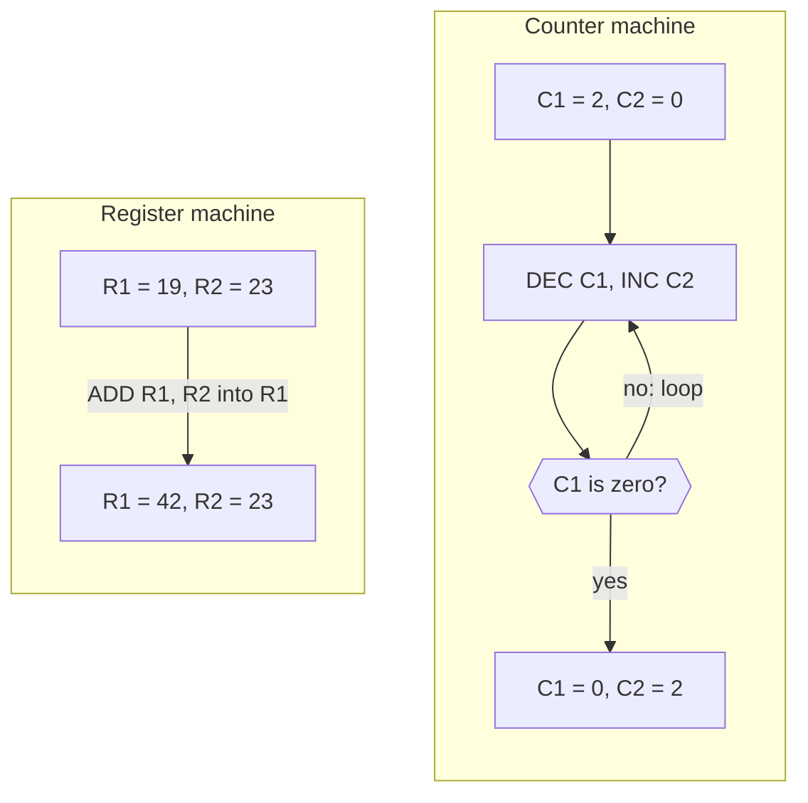

A register machine stores its values in a few numbered boxes called registers. Real processors are register machines. The smallest version, a *counter machine*, has only two operations: add one to a register, or subtract one and jump if the result is zero. It exists as a thinking tool: it is simple enough to prove things about, yet powerful enough to compute anything (two counters are enough). Several entries are register machines in disguise. CMake's `CMAKE_MATCH_1` to `CMAKE_MATCH_5` are the registers of [[entry:cmake]]. .NET's balancing groups, in [[entry:regex-dotnet]], are a counter.

On the left, the instruction names its cells (`R1` and `R2`). On the right, the machine has two counters and three moves: count down, count up and test for zero. Moving a count from `C1` to `C2` takes one pass of the loop for each unit, so a counter machine is slow on purpose. What it shows is how little machinery is enough.

- **Use it when:** you want to explain what a strange system *is*, by finding its registers.
- **Avoid it as a coding style:** it is a model for reasoning, not a way to write programs.

**Read more:**

- [Register machine](https://en.wikipedia.org/wiki/Register_machine) (Wikipedia)
- [Counter machine](https://en.wikipedia.org/wiki/Counter_machine) (Wikipedia)
