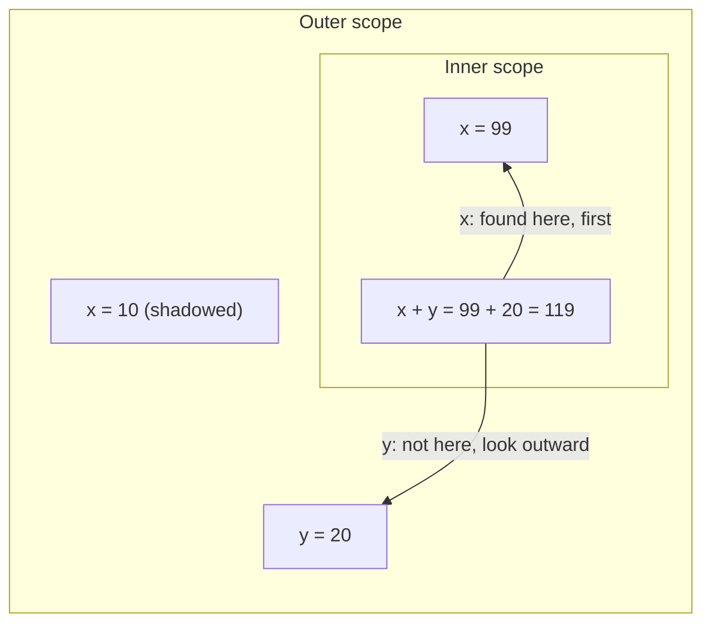

*Scope* is the part of a program where a name can be seen. *Binding* is the link between a name and a value. Most languages use *lexical* scope: a name means what it means where it is written. Some use *dynamic* scope: a name means whatever the most recent caller set. Dynamic scope can be useful, and it can be dangerous. In [[entry:apl-weird]] dynamic scope would let a rewritten function overwrite its parent's variables, so each generated header re-declares its locals. In Tcl, `uplevel` runs code in the scope of another stack frame. [[entry:tcl-weird]] uses `uplevel #0`, which means the global scope. In m4 and Make, every name is global.

A name is looked up in the innermost scope first, then outward. Here `x` is found at once in the inner scope, which *shadows* the outer `x = 10`. The name `y` is not bound in the inner scope, so the search goes outward. The scope decides where to look, and the binding is what the search finds. This picture is lexical scope: the boxes are the nesting of the source text.

- **Use it when:** lexical scope, almost always. It lets you read a function without knowing its callers.
- **Avoid:** dynamic and global scope, except for deliberate, documented settings.

**Read more:**

- [Scope (computer programming)](https://en.wikipedia.org/wiki/Scope_(computer_programming)) (Wikipedia)
- [Name binding](https://en.wikipedia.org/wiki/Name_binding) (Wikipedia)
- [Closure (computer programming)](https://en.wikipedia.org/wiki/Closure_(computer_programming)) (Wikipedia)
- [Scope](https://developer.mozilla.org/en-US/docs/Glossary/Scope) (MDN glossary)
