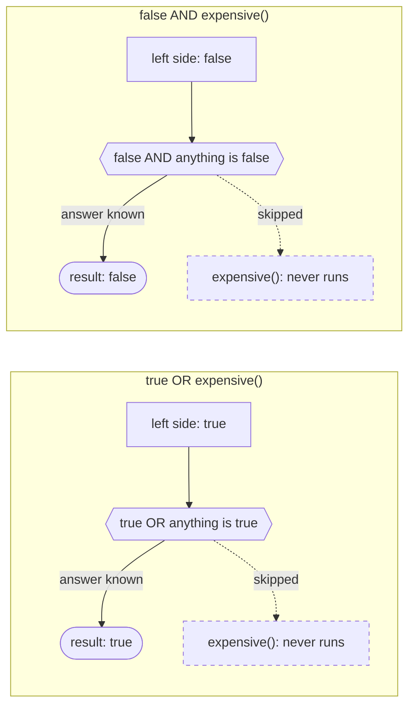

Short-circuit evaluation means that `and` and `or` stop as soon as the answer is known. In `a && b`, if `a` is false, `b` never runs. It exists for speed, and for a very useful habit: guard first, then act (`x != null && x.length > 0`). The same idea can be a loop. In [[entry:lisp-weird]] the `or` method combination calls methods one after another and stops at the first one that returns a true value. A class hierarchy becomes the loop, and `or` becomes the stop rule.

In both panels the left operand settles the answer, so the right operand is skipped. Anything it would have done, such as a slow query, a write or a printed line, does not happen. That is why `x != null && x.length > 0` is safe. It also means that an effect in the right operand is not a promise. See [[side-effect]].

- **Use it when:** you guard a risky operation, or pick the first good answer.
- **Avoid it when:** the second operand has an effect you expect to always happen. It silently will not.

**Read more:**

- [Short-circuit evaluation](https://en.wikipedia.org/wiki/Short-circuit_evaluation) (Wikipedia)
- [Common Lisp Object System](https://en.wikipedia.org/wiki/Common_Lisp_Object_System) (Wikipedia)
- [Logical AND (`&&`)](https://developer.mozilla.org/en-US/docs/Web/JavaScript/Reference/Operators/Logical_AND) (MDN), which describes short-circuiting in plain words
