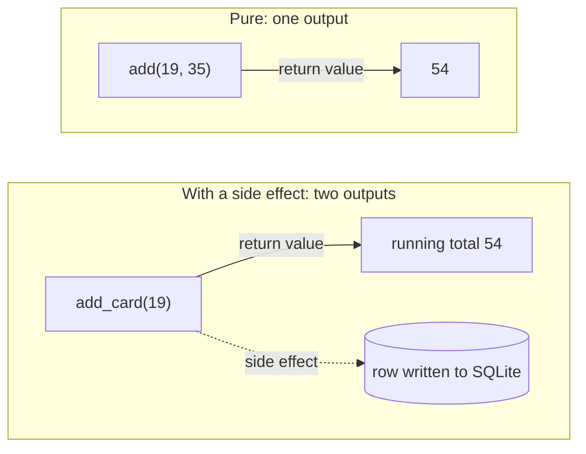

A side effect is anything an operation does besides returning a value: writing a file, changing a variable, printing, inserting a database row. Programs exist to cause effects, so effects are not bad. The problem is that *order, number and timing* start to matter. Run it twice and you may get two rows. Run it later and you may get a different answer. Several entries put an effect inside something that looks like a plain description: a lazy Haskell list, a LINQ query, a XAML tree. A rule falls out of that: **whoever reads the structure decides whether, and when, the effect happens.** `evaluate (length cards)` in Haskell and the final `Aggregate` in LINQ both mean "force it now".

Both calls return a value. Only the second also changes something outside itself: a row now exists in the database, and it still exists if the caller ignores the return value. That is why a side effect is not just another return value. The caller sees the return value only if it looks, but the effect has already happened. Compare [[referential-transparency]]: a pure call can be replaced by its value, and the second call cannot.

- **Use effects when:** at the edges of a program, where it talks to the world, and in places where you can say exactly when they run.
- **Avoid effects when:** they hide in lazy or "pure-looking" code, where nobody can say who triggers them.

**Read more:**

- [Side effect (computer science)](https://en.wikipedia.org/wiki/Side_effect_(computer_science)) (Wikipedia)
- [[referential-transparency]] in "Evaluation and demand"
