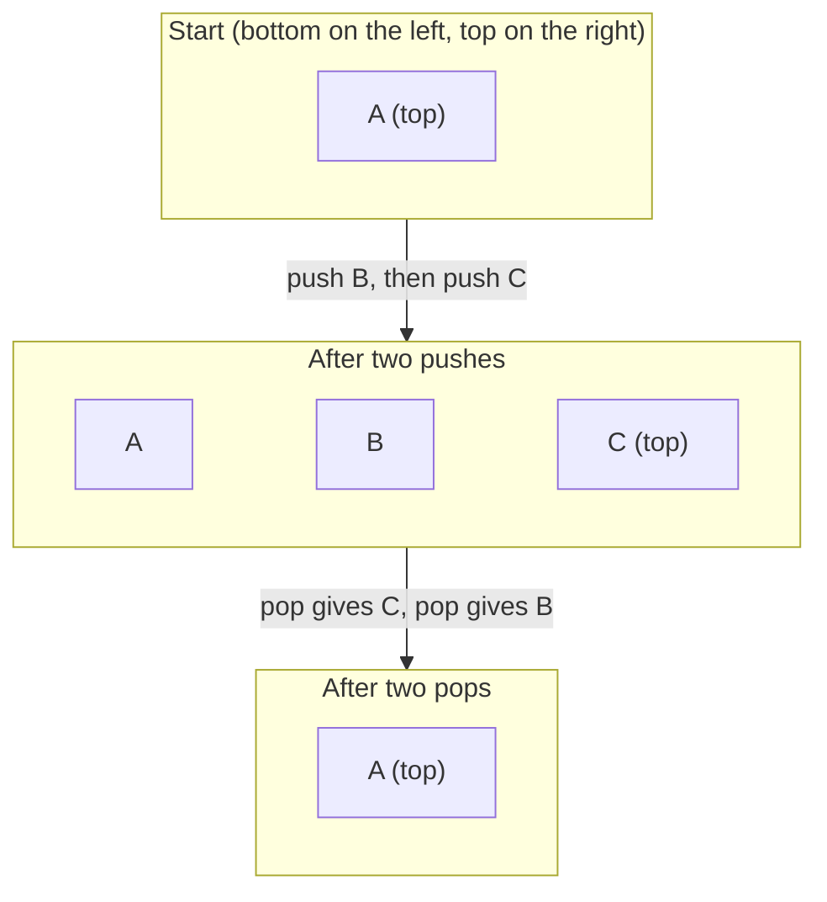

A stack is a pile where you add and remove at the top only: last in, first out. It is the right shape for anything nested: undo, expression evaluation, bracket matching and backtracking. In this repository the stack appears in two unusual places. In [[entry:forth-weird]] the data stack is the only memory. In [[entry:regex-dotnet]] *balancing groups* push a capture when they see an opening mark and pop one when they see a closing mark. A stack of marks is a counter, so a regex can compare two counts.

Only the top can be reached. A push adds on top and a pop removes from the top, so the last item in is the first one out. [[call-stack]] is one use of this structure, with frames as the items. Undo lists, bracket matching and the data stack of [[entry:forth-weird]] are others.

- **Use it when:** the problem is nested, or you must undo in reverse order.
- **Avoid it when:** you need random access or first-in, first-out order. Use an array or a queue.

**Read more:**

- [Stack (abstract data type)](https://en.wikipedia.org/wiki/Stack_(abstract_data_type)) (Wikipedia)
- [Pushdown automaton](https://en.wikipedia.org/wiki/Pushdown_automaton) (Wikipedia)
