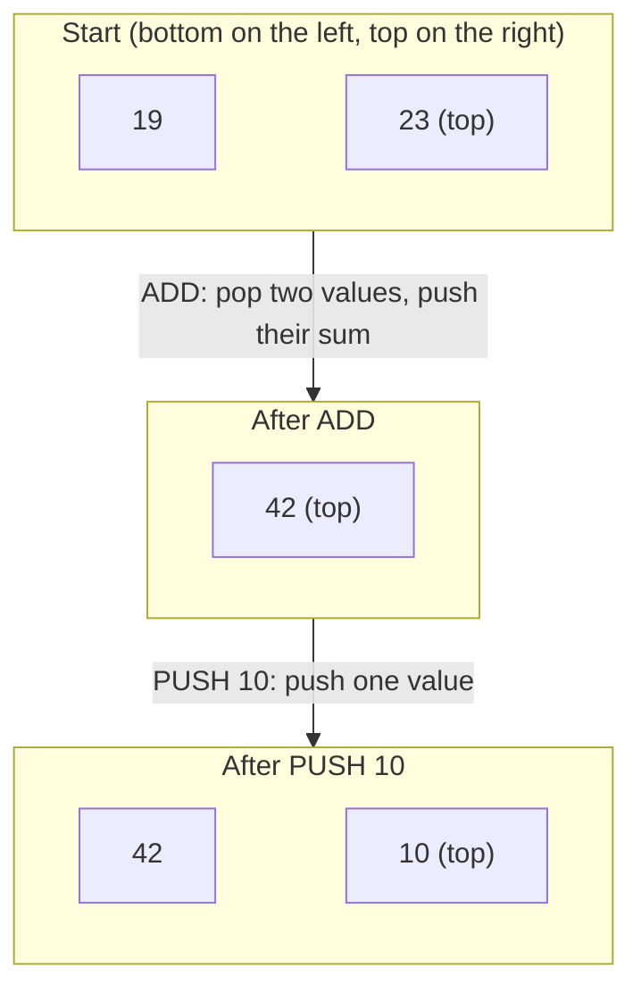

A stack machine keeps its working values on a stack. An instruction takes its inputs from the top and puts its result back. There are no named registers. It exists because the instructions can be tiny (`+` needs no operands) and a compiler can generate them easily. That is why the JVM, .NET's IL, WebAssembly, PostScript and Forth all use the idea. In [[entry:forth-weird]] the data stack is the *only* memory: the program has no `variable` at all.

Read the picture from top to bottom. `ADD` does not say where its inputs are: it pops the top two values and pushes one result. A real stack machine still has other memory (the JVM has local variables and a heap, for example). The stack only holds the values that the next instruction needs.

- **Use it when:** you build a small virtual machine or interpreter, or you want compact code.
- **Avoid it when:** you need random access to many values. Shuffling the stack with `dup`, `swap` and `rot` becomes unreadable fast.

**Read more:**

- [Stack machine](https://en.wikipedia.org/wiki/Stack_machine) (Wikipedia)
- [Reverse Polish notation](https://en.wikipedia.org/wiki/Reverse_Polish_notation) (Wikipedia)
- [Forth (programming language)](https://en.wikipedia.org/wiki/Forth_(programming_language)) (Wikipedia)
