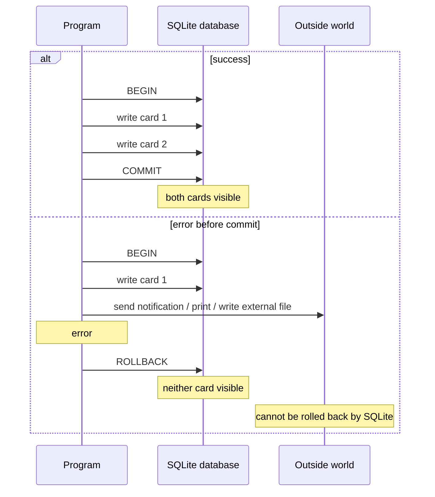

A transaction is a group of operations that either *all* happen or *none* happen. The classic promise is called ACID: atomic, consistent, isolated and durable. It exists because a crash or an error in the middle of an update would otherwise leave data half-changed. Each script entry writes its demo cards in one SQLite transaction, and the **commit** is the point of no return. That point is where laziness can hurt. In [[entry:haskell-weird]] a lazy `let` was forced only after the pipe to SQLite had closed, so the work happened too late. `evaluate (length cards)` before the commit fixed it.

`COMMIT` makes both rows visible together, and `ROLLBACK` removes both. Neither reaches past the database. A notification, a printout or a file written outside it has already happened. That is why [[entry:haskell-weird]] had to force its lazy effects *before* the commit, and why this picture is about the boundary of the transaction and not about the cards. Not every entry places its transaction boundaries in the same spot.

- **Use it when:** any multi-step change to stored data.
- **Avoid:** long transactions that hold locks, and assuming that effects outside the database (an email, a file) can be rolled back. They cannot.

**Read more:**

- [Database transaction](https://en.wikipedia.org/wiki/Database_transaction) (Wikipedia)
- [ACID](https://en.wikipedia.org/wiki/ACID) (Wikipedia)
- [Commit (data management)](https://en.wikipedia.org/wiki/Commit_(data_management)) (Wikipedia)
