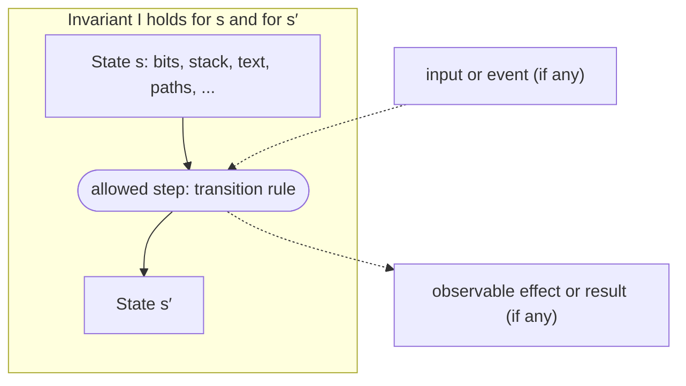
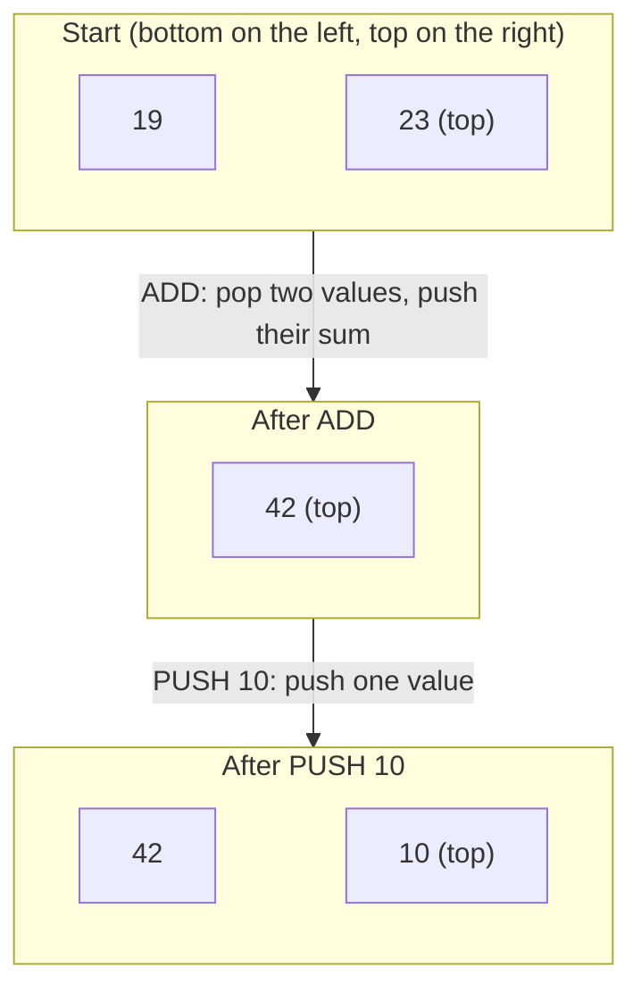
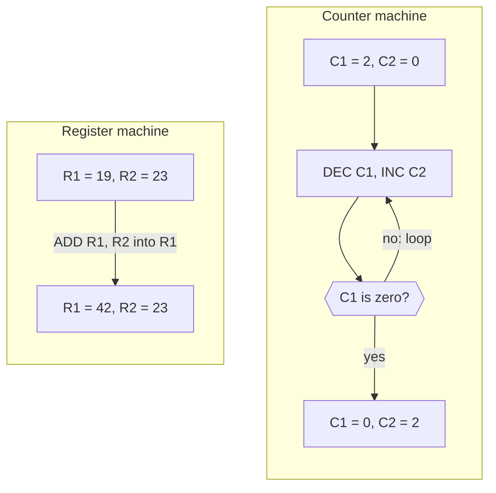
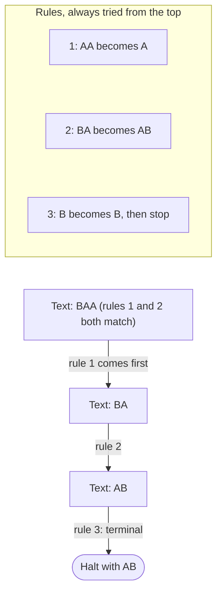
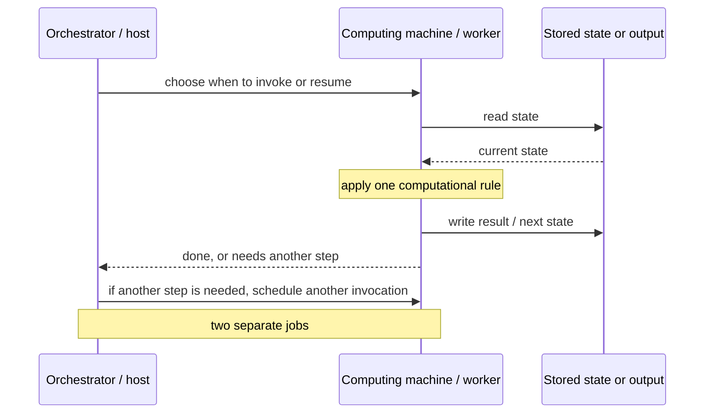

<!-- GENERATED by lessons/book/build.py from lessons/cs-source/ and the entries' frontmatter. Do not edit; edit the sources and run build.py. -->

# What counts as a machine?

For an advanced reading path with traces and experiments, see the [state and control beyond variables study guide](../study-guides/concepts/state-and-control-beyond-variables.md).

Before you can say that a regex engine, a build tool or a markup file "computes", you need to say what a machine is. The answer is smaller than you might think. A machine has a **state**, a set of allowed **steps**, a way to **represent** its values, and some facts that stay true while it runs (**invariants**). If you can say what those four are, you have named the machine.

The picture shows the four parts without naming any hardware: the state and how it is represented, one allowed step, and the invariant that holds before and after it. A regex engine's capture stack, a Make dependency graph and an editor buffer all fit this template. The template does not require finite states, explicit input and output, or machine instructions.

The first goal of this book is exactly that habit: *name the machine hiding inside the language*. A stack machine, a register machine and a rewriting system can all compute the same things, but they keep their memory in different places. The concepts here are the vocabulary for that: transition systems, operational semantics (state, and one step at a time), Turing machines, Markov algorithms and Turing completeness. One more question goes with them: which part of a design *computes*, and which part only decides what runs next ([Computation versus orchestration](02-what-counts-as-a-machine.md#computation-versus-orchestration))? The chapter "State beyond variables" then returns to the question that matters most for this repository: where does the state live?

## Models of computation

A model of computation is a precise description of what "computing" means: what one step is, and what memory exists. It exists because you cannot prove anything about "a computer" in general. You need rules small enough to reason about. Then you can ask: what can this model compute, and how fast? Famous models are the Turing machine, the lambda calculus, register machines and string-rewriting systems. This chapter uses a simple habit: **name the machine**. When a regex engine, a build tool or a markup file starts to compute, ask what kind of machine it has become.

- **Use it when:** you want to explain what a strange system really is, or to argue that it can (or cannot) do something.
- **Avoid:** confusing the model with real hardware. A Turing machine has an infinite tape. Your laptop does not.

**Read more:**

- [Model of computation](https://en.wikipedia.org/wiki/Model_of_computation) (Wikipedia)
- [Abstract machine](https://en.wikipedia.org/wiki/Abstract_machine) (Wikipedia)
- [Church–Turing thesis](https://en.wikipedia.org/wiki/Church%E2%80%93Turing_thesis) (Wikipedia)

**In this repo:**

**Applies to every entry that names its machine** (26 of 40; see the [table of machines](../goals.md)). Each of these entries states, in its machine and state fields, what kind of machine it really is and where its state lives, which is the habit this concept teaches.

## Transition systems and state machines

A transition system is the simplest machine: a set of *states* and a set of allowed *moves* between them. A finite-state machine is the case with a fixed, small number of states. It exists because small machines can be checked completely: you can list every state and every move. Parsers, network protocols, user-interface flows and the insides of regex engines are all built this way. Every entry in this repository can be drawn as a transition system if you ask two questions: what is the state, and what is one step?

- **Use it when:** behavior depends on history in a bounded way, such as "what did I see before?"
- **Avoid it when:** the state is unbounded. A finite machine cannot count matching brackets of any depth. For that you need a stack (see [Stack machines](02-what-counts-as-a-machine.md#stack-machines)). Also beware of *state explosion*: the number of states can grow faster than you can draw them.

**Read more:**

- [Transition system](https://en.wikipedia.org/wiki/Transition_system) (Wikipedia)
- [Finite-state machine](https://en.wikipedia.org/wiki/Finite-state_machine) (Wikipedia)

**In this repo:**

| Entry | Language | How it relates | What it teaches |
| --- | --- | --- | --- |
| [`ed-weird`](../../src/ed-weird/README.md) | ed, SQLite | demonstrates | That a line editor is a rewriting machine: lines are the data, addresses are the program, and a failed substitution inside a global command is an "if". |
| [`find-gnu`](../../src/find-gnu/README.md) | find, SQLite | demonstrates | That the GNU extras to find (path depth, file times, regular expressions and a built-in profiler) can replace a whole table of branches, and that find's optimizer has nothing to reorder when every branch ends in a side effect. |
| [`find-posix`](../../src/find-posix/README.md) | find, SQLite | demonstrates | That a directory walk can be a loop and a program: find digs the tree it is walking, and the path to the current directory is the whole machine. |
| [`javascript-events`](../../src/javascript-events/README.md) | JavaScript, SQLite | demonstrates | That a program can be a set of listeners, each doing one small thing and then emitting the event the next one waits for; and that emit() calls its listeners at once, so only an explicit scheduling boundary gives the event loop a turn. |
| [`tar-gnu`](../../src/tar-gnu/README.md) | GNU tar, SQLite | demonstrates | That a tar archive can be a serialized program: tar reads the members in order, and only the command that the operator attaches gives them an effect. |
| [`tar-gnu-weird`](../../src/tar-gnu-weird/README.md) | GNU tar, SQLite | demonstrates | That an archive's physical layout can set the pace of a program: tar's checkpoints are a clock, and each tick moves a state machine by one step. |

## Representing state

Any state must be written down in something. A number can be tally marks (unary), digits (decimal or binary), or even a single huge integer that encodes a whole program (Gödel numbering). The choice of *representation* decides what is easy. Tally marks are easy to rewrite with find-and-replace, but long. In [`regex-sed`](../../src/regex-sed/README.md) the whole program state is one line of text, and numbers are rows of marks that substitutions grow and shrink. COBOL's `PIC` clauses are also a representation: the picture of a field decides its size, rounding and range.

- **Use it when:** your medium has no numbers or no variables, and you must decide for yourself what "a count" looks like.
- **Avoid unary for large numbers:** one million needs one million marks.

**Read more:**

- [Unary numeral system](https://en.wikipedia.org/wiki/Unary_numeral_system) (Wikipedia)
- [Gödel numbering](https://en.wikipedia.org/wiki/G%C3%B6del_numbering) (Wikipedia)

**In this repo:**

| Entry | Language | How it relates | What it teaches |
| --- | --- | --- | --- |
| [`cobol`](../../src/cobol/README.md) | COBOL | demonstrates | That a stop rule can be declared as data, and that a number's picture can do your rounding. |
| [`ed-weird`](../../src/ed-weird/README.md) | ed, SQLite | demonstrates | That a line editor is a rewriting machine: lines are the data, addresses are the program, and a failed substitution inside a global command is an "if". |
| [`ex-weird`](../../src/ex-weird/README.md) | Ex, SQLite | demonstrates | That an editor's registers can hold a program: a line of text is copied into a register and run with @, and the editor's own marks and line addresses do the arithmetic. |
| [`find-gnu`](../../src/find-gnu/README.md) | find, SQLite | demonstrates | That the GNU extras to find (path depth, file times, regular expressions and a built-in profiler) can replace a whole table of branches, and that find's optimizer has nothing to reorder when every branch ends in a side effect. |
| [`find-posix`](../../src/find-posix/README.md) | find, SQLite | demonstrates | That a directory walk can be a loop and a program: find digs the tree it is walking, and the path to the current directory is the whole machine. |
| [`regex-sed`](../../src/regex-sed/README.md) | GNU sed, Regular expressions | demonstrates | That a program can be one line of text that substitutions rewrite until none applies: a Markov algorithm, with a catastrophic-backtracking regex as its clock. |
| [`tar-gnu`](../../src/tar-gnu/README.md) | GNU tar, SQLite | demonstrates | That a tar archive can be a serialized program: tar reads the members in order, and only the command that the operator attaches gives them an effect. |
| [`tar-gnu-weird`](../../src/tar-gnu-weird/README.md) | GNU tar, SQLite | demonstrates | That an archive's physical layout can set the pace of a program: tar's checkpoints are a clock, and each tick moves a state machine by one step. |

## Invariants

An invariant is a fact that stays true at every step. It exists because you cannot test every possible state of a program, but you *can* prove two things: the fact is true at the start, and every step keeps it true. Then it is true forever. In this repository a database rule such as `CHECK(demo_only=1)` is an invariant of the data: a non-demo row cannot exist. Each `check.sh` tries to break it, to show that the rule is real. Loop invariants work the same way: "the total so far equals the sum of the cards drawn".

- **Use it when:** you design a loop, a data schema, a concurrent algorithm or an assertion.
- **Avoid:** invariants that nobody can check, or that are so weak they say nothing.

**Read more:**

- [Invariant (computer science)](https://en.wikipedia.org/wiki/Invariant_(computer_science)) (Wikipedia)
- [Loop invariant](https://en.wikipedia.org/wiki/Loop_invariant) (Wikipedia)

**In this repo:**

| Entry | Language | How it relates | What it teaches |
| --- | --- | --- | --- |
| [`javascript`](../../src/javascript/README.md) | JavaScript, SQLite | demonstrates | That a for statement is three expressions and an empty body, and that JavaScript's own evaluation order, truthiness and comma operator are enough to run a whole program from the three clauses. |
| [`javascript-events`](../../src/javascript-events/README.md) | JavaScript, SQLite | demonstrates | That a program can be a set of listeners, each doing one small thing and then emitting the event the next one waits for; and that emit() calls its listeners at once, so only an explicit scheduling boundary gives the event loop a turn. |
| [`javascript-weird`](../../src/javascript-weird/README.md) | JavaScript, SQLite | demonstrates | That a closure is a state machine: a function plus the variables it was made next to, pulled one step at a time by an iterator, with reduce as the one fold that cannot stop. |
| [`tar-gnu-weird`](../../src/tar-gnu-weird/README.md) | GNU tar, SQLite | demonstrates | That an archive's physical layout can set the pace of a program: tar's checkpoints are a clock, and each tick moves a state machine by one step. |

## Observability

Observability is how much of a system's inside you can learn from the outside: through output, logs and traces. It exists because you cannot fix what you cannot see. Several entries have a trace switch for this reason. For example, `TRACE=1 ./timecards.sh` in [`regex-sed`](../../src/regex-sed/README.md) prints the whole program state at every step. But watching can change what you watch. In a lazy language, printing a value *forces* it, so the act of looking makes the computation happen. Programmers call a bug that vanishes when you look at it a *heisenbug*.

- **Use it when:** you design anything you will have to debug later. Log state changes, not only errors.
- **Avoid:** logging secrets, and forgetting that observation has a cost (and sometimes an effect).

**Read more:**

- [Observability (software)](https://en.wikipedia.org/wiki/Observability_(software)) (Wikipedia)
- [Heisenbug](https://en.wikipedia.org/wiki/Heisenbug) (Wikipedia)

**In this repo:**

| Entry | Language | How it relates | What it teaches |
| --- | --- | --- | --- |
| [`find-gnu`](../../src/find-gnu/README.md) | find, SQLite | demonstrates | That the GNU extras to find (path depth, file times, regular expressions and a built-in profiler) can replace a whole table of branches, and that find's optimizer has nothing to reorder when every branch ends in a side effect. |
| [`javascript-events`](../../src/javascript-events/README.md) | JavaScript, SQLite | demonstrates | That a program can be a set of listeners, each doing one small thing and then emitting the event the next one waits for; and that emit() calls its listeners at once, so only an explicit scheduling boundary gives the event loop a turn. |
| [`tar-gnu`](../../src/tar-gnu/README.md) | GNU tar, SQLite | demonstrates | That a tar archive can be a serialized program: tar reads the members in order, and only the command that the operator attaches gives them an effect. |
| [`tar-gnu-weird`](../../src/tar-gnu-weird/README.md) | GNU tar, SQLite | demonstrates | That an archive's physical layout can set the pace of a program: tar's checkpoints are a clock, and each tick moves a state machine by one step. |

## Stack machines

A stack machine keeps its working values on a stack. An instruction takes its inputs from the top and puts its result back. There are no named registers. It exists because the instructions can be tiny (`+` needs no operands) and a compiler can generate them easily. That is why the JVM, .NET's IL, WebAssembly, PostScript and Forth all use the idea. In [`forth-weird`](../../src/forth-weird/README.md) the data stack is the *only* memory: the program has no `variable` at all.

Read the picture from top to bottom. `ADD` does not say where its inputs are: it pops the top two values and pushes one result. A real stack machine still has other memory (the JVM has local variables and a heap, for example). The stack only holds the values that the next instruction needs.

- **Use it when:** you build a small virtual machine or interpreter, or you want compact code.
- **Avoid it when:** you need random access to many values. Shuffling the stack with `dup`, `swap` and `rot` becomes unreadable fast.

**Read more:**

- [Stack machine](https://en.wikipedia.org/wiki/Stack_machine) (Wikipedia)
- [Reverse Polish notation](https://en.wikipedia.org/wiki/Reverse_Polish_notation) (Wikipedia)
- [Forth (programming language)](https://en.wikipedia.org/wiki/Forth_(programming_language)) (Wikipedia)

**In this repo:**

| Entry | Language | How it relates | What it teaches |
| --- | --- | --- | --- |
| [`forth`](../../src/forth/README.md) | Forth | demonstrates | That a stack language needs one `begin ... until` and a pipe to be a whole program. |
| [`forth-weird`](../../src/forth-weird/README.md) | Forth | demonstrates | That the text interpreter's parse position is a program counter, if you let it be, and that the data stack can be a program's only memory. |

## Register machines and counter machines

A register machine stores its values in a few numbered boxes called registers. Real processors are register machines. The smallest version, a *counter machine*, has only two operations: add one to a register, or subtract one and jump if the result is zero. It exists as a thinking tool: it is simple enough to prove things about, yet powerful enough to compute anything (two counters are enough). Several entries are register machines in disguise. CMake's `CMAKE_MATCH_1` to `CMAKE_MATCH_5` are the registers of [`cmake`](../../src/cmake/README.md). .NET's balancing groups, in [`regex-dotnet`](../../src/regex-dotnet/README.md), are a counter.

On the left, the instruction names its cells (`R1` and `R2`). On the right, the machine has two counters and three moves: count down, count up and test for zero. Moving a count from `C1` to `C2` takes one pass of the loop for each unit, so a counter machine is slow on purpose. What it shows is how little machinery is enough.

- **Use it when:** you want to explain what a strange system *is*, by finding its registers.
- **Avoid it as a coding style:** it is a model for reasoning, not a way to write programs.

**Read more:**

- [Register machine](https://en.wikipedia.org/wiki/Register_machine) (Wikipedia)
- [Counter machine](https://en.wikipedia.org/wiki/Counter_machine) (Wikipedia)

**In this repo:**

| Entry | Language | How it relates | What it teaches |
| --- | --- | --- | --- |
| [`cmake`](../../src/cmake/README.md) | CMake | demonstrates | `while()` plus regex as a tiny register machine. |
| [`ex-weird`](../../src/ex-weird/README.md) | Ex, SQLite | demonstrates | That an editor's registers can hold a program: a line of text is copied into a register and run with @, and the editor's own marks and line addresses do the arithmetic. |
| [`forth-weird`](../../src/forth-weird/README.md) | Forth | demonstrates | That the text interpreter's parse position is a program counter, if you let it be, and that the data stack can be a program's only memory. |
| [`regex-dotnet`](../../src/regex-dotnet/README.md) | C#, Regular expressions | demonstrates | A regex as a stack-based counter. |

## Turing machines

A Turing machine has an endless tape of cells, a head that reads and writes one cell at a time, and a short table of rules. Alan Turing described it in 1936 to define exactly what an "algorithm" is. With it he showed that some questions have no algorithm at all, such as the halting problem: "does this program ever stop?" Nobody writes software for a Turing machine. It matters because of an argument: if a system can *simulate* one, it can compute anything that can be computed.

- **Use it when:** you want to argue that a notation is a full computer, or to understand why some problems cannot be solved.
- **Avoid:** using it to predict speed. Real machines do not walk along a tape.

**Read more:**

- [Turing machine](https://en.wikipedia.org/wiki/Turing_machine) (Wikipedia)
- [Halting problem](https://en.wikipedia.org/wiki/Halting_problem) (Wikipedia)
- [Church–Turing thesis](https://en.wikipedia.org/wiki/Church%E2%80%93Turing_thesis) (Wikipedia)

**In this repo:**

| Entry | Language | How it relates | What it teaches |
| --- | --- | --- | --- |
| [`m4`](../../src/m4/README.md) | m4 | analogy | That a macro processor is a programming language: no loop statement and no variable, just text that gets scanned again. |
| [`regex-sed`](../../src/regex-sed/README.md) | GNU sed, Regular expressions | analogy | That a program can be one line of text that substitutions rewrite until none applies: a Markov algorithm, with a catastrophic-backtracking regex as its clock. |

## Markov algorithms

A Markov algorithm is a list of find-and-replace rules, in order. Look for the first rule whose pattern appears in the text, replace it, and start again from the top. Stop when no rule applies (or when a rule says "stop"). The Russian mathematician Andrey Markov Jr. described it in the 1950s, and it can compute anything a Turing machine can. It exists to show that *rewriting text is computing*. [`regex-sed`](../../src/regex-sed/README.md) is exactly this: one line of text, and a script of substitutions that rewrite it until nothing matches. The line is the whole memory.

The order of the rules decides, not the place in the text. `BAA` matches rules 1 and 2, and rule 1 wins because it is first. After each rewrite the search for a rule starts again at rule 1. The run ends when a terminal rule applies (rule 3 here) or when no rule matches. Other rewriting systems, such as those in [Term and string rewriting](05-formal-languages-as-computational-substrates.md#term-and-string-rewriting), do not all pick rules this way.

- **Use it when:** you transform or normalize text, or when you want to teach that a program can be "just rules".
- **Avoid it for large programs:** rule order *is* the control flow, which is hard to reason about, and speed is hard to predict.

**Read more:**

- [Markov algorithm](https://en.wikipedia.org/wiki/Markov_algorithm) (Wikipedia)
- [Term and string rewriting](05-formal-languages-as-computational-substrates.md#term-and-string-rewriting) in "Formal languages as computational substrates"

**In this repo:**

| Entry | Language | How it relates | What it teaches |
| --- | --- | --- | --- |
| [`ed-weird`](../../src/ed-weird/README.md) | ed, SQLite | demonstrates | That a line editor is a rewriting machine: lines are the data, addresses are the program, and a failed substitution inside a global command is an "if". |
| [`regex-sed`](../../src/regex-sed/README.md) | GNU sed, Regular expressions | demonstrates | That a program can be one line of text that substitutions rewrite until none applies: a Markov algorithm, with a catastrophic-backtracking regex as its clock. |

## Turing completeness

A system is Turing complete if it can simulate any Turing machine (given unlimited memory). In plain words: it can compute whatever a general-purpose computer can. People enjoy finding this property in surprising places: Make, sed, m4, spreadsheets, even slide software. That is the spirit of this repository. But the property has a price. If a notation is Turing complete, you cannot decide in general what its programs will do (Rice's theorem). That is why security people prefer inputs that are *not* powerful. See [Language-theoretic security](05-formal-languages-as-computational-substrates.md#language-theoretic-security). The web community calls this the *rule of least power*: choose the least powerful language that solves the problem.

- **Use it when:** you want to know the ceiling of a notation, or explain why a "configuration language" can run forever.
- **Avoid it as praise:** "it is Turing complete" is a warning label as often as a compliment.

**Read more:**

- [Turing completeness](https://en.wikipedia.org/wiki/Turing_completeness) (Wikipedia)
- [Rice's theorem](https://en.wikipedia.org/wiki/Rice%27s_theorem) (Wikipedia)
- [Rule of least power](https://en.wikipedia.org/wiki/Rule_of_least_power) (Wikipedia)

**In this repo:**

| Entry | Language | How it relates | What it teaches |
| --- | --- | --- | --- |
| [`m4`](../../src/m4/README.md) | m4 | demonstrates | That a macro processor is a programming language: no loop statement and no variable, just text that gets scanned again. |
| [`make-gnu`](../../src/make-gnu/README.md) | GNU Make | demonstrates | Arithmetic and looping in plain Make syntax, no shell required. |
| [`regex-sed`](../../src/regex-sed/README.md) | GNU sed, Regular expressions | demonstrates | That a program can be one line of text that substitutions rewrite until none applies: a Markov algorithm, with a catastrophic-backtracking regex as its clock. |

## Operational semantics

**Operational semantics** says what a program means by saying how it runs: what a machine's *state* is, and what *one step* does to it. A language is then a set of rules of the form "in this state, this construct moves the machine to that state". It is the most direct way to answer "what does this actually do?", and it is what you do when you read a program one transition at a time.

Every entry that names its machine could be described this way. Three do it on the page. [`tar-gnu-weird`](../../src/tar-gnu-weird/README.md) has one row of registers (the hours worked, the target, the total, the seed, a done flag) and one transition, run once per tar checkpoint. [`javascript`](../../src/javascript/README.md) is the three clauses of a `for`: initialize once, then test, body, update, test, body, update. Its README traces one card through them. [`ex-weird`](../../src/ex-weird/README.md) has marks and registers as its state, and each command line moves them.

- **Use it when:** you must explain, or check, exactly what a strange construct does. Write down the state and the step, and run it by hand.
- **Avoid it when:** you need to compare programs by what they compute and not by how. Then you want a semantics that ignores the steps.

**Read more:**

- [Operational semantics](https://en.wikipedia.org/wiki/Operational_semantics) (Wikipedia)
- [Transition system](https://en.wikipedia.org/wiki/Transition_system) (Wikipedia)

**In this repo:**

| Entry | Language | How it relates | What it teaches |
| --- | --- | --- | --- |
| [`ex-weird`](../../src/ex-weird/README.md) | Ex, SQLite | demonstrates | That an editor's registers can hold a program: a line of text is copied into a register and run with @, and the editor's own marks and line addresses do the arithmetic. |
| [`javascript`](../../src/javascript/README.md) | JavaScript, SQLite | demonstrates | That a for statement is three expressions and an empty body, and that JavaScript's own evaluation order, truthiness and comma operator are enough to run a whole program from the three clauses. |
| [`tar-gnu-weird`](../../src/tar-gnu-weird/README.md) | GNU tar, SQLite | demonstrates | That an archive's physical layout can set the pace of a program: tar's checkpoints are a clock, and each tick moves a state machine by one step. |

## Computation versus orchestration

Two jobs hide in every program. **Computation** makes new values: the sum, the stop decision, the next card. **Orchestration** decides what runs next, and in what order: the loop, the callbacks, the dispatch. When an entry says "the regex engine does the work" or "tar is the loop", the useful question is which of the two jobs it means.

The entries answer it differently:

- In [`tar-gnu`](../../src/tar-gnu/README.md) tar *orchestrates*: it walks the members in order. A small dispatcher *computes*: it gives the five record types a meaning. The program's data (the dice, the order, the limit) is in the archive.
- In [`tar-gnu-weird`](../../src/tar-gnu-weird/README.md) tar supplies only *time*: one tick per record. A single SQL transaction computes everything else.
- In [`ed-weird`](../../src/ed-weird/README.md) and [`ex-weird`](../../src/ex-weird/README.md) a launcher does the *edges* (five random digits, a database write) and the editor does the computing and the sequencing.
- In [`regex-pcre2`](../../src/regex-pcre2/README.md) the regex engine orchestrates by matching and backtracking, and a bodiless C dispatcher computes what each callout means. [`xaml`](../../src/xaml/README.md) lets the parser orchestrate: document order is the order of execution.
- In [`javascript-weird`](../../src/javascript-weird/README.md) the consumer orchestrates (it asks for the next card) and three closures compute. The impure parts, such as the database, the clock and the screen, sit at the edge.

Naming the split tells you where a bug can be, what to test, and what an attacker would take over. It also keeps a stunt honest: if the "weird" part only orchestrates while an ordinary program computes, it is a costume change.

The host decides *when*, and the worker decides *what the next value is*. In [`tar-gnu-weird`](../../src/tar-gnu-weird/README.md) tar's checkpoints play the host and one SQL transaction is the worker. In [`tar-gnu`](../../src/tar-gnu/README.md) tar walks the archive and a dispatcher gives each record a meaning. The picture shows two *roles*. One piece of software may play both, and an orchestrator may compute too.

- **Use it when:** you review an unusual design, or write a test that must prove that a named tool does the interesting work.
- **Avoid it when:** the two are the same thing, as in a pure expression. Do not invent a split.

**Read more:**

- [Separation of concerns](https://en.wikipedia.org/wiki/Separation_of_concerns) (Wikipedia)
- [Orchestration (computing)](https://en.wikipedia.org/wiki/Orchestration_(computing)) (Wikipedia)

**In this repo:**

| Entry | Language | How it relates | What it teaches |
| --- | --- | --- | --- |
| [`ed-weird`](../../src/ed-weird/README.md) | ed, SQLite | demonstrates | That a line editor is a rewriting machine: lines are the data, addresses are the program, and a failed substitution inside a global command is an "if". |
| [`ex-weird`](../../src/ex-weird/README.md) | Ex, SQLite | demonstrates | That an editor's registers can hold a program: a line of text is copied into a register and run with @, and the editor's own marks and line addresses do the arithmetic. |
| [`javascript-weird`](../../src/javascript-weird/README.md) | JavaScript, SQLite | demonstrates | That a closure is a state machine: a function plus the variables it was made next to, pulled one step at a time by an iterator, with reduce as the one fold that cannot stop. |
| [`regex-pcre2`](../../src/regex-pcre2/README.md) | C, PCRE2, Regular expressions | demonstrates | Regex callouts as a tiny instruction set. |
| [`tar-gnu`](../../src/tar-gnu/README.md) | GNU tar, SQLite | demonstrates | That a tar archive can be a serialized program: tar reads the members in order, and only the command that the operator attaches gives them an effect. |
| [`tar-gnu-weird`](../../src/tar-gnu-weird/README.md) | GNU tar, SQLite | demonstrates | That an archive's physical layout can set the pace of a program: tar's checkpoints are a clock, and each tick moves a state machine by one step. |
| [`xaml`](../../src/xaml/README.md) | XAML, C# | demonstrates | How far a markup parser can be pushed before it stops describing a UI and starts *running* a program. |
