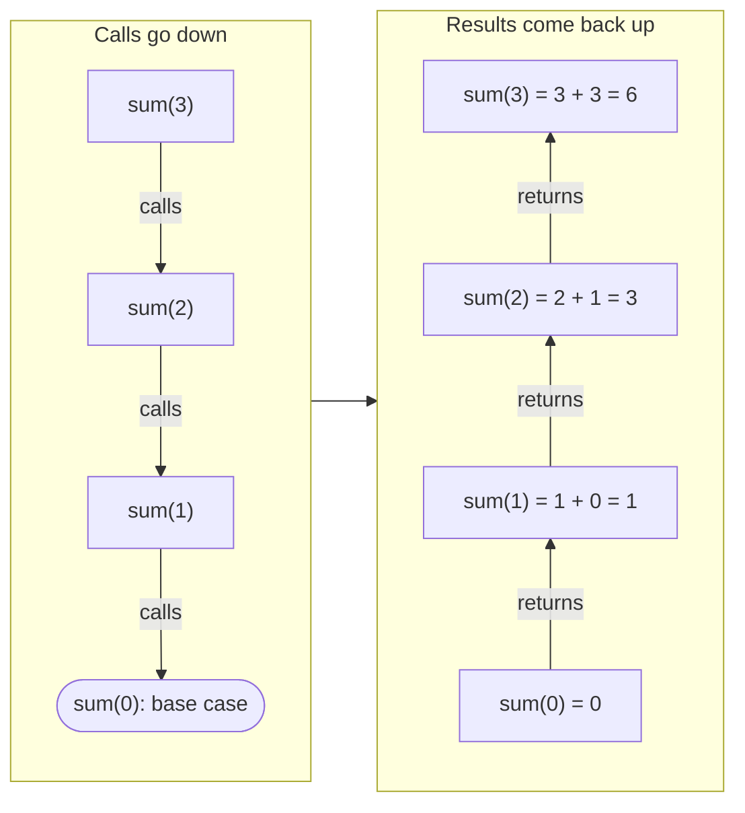
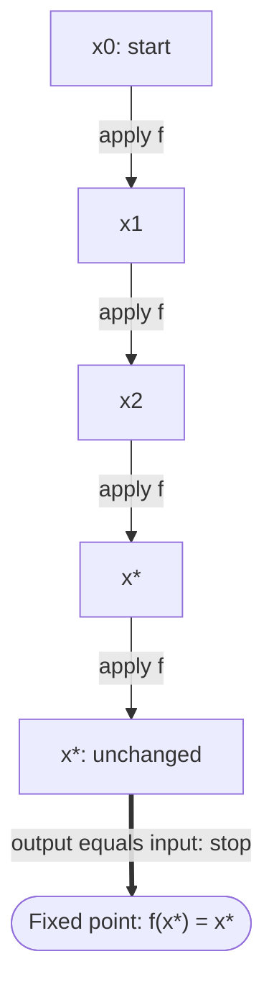
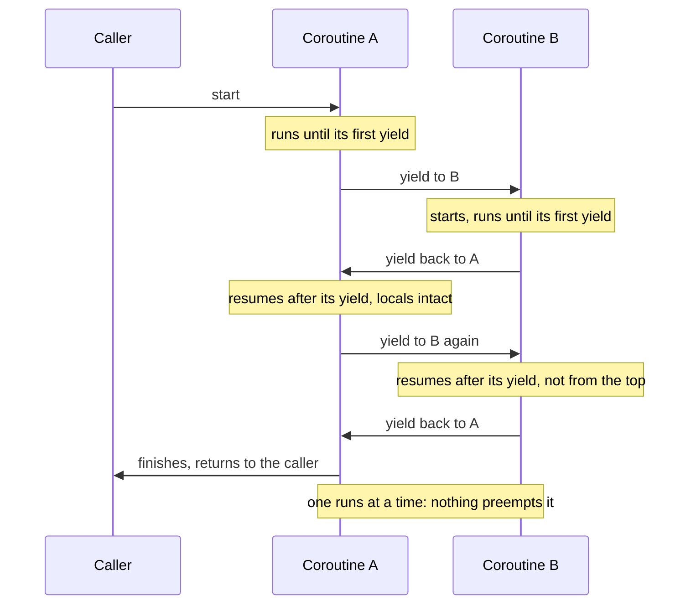

<!-- GENERATED by lessons/book/build.py from lessons/cs-source/ and the entries' frontmatter. Do not edit; edit the sources and run build.py. -->

# Control flow and continuations

For an advanced reading path with traces and experiments, see the [state and control beyond variables study guide](../study-guides/concepts/state-and-control-beyond-variables.md).

"What runs next?" is one of the two basic questions about any program. (The other is "what does it remember?", in the chapter "State beyond variables".) Most languages answer it with a program counter and a call stack, and most programmers never think about it again. The entries in this book keep control somewhere else, so you can see it clearly.

In COBOL it is the target of a `GO TO` that `ALTER` can change. In Forth it is the parse position `>in`, which the program can move backward. In GNU Make it is the set of files that exist, and the build restarts when a makefile is remade. In XAML it is the order of the elements in the document. Each of these is a *continuation* in disguise: the rest of the computation, stored as something other than a stack frame. This chapter gives you the vocabulary: structured programming, recursion, fixed points, coroutines, continuations and self-modifying code. It ends with an idea about *when* code runs: logical clocks, where time is a count of events. The tar entries use it. Events, callbacks and the event loop, where something else calls your code, have their own chapter later in this part.

## Control flow

Control flow is the order in which a program's steps run: one after another, a choice between branches, a repetition, a call and a return, or a jump. It exists as a separate idea because "what happens next?" is a different question from "what is the data?". Most languages weld control flow to two things: the *program counter* and the *call stack*. The entries in this repository pull it loose and keep it somewhere else. In COBOL it lives in the target of a `GO TO`. In Forth it lives in the text interpreter's parse position. In Make it lives in which files exist. Seeing it move is the best way to understand that it is a thing you can name.

- **Use it when:** you ask, about any program, "where does 'what runs next' live?"
- **Avoid it when:** the mechanism hides control flow from debugging tools. A debugger shows the call stack. It does not show a rewritten line of text.

**Read more:**

- [Control flow](https://en.wikipedia.org/wiki/Control_flow) (Wikipedia)
- [Control-flow graph](https://en.wikipedia.org/wiki/Control-flow_graph) (Wikipedia)

**In this repo:**

| Entry | Language | How it relates | What it teaches |
| --- | --- | --- | --- |
| [`apl-weird`](../../src/apl-weird/README.md) | APL | demonstrates | That `⎕CR`, `⎕FX` and compress make "if" and "loop" optional, and that a function can be its own successor. |
| [`awk`](../../src/awk/README.md) | AWK | demonstrates | That portable AWK can build records out of fields and stream its output through a pipe, with arrays and parameter-local variables for state. |
| [`awk-weird`](../../src/awk-weird/README.md) | AWK | demonstrates | That a regular expression as the record separator turns a stream of random bytes into dice, and that awk's implicit main loop plus one pattern is a whole program. |
| [`cmake`](../../src/cmake/README.md) | CMake | demonstrates | That `while()` and a regex can form a tiny register machine. |
| [`cobol`](../../src/cobol/README.md) | COBOL | demonstrates | That a stop rule can be declared as data, and that a number's picture can do your rounding. |
| [`cobol-weird`](../../src/cobol-weird/README.md) | COBOL | demonstrates | That a program can rewrite its own control flow and that structured programming makes such changes easier to trace. |
| [`find-gnu`](../../src/find-gnu/README.md) | find, SQLite | demonstrates | That the GNU extras to find (path depth, file times, regular expressions and a built-in profiler) can replace a whole table of branches, and that find's optimizer has nothing to reorder when every branch ends in a side effect. |
| [`find-posix`](../../src/find-posix/README.md) | find, SQLite | demonstrates | That a directory walk can be a loop and a program: find digs the tree it is walking, and the path to the current directory is the whole machine. |
| [`forth`](../../src/forth/README.md) | Forth | demonstrates | That a stack language needs one `begin ... until` and a pipe to be a whole program. |
| [`forth-weird`](../../src/forth-weird/README.md) | Forth | demonstrates | That the text interpreter's parse position is a program counter, if you let it be, and that the data stack can be a program's only memory. |
| [`GoChallenge1`](../../src/GoChallenge1/README.md) | Go | demonstrates | That one three-part `for` with an empty body can run the whole Go program. |
| [`haskell-weird`](../../src/haskell-weird/README.md) | Haskell | demonstrates | That reading a lazy list can drive a program when forcing each element has a side effect. |
| [`JavaChallenge1`](../../src/JavaChallenge1/README.md) | Java | demonstrates | That a Java `for (init; condition; update) { }` can preserve the shape of the original C# program. |
| [`javascript`](../../src/javascript/README.md) | JavaScript, SQLite | demonstrates | That a for statement is three expressions and an empty body, and that JavaScript's own evaluation order, truthiness and comma operator are enough to run a whole program from the three clauses. |
| [`javascript-events`](../../src/javascript-events/README.md) | JavaScript, SQLite | demonstrates | That a program can be a set of listeners, each doing one small thing and then emitting the event the next one waits for; and that emit() calls its listeners at once, so only an explicit scheduling boundary gives the event loop a turn. |
| [`LinqChallenge1`](../../src/LinqChallenge1/README.md) | C#, LINQ | demonstrates | That a chain of LINQ methods can express the entire program. |
| [`lisp`](../../src/lisp/README.md) | Common Lisp | demonstrates | That Common Lisp `LOOP` can express a whole algorithm as clauses for counting, drawing, summing, collecting and stopping. |
| [`lisp-weird`](../../src/lisp-weird/README.md) | Common Lisp | demonstrates | That CLOS method combination is a control-flow construct: a class hierarchy is a loop, and `or` is a stop rule. |
| [`make-gnu`](../../src/make-gnu/README.md) | GNU Make | demonstrates | That GNU Make can do arithmetic and loop in its own syntax, without a shell for either. |
| [`ModernChallenge1`](../../src/ModernChallenge1/README.md) | C# | demonstrates | That a `for` statement with no body can drive runtime XAML, LINQ to Objects, EF Core and WPF animation. |
| [`tcl-weird`](../../src/tcl-weird/README.md) | Tcl, SQLite | demonstrates | That Tcl code is just strings, so it can live in a database and be fetched, defined and run on demand, with SQLite triggers as the control flow. |

## Goto and structured programming

`GOTO` jumps to any other place in the program. In 1966 Böhm and Jacopini proved that you never *need* it: sequence, choice and loops are enough for any computation. In 1968 Edsger Dijkstra wrote the famous letter "Go To Statement Considered Harmful". Structured programming won because you can reason about a block with one way in and one way out. COBOL's `ALTER` goes the opposite way: it changes where a `GO TO` points *while the program runs*. [`cobol-weird`](../../src/cobol-weird/README.md) uses it as its loop. The statement was later removed from the COBOL standard. GnuCOBOL still runs it.

- **Use `goto` when:** in a few honest cases, such as one clean exit for error handling in C, or in generated code and state machines.
- **Avoid it when:** a target computed or changed at run time would make the code hard to read.

**Read more:**

- [Goto](https://en.wikipedia.org/wiki/Goto) (Wikipedia)
- [Structured program theorem](https://en.wikipedia.org/wiki/Structured_program_theorem) (Wikipedia)
- [Considered harmful](https://en.wikipedia.org/wiki/Considered_harmful) (Wikipedia)

**In this repo:**

| Entry | Language | How it relates | What it teaches |
| --- | --- | --- | --- |
| [`cobol-weird`](../../src/cobol-weird/README.md) | COBOL | demonstrates | That a program can rewrite its own control flow and that structured programming makes such changes easier to trace. |

## The program counter

The program counter is a register that holds the address of the next instruction. After each step it moves forward by one, unless a jump sets it somewhere else. It exists because a machine needs to know "where am I?". Every interpreter has one, even if it has a different name. In [`forth-weird`](../../src/forth-weird/README.md) the role is played by `>in`, the position of the text interpreter in the current line. The program *moves `>in` backward* to repeat itself. In [`cobol-weird`](../../src/cobol-weird/README.md) it is the destination of one `GO TO`.

- **Use this idea when:** you debug, or write an interpreter, a debugger or a virtual machine. These are the cases where reaching for the "where am I" value is legitimate.
- **Avoid it when:** ordinary application code would need direct access to it.

**Read more:**

- [Program counter](https://en.wikipedia.org/wiki/Program_counter) (Wikipedia)
- [Interpreter (computing)](https://en.wikipedia.org/wiki/Interpreter_(computing)) (Wikipedia)

**In this repo:**

| Entry | Language | How it relates | What it teaches |
| --- | --- | --- | --- |
| [`cobol-weird`](../../src/cobol-weird/README.md) | COBOL | demonstrates | That a program can rewrite its own control flow and that structured programming makes such changes easier to trace. |
| [`ex-weird`](../../src/ex-weird/README.md) | Ex, SQLite | demonstrates | That an editor's registers can hold a program: a line of text is copied into a register and run with @, and the editor's own marks and line addresses do the arithmetic. |
| [`forth-weird`](../../src/forth-weird/README.md) | Forth | demonstrates | That the text interpreter's parse position is a program counter, if you let it be, and that the data stack can be a program's only memory. |

## Recursion

A recursive definition uses itself. A function calls itself on a smaller problem until the problem is so small that the answer is obvious. It exists because many things are naturally nested: trees, folders, grammars, arithmetic expressions. Loops and recursion are equally powerful, and functional languages use recursion instead of loops. Several entries here recurse in disguise. In [`m4`](../../src/m4/README.md) a macro whose replacement text contains itself is read again, which makes a loop. In [`tcl-weird`](../../src/tcl-weird/README.md) a database trigger inserts a row, which fires the same trigger again. The stop rule is a query that finds nothing.

On the way down, each call hands a smaller problem to the next call. The base case, `sum(0)`, is the only call that answers without calling again. Without it the calls never stop. On the way up, each call finishes the work it was waiting to do. [The call stack](06-state-beyond-variables.md#the-call-stack) shows where those waiting calls are kept.

- **Use it when:** the data is nested, or the problem splits into smaller copies of itself.
- **Avoid it when:** the depth is unbounded and the language does not remove tail calls. The stack can run out. Always know the stop rule, and know what happens if it never fires.

**Read more:**

- [Recursion (computer science)](https://en.wikipedia.org/wiki/Recursion_(computer_science)) (Wikipedia)
- [Tail call](https://en.wikipedia.org/wiki/Tail_call) (Wikipedia)
- [Recursion](https://developer.mozilla.org/en-US/docs/Glossary/Recursion) (MDN glossary)

**In this repo:**

| Entry | Language | How it relates | What it teaches |
| --- | --- | --- | --- |
| [`find-gnu`](../../src/find-gnu/README.md) | find, SQLite | demonstrates | That the GNU extras to find (path depth, file times, regular expressions and a built-in profiler) can replace a whole table of branches, and that find's optimizer has nothing to reorder when every branch ends in a side effect. |
| [`find-posix`](../../src/find-posix/README.md) | find, SQLite | demonstrates | That a directory walk can be a loop and a program: find digs the tree it is walking, and the path to the current directory is the whole machine. |
| [`m4`](../../src/m4/README.md) | m4 | demonstrates | That a macro processor is a programming language: no loop statement and no variable, just text that gets scanned again. |
| [`tcl-weird`](../../src/tcl-weird/README.md) | Tcl, SQLite | demonstrates | That Tcl code is just strings, so it can live in a database and be fetched, defined and run on demand, with SQLite triggers as the control flow. |

## Fixed-point iteration

A *fixed point* of a function is a value that the function leaves unchanged: f(x) = x. Fixed-point iteration finds one by applying the function again and again until nothing changes. It exists because many problems are really "keep going until it settles": balance an equation, compute a closure, or simplify an expression. This repository is full of it. [`regex-sed`](../../src/regex-sed/README.md) applies substitutions until none matches. [`make-gnu`](../../src/make-gnu/README.md) remakes its own makefile until the makefile is up to date. A compiler's optimizer does the same, passing over the code until no more improvements appear.

Every pass applies the same function `f`. The run stops when a pass returns its own input, so that `f(x*) = x*`. The value `x` does not have to be a number. It can be a line of text (as in [`regex-sed`](../../src/regex-sed/README.md)), a makefile or a piece of code. A real program also needs a limit, in case the values never settle.

- **Use it when:** each step is a clear improvement and "no change" is a clear signal to stop.
- **Avoid it when:** the process might never settle. It can bounce between two states forever. Always add a limit, or a timeout. The sandbox gives every `check.sh` a time limit.

**Read more:**

- [Fixed-point iteration](https://en.wikipedia.org/wiki/Fixed-point_iteration) (Wikipedia)
- [Fixed point (mathematics)](https://en.wikipedia.org/wiki/Fixed_point_(mathematics)) (Wikipedia)

**In this repo:**

| Entry | Language | How it relates | What it teaches |
| --- | --- | --- | --- |
| [`m4`](../../src/m4/README.md) | m4 | demonstrates | That a macro processor is a programming language: no loop statement and no variable, just text that gets scanned again. |
| [`make-gnu`](../../src/make-gnu/README.md) | GNU Make | demonstrates | That GNU Make can do arithmetic and loop in its own syntax, without a shell for either. |
| [`regex-sed`](../../src/regex-sed/README.md) | GNU sed, Regular expressions | demonstrates | That a program can be one line of text that substitutions rewrite until none applies: a Markov algorithm, with a catastrophic-backtracking regex as its clock. |

## Coroutines

A coroutine is a function that can pause in the middle and resume later, with its local variables intact. Ordinary functions run from start to finish. A coroutine can hand a value to its caller, wait and carry on when asked. It exists for producers and consumers, for generators and for cooperative multitasking (`async`/`await` is built on the idea). Several entries are coroutines wearing a different hat. A Rust iterator made with `successors`, a Kotlin `generateSequence` and Python's `iter(step, False)` each produce the next value only when the loop asks for it.

Control moves only when a coroutine yields, so only one routine runs at a time. That is the difference from threads: nothing preempts a coroutine, and nothing runs in parallel. A coroutine that resumes continues after its last `yield`, with its local variables as it left them. An ordinary call would start again from the top.

- **Use it when:** you process a stream, or you want two pieces of code to take turns without threads.
- **Avoid it when:** you need real parallelism, or when the many pause points make the program hard to follow.

**Read more:**

- [Coroutine](https://en.wikipedia.org/wiki/Coroutine) (Wikipedia)
- [Iterators and generators](04-evaluation-and-demand.md#iterators-and-generators) in "Evaluation and demand"

**In this repo:**

| Entry | Language | How it relates | What it teaches |
| --- | --- | --- | --- |
| [`javascript-events`](../../src/javascript-events/README.md) | JavaScript, SQLite | counterexample | That a program can be a set of listeners, each doing one small thing and then emitting the event the next one waits for; and that emit() calls its listeners at once, so only an explicit scheduling boundary gives the event loop a turn. |
| [`javascript-weird`](../../src/javascript-weird/README.md) | JavaScript, SQLite | analogy | That a closure is a state machine: a function plus the variables it was made next to, pulled one step at a time by an iterator, with reduce as the one fold that cannot stop. |
| [`KotlinChallenge1`](../../src/KotlinChallenge1/README.md) | Kotlin | analogy | That Kotlin can use `generateSequence` as the loop, ending when the generator returns null. |
| [`PythonChallenge1`](../../src/PythonChallenge1/README.md) | Python | analogy | That Python can drive a whole program with `iter(step, False)`, which calls `step` until it returns `False`. |
| [`RustChallenge1`](../../src/RustChallenge1/README.md) | Rust | analogy | That iterators and closures can express the control flow of a whole Rust program. |

## Continuations

A continuation is "the rest of the computation" from some point, treated as a value. If you could pause a program and ask "what will you do next?", the answer is the continuation. In *continuation-passing style* every function takes an extra argument, a function that says what to do with the result. It exists because early exit, exceptions, generators, backtracking and `async`/`await` can all be written as ordinary function calls once "what next?" is a value. The entries here choose "what next?" on purpose. COBOL's `ALTER` rewrites it. Forth's `>in` rewinds it. Make's restart is "the rest of the build, again".

```mermaid
flowchart TB
    accTitle: A continuation names the remaining computation; a normal call merely returns to its caller
    accDescr: Two parallel panels. In an ordinary call, the caller does A, calls B, B finishes, and control returns to the caller, which does C. The caller's stack keeps the return point. With an explicit continuation, the program does A, captures K, the value that stands for what to do next, runs something else, later invokes K, and then does C. K is drawn as a separate box because it is a value that stands for pending control.
    subgraph CONT["Explicit continuation"]
        A2["Do A"] --> CAP[("capture K: what to do next")] --> OTH["run something else"] --> RES["invoke K"] --> C2["Do C"]
    end
    subgraph CALL["Ordinary call and return"]
        A1["Caller: do A"] --> B1["call B: return point stays on the stack"] --> B2["B finishes"] --> C1["Caller: do C"]
    end
```

On the left the return point is hidden in the caller's stack, and the callee cannot name it. On the right it is a value, `K`, that can be stored, handed on and used later (or not at all). COBOL's mutable `GO TO` target, Forth's `>in` and Make's restart state are *analogies* for control that is held outside the call stack. None of them captures a first-class continuation, and an ordinary callback or closure is not one either.

- **Use it when:** you write a compiler, an async library or a web framework with callbacks.
- **Avoid it when:** you write by hand in a language without tail calls. The code becomes callbacks inside callbacks, and the stack grows.

**Read more:**

- [Continuation](https://en.wikipedia.org/wiki/Continuation) (Wikipedia)
- [Continuation-passing style](https://en.wikipedia.org/wiki/Continuation-passing_style) (Wikipedia)
- [Call-with-current-continuation](https://en.wikipedia.org/wiki/Call-with-current-continuation) (Wikipedia)

**In this repo:**

| Entry | Language | How it relates | What it teaches |
| --- | --- | --- | --- |
| [`cobol-weird`](../../src/cobol-weird/README.md) | COBOL | analogy | That a program can rewrite its own control flow and that structured programming makes such changes easier to trace. |
| [`forth-weird`](../../src/forth-weird/README.md) | Forth | analogy | That the text interpreter's parse position is a program counter, if you let it be, and that the data stack can be a program's only memory. |
| [`javascript-weird`](../../src/javascript-weird/README.md) | JavaScript, SQLite | counterexample | That a closure is a state machine: a function plus the variables it was made next to, pulled one step at a time by an iterator, with reduce as the one fold that cannot stop. |
| [`make-gnu`](../../src/make-gnu/README.md) | GNU Make | analogy | That GNU Make can do arithmetic and loop in its own syntax, without a shell for either. |
| [`tar-gnu`](../../src/tar-gnu/README.md) | GNU tar, SQLite | counterexample | That a tar archive can be a serialized program: tar reads the members in order, and only the command that the operator attaches gives them an effect. |

## Self-modifying code

Self-modifying code changes its own instructions while it runs. Early computers did it to save scarce memory. Today the idea lives on in just-in-time compilers, in program loaders and in malware that hides itself. In this repository it is a way to move control flow into the program text. [`apl-weird`](../../src/apl-weird/README.md) reads a function's source with `⎕CR`, rewrites it and defines the new version with `⎕FX`. [`cobol-weird`](../../src/cobol-weird/README.md) changes a `GO TO` with `ALTER`. [`tcl-weird`](../../src/tcl-weird/README.md) keeps procedure source in a database table and defines it on demand.

- **Use it when:** you generate code at a clear boundary: write text, compile it, run it. That is what JIT compilers and code generators do.
- **Avoid it in hand-written programs.** Debuggers, caches and security tools (some systems forbid memory that is both writable and executable) all assume that code does not change.

**Read more:**

- [Self-modifying code](https://en.wikipedia.org/wiki/Self-modifying_code) (Wikipedia)
- [Just-in-time compilation](https://en.wikipedia.org/wiki/Just-in-time_compilation) (Wikipedia)

**In this repo:**

| Entry | Language | How it relates | What it teaches |
| --- | --- | --- | --- |
| [`apl-weird`](../../src/apl-weird/README.md) | APL | demonstrates | That `⎕CR`, `⎕FX` and compress make "if" and "loop" optional, and that a function can be its own successor. |
| [`cobol-weird`](../../src/cobol-weird/README.md) | COBOL | demonstrates | That a program can rewrite its own control flow and that structured programming makes such changes easier to trace. |
| [`ex-weird`](../../src/ex-weird/README.md) | Ex, SQLite | demonstrates | That an editor's registers can hold a program: a line of text is copied into a register and run with @, and the editor's own marks and line addresses do the arithmetic. |

## Logical clocks and event ordering

A **logical clock** counts *events*, not seconds. It answers "what happened before what?" and "how many steps have passed?" without asking how long anything took. Distributed systems use logical clocks because real clocks on different machines disagree. A program can also use one on a single machine, to make its behavior independent of speed.

In [`tar-gnu-weird`](../../src/tar-gnu-weird/README.md) one tar checkpoint is one hour of work. The clock is the number of records tar has written, and `check.sh` predicts the result of a run from the archive's layout alone. A faster or a slower machine makes no difference. A longer archive gives more ticks, a shorter one stalls the program, and a different checkpoint interval changes the count in a way the check calculates in advance. One detail is easy to miss: `TAR_CHECKPOINT` counts *records* (with `--checkpoint=2` it reads 2, 4, 6), while the machine counts *calls*. They are two clocks, and the entry says which one it uses. [`make-gnu`](../../src/make-gnu/README.md) has a counter of a similar kind: `MAKE_RESTARTS` counts rounds of the build, not time.

- **Use it when:** you need to order events, to make a run repeatable or to test timing without waiting.
- **Avoid it when:** the real duration is the thing you need. A logical clock cannot tell you how long anything took.

**Read more:**

- [Logical clock](https://en.wikipedia.org/wiki/Logical_clock) (Wikipedia)
- [Lamport timestamp](https://en.wikipedia.org/wiki/Lamport_timestamp) (Wikipedia)

**In this repo:**

| Entry | Language | How it relates | What it teaches |
| --- | --- | --- | --- |
| [`make-gnu`](../../src/make-gnu/README.md) | GNU Make | analogy | That GNU Make can do arithmetic and loop in its own syntax, without a shell for either. |
| [`tar-gnu-weird`](../../src/tar-gnu-weird/README.md) | GNU tar, SQLite | demonstrates | That an archive's physical layout can set the pace of a program: tar's checkpoints are a clock, and each tick moves a state machine by one step. |
