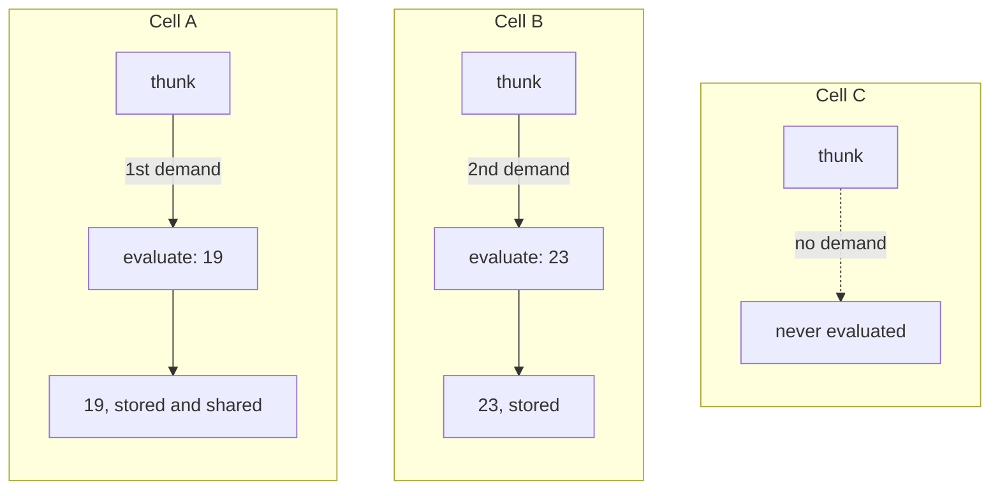
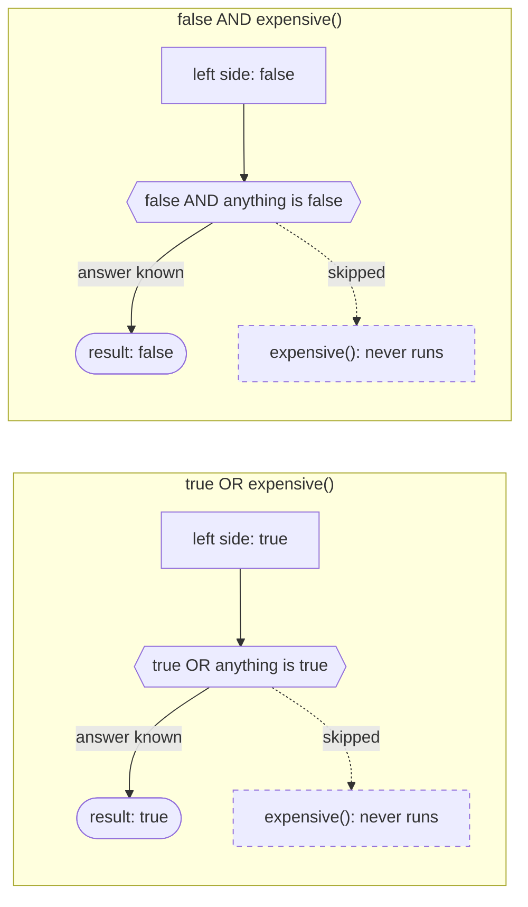
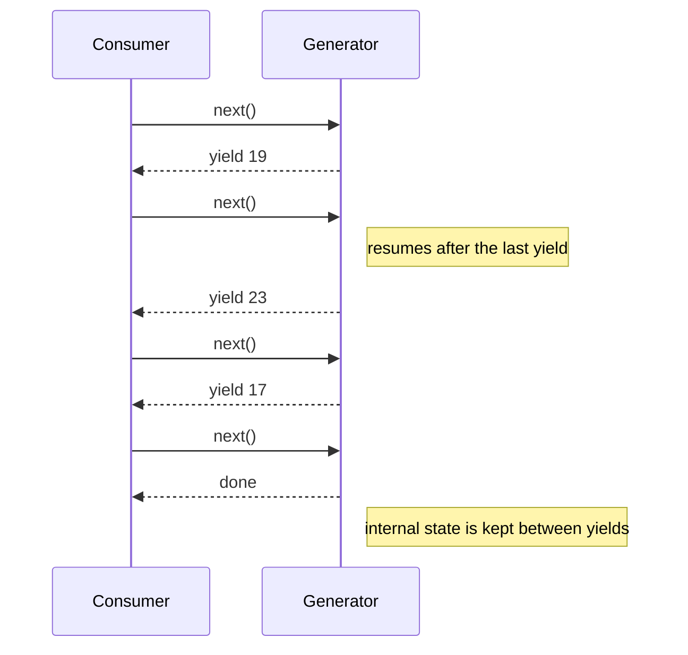
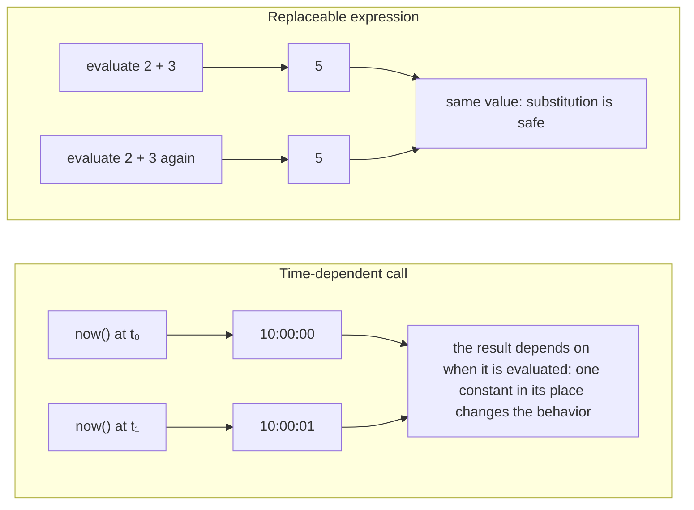
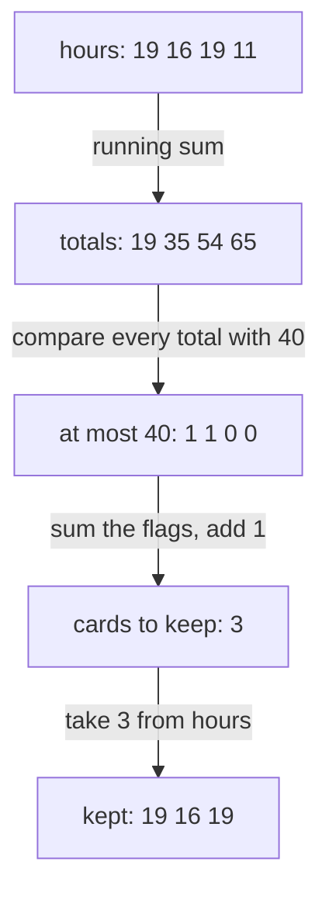
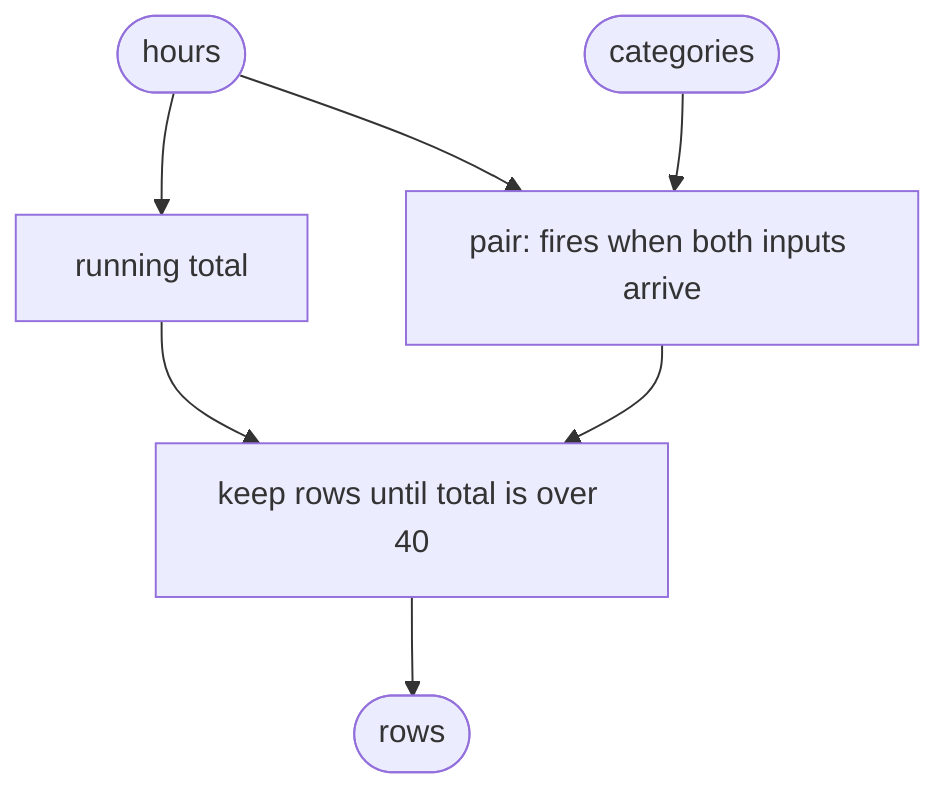

<!-- GENERATED by lessons/book/build.py from lessons/cs-source/ and the entries' frontmatter. Do not edit; edit the sources and run build.py. -->

# Evaluation and demand

For an advanced reading path with traces and experiments, see the [evaluation, demand and laziness study guide](../study-guides/concepts/evaluation-demand-and-laziness.md).

Is a value computed when you write it, when you first need it, or each time you ask? That is the question of **evaluation strategy**, and the same-looking code answers it differently in different languages.

Haskell is lazy: one `span` over an infinite list is the stop rule, because only the needed part is ever computed. LINQ is deferred: a pipeline does nothing until someone enumerates it. APL is eager and works on whole arrays at once, so it draws more numbers than it needs and trims the result. When effects are involved, the choice stops being a detail. If a lazy list performs input and output, then *reading the list* is what does the work. This chapter explains the vocabulary: strategies and short circuits, iterators and generators, first-class and higher-order functions, functors and `map`, monoids and folds (and why `reduce` cannot stop early), and dataflow. The table at the end shows every entry's strategy in one place.

```mermaid
flowchart TB
    accTitle: The same requested prefix can entail different work
    accDescr: Three lanes show a consumer that asks for only the first two elements of a sequence of five. In the eager lane, all five values 1 to 5 are computed first, the consumer takes 1 and 2, and 3 to 5 were computed but unused. In the lazy by-need lane, thunks are built, 1 is demanded, evaluated and cached, 2 is demanded, evaluated and cached, and 3 to 5 are never evaluated. In the deferred pipeline lane, the pipeline is defined and no work happens, then enumerating computes and yields 1 and 2, and enumerating again may repeat the work because deferred is not automatically memoized.
    subgraph DEFER["Deferred, like LINQ"]
        D1["define: no work yet"] --> D2["enumerate: 1, 2"] --> D3["enumerate again: may redo"]
    end
    subgraph LAZY["Lazy, by need"]
        L1["build thunks"] --> L2["demand 1: cache"] --> L3["demand 2: cache"] --> L4["3 to 5: never run"]
    end
    subgraph EAGER["Eager, like an array"]
        E1["construct"] --> E2["compute 1 to 5"] --> E3["consumer takes 1, 2"] --> E4["3 to 5: unused"]
    end
    classDef unused stroke-dasharray: 5 3
    class E4,L4,D3 unused
```

The values 1 to 5 are only a sample. Haskell's call-by-need *remembers* an evaluated value, while a deferred enumerable pipeline usually recomputes it each time you enumerate. APL often evaluates a whole array, so it is closest to the eager lane. The picture compares strategies, and it is not an exact trace of any one entry.

| Entry | Name | Evaluation |
| --- | --- | --- |
| [`apl`](../../src/apl/README.md) | APL | eager |
| [`apl-weird`](../../src/apl-weird/README.md) | APL | eager |
| [`awk`](../../src/awk/README.md) | AWK | eager |
| [`awk-weird`](../../src/awk-weird/README.md) | AWK | eager |
| [`cmake`](../../src/cmake/README.md) | CMake | eager |
| [`cobol`](../../src/cobol/README.md) | COBOL | eager |
| [`cobol-weird`](../../src/cobol-weird/README.md) | COBOL | eager |
| [`lisp`](../../src/lisp/README.md) | Common Lisp | eager |
| [`lisp-weird`](../../src/lisp-weird/README.md) | Common Lisp | eager |
| [`ex-weird`](../../src/ex-weird/README.md) | Ex | eager |
| [`forth`](../../src/forth/README.md) | Forth | eager |
| [`forth-weird`](../../src/forth-weird/README.md) | Forth | eager |
| [`tar-gnu`](../../src/tar-gnu/README.md) | GNU tar | eager |
| [`tar-gnu-weird`](../../src/tar-gnu-weird/README.md) | GNU tar | eager |
| [`GoChallenge1`](../../src/GoChallenge1/README.md) | Go | eager |
| [`JavaChallenge1`](../../src/JavaChallenge1/README.md) | Java | eager |
| [`javascript`](../../src/javascript/README.md) | JavaScript | eager |
| [`javascript-events`](../../src/javascript-events/README.md) | JavaScript | eager |
| [`tcl`](../../src/tcl/README.md) | Tcl | eager |
| [`tcl-weird`](../../src/tcl-weird/README.md) | Tcl | eager |
| [`haskell`](../../src/haskell/README.md) | Haskell | lazy |
| [`haskell-weird`](../../src/haskell-weird/README.md) | Haskell | lazy |
| [`javascript-weird`](../../src/javascript-weird/README.md) | JavaScript | lazy |
| [`KotlinChallenge1`](../../src/KotlinChallenge1/README.md) | Kotlin | lazy |
| [`PythonChallenge1`](../../src/PythonChallenge1/README.md) | Python | lazy |
| [`RustChallenge1`](../../src/RustChallenge1/README.md) | Rust | lazy |
| [`ModernChallenge1`](../../src/ModernChallenge1/README.md) | C# `for` | deferred |
| [`LinqChallenge1`](../../src/LinqChallenge1/README.md) | LINQ | deferred |
| [`LinqChallenge2`](../../src/LinqChallenge2/README.md) | LINQ | deferred |
| [`ed-weird`](../../src/ed-weird/README.md) | ed | rewriting |
| [`regex-sed`](../../src/regex-sed/README.md) | GNU sed | rewriting |
| [`m4`](../../src/m4/README.md) | m4 | rewriting |
| [`regex-dotnet`](../../src/regex-dotnet/README.md) | .NET regex | search |
| [`regex-pcre2`](../../src/regex-pcre2/README.md) | PCRE2 | search |
| [`regex-pcre2grep`](../../src/regex-pcre2grep/README.md) | pcre2grep | search |
| [`regex-perl`](../../src/regex-perl/README.md) | Perl | search |
| [`find-gnu`](../../src/find-gnu/README.md) | GNU find | declarative |
| [`make-gnu`](../../src/make-gnu/README.md) | GNU Make | declarative |
| [`find-posix`](../../src/find-posix/README.md) | POSIX find | declarative |
| [`xaml`](../../src/xaml/README.md) | XAML | declarative |

## Evaluation strategies

An evaluation strategy answers one question: *when* is an argument computed? Before the call (call by value, also called eager)? When it is first needed, and then remembered (call by need, also called lazy)? Every time it is used (call by name)? It exists because the answer changes what a program means as soon as there are effects or infinite data. `f(g(x))` looks the same in every language. It does not behave the same. This whole chapter is about that gap: [`haskell`](../../src/haskell/README.md) is lazy, [`apl`](../../src/apl/README.md) is eager, and LINQ is *deferred*.

- **Use it when:** you read any unfamiliar language. Find its default strategy first.
- **Avoid assuming** that your habits from one language apply in another.

**Read more:**

- [Evaluation strategy](https://en.wikipedia.org/wiki/Evaluation_strategy) (Wikipedia)
- [Call-by-need](https://en.wikipedia.org/wiki/Call-by-need) (Wikipedia)
- [Call-by-name](https://en.wikipedia.org/wiki/Call-by-name) (Wikipedia)

**In this repo:**

| Entry | Language | How it relates | What it teaches |
| --- | --- | --- | --- |
| [`haskell`](../../src/haskell/README.md) | Haskell | demonstrates | That a lazy list and one `span` are the whole stop rule. |
| [`haskell-weird`](../../src/haskell-weird/README.md) | Haskell | demonstrates | Lazy IO as control flow: a list whose elements have side effects, so reading the list is what does the work. |
| [`PythonChallenge1`](../../src/PythonChallenge1/README.md) | Python | demonstrates | A one-statement port in Python: `iter(step, False)` calls a function again and again until it returns `False`. |

## Eager evaluation

Eager evaluation computes a value as soon as the code asks for it. It is the default in most languages. It exists because it is simple: cost and order are easy to predict, and effects happen exactly where you wrote them. [`apl`](../../src/apl/README.md) is eager in a strong sense: each primitive works on a whole array at once. The entry draws five numbers, a bound that can never be too small, although it often needs fewer. "Draw more than enough, then trim" replaces a loop that decides when to stop.

- **Use it when:** you need a predictable order of effects, or when the result will certainly be used.
- **Avoid it when:** the work might be wasted, or the source is huge or infinite.

**Read more:**

- [Eager evaluation](https://en.wikipedia.org/wiki/Eager_evaluation) (Wikipedia)
- [Lazy evaluation](04-evaluation-and-demand.md#lazy-evaluation), the opposite idea

**In this repo:**

| Entry | Language | How it relates | What it teaches |
| --- | --- | --- | --- |
| [`apl`](../../src/apl/README.md) | APL | demonstrates | That five rolls and a take-while can replace a loop. |
| [`apl-weird`](../../src/apl-weird/README.md) | APL | demonstrates | That `⎕CR`, `⎕FX` and compress make "if" and "loop" optional, and that a function can be its own successor. |
| [`javascript`](../../src/javascript/README.md) | JavaScript, SQLite | demonstrates | That a for statement is three expressions and an empty body, and that JavaScript's own evaluation order, truthiness and comma operator are enough to run a whole program from the three clauses. |
| [`javascript-weird`](../../src/javascript-weird/README.md) | JavaScript, SQLite | demonstrates | That a closure is a state machine: a function plus the variables it was made next to, pulled one step at a time by an iterator, with reduce as the one fold that cannot stop. |

## Lazy evaluation

Lazy evaluation delays a computation until its result is needed, and then remembers the answer. The waiting computation is called a *thunk*. It exists so that you can describe the *whole* answer and then take only what you want. In [`haskell`](../../src/haskell/README.md) one `span` over an infinite lazy list is the entire stop rule. The price is that "when does this run?" becomes hard to answer. In [`haskell-weird`](../../src/haskell-weird/README.md) the list elements perform input and output, so *reading the list* is what does the work. Reading too early or too late changes the result.

A thunk is a promise to compute a value. Demanding a cell runs its thunk once and stores the value, so a second demand for `A` costs nothing. Cell `C` is never demanded, so its work never happens. Storing the value is part of lazy evaluation in the strict sense. A pipeline that only delays work, such as a generator, may compute the same value again on each pass. See [Iterators and generators](04-evaluation-and-demand.md#iterators-and-generators).

- **Use it when:** the code is pure (no effects), you want infinite sequences, or some results may not be needed.
- **Avoid it when:** effects are involved, or when memory matters. A pile of unevaluated thunks can use a lot of it (a *space leak*).

**Read more:**

- [Lazy evaluation](https://en.wikipedia.org/wiki/Lazy_evaluation) (Wikipedia)
- [Thunk](https://en.wikipedia.org/wiki/Thunk) (Wikipedia)
- [Graph reduction](https://en.wikipedia.org/wiki/Graph_reduction) (Wikipedia)

**In this repo:**

| Entry | Language | How it relates | What it teaches |
| --- | --- | --- | --- |
| [`haskell`](../../src/haskell/README.md) | Haskell | demonstrates | That a lazy list and one `span` are the whole stop rule. |
| [`haskell-weird`](../../src/haskell-weird/README.md) | Haskell | demonstrates | Lazy IO as control flow: a list whose elements have side effects, so reading the list is what does the work. |
| [`javascript-weird`](../../src/javascript-weird/README.md) | JavaScript, SQLite | demonstrates | That a closure is a state machine: a function plus the variables it was made next to, pulled one step at a time by an iterator, with reduce as the one fold that cannot stop. |
| [`KotlinChallenge1`](../../src/KotlinChallenge1/README.md) | Kotlin | demonstrates | A one-statement port in Kotlin: `generateSequence` is the loop, and it ends when the generator returns null. |
| [`LinqChallenge1`](../../src/LinqChallenge1/README.md) | C#, LINQ | demonstrates | LINQ method chains, end to end. |
| [`LinqChallenge2`](../../src/LinqChallenge2/README.md) | C#, LINQ | demonstrates | C# query syntax, pushed as far as it goes. |
| [`m4`](../../src/m4/README.md) | m4 | demonstrates | That a macro processor is a programming language: no loop statement and no variable, just text that gets scanned again. |
| [`RustChallenge1`](../../src/RustChallenge1/README.md) | Rust | demonstrates | Iterators and closures as control flow. |

## Short-circuit evaluation

Short-circuit evaluation means that `and` and `or` stop as soon as the answer is known. In `a && b`, if `a` is false, `b` never runs. It exists for speed, and for a very useful habit: guard first, then act (`x != null && x.length > 0`). The same idea can be a loop. In [`lisp-weird`](../../src/lisp-weird/README.md) the `or` method combination calls methods one after another and stops at the first one that returns a true value. A class hierarchy becomes the loop, and `or` becomes the stop rule.

In both panels the left operand settles the answer, so the right operand is skipped. Anything it would have done, such as a slow query, a write or a printed line, does not happen. That is why `x != null && x.length > 0` is safe. It also means that an effect in the right operand is not a promise. See [Side effects](07-effects-errors-and-commitment.md#side-effects).

- **Use it when:** you guard a risky operation, or pick the first good answer.
- **Avoid it when:** the second operand has an effect you expect to always happen. It silently will not.

**Read more:**

- [Short-circuit evaluation](https://en.wikipedia.org/wiki/Short-circuit_evaluation) (Wikipedia)
- [Common Lisp Object System](https://en.wikipedia.org/wiki/Common_Lisp_Object_System) (Wikipedia)
- [Logical AND (`&&`)](https://developer.mozilla.org/en-US/docs/Web/JavaScript/Reference/Operators/Logical_AND) (MDN), which describes short-circuiting in plain words

**In this repo:**

| Entry | Language | How it relates | What it teaches |
| --- | --- | --- | --- |
| [`find-gnu`](../../src/find-gnu/README.md) | find, SQLite | demonstrates | That the GNU extras to find (path depth, file times, regular expressions and a built-in profiler) can replace a whole table of branches, and that find's optimizer has nothing to reorder when every branch ends in a side effect. |
| [`find-posix`](../../src/find-posix/README.md) | find, SQLite | demonstrates | That a directory walk can be a loop and a program: find digs the tree it is walking, and the path to the current directory is the whole machine. |
| [`javascript`](../../src/javascript/README.md) | JavaScript, SQLite | demonstrates | That a for statement is three expressions and an empty body, and that JavaScript's own evaluation order, truthiness and comma operator are enough to run a whole program from the three clauses. |
| [`javascript-weird`](../../src/javascript-weird/README.md) | JavaScript, SQLite | demonstrates | That a closure is a state machine: a function plus the variables it was made next to, pulled one step at a time by an iterator, with reduce as the one fold that cannot stop. |
| [`lisp-weird`](../../src/lisp-weird/README.md) | Common Lisp | demonstrates | That CLOS method combination is a control-flow construct: a class hierarchy is a loop, and `or` is a stop rule. |

## Deferred execution

Deferred execution means that you describe a query or a pipeline now, and it runs later, when someone asks for the results. In C#'s LINQ, `Where` and `Select` do no work by themselves. The work happens when a `foreach`, `ToList` or `Aggregate` reads the sequence. It exists so that pipelines can be composed cheaply, and so that a provider (such as Entity Framework) can translate the whole query into SQL. The surprises are real. The query runs *again* each time it is read, effects inside it happen late, and a variable captured by the query may have changed by then. [`LinqChallenge1`](../../src/LinqChallenge1/README.md) and [`LinqChallenge2`](../../src/LinqChallenge2/README.md) put effects inside the pipeline on purpose, and a final eager operator forces them.

- **Use it when:** you build queries and transformations that are free of effects.
- **Avoid it when:** a stage has side effects. Decide who forces the pipeline, and when.

**Read more:**

- [Language Integrated Query](https://en.wikipedia.org/wiki/Language_Integrated_Query) (Wikipedia)
- [Lazy evaluation](https://en.wikipedia.org/wiki/Lazy_evaluation) (Wikipedia)
- [Iterator](https://en.wikipedia.org/wiki/Iterator) (Wikipedia)

**In this repo:**

| Entry | Language | How it relates | What it teaches |
| --- | --- | --- | --- |
| [`javascript-events`](../../src/javascript-events/README.md) | JavaScript, SQLite | demonstrates | That a program can be a set of listeners, each doing one small thing and then emitting the event the next one waits for; and that emit() calls its listeners at once, so only an explicit scheduling boundary gives the event loop a turn. |
| [`javascript-weird`](../../src/javascript-weird/README.md) | JavaScript, SQLite | demonstrates | That a closure is a state machine: a function plus the variables it was made next to, pulled one step at a time by an iterator, with reduce as the one fold that cannot stop. |
| [`LinqChallenge1`](../../src/LinqChallenge1/README.md) | C#, LINQ | demonstrates | LINQ method chains, end to end. |
| [`LinqChallenge2`](../../src/LinqChallenge2/README.md) | C#, LINQ | demonstrates | C# query syntax, pushed as far as it goes. |
| [`ModernChallenge1`](../../src/ModernChallenge1/README.md) | C# | demonstrates | Runtime XAML, LINQ to Objects, EF Core, and WPF animation - all from inside a `for` statement that has no body. |

## Iterators and generators

An *iterator* is an object that answers "give me the next one". A *generator* is a function you write as ordinary straight-line code that hands out values one at a time with `yield`. Both exist so that you can handle a sequence that is too big to store, or has no end, and so that the code that produces values stays separate from the code that uses them. Four entries are built on the idea: Rust's `successors`, Kotlin's `generateSequence`, Python's `iter(step, False)` and Haskell's lazy lists. In each one, the loop "stops" because the consumer stops asking. JavaScript spells the idea out as the **iteration protocol**: an iterable has a `[Symbol.iterator]()` method that answers an object with a `next()` method, and `next()` answers `{ value, done }`. [`javascript-weird`](../../src/javascript-weird/README.md) writes one by hand around a closure, and a consumer such as `toArray()` or `take(1)` decides how many values ever exist. It also shows the one-shot trap: a second pass over the same iterator finds it already used up.

The consumer asks and the generator answers. This is *pull*: nothing runs until `next()` is called, and the generator does only enough work to reach its next `yield`. A push design, such as a callback, would draw the arrows the other way (see [Callbacks](10-events-callbacks-and-reactive-control-flow.md#callbacks)). The consumer can also stop early by not asking again.

- **Use it when:** you stream data, or describe an unlimited series and take a prefix.
- **Avoid:** iterators with hidden effects, and the surprise of a one-shot iterator that is already used up.

**Read more:**

- [Iterator](https://en.wikipedia.org/wiki/Iterator) (Wikipedia)
- [Generator (computer programming)](https://en.wikipedia.org/wiki/Generator_(computer_programming)) (Wikipedia)
- [Stream (computing)](https://en.wikipedia.org/wiki/Stream_(computing)) (Wikipedia)
- [Iterators and generators](https://developer.mozilla.org/en-US/docs/Web/JavaScript/Guide/Iterators_and_generators) (MDN), a clear tutorial on the idea

**In this repo:**

| Entry | Language | How it relates | What it teaches |
| --- | --- | --- | --- |
| [`haskell`](../../src/haskell/README.md) | Haskell | demonstrates | That a lazy list and one `span` are the whole stop rule. |
| [`javascript-weird`](../../src/javascript-weird/README.md) | JavaScript, SQLite | demonstrates | That a closure is a state machine: a function plus the variables it was made next to, pulled one step at a time by an iterator, with reduce as the one fold that cannot stop. |
| [`KotlinChallenge1`](../../src/KotlinChallenge1/README.md) | Kotlin | demonstrates | A one-statement port in Kotlin: `generateSequence` is the loop, and it ends when the generator returns null. |
| [`PythonChallenge1`](../../src/PythonChallenge1/README.md) | Python | demonstrates | A one-statement port in Python: `iter(step, False)` calls a function again and again until it returns `False`. |
| [`RustChallenge1`](../../src/RustChallenge1/README.md) | Rust | demonstrates | Iterators and closures as control flow. |

## Referential transparency

An expression is referentially transparent if you can replace it with its value and the program does not change. `2 + 3` is. `readLine()` is not, because it gives a different answer each time. It exists as the rule behind *pure* functions: they are easy to test, to cache, to run in parallel and to rearrange. Effects break it. That is the whole point of [`haskell-weird`](../../src/haskell-weird/README.md): it hides input and output inside a list, so a list that looks like plain data is not plain data. Where it is allowed to be violated, the code must say so loudly.

The left side can be replaced by `5` anywhere. The right side cannot: the call's value depends on *when* it runs, and the times shown are only illustrative. This is about referential transparency, which is the same as repeatability here, and not about [Idempotence](07-effects-errors-and-commitment.md#idempotence). A function that reads the clock changes nothing, so it is not "non-idempotent". It is just not repeatable. [Idempotence](07-effects-errors-and-commitment.md#idempotence) is about what an operation does to state.

- **Use it when:** as much as you can. Keep the pure core large and push effects to the edges.
- **Avoid pretending:** random numbers, clocks, files and networks are not transparent.

**Read more:**

- [Referential transparency](https://en.wikipedia.org/wiki/Referential_transparency) (Wikipedia)
- [Pure function](https://en.wikipedia.org/wiki/Pure_function) (Wikipedia)
- [Functional programming](https://en.wikipedia.org/wiki/Functional_programming) (Wikipedia)

**In this repo:**

| Entry | Language | How it relates | What it teaches |
| --- | --- | --- | --- |
| [`apl`](../../src/apl/README.md) | APL | demonstrates | That five rolls and a take-while can replace a loop. |
| [`haskell`](../../src/haskell/README.md) | Haskell | demonstrates | That a lazy list and one `span` are the whole stop rule. |
| [`haskell-weird`](../../src/haskell-weird/README.md) | Haskell | demonstrates | Lazy IO as control flow: a list whose elements have side effects, so reading the list is what does the work. |
| [`javascript-weird`](../../src/javascript-weird/README.md) | JavaScript, SQLite | demonstrates | That a closure is a state machine: a function plus the variables it was made next to, pulled one step at a time by an iterator, with reduce as the one fold that cannot stop. |

## Array programming

Array programming applies an operation to a whole array at once. Scalars stretch to match, and explicit loops mostly disappear. Kenneth Iverson invented APL for this in the 1960s, and the idea lives on in J, K, R, MATLAB and NumPy. It exists because it makes the code short and because hardware can do many elements at the same time (SIMD, GPUs). [`apl`](../../src/apl/README.md) shows the style: five random draws, a running sum `+\` and a take-while replace the loop. You describe the full answer, then trim it.

Read the picture from top to bottom. Each step is one operation on a whole array, and no step is a loop. The comparison gives a flag for every total at once. The number of flags that are 1, plus one, is the number of cards to keep, because the card that crosses 40 is kept too. [`apl`](../../src/apl/README.md) works this way. The numbers here are only an example, and the idea does not depend on APL's symbols.

- **Use it when:** you work with numbers, tables and signals.
- **Avoid it when:** the algorithm is inherently one step after another, or the intermediate arrays are too big for memory. Also remember that a dense notation is hard for a team that does not read it.

**Read more:**

- [Array programming](https://en.wikipedia.org/wiki/Array_programming) (Wikipedia)
- [APL (programming language)](https://en.wikipedia.org/wiki/APL_(programming_language)) (Wikipedia)
- [Kenneth E. Iverson](https://en.wikipedia.org/wiki/Kenneth_E._Iverson) (Wikipedia)
- [Single instruction, multiple data](https://en.wikipedia.org/wiki/Single_instruction,_multiple_data) (Wikipedia)

**In this repo:**

| Entry | Language | How it relates | What it teaches |
| --- | --- | --- | --- |
| [`apl`](../../src/apl/README.md) | APL | demonstrates | That five rolls and a take-while can replace a loop. |
| [`apl-weird`](../../src/apl-weird/README.md) | APL | demonstrates | That `⎕CR`, `⎕FX` and compress make "if" and "loop" optional, and that a function can be its own successor. |

## First-class and higher-order functions

A language has **first-class functions** when a function is a value: you can store it, pass it as an argument, return it from another function and keep it in a data structure. A **higher-order function** is a function that takes a function, returns one, or both. `map`, `filter` and `reduce` take functions. A function that builds a configured function, such as a counter factory, returns one.

It exists because it lets you separate *what to do to each item* from *how to walk the items*. The walk can then be lazy, eager, parallel or early-stopping, and the code that says what to do does not change. [`haskell`](../../src/haskell/README.md) describes the cards with `zipWith3` and `scanl1`. [`LinqChallenge1`](../../src/LinqChallenge1/README.md) chains `Select` and `Aggregate`. [`RustChallenge1`](../../src/RustChallenge1/README.md) steers a loop with iterators and closures. [`javascript-weird`](../../src/javascript-weird/README.md) is built the same way throughout: a pipeline of `map` calls that take closures, ended by `toArray`, and a `reduce` over the finished list.

The price is a different kind of reading. When the walk is hidden in a library call, you cannot see in what order the callbacks run, how many times, or whether the walk stops early. That matters when the callback has an effect. `reduce` cannot stop early, `some` can, and the lazy `map` of an iterator runs one value at a time while an array's `map` finishes each stage before the next one begins ([`javascript-weird`](../../src/javascript-weird/README.md) shows both orders).

- **Use it when:** the work on each item is separate from the walk, or you want to reuse one walk with many callbacks.
- **Avoid it when:** the callback has hidden effects and the order matters. Write the order down, or use a plain loop and say why.

**Read more:**

- [First-class function](https://en.wikipedia.org/wiki/First-class_function) (Wikipedia)
- [Higher-order function](https://en.wikipedia.org/wiki/Higher-order_function) (Wikipedia)
- [Functions](https://developer.mozilla.org/en-US/docs/Web/JavaScript/Guide/Functions) (MDN)

**In this repo:**

| Entry | Language | How it relates | What it teaches |
| --- | --- | --- | --- |
| [`haskell`](../../src/haskell/README.md) | Haskell | demonstrates | That a lazy list and one `span` are the whole stop rule. |
| [`javascript`](../../src/javascript/README.md) | JavaScript, SQLite | demonstrates | That a for statement is three expressions and an empty body, and that JavaScript's own evaluation order, truthiness and comma operator are enough to run a whole program from the three clauses. |
| [`javascript-weird`](../../src/javascript-weird/README.md) | JavaScript, SQLite | demonstrates | That a closure is a state machine: a function plus the variables it was made next to, pulled one step at a time by an iterator, with reduce as the one fold that cannot stop. |
| [`LinqChallenge1`](../../src/LinqChallenge1/README.md) | C#, LINQ | demonstrates | LINQ method chains, end to end. |
| [`RustChallenge1`](../../src/RustChallenge1/README.md) | Rust | demonstrates | Iterators and closures as control flow. |

## Functors and mapping

A **functor** is a container type with a `map` that applies a function to the values inside *without changing the container's shape*. To count as a functor, `map` must obey two laws:

- **Identity:** `map(id, xs) = xs`. Mapping a function that changes nothing changes nothing.
- **Composition:** `map(g ∘ f, xs) = map(g, map(f, xs))`. Mapping two functions in one pass equals mapping them one after the other.

Lists, `Maybe`, and functions themselves are functors in Haskell (`fmap`). JavaScript's `Array.prototype.map`, LINQ's `Select` and a Kotlin `Sequence.map` all *look* like this. Whether each one really obeys the laws depends on what the function does. If the function has a side effect, or reads a counter, the second law fails in practice: the effects happen in a different order. `[1,2,3].map(f).map(g)` runs `f` three times and then `g` three times. A lazy sequence interleaves them: `f(1), g(1), f(2), g(2), …`. With pure functions you cannot tell the difference. With effects you can. [`javascript-weird`](../../src/javascript-weird/README.md) saves a row inside a `map`, so the lazy order is the program, and its check script shows both orders.

Laziness differs too. Python's `map` and a LINQ `Select` are lazy and run nothing until asked. JavaScript's `Array.prototype.map` is eager and builds the whole result at once. Haskell's `fmap` on a list is lazy again. The type of `map` is the same in all of them. The *evaluation* is not.

- **Use it when:** you want to change every value in a structure and keep the structure, and you want a rule that says when two pipelines are interchangeable.
- **Avoid it when:** the function has effects. Use a loop or an effect-aware operation, and say so, so that the reader knows the order matters.

**Read more:**

- [Functor](https://en.wikipedia.org/wiki/Functor) (Wikipedia)
- [`Array.prototype.map()`](https://developer.mozilla.org/en-US/docs/Web/JavaScript/Reference/Global_Objects/Array/map) (MDN)

**In this repo:**

| Entry | Language | How it relates | What it teaches |
| --- | --- | --- | --- |
| [`javascript-weird`](../../src/javascript-weird/README.md) | JavaScript, SQLite | demonstrates | That a closure is a state machine: a function plus the variables it was made next to, pulled one step at a time by an iterator, with reduce as the one fold that cannot stop. |
| [`LinqChallenge1`](../../src/LinqChallenge1/README.md) | C#, LINQ | analogy | LINQ method chains, end to end. |

## Monoids and folds

A **monoid** is a type with an *associative* combining operation and an *identity* value. Integers with `+` and `0` are a monoid. So are strings with concatenation and `""`. A **fold** (also called `reduce` or `Aggregate`) collapses a list into one value by combining the items one at a time, starting from a seed.

When the operation is associative, the grouping does not matter: `(a + b) + c = a + (b + c)`. That lets a fold be split across threads, or restarted from a partial result. When there is an identity, the fold of an empty list has a sensible answer: the seed.

A **scan** (`scanl` in Haskell) is a fold that keeps every partial result: `scanl (+) 0 [10,12,15]` is `[0,10,22,37]`. A running total is a scan. [`haskell`](../../src/haskell/README.md) uses `scanl1` to get every running total of the card hours, then `span` to take the cards until one crosses 40. A fold gives only the last total, and cannot say where to stop. In JavaScript, `reduce` is a fold. It cannot stop early by itself, because it must walk the whole array (it has no `break`). Stopping needs `some`, `find`, a generator, or a different tool. [`javascript-weird`](../../src/javascript-weird/README.md) shows each of these.

An associative operation is not the same as a commutative one. `"ab" + "c"` is not `"c" + "ab"`. Folds over non-commutative monoids depend on order.

- **Use it when:** you accumulate a result, and you want to know whether it can be split, merged or restarted.
- **Avoid it when:** you need the first item that satisfies a test. A fold that cannot stop early does too much work, or too much of the wrong work.

**Read more:**

- [Monoid](https://en.wikipedia.org/wiki/Monoid) (Wikipedia)
- [Fold (higher-order function)](https://en.wikipedia.org/wiki/Fold_(higher-order_function)) (Wikipedia)
- [Prefix sum](https://en.wikipedia.org/wiki/Prefix_sum) (Wikipedia)
- [`Array.prototype.reduce()`](https://developer.mozilla.org/en-US/docs/Web/JavaScript/Reference/Global_Objects/Array/reduce) (MDN)

**In this repo:**

| Entry | Language | How it relates | What it teaches |
| --- | --- | --- | --- |
| [`haskell`](../../src/haskell/README.md) | Haskell | demonstrates | That a lazy list and one `span` are the whole stop rule. |
| [`javascript`](../../src/javascript/README.md) | JavaScript, SQLite | demonstrates | That a for statement is three expressions and an empty body, and that JavaScript's own evaluation order, truthiness and comma operator are enough to run a whole program from the three clauses. |
| [`javascript-weird`](../../src/javascript-weird/README.md) | JavaScript, SQLite | demonstrates | That a closure is a state machine: a function plus the variables it was made next to, pulled one step at a time by an iterator, with reduce as the one fold that cannot stop. |
| [`LinqChallenge1`](../../src/LinqChallenge1/README.md) | C#, LINQ | demonstrates | LINQ method chains, end to end. |
| [`lisp`](../../src/lisp/README.md) | Common Lisp | analogy | How `LOOP` can express a whole algorithm as a list of clauses: count, draw, sum, collect, stop. |

## Dataflow programming

In **dataflow programming** you describe how values flow from one step to the next, and the order of execution follows from the data: a step runs when its input is ready, or when its output is asked for. A spreadsheet is the familiar example. A LINQ query and an iterator pipeline are small ones. The program is a graph of steps, and the machine decides when each runs.

Each arrow is a data dependency: the node at the head needs a value from the node at the tail. The `pair` node has two inputs, so it cannot fire until both have arrived. The picture does not say which node a program calls first. The arrival of values decides. [Dependency graphs](06-state-beyond-variables.md#dependency-graphs) also draws arrows between things, but there the arrows say what to redo after a change.

It matters here because several entries move control out of statements and into such a graph. In [`LinqChallenge1`](../../src/LinqChallenge1/README.md) and [`LinqChallenge2`](../../src/LinqChallenge2/README.md) a query describes the cards, and the final operator asks for them. In [`javascript-weird`](../../src/javascript-weird/README.md) the pipeline `Iterator.from(...).map(...).map(...).toArray()` is a chain of steps, and each card flows through all of them before the next one is asked for. [`make-gnu`](../../src/make-gnu/README.md) has a related shape: a dependency graph decides what runs and in what order. That is *dependency*, which is not the same as the flow of data, so it is an analogy here.

- **Use it when:** the problem is a series of transformations, and you want the order to follow the dependencies.
- **Avoid it when:** the steps have effects whose order matters. A dataflow graph hides the order, and an effect that depends on it becomes a bug.

**Read more:**

- [Dataflow programming](https://en.wikipedia.org/wiki/Dataflow_programming) (Wikipedia)
- [Pipeline (software)](https://en.wikipedia.org/wiki/Pipeline_(software)) (Wikipedia)

**In this repo:**

| Entry | Language | How it relates | What it teaches |
| --- | --- | --- | --- |
| [`javascript-weird`](../../src/javascript-weird/README.md) | JavaScript, SQLite | demonstrates | That a closure is a state machine: a function plus the variables it was made next to, pulled one step at a time by an iterator, with reduce as the one fold that cannot stop. |
| [`LinqChallenge1`](../../src/LinqChallenge1/README.md) | C#, LINQ | demonstrates | LINQ method chains, end to end. |
| [`LinqChallenge2`](../../src/LinqChallenge2/README.md) | C#, LINQ | demonstrates | C# query syntax, pushed as far as it goes. |
| [`make-gnu`](../../src/make-gnu/README.md) | GNU Make | analogy | Arithmetic and looping in plain Make syntax, no shell required. |
