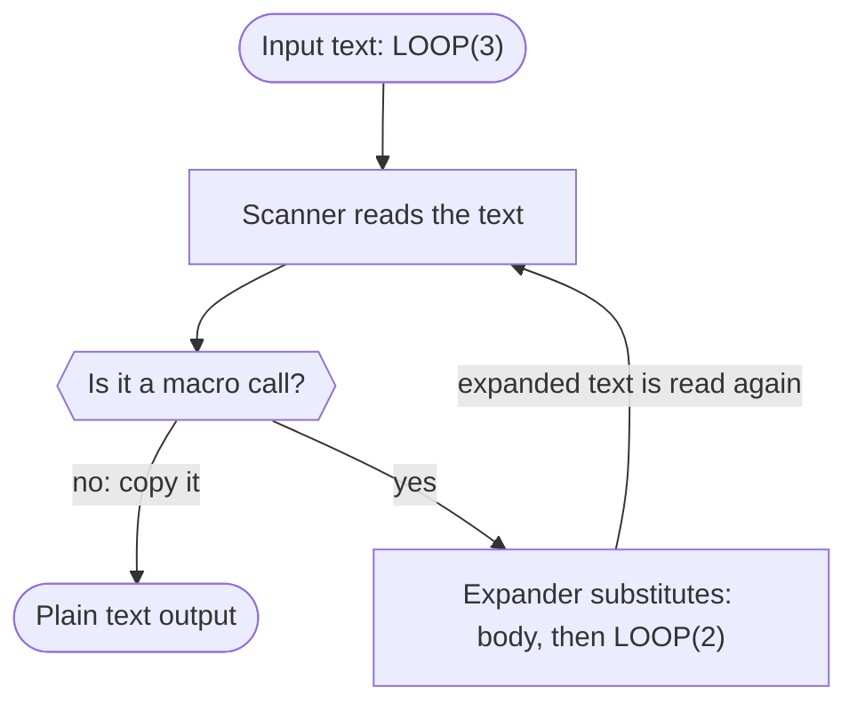
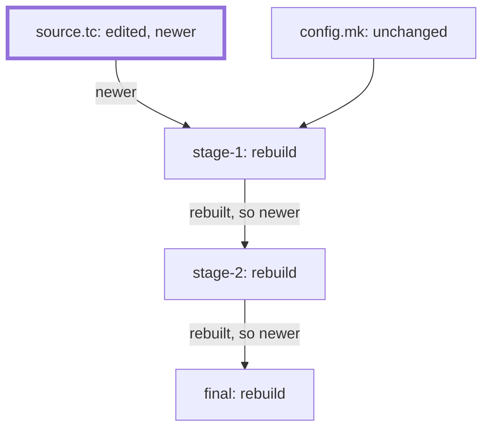

<!-- GENERATED by lessons/book/build.py from lessons/cs-source/ and the entries' frontmatter. Do not edit; edit the sources and run build.py. -->

# Formal languages as computational substrates

For an advanced reading path with traces and experiments, see the [formal languages and weird machines study guide](../study-guides/concepts/formal-languages-and-weird-machines.md).

A formal language is a notation with strict rules that a machine can process. The recurring surprise of this repository is that a notation built for *one* job turns out to be a computer. Regular expressions were made to match text, and Perl, PCRE2 and .NET engines turn them into search machines, a stack and a counter. `sed` is a rewriting system. Make and CMake were made to order builds, and they became a restarting loop and a register machine. XAML was made to describe a user interface, and its parser runs methods.

This chapter gives you the theory underneath: the Chomsky hierarchy (how much machine does a notation need?), parsing, rewriting, macros and declarative languages, interpreters and virtual machines (a representation plus something that gives it behavior), and category theory, a small part of which is useful for saying exactly what a pipeline preserves. It ends with two security ideas that explain why this matters outside the book. If an input language is more powerful than its authors realized, then reading the input is the same as running a program. See [language-theoretic security](#language-theoretic-security) and [weird machines](#weird-machines).

## The Chomsky hierarchy

In 1956 Noam Chomsky sorted formal languages into four classes by power: regular, context-free, context-sensitive and unrestricted. Each class needs a stronger machine to recognize it: a finite automaton, a pushdown automaton (a finite machine plus a stack), a bounded Turing machine and a full Turing machine. It exists to answer a practical question: *how much machine does this notation need?* A regular expression, in the classic sense, cannot check that brackets are balanced, because that needs a stack. Real regex engines go beyond the classic class. .NET's balancing groups in [`regex-dotnet`](../../src/regex-dotnet/README.md) give the engine a stack of captures, and that is exactly the extra power.

- **Use it when:** you choose a parsing tool, or you wonder whether a pattern can do the job.
- **Avoid:** parsing nested formats such as HTML with a plain regular expression.

**Read more:**

- [Chomsky hierarchy](https://en.wikipedia.org/wiki/Chomsky_hierarchy) (Wikipedia)
- [Formal language](https://en.wikipedia.org/wiki/Formal_language) (Wikipedia)
- [Pushdown automaton](https://en.wikipedia.org/wiki/Pushdown_automaton) (Wikipedia)

**In this repo:**

| Entry | Language | How it relates | What it teaches |
| --- | --- | --- | --- |
| [`regex-dotnet`](../../src/regex-dotnet/README.md) | C#, Regular expressions | demonstrates | A regex as a stack-based counter. |

## Regular expressions

A regular expression is a compact pattern for a set of strings. Stephen Kleene described the idea in the 1950s. Ken Thompson put it into text editors, and from there it reached `grep`, `sed`, `awk` and every modern language. It exists because searching text is one of the most common jobs there is. Modern "regex" engines add features such as backreferences, lookaround and code callouts. Most of them work by *backtracking*: they try a path, and if it fails they go back and try another. That design makes the engine powerful, and it makes some patterns very slow. This repository uses five engines as five different computers. See [the regular-expression lesson](../languages/regex.md).

- **Use it when:** you tokenize, validate a simple format or search logs.
- **Avoid it when:** the data is nested, or when an attacker chooses the input and the engine backtracks (see [Regular-expression denial of service](08-abstraction-leaks-and-implementation-dependence.md#regular-expression-denial-of-service)).

**Read more:**

- [Regular expression](https://en.wikipedia.org/wiki/Regular_expression) (Wikipedia)
- [Thompson's construction](https://en.wikipedia.org/wiki/Thompson%27s_construction) (Wikipedia)
- [Kleene star](https://en.wikipedia.org/wiki/Kleene_star) (Wikipedia)
- [Regular expressions](https://developer.mozilla.org/en-US/docs/Web/JavaScript/Guide/Regular_expressions) (MDN), a practical guide to the notation

**In this repo:**

| Entry | Language | How it relates | What it teaches |
| --- | --- | --- | --- |
| [`awk`](../../src/awk/README.md) | AWK | demonstrates | Portable, idiomatic AWK: functions with local variables in the parameter list, arrays, fields as a record builder, and a pipe as an output stream. |
| [`awk-weird`](../../src/awk-weird/README.md) | AWK | demonstrates | That a regular expression as the record separator turns a stream of random bytes into dice, and that awk's implicit main loop plus one pattern is a whole program. |
| [`cmake`](../../src/cmake/README.md) | CMake | demonstrates | `while()` plus regex as a tiny register machine. |
| [`ed-weird`](../../src/ed-weird/README.md) | ed, SQLite | demonstrates | That a line editor is a rewriting machine: lines are the data, addresses are the program, and a failed substitution inside a global command is an "if". |
| [`find-gnu`](../../src/find-gnu/README.md) | find, SQLite | demonstrates | That the GNU extras to find (path depth, file times, regular expressions and a built-in profiler) can replace a whole table of branches, and that find's optimizer has nothing to reorder when every branch ends in a side effect. |
| [`regex-dotnet`](../../src/regex-dotnet/README.md) | C#, Regular expressions | demonstrates | A regex as a stack-based counter. |
| [`regex-pcre2`](../../src/regex-pcre2/README.md) | C, PCRE2, Regular expressions | demonstrates | Regex callouts as a tiny instruction set. |
| [`regex-pcre2grep`](../../src/regex-pcre2grep/README.md) | PCRE2, Regular expressions | demonstrates | Program exit codes as control flow. |
| [`regex-perl`](../../src/regex-perl/README.md) | Perl, Regular expressions | demonstrates | Executable code inside a live regex match. |
| [`regex-sed`](../../src/regex-sed/README.md) | GNU sed, Regular expressions | demonstrates | That a program can be one line of text that substitutions rewrite until none applies: a Markov algorithm, with a catastrophic-backtracking regex as its clock. |

## Parsing

Parsing turns text into structure, following a grammar. It exists because programs and data arrive as flat text, and the computer needs a tree. There are hand-written *recursive descent* parsers and generated ones. Every XML, JSON or programming-language tool has one. JSON is a good example of a format whose grammar is written down exactly (RFC 8259). Parsing is also where input becomes dangerous, because it is the first code that touches untrusted data. Two entries show a parser that does more than read. [`forth-weird`](../../src/forth-weird/README.md)'s text interpreter parses a word and runs it at once, so the program can move its own parse position. [`xaml`](../../src/xaml/README.md)'s parser builds objects *and calls methods* while it reads the file.

- **Use it when:** you accept any structured input. Use a real parser and a real grammar.
- **Avoid:** ad hoc parsing with `split` and regular expressions for nested formats, and parsers that also act on what they read.

**Read more:**

- [Parsing](https://en.wikipedia.org/wiki/Parsing) (Wikipedia)
- [Recursive descent parser](https://en.wikipedia.org/wiki/Recursive_descent_parser) (Wikipedia)
- [RFC 8259: the JSON format](https://www.rfc-editor.org/rfc/rfc8259), a small, precise grammar

**In this repo:**

| Entry | Language | How it relates | What it teaches |
| --- | --- | --- | --- |
| [`forth-weird`](../../src/forth-weird/README.md) | Forth | demonstrates | That the text interpreter's parse position is a program counter, if you let it be, and that the data stack can be a program's only memory. |
| [`regex-dotnet`](../../src/regex-dotnet/README.md) | C#, Regular expressions | demonstrates | A regex as a stack-based counter. |
| [`tar-gnu`](../../src/tar-gnu/README.md) | GNU tar, SQLite | demonstrates | That a tar archive can be a serialized program: tar reads the members in order, and only the command that the operator attaches gives them an effect. |
| [`xaml`](../../src/xaml/README.md) | XAML, C# | demonstrates | How far a markup parser can be pushed before it stops describing a UI and starts *running* a program. |

## Term and string rewriting

Rewriting means replacing parts of a structure according to rules, again and again, until no rule applies. A *term* is a tree, such as an arithmetic expression. A *string* is the special case where the structure is a line of text. It exists because many kinds of computation are really simplification: algebra, the lambda calculus, an optimizing compiler, a spell-fixing text filter. Two properties matter. Does it always stop (*termination*)? Does every order of rewriting give the same answer (*confluence*)? In this repository [`regex-sed`](../../src/regex-sed/README.md) and [`m4`](../../src/m4/README.md) are rewriting systems, and the answer is simply the text that is left.

- **Use it when:** you simplify, normalize or translate structures with clear rules.
- **Avoid it when:** rule order matters but is not written down, or when termination is not obvious.

**Read more:**

- [Rewriting](https://en.wikipedia.org/wiki/Rewriting) (Wikipedia)
- [Confluence (abstract rewriting)](https://en.wikipedia.org/wiki/Confluence_(abstract_rewriting)) (Wikipedia)
- [Markov algorithms](02-what-counts-as-a-machine.md#markov-algorithms) in "What counts as a machine?"

**In this repo:**

| Entry | Language | How it relates | What it teaches |
| --- | --- | --- | --- |
| [`ed-weird`](../../src/ed-weird/README.md) | ed, SQLite | demonstrates | That a line editor is a rewriting machine: lines are the data, addresses are the program, and a failed substitution inside a global command is an "if". |
| [`m4`](../../src/m4/README.md) | m4 | demonstrates | That a macro processor is a programming language: no loop statement and no variable, just text that gets scanned again. |
| [`regex-sed`](../../src/regex-sed/README.md) | GNU sed, Regular expressions | demonstrates | That a program can be one line of text that substitutions rewrite until none applies: a Markov algorithm, with a catastrophic-backtracking regex as its clock. |

## Macros and text expansion

A macro is a name that is replaced by text, or by code, *before* the real language sees it. The C preprocessor is the best-known one. m4 is a general macro processor. Lisp macros work on code as data, not as text. They exist to let you build abstractions that functions cannot: repeated boilerplate, new syntax, code generated at compile time. [`m4`](../../src/m4/README.md) has no loop statement and no variable. It builds a loop from a macro whose replacement text contains itself, so the output is scanned again. [`lisp-weird`](../../src/lisp-weird/README.md) uses a `defcard` macro to write five similar classes and methods, at compile time.



The important arrow is the one that goes back. The expander does not just print its replacement text. It puts the text back in front of the scanner, so a macro call inside the replacement is expanded too. Here `LOOP(3)` leaves `LOOP(2)` behind, and the process ends when the replacement holds no macro call. [`m4`](../../src/m4/README.md) works this way. Other macro systems may not read their own output again.

- **Use it when:** you generate repetitive code, or define a small language on top of a bigger one.
- **Avoid it when:** a plain function would do. Macro bugs are hard to debug, and text macros can capture names by accident. Lisp-style *hygienic* macros reduce this danger.

**Read more:**

- [Macro (computer science)](https://en.wikipedia.org/wiki/Macro_(computer_science)) (Wikipedia)
- [M4 (computer language)](https://en.wikipedia.org/wiki/M4_(computer_language)) (Wikipedia)
- [Hygienic macro](https://en.wikipedia.org/wiki/Hygienic_macro) (Wikipedia)

**In this repo:**

| Entry | Language | How it relates | What it teaches |
| --- | --- | --- | --- |
| [`lisp`](../../src/lisp/README.md) | Common Lisp | demonstrates | How `LOOP` can express a whole algorithm as a list of clauses: count, draw, sum, collect, stop. |
| [`lisp-weird`](../../src/lisp-weird/README.md) | Common Lisp | demonstrates | That CLOS method combination is a control-flow construct: a class hierarchy is a loop, and `or` is a stop rule. |
| [`m4`](../../src/m4/README.md) | m4 | demonstrates | That a macro processor is a programming language: no loop statement and no variable, just text that gets scanned again. |

## Declarative programming

Declarative programming says *what* you want, not *how* to get it. SQL, HTML, CSS, Make, regular expressions and AWK's pattern column are all declarative. It exists because a tool that knows the goal can choose the method: a database picks the query plan, and `make` picks the build order. The trap is the belief that "declarative" means "harmless". When a declarative notation can name a function and give it arguments, it is one step from being a program. XAML's `ObjectDataProvider` and Make's `include` are examples, and [`xaml`](../../src/xaml/README.md) and [`make-gnu`](../../src/make-gnu/README.md) show where that step leads.

- **Use it when:** the task is a query, a configuration or a build. Let the tool optimize.
- **Avoid:** assuming a declarative file is safe to load from anyone. Check what it is allowed to call.

**Read more:**

- [Declarative programming](https://en.wikipedia.org/wiki/Declarative_programming) (Wikipedia)
- [Rule of least power](https://en.wikipedia.org/wiki/Rule_of_least_power) (Wikipedia)

**In this repo:**

| Entry | Language | How it relates | What it teaches |
| --- | --- | --- | --- |
| [`awk`](../../src/awk/README.md) | AWK | demonstrates | Portable, idiomatic AWK: functions with local variables in the parameter list, arrays, fields as a record builder, and a pipe as an output stream. |
| [`awk-weird`](../../src/awk-weird/README.md) | AWK | demonstrates | That a regular expression as the record separator turns a stream of random bytes into dice, and that awk's implicit main loop plus one pattern is a whole program. |
| [`cobol`](../../src/cobol/README.md) | COBOL | demonstrates | That a stop rule can be declared as data, and that a number's picture can do your rounding. |
| [`LinqChallenge2`](../../src/LinqChallenge2/README.md) | C#, LINQ | demonstrates | C# query syntax, pushed as far as it goes. |
| [`make-gnu`](../../src/make-gnu/README.md) | GNU Make | demonstrates | Arithmetic and looping in plain Make syntax, no shell required. |
| [`xaml`](../../src/xaml/README.md) | XAML, C# | demonstrates | How far a markup parser can be pushed before it stops describing a UI and starts *running* a program. |

## Domain-specific languages

A domain-specific language (DSL) is a small language for one kind of job. SQL is for queries, regular expressions for patterns, Make for builds, AWK for records, LINQ query syntax for collections. It exists because a tool that speaks the vocabulary of the problem is shorter, easier to read and often safer than general code. There is a classic danger. Users ask for variables, then conditions, then loops, and the DSL grows into a general language by accident, with fewer tools and worse error messages. Programmers call this the *inner-platform effect*. Most entries here are DSLs that crossed that line, which is why they were fun to write.

- **Use it when:** the domain has a stable vocabulary and many people use it.
- **Avoid it when:** a library in a normal language does the same job. If your DSL needs loops, think again about embedding it in a general language.

**Read more:**

- [Domain-specific language](https://en.wikipedia.org/wiki/Domain-specific_language) (Wikipedia)
- [Inner-platform effect](https://en.wikipedia.org/wiki/Inner-platform_effect) (Wikipedia)

**In this repo:**

| Entry | Language | How it relates | What it teaches |
| --- | --- | --- | --- |
| [`awk`](../../src/awk/README.md) | AWK | demonstrates | Portable, idiomatic AWK: functions with local variables in the parameter list, arrays, fields as a record builder, and a pipe as an output stream. |
| [`cmake`](../../src/cmake/README.md) | CMake | demonstrates | `while()` plus regex as a tiny register machine. |
| [`find-gnu`](../../src/find-gnu/README.md) | find, SQLite | demonstrates | That the GNU extras to find (path depth, file times, regular expressions and a built-in profiler) can replace a whole table of branches, and that find's optimizer has nothing to reorder when every branch ends in a side effect. |
| [`find-posix`](../../src/find-posix/README.md) | find, SQLite | demonstrates | That a directory walk can be a loop and a program: find digs the tree it is walking, and the path to the current directory is the whole machine. |
| [`LinqChallenge2`](../../src/LinqChallenge2/README.md) | C#, LINQ | demonstrates | C# query syntax, pushed as far as it goes. |
| [`lisp`](../../src/lisp/README.md) | Common Lisp | demonstrates | How `LOOP` can express a whole algorithm as a list of clauses: count, draw, sum, collect, stop. |
| [`regex-pcre2`](../../src/regex-pcre2/README.md) | C, PCRE2, Regular expressions | demonstrates | Regex callouts as a tiny instruction set. |
| [`tar-gnu`](../../src/tar-gnu/README.md) | GNU tar, SQLite | demonstrates | That a tar archive can be a serialized program: tar reads the members in order, and only the command that the operator attaches gives them an effect. |

## Markup languages

A markup language is text with annotations that describe its structure: HTML, XML, Markdown, XAML. It exists so that people and tools can share one document, and so that content stays separate from presentation. XAML describes a tree of user-interface objects, and a loader creates the objects. The danger is a format that can name *types* and *methods*. Then loading a file means running code chosen by the file's author. That is the idea behind many deserialization attacks, and it is exactly what [`xaml`](../../src/xaml/README.md) does on purpose: all the behavior of that program lives in one markup file and runs while the file is parsed.

- **Use it when:** you describe documents or data that both humans and tools must read.
- **Avoid:** letting a document choose arbitrary types or call arbitrary methods. Use an allowlist.

**Read more:**

- [Markup language](https://en.wikipedia.org/wiki/Markup_language) (Wikipedia)
- [XAML](https://en.wikipedia.org/wiki/XAML) (Wikipedia)
- [XML external entity attack](https://en.wikipedia.org/wiki/XML_external_entity_attack) (Wikipedia)
- [Deserialization cheat sheet](https://cheatsheetseries.owasp.org/cheatsheets/Deserialization_Cheat_Sheet.html) (OWASP), on loading data safely

**In this repo:**

| Entry | Language | How it relates | What it teaches |
| --- | --- | --- | --- |
| [`ModernChallenge1`](../../src/ModernChallenge1/README.md) | C# | demonstrates | Runtime XAML, LINQ to Objects, EF Core, and WPF animation - all from inside a `for` statement that has no body. |
| [`xaml`](../../src/xaml/README.md) | XAML, C# | demonstrates | How far a markup parser can be pushed before it stops describing a UI and starts *running* a program. |

## Build automation

Build automation tools rebuild only what changed, and they do it in dependency order. Make, created at Bell Labs in 1976, is the classic example. CMake and Gradle are modern ones. They exist because compiling everything every time is slow, and building in the wrong order is wrong. The state of a build is *files*: which exist, and which are newer than what they depend on. That makes a build tool a strange computer. [`make-gnu`](../../src/make-gnu/README.md) counts with files that are created one per pass, and loops by making Make read a generated makefile again. [`cmake`](../../src/cmake/README.md) loops with a `while()` whose regex leaves its results in variables.



The tool compares file dates along the arrows. `source.tc` is newer than `stage-1`, so `stage-1` is stale and is rebuilt. That makes it newer than `stage-2`, and so on down the chain. `config.mk` did not change, so it causes no work. The tool decides what to run and in what order. It does not pass values from step to step as [Dataflow programming](04-evaluation-and-demand.md#dataflow-programming) does. Some entries use this decision machinery as a loop: [`make-gnu`](../../src/make-gnu/README.md) remakes a generated makefile and then starts the walk again.

- **Use it when:** you compile, package or generate files from other files.
- **Avoid as a general computer.** Timestamps can be coarse (WSL and some file systems), and a build that depends on hidden state is not reproducible.

**Read more:**

- [Build automation](https://en.wikipedia.org/wiki/Build_automation) (Wikipedia)
- [Make (software)](https://en.wikipedia.org/wiki/Make_(software)) (Wikipedia)
- [Reproducible builds](https://en.wikipedia.org/wiki/Reproducible_builds) (Wikipedia), the idea behind this book's deterministic build

**In this repo:**

| Entry | Language | How it relates | What it teaches |
| --- | --- | --- | --- |
| [`cmake`](../../src/cmake/README.md) | CMake | demonstrates | `while()` plus regex as a tiny register machine. |
| [`make-gnu`](../../src/make-gnu/README.md) | GNU Make | demonstrates | Arithmetic and looping in plain Make syntax, no shell required. |

## Language-theoretic security

Language-theoretic security (LangSec) is a way of thinking about security. Every input format is a formal language, and the code that reads it is that language's recognizer. Many attacks work because two parsers read the same bytes differently, or because the input language is so powerful that no one can say what it will do. The advice follows from that: keep formats simple (see [Turing completeness](02-what-counts-as-a-machine.md#turing-completeness)), parse completely *before* acting, and use one well-tested parser. It also criticizes the old "robustness principle", *be liberal in what you accept*, because being liberal creates more meanings for the same bytes. The IETF has revisited that principle too.

- **Use it when:** you design a file format, a protocol or an API, or you review code that reads input.
- **Avoid:** accepting "almost valid" input, and mixing parsing with processing.

**Read more:**

- [Language-theoretic security](https://en.wikipedia.org/wiki/Language-theoretic_security) (Wikipedia)
- [Robustness principle](https://en.wikipedia.org/wiki/Robustness_principle) (Wikipedia)
- [RFC 9413: Maintaining Robust Protocols](https://www.rfc-editor.org/rfc/rfc9413), a modern IETF view of the principle

**In this repo:**

| Entry | Language | How it relates | What it teaches |
| --- | --- | --- | --- |
| [`tar-gnu`](../../src/tar-gnu/README.md) | GNU tar, SQLite | demonstrates | That a tar archive can be a serialized program: tar reads the members in order, and only the command that the operator attaches gives them an effect. |
| [`xaml`](../../src/xaml/README.md) | XAML, C# | demonstrates | How far a markup parser can be pushed before it stops describing a UI and starts *running* a program. |

## Weird machines

"Weird machine" is a term from security research. A program has the machine its authors meant, and it also has *another* machine, made of the same parts, that an attacker can drive with crafted input. In return-oriented programming, for example, an attacker chains small pieces of existing code into a new program. The term exists to explain why "it was only supposed to parse a file" is not a safety argument. Every entry in this repository is a weird machine made on purpose, in a safe place: a regex engine that counts, a parser that loops, a build tool that restarts. Each one asks the lesson's question in reverse: *what can input make this program do?*

- **Use it when:** you review an attack surface, and when you want to understand how a "harmless" feature computes.
- **Avoid building them in production.** If you must, describe the machine in the README, as the entries here do.

**Read more:**

- [Weird machine](https://en.wikipedia.org/wiki/Weird_machine) (Wikipedia)
- [Return-oriented programming](https://en.wikipedia.org/wiki/Return-oriented_programming) (Wikipedia)
- [Language-theoretic security](05-formal-languages-as-computational-substrates.md#language-theoretic-security)

**In this repo:**

| Entry | Language | How it relates | What it teaches |
| --- | --- | --- | --- |
| [`ed-weird`](../../src/ed-weird/README.md) | ed, SQLite | demonstrates | That a line editor is a rewriting machine: lines are the data, addresses are the program, and a failed substitution inside a global command is an "if". |
| [`ex-weird`](../../src/ex-weird/README.md) | Ex, SQLite | demonstrates | That an editor's registers can hold a program: a line of text is copied into a register and run with @, and the editor's own marks and line addresses do the arithmetic. |
| [`find-gnu`](../../src/find-gnu/README.md) | find, SQLite | demonstrates | That the GNU extras to find (path depth, file times, regular expressions and a built-in profiler) can replace a whole table of branches, and that find's optimizer has nothing to reorder when every branch ends in a side effect. |
| [`find-posix`](../../src/find-posix/README.md) | find, SQLite | demonstrates | That a directory walk can be a loop and a program: find digs the tree it is walking, and the path to the current directory is the whole machine. |
| [`xaml`](../../src/xaml/README.md) | XAML, C# | demonstrates | How far a markup parser can be pushed before it stops describing a UI and starts *running* a program. |

## Category theory

Category theory is the mathematics of **things and the arrows between them**, and of how arrows compose. A **category** has *objects* and *morphisms* (arrows). Each morphism goes from one object to another. Two rules hold:

1. **Identity.** Every object has an arrow to itself that changes nothing: `id`.
2. **Composition.** If `f : A → B` and `g : B → C`, then `g ∘ f : A → C` exists. Composition is associative: `h ∘ (g ∘ f) = (h ∘ g) ∘ f`. And `f ∘ id = f = id ∘ f`.

In programming, the usual category has *types* as objects and *functions* as arrows. The rules then say something you already use: you can chain functions, you can wrap a chain in parentheses wherever you like, and a function that returns its input changes nothing.

```haskell
-- Haskell: composition is a function, and the laws are things you can test.
(show . (+ 1)) 41          -- "42"
(id . show) 42 == show 42   -- True: identity
```

```python
# Python: the same idea. compose(g, f)(x) is g(f(x)).
compose = lambda g, f: lambda x: g(f(x))
assert compose(str, lambda n: n + 1)(41) == "42"
```

Three honest warnings come with the vocabulary:

- **It is a lens, not a label.** You can *describe* many pipelines as arrows between types. That does not make every LINQ operator, every `map` or every `INSERT ... SELECT` a formal part of a category. A claim such as "this is a functor" is a claim with laws, and the laws must hold.
- **Syntax is not structure.** Two operations both called `map` can differ in laziness, in order of effects and in what they do to an empty input. Same name, same shape, different behavior. The laws decide, and the names do not.
- **A round trip is not an isomorphism by default.** An *isomorphism* is a pair of arrows `f` and `g` with `g ∘ f = id` and `f ∘ g = id`. An encoder and a decoder (see [Serialization, deserialization and object pickling](06-state-beyond-variables.md#serialization-deserialization-and-object-pickling)) form one only if both laws hold. Many codecs keep the second law only on some values.

This book uses the ideas where an entry gives them something real to hold. [`haskell`](../../src/haskell/README.md) composes small pure functions. [`LinqChallenge1`](../../src/LinqChallenge1/README.md) chains query operators. The next pages, [Functors and mapping](04-evaluation-and-demand.md#functors-and-mapping) and [Monoids and folds](04-evaluation-and-demand.md#monoids-and-folds), name two of the laws that make such chains safe to rearrange.

- **Use it when:** you want to say precisely what a pipeline preserves, or when two designs look alike and you need to know if they behave alike.
- **Avoid it when:** the vocabulary replaces the explanation. If a plain sentence says the same thing, write the sentence.

**Read more:**

- [Category theory](https://en.wikipedia.org/wiki/Category_theory) (Wikipedia)
- [Category (mathematics)](https://en.wikipedia.org/wiki/Category_(mathematics)) (Wikipedia)
- [Function composition](https://en.wikipedia.org/wiki/Function_composition) (Wikipedia)
- [Isomorphism](https://en.wikipedia.org/wiki/Isomorphism) (Wikipedia)

**In this repo:**

| Entry | Language | How it relates | What it teaches |
| --- | --- | --- | --- |
| [`haskell`](../../src/haskell/README.md) | Haskell | analogy | That a lazy list and one `span` are the whole stop rule. |
| [`javascript-weird`](../../src/javascript-weird/README.md) | JavaScript, SQLite | analogy | That a closure is a state machine: a function plus the variables it was made next to, pulled one step at a time by an iterator, with reduce as the one fold that cannot stop. |
| [`LinqChallenge1`](../../src/LinqChallenge1/README.md) | C#, LINQ | analogy | LINQ method chains, end to end. |

## Interpreters and virtual machines

An **interpreter** reads a program as data and does what it says, step by step. A **virtual machine** is an interpreter for a small, fixed instruction set. Both are the same trick: a *representation* (text, records, bytes) plus a *program that gives it behavior*. Take the interpreter away and the representation is only data.

Several entries are interpreters in small. In [`tar-gnu`](../../src/tar-gnu/README.md) the program is the members of a tar archive, and a dispatcher of about 80 lines gives four record types their meaning. It checks every record against a strict grammar and refuses an unknown one. In [`tcl-weird`](../../src/tcl-weird/README.md) Tcl source is stored in SQLite rows, and an overridden `unknown` command fetches and runs it. In [`xaml`](../../src/xaml/README.md) the parser that loads a document is the interpreter that runs it. In [`regex-pcre2`](../../src/regex-pcre2/README.md) callout strings are opcodes, and a bodiless C function is the dispatcher. In [`ex-weird`](../../src/ex-weird/README.md) Ex is the interpreter and a register of text is the program, which the program rewrites and runs again. The question to ask of each is the same: what is the representation, what is the interpreter, and who chose to run the one with the other?

- **Use it when:** a program is easier to change as data than as code, or you want a small, safe language for others to write in.
- **Avoid it when:** the data comes from someone you do not trust and the interpreter is general. A strict grammar and a fixed set of instructions are what keep a data format from becoming a way in.

**Read more:**

- [Interpreter (computing)](https://en.wikipedia.org/wiki/Interpreter_(computing)) (Wikipedia)
- [Virtual machine](https://en.wikipedia.org/wiki/Virtual_machine) (Wikipedia)

**In this repo:**

| Entry | Language | How it relates | What it teaches |
| --- | --- | --- | --- |
| [`ex-weird`](../../src/ex-weird/README.md) | Ex, SQLite | demonstrates | That an editor's registers can hold a program: a line of text is copied into a register and run with @, and the editor's own marks and line addresses do the arithmetic. |
| [`regex-pcre2`](../../src/regex-pcre2/README.md) | C, PCRE2, Regular expressions | demonstrates | Regex callouts as a tiny instruction set. |
| [`tar-gnu`](../../src/tar-gnu/README.md) | GNU tar, SQLite | demonstrates | That a tar archive can be a serialized program: tar reads the members in order, and only the command that the operator attaches gives them an effect. |
| [`tcl-weird`](../../src/tcl-weird/README.md) | Tcl, SQLite | demonstrates | That Tcl code is just strings, so it can live in a database and be fetched, defined and run on demand, with SQLite triggers as the control flow. |
| [`xaml`](../../src/xaml/README.md) | XAML, C# | demonstrates | How far a markup parser can be pushed before it stops describing a UI and starts *running* a program. |
