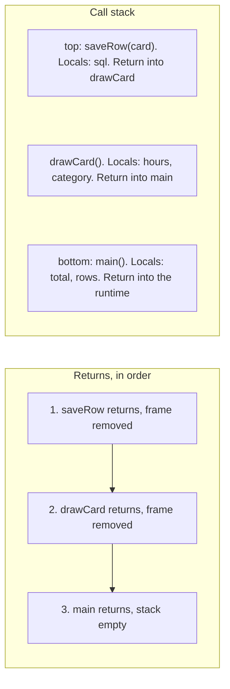
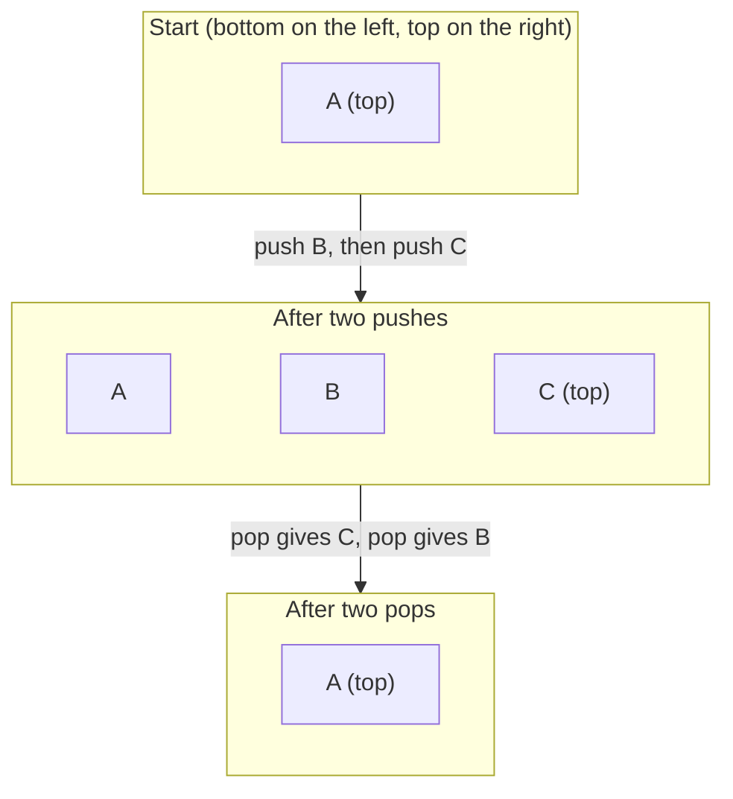
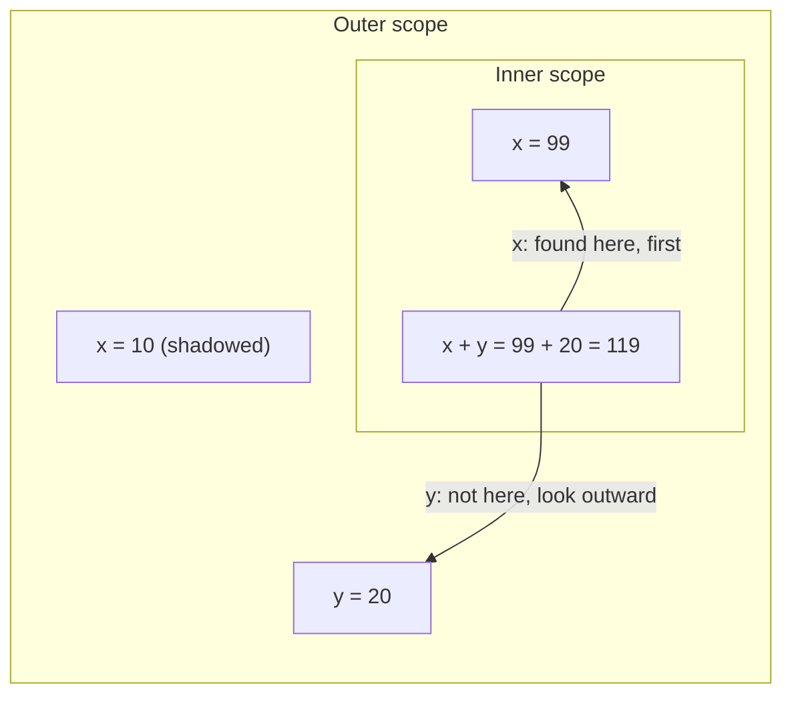
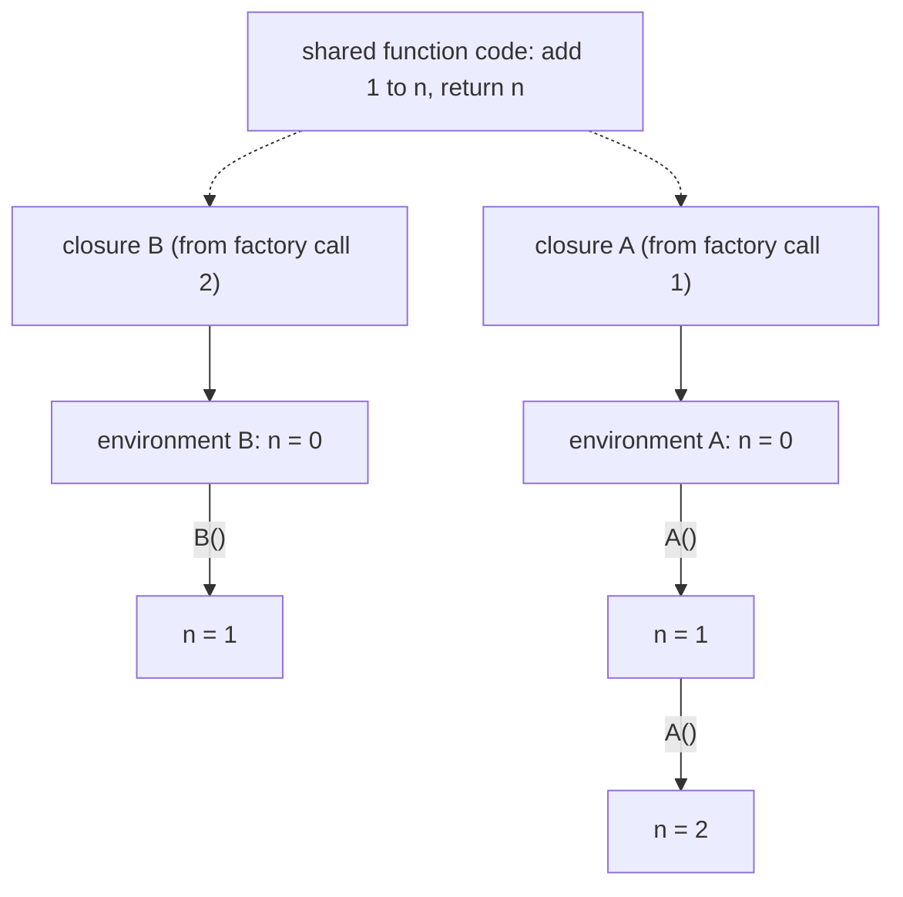
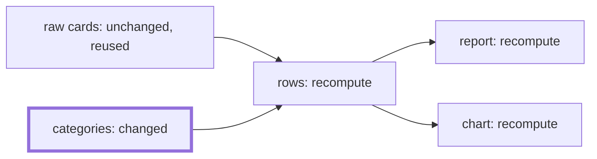
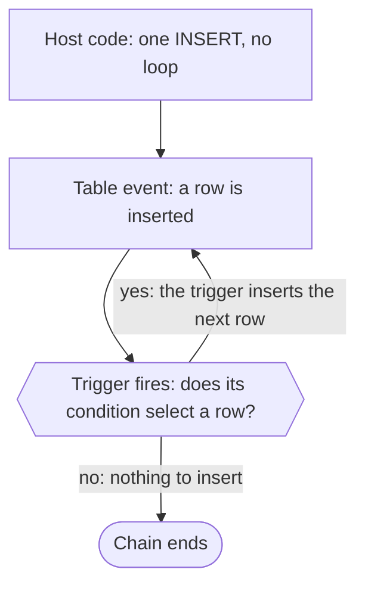
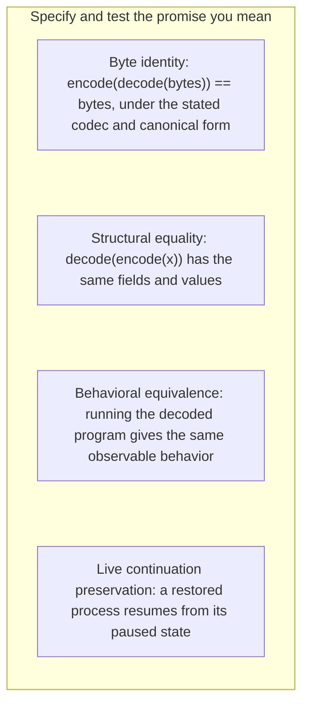

<!-- GENERATED by lessons/book/build.py from lessons/cs-source/ and the entries' frontmatter. Do not edit; edit the sources and run build.py. -->

# State beyond variables

If a language has no variables, or if you may not use them, where can a program keep what it remembers? This chapter collects the answers. A stack of marks. A line of text that substitutions rewrite. Which files exist on disk. The captures that a regex leaves behind. The source text of functions. A temporary table of procedures. The depth of a trigger's recursion. A pile of `x` characters.

None of these looks like "state" in the way that a variable does, and every one of them is. The concepts below are the places where it can hide: the call stack, the stack as a data structure, scope and binding, closures (a function plus its environment), code as data, reflection, dependency graphs, database triggers, and serialization (a program or a state written down as bytes, and what it takes to read it back and run it). The first concept is state itself, and the lesson is a habit: for every program, ask *where does it live?* You will find a table of the entries' answers in [By overall goals](../goals.md).

## State

State is whatever a program remembers between steps. Without it, nothing could be computed. The interesting question is *where it lives*: in variables, on a stack, on the heap, in a file, in a database, in an environment variable, over the network. This book's first goal is to ask that question about every program. The answers here are surprising. State lives in the target of a `GO TO`, in one line of text, in which files exist on disk, in the captures of a regex, in the text of functions, in the input stream, and in the depth of trigger recursion. See the table in [By overall goals](../goals.md).

- **Use it when:** make state explicit, small and close to where it is used.
- **Avoid hidden and global state.** It is hard to test, hard to share and hard to reason about.

**Read more:**

- [State (computer science)](https://en.wikipedia.org/wiki/State_(computer_science)) (Wikipedia)
- [File system](https://en.wikipedia.org/wiki/File_system) (Wikipedia), where the Make entry keeps its state
- [Global variable](https://en.wikipedia.org/wiki/Global_variable) (Wikipedia)

**In this repo:**

| Entry | Language | How it relates | What it teaches |
| --- | --- | --- | --- |
| [`apl-weird`](../../src/apl-weird/README.md) | APL | demonstrates | That `⎕CR`, `⎕FX` and compress make "if" and "loop" optional, and that a function can be its own successor. |
| [`awk-weird`](../../src/awk-weird/README.md) | AWK | demonstrates | That a regular expression as the record separator turns a stream of random bytes into dice, and that awk's implicit main loop plus one pattern is a whole program. |
| [`cmake`](../../src/cmake/README.md) | CMake | demonstrates | `while()` plus regex as a tiny register machine. |
| [`cobol-weird`](../../src/cobol-weird/README.md) | COBOL | demonstrates | Why structured programming won, by running a program whose control flow rewrites itself. |
| [`ed-weird`](../../src/ed-weird/README.md) | ed, SQLite | demonstrates | That a line editor is a rewriting machine: lines are the data, addresses are the program, and a failed substitution inside a global command is an "if". |
| [`ex-weird`](../../src/ex-weird/README.md) | Ex, SQLite | demonstrates | That an editor's registers can hold a program: a line of text is copied into a register and run with @, and the editor's own marks and line addresses do the arithmetic. |
| [`forth-weird`](../../src/forth-weird/README.md) | Forth | demonstrates | That the text interpreter's parse position is a program counter, if you let it be, and that the data stack can be a program's only memory. |
| [`haskell-weird`](../../src/haskell-weird/README.md) | Haskell | demonstrates | Lazy IO as control flow: a list whose elements have side effects, so reading the list is what does the work. |
| [`javascript`](../../src/javascript/README.md) | JavaScript, SQLite | demonstrates | That a for statement is three expressions and an empty body, and that JavaScript's own evaluation order, truthiness and comma operator are enough to run a whole program from the three clauses. |
| [`javascript-events`](../../src/javascript-events/README.md) | JavaScript, SQLite | demonstrates | That a program can be a set of listeners, each doing one small thing and then emitting the event the next one waits for; and that emit() calls its listeners at once, so only an explicit scheduling boundary gives the event loop a turn. |
| [`javascript-weird`](../../src/javascript-weird/README.md) | JavaScript, SQLite | demonstrates | That a closure is a state machine: a function plus the variables it was made next to, pulled one step at a time by an iterator, with reduce as the one fold that cannot stop. |
| [`lisp-weird`](../../src/lisp-weird/README.md) | Common Lisp | demonstrates | That CLOS method combination is a control-flow construct: a class hierarchy is a loop, and `or` is a stop rule. |
| [`m4`](../../src/m4/README.md) | m4 | demonstrates | That a macro processor is a programming language: no loop statement and no variable, just text that gets scanned again. |
| [`make-gnu`](../../src/make-gnu/README.md) | GNU Make | demonstrates | Arithmetic and looping in plain Make syntax, no shell required. |
| [`regex-dotnet`](../../src/regex-dotnet/README.md) | C#, Regular expressions | demonstrates | A regex as a stack-based counter. |
| [`regex-pcre2`](../../src/regex-pcre2/README.md) | C, PCRE2, Regular expressions | demonstrates | Regex callouts as a tiny instruction set. |
| [`regex-perl`](../../src/regex-perl/README.md) | Perl, Regular expressions | demonstrates | Executable code inside a live regex match. |
| [`regex-sed`](../../src/regex-sed/README.md) | GNU sed, Regular expressions | demonstrates | That a program can be one line of text that substitutions rewrite until none applies: a Markov algorithm, with a catastrophic-backtracking regex as its clock. |
| [`tar-gnu-weird`](../../src/tar-gnu-weird/README.md) | GNU tar, SQLite | demonstrates | That an archive's physical layout can set the pace of a program: tar's checkpoints are a clock, and each tick moves a state machine by one step. |
| [`tcl-weird`](../../src/tcl-weird/README.md) | Tcl, SQLite | demonstrates | That Tcl code is just strings, so it can live in a database and be fetched, defined and run on demand, with SQLite triggers as the control flow. |
| [`xaml`](../../src/xaml/README.md) | XAML, C# | demonstrates | How far a markup parser can be pushed before it stops describing a UI and starts *running* a program. |

## The call stack

The call stack is a stack of *frames*. Each active function call has one, holding its return address and its local variables. It exists so that functions can call functions, and recursion works. For most programmers the call stack *is* "where am I in the program". Several entries live without it, or work around it. A sed script has no calls at all. m4 and Make repeat by reading text again. The trigger recursion in [`tcl-weird`](../../src/tcl-weird/README.md) is limited by the database, not by a stack you can see.



Each active call owns one frame, and the newest frame is on top. When `saveRow` returns, its frame is removed and execution continues at the return address it stored, which is inside `drawCard`. The names here are examples, and the exact layout of a frame differs between languages and processors. The general idea of a stack is in [The stack as a data structure](06-state-beyond-variables.md#the-stack-as-a-data-structure).

- **Use it when:** you read a stack trace, or you reason about recursion depth.
- **Avoid:** unbounded recursion. A stack overflow ends the program, and in unsafe languages it can become a security hole.

**Read more:**

- [Call stack](https://en.wikipedia.org/wiki/Call_stack) (Wikipedia)
- [Stack buffer overflow](https://en.wikipedia.org/wiki/Stack_buffer_overflow) (Wikipedia)
- [Tail call](https://en.wikipedia.org/wiki/Tail_call) (Wikipedia)

**In this repo:**

| Entry | Language | How it relates | What it teaches |
| --- | --- | --- | --- |
| [`find-gnu`](../../src/find-gnu/README.md) | find, SQLite | demonstrates | That the GNU extras to find (path depth, file times, regular expressions and a built-in profiler) can replace a whole table of branches, and that find's optimizer has nothing to reorder when every branch ends in a side effect. |
| [`find-posix`](../../src/find-posix/README.md) | find, SQLite | demonstrates | That a directory walk can be a loop and a program: find digs the tree it is walking, and the path to the current directory is the whole machine. |
| [`javascript-events`](../../src/javascript-events/README.md) | JavaScript, SQLite | demonstrates | That a program can be a set of listeners, each doing one small thing and then emitting the event the next one waits for; and that emit() calls its listeners at once, so only an explicit scheduling boundary gives the event loop a turn. |

## The stack as a data structure

A stack is a pile where you add and remove at the top only: last in, first out. It is the right shape for anything nested: undo, expression evaluation, bracket matching and backtracking. In this repository the stack appears in two unusual places. In [`forth-weird`](../../src/forth-weird/README.md) the data stack is the only memory. In [`regex-dotnet`](../../src/regex-dotnet/README.md) *balancing groups* push a capture when they see an opening mark and pop one when they see a closing mark. A stack of marks is a counter, so a regex can compare two counts.



Only the top can be reached. A push adds on top and a pop removes from the top, so the last item in is the first one out. [The call stack](06-state-beyond-variables.md#the-call-stack) is one use of this structure, with frames as the items. Undo lists, bracket matching and the data stack of [`forth-weird`](../../src/forth-weird/README.md) are others.

- **Use it when:** the problem is nested, or you must undo in reverse order.
- **Avoid it when:** you need random access or first-in, first-out order. Use an array or a queue.

**Read more:**

- [Stack (abstract data type)](https://en.wikipedia.org/wiki/Stack_(abstract_data_type)) (Wikipedia)
- [Pushdown automaton](https://en.wikipedia.org/wiki/Pushdown_automaton) (Wikipedia)

**In this repo:**

| Entry | Language | How it relates | What it teaches |
| --- | --- | --- | --- |
| [`forth`](../../src/forth/README.md) | Forth | demonstrates | That a stack language needs one `begin ... until` and a pipe to be a whole program. |
| [`forth-weird`](../../src/forth-weird/README.md) | Forth | demonstrates | That the text interpreter's parse position is a program counter, if you let it be, and that the data stack can be a program's only memory. |
| [`regex-dotnet`](../../src/regex-dotnet/README.md) | C#, Regular expressions | demonstrates | A regex as a stack-based counter. |

## Scope and binding

*Scope* is the part of a program where a name can be seen. *Binding* is the link between a name and a value. Most languages use *lexical* scope: a name means what it means where it is written. Some use *dynamic* scope: a name means whatever the most recent caller set. Dynamic scope can be useful, and it can be dangerous. In [`apl-weird`](../../src/apl-weird/README.md) dynamic scope would let a rewritten function overwrite its parent's variables, so each generated header re-declares its locals. In Tcl, `uplevel` runs code in the scope of another stack frame. [`tcl-weird`](../../src/tcl-weird/README.md) uses `uplevel #0`, which means the global scope. In m4 and Make, every name is global.



A name is looked up in the innermost scope first, then outward. Here `x` is found at once in the inner scope, which *shadows* the outer `x = 10`. The name `y` is not bound in the inner scope, so the search goes outward. The scope decides where to look, and the binding is what the search finds. This picture is lexical scope: the boxes are the nesting of the source text.

- **Use it when:** lexical scope, almost always. It lets you read a function without knowing its callers.
- **Avoid:** dynamic and global scope, except for deliberate, documented settings.

**Read more:**

- [Scope (computer programming)](https://en.wikipedia.org/wiki/Scope_(computer_programming)) (Wikipedia)
- [Name binding](https://en.wikipedia.org/wiki/Name_binding) (Wikipedia)
- [Closure (computer programming)](https://en.wikipedia.org/wiki/Closure_(computer_programming)) (Wikipedia)
- [Scope](https://developer.mozilla.org/en-US/docs/Glossary/Scope) (MDN glossary)

**In this repo:**

| Entry | Language | How it relates | What it teaches |
| --- | --- | --- | --- |
| [`apl-weird`](../../src/apl-weird/README.md) | APL | demonstrates | That `⎕CR`, `⎕FX` and compress make "if" and "loop" optional, and that a function can be its own successor. |
| [`javascript`](../../src/javascript/README.md) | JavaScript, SQLite | demonstrates | That a for statement is three expressions and an empty body, and that JavaScript's own evaluation order, truthiness and comma operator are enough to run a whole program from the three clauses. |
| [`javascript-weird`](../../src/javascript-weird/README.md) | JavaScript, SQLite | demonstrates | That a closure is a state machine: a function plus the variables it was made next to, pulled one step at a time by an iterator, with reduce as the one fold that cannot stop. |
| [`lisp-weird`](../../src/lisp-weird/README.md) | Common Lisp | demonstrates | That CLOS method combination is a control-flow construct: a class hierarchy is a loop, and `or` is a stop rule. |
| [`m4`](../../src/m4/README.md) | m4 | demonstrates | That a macro processor is a programming language: no loop statement and no variable, just text that gets scanned again. |
| [`tcl`](../../src/tcl/README.md) | Tcl | demonstrates | Idiomatic Tcl: procs in a namespace, dicts for records, braced `expr`, and `db eval` binding Tcl variables straight into SQL. |
| [`tcl-weird`](../../src/tcl-weird/README.md) | Tcl, SQLite | demonstrates | That Tcl code is just strings, so it can live in a database and be fetched, defined and run on demand, with SQLite triggers as the control flow. |

## Closures and lexical environments

A **closure** is a function together with the variables it was made next to. Those variables are its **lexical environment**: the names that were in scope where the function was written. The function keeps them alive after the code that made them has finished. That is why a function can remember a count, a total or a seed between calls, and why nothing else can reach them.

```js
const counter = () => { let n = 0; return () => ++n; };   // `n` lives on, inside the returned function
const next = counter(); next(); next();                   // 1, then 2
```



Each box under a closure is that closure's *own* environment. The number is not copied into the code when the closure is made. The factory's call frame can return, and the captured variable lives on while the closure can be reached. These are two different factory calls. Two functions made in *one* factory call over the same variable would share it, as described below.

Be exact about three things:

- **A closure captures variables, not values.** Two closures over the same variable share it, and a change made by one is seen by the other. Each call to a factory such as `counter()` makes a *new* variable, so two counters never share state. C# lambdas behave the same way.
- **Lambda syntax is not a closure.** `x => x + 1` uses no outside variable, so there is nothing interesting to capture. An arrow function that updates a variable that outlives the call is a closure that matters.
- **A closure is not a continuation.** You can call it again and it does the *next* step. You cannot hand it "the rest of the computation", resume it in the middle of something, or go back. See [Continuations](03-control-flow-and-continuations.md#continuations). Nor is `this` a captured variable: a method that uses `this.n` loses its `n` when you detach it from its object, and a closure keeps its variable.

The environment lives as long as the function can be reached. When nothing refers to the function any more, the engine may collect it, and its variables with it. [`javascript-weird`](../../src/javascript-weird/README.md) builds its whole algorithm from three closures (a seeded number source, a card machine, and an iterator around it), and its check script proves each claim on this page, including the lifetime one, with a `WeakRef` and a forced garbage collection. [`javascript`](../../src/javascript/README.md) uses a closure over the seed for its random numbers. [`RustChallenge1`](../../src/RustChallenge1/README.md) and [`ModernChallenge1`](../../src/ModernChallenge1/README.md) use closures (and a C# lambda) to move work into places that expect a value.

- **Use it when:** you need private state without a class, a function that is configured once and called many times, or a callback that must remember something.
- **Avoid it when:** the hidden state makes the program hard to test or to read. Captured variables do not show up in a debugger the way fields do, and a long chain of closures is hard to follow.

**Read more:**

- [Closure (computer programming)](https://en.wikipedia.org/wiki/Closure_(computer_programming)) (Wikipedia)
- [Scope (computer science)](https://en.wikipedia.org/wiki/Scope_(computer_science)) (Wikipedia)
- [Closures](https://developer.mozilla.org/en-US/docs/Web/JavaScript/Guide/Closures) (MDN)

**In this repo:**

| Entry | Language | How it relates | What it teaches |
| --- | --- | --- | --- |
| [`JavaChallenge1`](../../src/JavaChallenge1/README.md) | Java | analogy | A one-statement port in Java: the literal original shape, `for (init; condition; update) { }`. |
| [`javascript`](../../src/javascript/README.md) | JavaScript, SQLite | demonstrates | That a for statement is three expressions and an empty body, and that JavaScript's own evaluation order, truthiness and comma operator are enough to run a whole program from the three clauses. |
| [`javascript-weird`](../../src/javascript-weird/README.md) | JavaScript, SQLite | demonstrates | That a closure is a state machine: a function plus the variables it was made next to, pulled one step at a time by an iterator, with reduce as the one fold that cannot stop. |
| [`ModernChallenge1`](../../src/ModernChallenge1/README.md) | C# | demonstrates | Runtime XAML, LINQ to Objects, EF Core, and WPF animation - all from inside a `for` statement that has no body. |
| [`RustChallenge1`](../../src/RustChallenge1/README.md) | Rust | demonstrates | Iterators and closures as control flow. |

## Homoiconicity: code as data

A language is *homoiconic* when its programs are written in its own data structures. In Lisp, code is a list, so a macro is just a program that builds a list. Tcl goes a different way, with "everything is a string", and APL treats a function as a character matrix. In Forth the program is a stream of words that the interpreter can read. The idea exists because it makes metaprogramming simple: if code is data, you can inspect it, build it and change it with the tools you already have. [`apl-weird`](../../src/apl-weird/README.md) reads its own source with `⎕CR`, rewrites it and defines the copy with `⎕FX`.

- **Use it when:** you write macros, code transformers or small languages.
- **Avoid it when:** tools must understand your code without running it. Static analyzers and refactoring tools find it hard to follow code that builds code.

**Read more:**

- [Homoiconicity](https://en.wikipedia.org/wiki/Homoiconicity) (Wikipedia)
- [Lisp (programming language)](https://en.wikipedia.org/wiki/Lisp_(programming_language)) (Wikipedia)
- [Metaprogramming](https://en.wikipedia.org/wiki/Metaprogramming) (Wikipedia)

**In this repo:**

| Entry | Language | How it relates | What it teaches |
| --- | --- | --- | --- |
| [`apl-weird`](../../src/apl-weird/README.md) | APL | demonstrates | That `⎕CR`, `⎕FX` and compress make "if" and "loop" optional, and that a function can be its own successor. |
| [`ex-weird`](../../src/ex-weird/README.md) | Ex, SQLite | demonstrates | That an editor's registers can hold a program: a line of text is copied into a register and run with @, and the editor's own marks and line addresses do the arithmetic. |
| [`lisp`](../../src/lisp/README.md) | Common Lisp | demonstrates | How `LOOP` can express a whole algorithm as a list of clauses: count, draw, sum, collect, stop. |
| [`lisp-weird`](../../src/lisp-weird/README.md) | Common Lisp | demonstrates | That CLOS method combination is a control-flow construct: a class hierarchy is a loop, and `or` is a stop rule. |
| [`tcl-weird`](../../src/tcl-weird/README.md) | Tcl, SQLite | demonstrates | That Tcl code is just strings, so it can live in a database and be fetched, defined and run on demand, with SQLite triggers as the control flow. |

## Reflection and metaprogramming

*Reflection* means a program inspects or changes its own structure while it runs: it finds a type by name, lists methods, calls one. *Metaprogramming* means a program writes or transforms programs. They exist because frameworks need them: serializers, test runners, dependency injection and plugin systems all find code they have never seen. XAML works by reflection: a type name in the markup becomes an object. Common Lisp's metaobject protocol lets [`lisp-weird`](../../src/lisp-weird/README.md) ask which methods apply to a call. The cost is that tools and optimizers cannot see through it, and a name that comes from data can become an attack.

- **Use it when:** at the boundaries of a framework, where code must be found by name.
- **Avoid it in business logic.** If names come from outside, accept only an explicit list.

**Read more:**

- [Reflective programming](https://en.wikipedia.org/wiki/Reflective_programming) (Wikipedia)
- [Metaprogramming](https://en.wikipedia.org/wiki/Metaprogramming) (Wikipedia)
- [Metaobject](https://en.wikipedia.org/wiki/Metaobject) (Wikipedia)

**In this repo:**

| Entry | Language | How it relates | What it teaches |
| --- | --- | --- | --- |
| [`apl-weird`](../../src/apl-weird/README.md) | APL | demonstrates | That `⎕CR`, `⎕FX` and compress make "if" and "loop" optional, and that a function can be its own successor. |
| [`ex-weird`](../../src/ex-weird/README.md) | Ex, SQLite | demonstrates | That an editor's registers can hold a program: a line of text is copied into a register and run with @, and the editor's own marks and line addresses do the arithmetic. |
| [`forth-weird`](../../src/forth-weird/README.md) | Forth | demonstrates | That the text interpreter's parse position is a program counter, if you let it be, and that the data stack can be a program's only memory. |
| [`lisp-weird`](../../src/lisp-weird/README.md) | Common Lisp | demonstrates | That CLOS method combination is a control-flow construct: a class hierarchy is a loop, and `or` is a stop rule. |
| [`tcl`](../../src/tcl/README.md) | Tcl | demonstrates | Idiomatic Tcl: procs in a namespace, dicts for records, braced `expr`, and `db eval` binding Tcl variables straight into SQL. |
| [`tcl-weird`](../../src/tcl-weird/README.md) | Tcl, SQLite | demonstrates | That Tcl code is just strings, so it can live in a database and be fetched, defined and run on demand, with SQLite triggers as the control flow. |
| [`xaml`](../../src/xaml/README.md) | XAML, C# | demonstrates | How far a markup parser can be pushed before it stops describing a UI and starts *running* a program. |

## Dependency graphs

A dependency graph has a node for each thing and an arrow for "this needs that". If there are no cycles, it is a directed acyclic graph, and a *topological sort* gives an order that always works: build the needed things first. It exists so that tools do only the work that is needed, in the right order, and in parallel where they can. Make, package managers, spreadsheets and schedulers are all dependency engines. What is unusual in [`make-gnu`](../../src/make-gnu/README.md) is that the graph can *change while it is being walked*: Make remakes an included makefile, then starts over with the new graph. That restart is the loop.



Each arrow here runs from an input to the thing built from it, so a change travels along the arrows. (Some books draw the arrow the other way, from a thing to what it needs. The facts are the same.) Only `categories` changed, so only what is downstream of it must be redone. `raw cards` keeps its old result. The graph says what *must* be recomputed, not when values arrive. For that, see [Dataflow programming](04-evaluation-and-demand.md#dataflow-programming).

- **Use it when:** any problem of the form "A must come before B".
- **Avoid:** cycles, and dependencies that are not declared. A hidden dependency gives wrong incremental builds.

**Read more:**

- [Dependency graph](https://en.wikipedia.org/wiki/Dependency_graph) (Wikipedia)
- [Directed acyclic graph](https://en.wikipedia.org/wiki/Directed_acyclic_graph) (Wikipedia)
- [Topological sorting](https://en.wikipedia.org/wiki/Topological_sorting) (Wikipedia)

**In this repo:**

| Entry | Language | How it relates | What it teaches |
| --- | --- | --- | --- |
| [`make-gnu`](../../src/make-gnu/README.md) | GNU Make | demonstrates | Arithmetic and looping in plain Make syntax, no shell required. |

## Database triggers

A trigger is code that the database runs by itself when a row is inserted, updated or deleted. It exists to keep rules close to the data: audit logs, derived columns, checks that a `CHECK` constraint cannot express. In [`tcl-weird`](../../src/tcl-weird/README.md) a trigger is the loop. Each insert fires the trigger, which inserts the next row, until a `WHERE` clause finds nothing to insert. The cost is invisible control flow. Nothing in the application code says "this also happens", and the order and depth of triggers can surprise you.



The host code runs one `INSERT` and has no loop. The trigger belongs to the table, so each insert is an event that fires it. The trigger's own `INSERT` is another event, and that is how one change causes the next. A chain like this ends only because the condition finally selects no row. Databases are careful about it. SQLite does not let a trigger fire itself unless `PRAGMA recursive_triggers` is on, and [`tcl-weird`](../../src/tcl-weird/README.md) turns it on on purpose.

- **Use it when:** for audit trails and rules that must hold whoever writes the data.
- **Avoid it when:** you are tempted to put business workflows in triggers, or to use them as a program loop (as this entry does, on purpose).

**Read more:**

- [Database trigger](https://en.wikipedia.org/wiki/Database_trigger) (Wikipedia)
- [SQLite](https://en.wikipedia.org/wiki/SQLite) (Wikipedia)

**In this repo:**

| Entry | Language | How it relates | What it teaches |
| --- | --- | --- | --- |
| [`tcl-weird`](../../src/tcl-weird/README.md) | Tcl, SQLite | demonstrates | That Tcl code is just strings, so it can live in a database and be fetched, defined and run on demand, with SQLite triggers as the control flow. |

## Serialization, deserialization and object pickling

**Serialization** turns something abstract into bytes that you can store or send: an object, a state, a list of instructions. **Deserialization** reads the bytes back. These are two separate acts, and a third act hides behind them: **interpretation**, which gives the decoded data an effect. You can parse a file and do nothing with it. You can also parse a file and run it. Most of the danger in this topic lives in the gap between the two.

**Object pickling** is serialization of an object graph. Python's `pickle` writes the *recipe* to rebuild an object: which class, which arguments, which attributes. Reading a pickle can call any function the recipe names, so unpickling bytes you do not trust runs the sender's code. The Python documentation says so in a warning box. A serialized **program** is the same idea one level up: source text, a syntax tree, bytecode, or a small instruction stream stored as records. [`tar-gnu`](../../src/tar-gnu/README.md) stores a program as the members of a tar archive: each member name is an instruction, each member body is its operand. [`tcl-weird`](../../src/tcl-weird/README.md) stores Tcl source in SQLite rows and runs it on demand. [`apl-weird`](../../src/apl-weird/README.md) reads a function's source, rewrites it, and defines the copy. [`xaml`](../../src/xaml/README.md) stores an object graph as markup that a parser turns into live objects.

What does a round trip keep? Be exact, because "the same" has four different meanings:

- **Byte identity.** `encode(decode(bytes))` gives the same bytes. [`tar-gnu`](../../src/tar-gnu/README.md) builds a byte-identical archive from the same seed, because it fixes the order, the times and the owners.
- **Structural equality.** The decoded structure has the same fields and values. The inspector in [`tar-gnu`](../../src/tar-gnu/README.md) and the database rows agree on every card.
- **Behavioral equivalence.** Running the decoded program gives the same results. Two runs of one archive, in two fresh databases, give the same cards.
- **Continuation or live-state preservation.** A paused process, with its stack, its open files and its position, resumes where it stopped. This is a much stronger promise. Almost no format makes it, and the tar entries do not claim it.



The four cards are separate promises, and none implies another. Equal bytes do not promise that a program behaves the same, and a serializer that keeps every field does not resume a process. [`tar-gnu`](../../src/tar-gnu/README.md), [`tcl-weird`](../../src/tcl-weird/README.md), [`apl-weird`](../../src/apl-weird/README.md), [`xaml`](../../src/xaml/README.md) and Python's `pickle` each make a different one of them. Do not forget that deserializing may itself run code (see Security, next).

`decode(encode(x))` may keep some of these and lose others. A JSON round trip keeps the structure and loses the object's identity, its methods and its undefined values. State what you promise before you promise it.

**Security.** Bytes are inert until a consumer gives them meaning. A tar archive cannot register a hook for itself: `tar -xf` only writes files, and it is the operator's `--to-command` option that makes tar start a program for each member. JSON is not "safe by nature" either. It is only data, until a consumer passes a field to `eval`, a shell or a SQL string. Unsafe deserialization attacks chain the *reconstruction callbacks* that a format allows (constructors, `__reduce__`, `readObject`) into code that does something the author did not plan. The defenses are old and boring. Do not deserialize untrusted bytes into live objects. Check every record against a strict grammar. Refuse what you do not know. Run the consumer with the least privilege it needs.

**Category theory.** An encoder and a decoder are functions that should compose to something with a stated law: `decode ∘ encode = id` on the values you care about. That is true for some types and some formats, false for others (a format may map two values to one string). Do not call a codec an isomorphism unless you can prove the law in both directions; [Category theory](05-formal-languages-as-computational-substrates.md#category-theory) says what the word asks of you.

| | What the bytes hold | What the consumer rebuilds | Can code run while reading? | Where the trust boundary is |
| --- | --- | --- | --- | --- |
| Python `pickle` | A recipe: classes, arguments, state | Live Python objects | Yes, by design | Around the bytes: never read pickles you did not write |
| JSON | Numbers, strings, lists, maps | Plain data | No, unless your code interprets a field | Inside your code that uses the fields |
| tar | Files: names, bytes, sizes, times, modes | Files on disk, or a stream of members | No, unless the operator passes `--to-command` or `--checkpoint-action` | In the command line the operator wrote |

- **Use it when:** you must store a state, send a value, or ship a program, and you can state which kind of "same" you need back.
- **Avoid it when:** the bytes come from someone you do not trust and the format can rebuild arbitrary objects. Use a data-only format and a strict parser.

**Read more:**

- [Serialization](https://en.wikipedia.org/wiki/Serialization) (Wikipedia)
- [Pickle (Python)](https://en.wikipedia.org/wiki/Pickle_(Python)) (Wikipedia)
- [Tar (computing)](https://en.wikipedia.org/wiki/Tar_(computing)) (Wikipedia)
- [Deserialization of untrusted data](https://owasp.org/www-community/vulnerabilities/Deserialization_of_untrusted_data) (OWASP)
- [Deserialization Cheat Sheet](https://cheatsheetseries.owasp.org/cheatsheets/Deserialization_Cheat_Sheet.html) (OWASP)
- [`JSON`](https://developer.mozilla.org/en-US/docs/Web/JavaScript/Reference/Global_Objects/JSON) (MDN)

**In this repo:**

| Entry | Language | How it relates | What it teaches |
| --- | --- | --- | --- |
| [`apl-weird`](../../src/apl-weird/README.md) | APL | demonstrates | That `⎕CR`, `⎕FX` and compress make "if" and "loop" optional, and that a function can be its own successor. |
| [`m4`](../../src/m4/README.md) | m4 | analogy | That a macro processor is a programming language: no loop statement and no variable, just text that gets scanned again. |
| [`regex-sed`](../../src/regex-sed/README.md) | GNU sed, Regular expressions | analogy | That a program can be one line of text that substitutions rewrite until none applies: a Markov algorithm, with a catastrophic-backtracking regex as its clock. |
| [`tar-gnu`](../../src/tar-gnu/README.md) | GNU tar, SQLite | demonstrates | That a tar archive can be a serialized program: tar reads the members in order, and only the command that the operator attaches gives them an effect. |
| [`tcl-weird`](../../src/tcl-weird/README.md) | Tcl, SQLite | demonstrates | That Tcl code is just strings, so it can live in a database and be fetched, defined and run on demand, with SQLite triggers as the control flow. |
| [`xaml`](../../src/xaml/README.md) | XAML, C# | demonstrates | How far a markup parser can be pushed before it stops describing a UI and starts *running* a program. |
