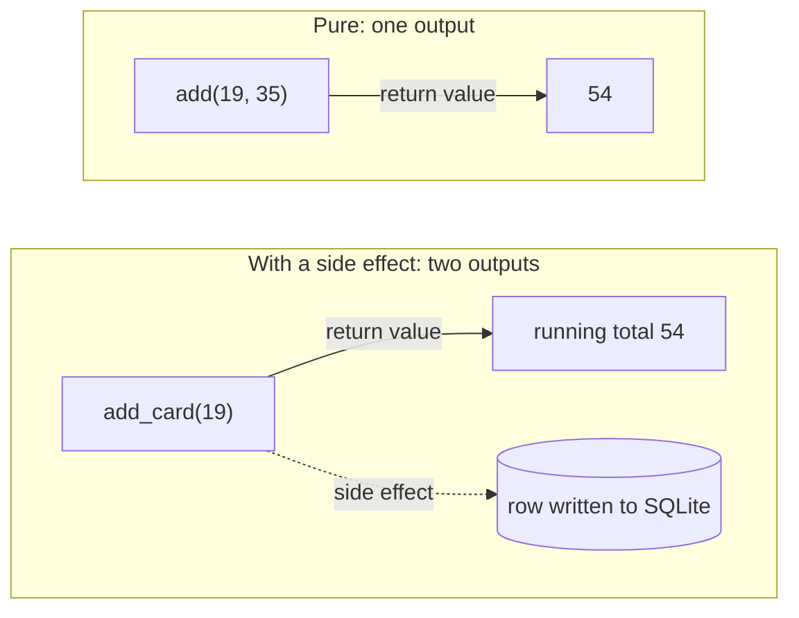
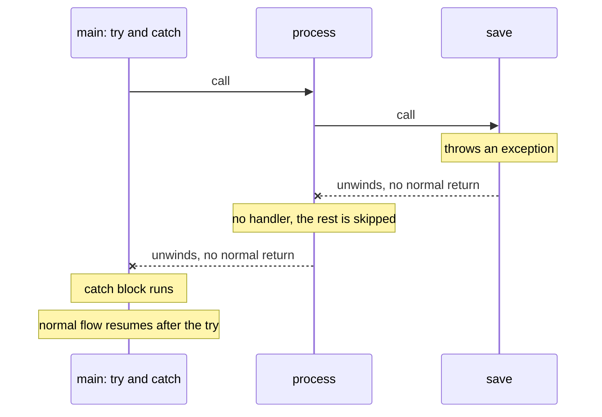
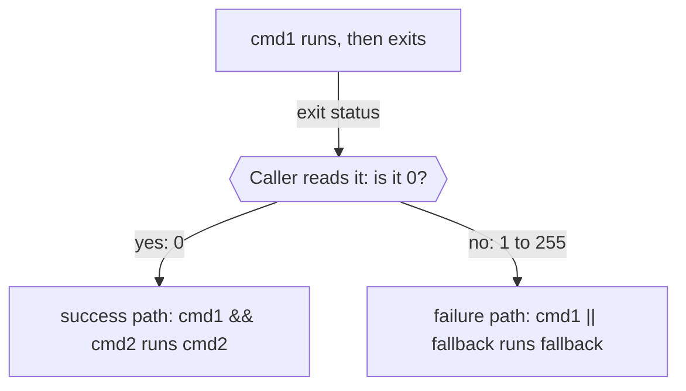
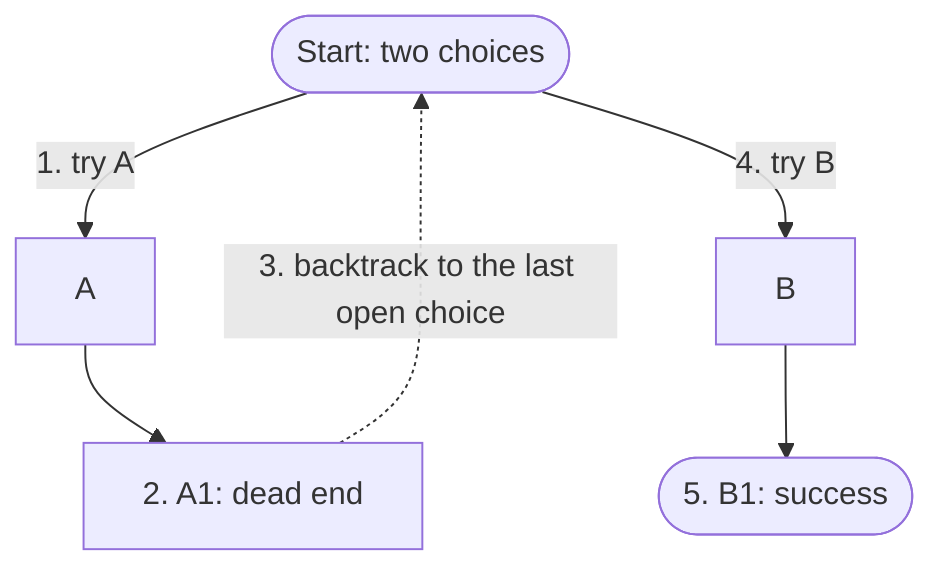
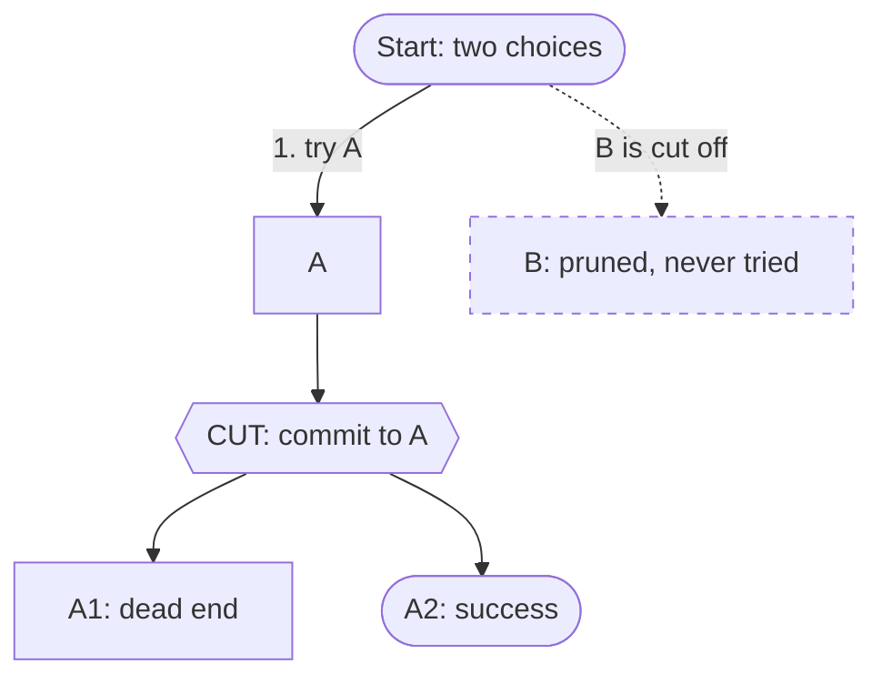
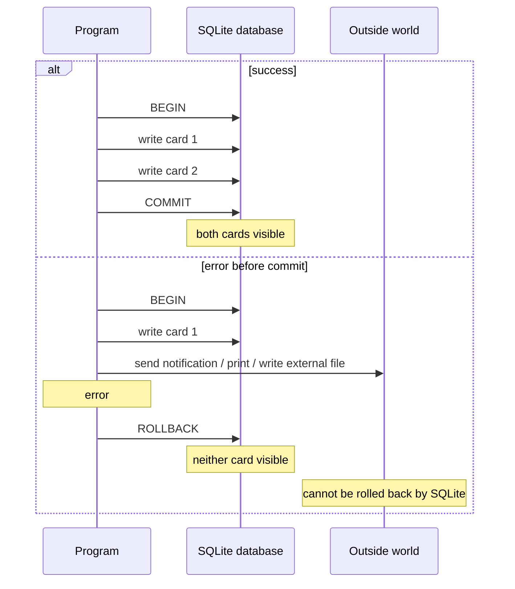
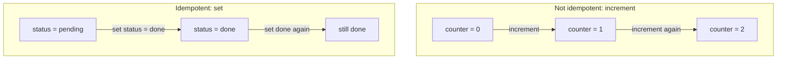

<!-- GENERATED by lessons/book/build.py from lessons/cs-source/ and the entries' frontmatter. Do not edit; edit the sources and run build.py. -->

# Effects, errors and commitment

For an advanced reading path with traces and experiments, see the [effects, errors and commitment study guide](../study-guides/concepts/effects-errors-and-commitment.md).

A program that does nothing outside itself is a very expensive heater. Useful programs change the world: they write files, print and insert rows. This chapter is about the three questions that follow. When does an effect happen (**side effects**)? What happens when something goes wrong (**errors**)? And at what point is a change final (**commitment**)?

The entries here play with all three. A regex engine runs the whole demo and then *fails on purpose*, so what survives the failure becomes the lesson. A constraint violation, an arithmetic overflow or a program's exit code *is* the stop rule. A database transaction commits only when the work is complete. The concepts below give each of these a name and a reason: side effects, effect systems, exceptions, exit status, constraints, backtracking, the cut, transactions, idempotence and thread safety.

## Side effects

A side effect is anything an operation does besides returning a value: writing a file, changing a variable, printing, inserting a database row. Programs exist to cause effects, so effects are not bad. The problem is that *order, number and timing* start to matter. Run it twice and you may get two rows. Run it later and you may get a different answer. Several entries put an effect inside something that looks like a plain description: a lazy Haskell list, a LINQ query, a XAML tree. A rule falls out of that: **whoever reads the structure decides whether, and when, the effect happens.** `evaluate (length cards)` in Haskell and the final `Aggregate` in LINQ both mean "force it now".

Both calls return a value. Only the second also changes something outside itself: a row now exists in the database, and it still exists if the caller ignores the return value. That is why a side effect is not just another return value. The caller sees the return value only if it looks, but the effect has already happened. Compare [Referential transparency](04-evaluation-and-demand.md#referential-transparency): a pure call can be replaced by its value, and the second call cannot.

- **Use effects when:** at the edges of a program, where it talks to the world, and in places where you can say exactly when they run.
- **Avoid effects when:** they hide in lazy or "pure-looking" code, where nobody can say who triggers them.

**Read more:**

- [Side effect (computer science)](https://en.wikipedia.org/wiki/Side_effect_(computer_science)) (Wikipedia)
- [Referential transparency](04-evaluation-and-demand.md#referential-transparency) in "Evaluation and demand"

**In this repo:**

| Entry | Language | How it relates | What it teaches |
| --- | --- | --- | --- |
| [`find-gnu`](../../src/find-gnu/README.md) | find, SQLite | demonstrates | That the GNU extras to find (path depth, file times, regular expressions and a built-in profiler) can replace a whole table of branches, and that find's optimizer has nothing to reorder when every branch ends in a side effect. |
| [`find-posix`](../../src/find-posix/README.md) | find, SQLite | demonstrates | That a directory walk can be a loop and a program: find digs the tree it is walking, and the path to the current directory is the whole machine. |
| [`GoChallenge1`](../../src/GoChallenge1/README.md) | Go | demonstrates | That one three-part `for` with an empty body can run the whole Go program. |
| [`haskell-weird`](../../src/haskell-weird/README.md) | Haskell | demonstrates | That reading a lazy list can drive a program when forcing each element has a side effect. |
| [`JavaChallenge1`](../../src/JavaChallenge1/README.md) | Java | demonstrates | That a Java `for (init; condition; update) { }` can preserve the shape of the original C# program. |
| [`javascript`](../../src/javascript/README.md) | JavaScript, SQLite | demonstrates | That a for statement is three expressions and an empty body, and that JavaScript's own evaluation order, truthiness and comma operator are enough to run a whole program from the three clauses. |
| [`javascript-events`](../../src/javascript-events/README.md) | JavaScript, SQLite | demonstrates | That a program can be a set of listeners, each doing one small thing and then emitting the event the next one waits for; and that emit() calls its listeners at once, so only an explicit scheduling boundary gives the event loop a turn. |
| [`javascript-weird`](../../src/javascript-weird/README.md) | JavaScript, SQLite | demonstrates | That a closure is a state machine: a function plus the variables it was made next to, pulled one step at a time by an iterator, with reduce as the one fold that cannot stop. |
| [`KotlinChallenge1`](../../src/KotlinChallenge1/README.md) | Kotlin | demonstrates | That Kotlin can use `generateSequence` as the loop, ending when the generator returns null. |
| [`LinqChallenge1`](../../src/LinqChallenge1/README.md) | C#, LINQ | demonstrates | That a chain of LINQ methods can express the entire program. |
| [`LinqChallenge2`](../../src/LinqChallenge2/README.md) | C#, LINQ | demonstrates | That C# query syntax can express the computation and order its effects. |
| [`ModernChallenge1`](../../src/ModernChallenge1/README.md) | C# | demonstrates | That a `for` statement with no body can drive runtime XAML, LINQ to Objects, EF Core and WPF animation. |
| [`PythonChallenge1`](../../src/PythonChallenge1/README.md) | Python | demonstrates | That Python can drive a whole program with `iter(step, False)`, which calls `step` until it returns `False`. |
| [`regex-pcre2`](../../src/regex-pcre2/README.md) | C, PCRE2, Regular expressions | demonstrates | That regex callouts can serve as a tiny instruction set. |
| [`regex-pcre2grep`](../../src/regex-pcre2grep/README.md) | PCRE2, Regular expressions | demonstrates | That program exit codes can steer control flow. |
| [`regex-perl`](../../src/regex-perl/README.md) | Perl, Regular expressions | demonstrates | That Perl can execute code during a regex match. |
| [`RustChallenge1`](../../src/RustChallenge1/README.md) | Rust | demonstrates | That iterators and closures can express the control flow of a whole Rust program. |
| [`tar-gnu-weird`](../../src/tar-gnu-weird/README.md) | GNU tar, SQLite | demonstrates | That an archive's physical layout can set the pace of a program: tar's checkpoints are a clock, and each tick moves a state machine by one step. |
| [`xaml`](../../src/xaml/README.md) | XAML, C# | demonstrates | That a markup parser can run a program while it describes a UI. |

## Monads and effect systems

Pure functional languages have a neat answer to side effects: describe the effect as a *value*, and let the runtime perform it. In Haskell an `IO` action is such a value. A **monad** is the pattern that chains these actions in order ("do this, then use its result to decide the next thing"). An *effect system* goes further and records the possible effects in the type. The idea exists so that you can still test and reason about the pure parts. [`haskell-weird`](../../src/haskell-weird/README.md) breaks the pattern on purpose. `unsafeInterleaveIO` lets *reading* a list element perform input and output, which is exactly what the type system tries to prevent. The program stays correct only because card *n* cannot be read before card *n−1*.

- **Use it when:** in Haskell, or any language where effects are tracked, you want them visible in signatures.
- **Avoid `unsafePerformIO` and `unsafeInterleaveIO`** except deep inside a library, with a comment that explains why it is safe.

**Read more:**

- [Monad (functional programming)](https://en.wikipedia.org/wiki/Monad_(functional_programming)) (Wikipedia)
- [Effect system](https://en.wikipedia.org/wiki/Effect_system) (Wikipedia)
- [Haskell](https://en.wikipedia.org/wiki/Haskell) (Wikipedia)

**In this repo:**

| Entry | Language | How it relates | What it teaches |
| --- | --- | --- | --- |
| [`haskell-weird`](../../src/haskell-weird/README.md) | Haskell | demonstrates | That reading a lazy list can drive a program when forcing each element has a side effect. |

## Exception handling

Exception handling is a language feature for errors: raise a signal, unwind the stack and let a handler deal with it. It exists to keep the normal path of the code free of error checks. COBOL has an older, simpler form. `ON SIZE ERROR` runs when an arithmetic result does not fit the field, and the field stays unchanged. In [`cobol-weird`](../../src/cobol-weird/README.md) that overflow *is* the stop rule: a two-digit counter overflows on purpose, and the error branch ends the loop. Errors as control flow work, but they hide the real design from the next reader.

The normal `return` of `save` and `process` never runs. The exception passes outward through each call until a `catch` accepts it, and then normal flow resumes after the `try` in `main`. If nothing catches it, it leaves the program. Unwinding only moves control. It does not undo what the skipped code already did: a row that `save` wrote stays written, unless a transaction rolls it back (see [Transactions](07-effects-errors-and-commitment.md#transactions)).

- **Use it when:** something truly unexpected happens, and the caller can recover or must be told.
- **Avoid it when:** the "error" is a normal, frequent outcome (such as "end of input"), or when you catch everything and move on in silence.

**Read more:**

- [Exception handling](https://en.wikipedia.org/wiki/Exception_handling) (Wikipedia)
- [Fail-fast system](https://en.wikipedia.org/wiki/Fail-fast_system) (Wikipedia)

**In this repo:**

| Entry | Language | How it relates | What it teaches |
| --- | --- | --- | --- |
| [`cobol-weird`](../../src/cobol-weird/README.md) | COBOL | demonstrates | That a program can rewrite its own control flow and that structured programming makes such changes easier to trace. |
| [`javascript-events`](../../src/javascript-events/README.md) | JavaScript, SQLite | demonstrates | That a program can be a set of listeners, each doing one small thing and then emitting the event the next one waits for; and that emit() calls its listeners at once, so only an explicit scheduling boundary gives the event loop a turn. |

## Exit status

An exit status is the number that a finished process hands back to whoever started it. On Unix, `0` means success and anything else means failure, in the range 0 to 255. It exists so that programs can be glued together: `if`, `&&` and `||` in a shell all read it. It is also a control signal in this repository. In [`regex-pcre2grep`](../../src/regex-pcre2grep/README.md) the exit code of a small program steers the regex match. In [`regex-sed`](../../src/regex-sed/README.md) the script exits `1` on purpose, and the wrapper maps that back to success. Every `check.sh` exits non-zero on any failure, so the sandbox gate can judge a run without reading it.

The status is one small number. The caller does not learn what went wrong, only which branch to take. In `cmd1 && cmd2` the shell runs `cmd2` after a 0. In `cmd1 || fallback` it runs `fallback` after any other value. A shell `if` reads the same status. A program that needs to say more must also print a message or write a file.

- **Use it when:** scripts and tools that other tools call. Document what each code means.
- **Avoid it when:** you need to return rich data or preserve a number outside the platform's exit-status range.

**Read more:**

- [Exit status](https://en.wikipedia.org/wiki/Exit_status) (Wikipedia)

**In this repo:**

| Entry | Language | How it relates | What it teaches |
| --- | --- | --- | --- |
| [`regex-pcre2grep`](../../src/regex-pcre2grep/README.md) | PCRE2, Regular expressions | demonstrates | That program exit codes can steer control flow. |
| [`regex-sed`](../../src/regex-sed/README.md) | GNU sed, Regular expressions | demonstrates | That a program can be one line of text that substitutions rewrite until none applies: a Markov algorithm, with a catastrophic-backtracking regex as its clock. |
| [`tar-gnu`](../../src/tar-gnu/README.md) | GNU tar, SQLite | demonstrates | That a tar archive can be a serialized program: tar reads the members in order, and only the command that the operator attaches gives them an effect. |
| [`tar-gnu-weird`](../../src/tar-gnu-weird/README.md) | GNU tar, SQLite | demonstrates | That an archive's physical layout can set the pace of a program: tar's checkpoints are a clock, and each tick moves a state machine by one step. |

## Integrity constraints

An integrity constraint is a rule that the database itself enforces: `NOT NULL`, `UNIQUE`, `FOREIGN KEY`, `CHECK`. It exists because "we validate in the application" is only as good as every application. A constraint makes bad data *impossible*, not just unlikely. In this repository `CHECK(demo_only=1)` appears in nearly every entry: a table where a non-demo row cannot exist, which each `check.sh` tries to violate. Here constraints are also used as a stop rule (a violation ends the run) and as a guarantee. The second use is the one to keep in real programs.

- **Use it when:** a rule must hold no matter who writes the data. See also [Invariants](02-what-counts-as-a-machine.md#invariants).
- **Avoid it when:** users need validation messages they can act on. Complex rules that need triggers are also a poor fit for a simple constraint.

**Read more:**

- [Integrity constraint](https://en.wikipedia.org/wiki/Integrity_constraint) (Wikipedia)
- [Check constraint](https://en.wikipedia.org/wiki/Check_constraint) (Wikipedia)

**In this repo:**

| Entry | Language | How it relates | What it teaches |
| --- | --- | --- | --- |
| [`cobol`](../../src/cobol/README.md) | COBOL | demonstrates | That a stop rule can be declared as data, and that a number's picture can do your rounding. |
| [`find-gnu`](../../src/find-gnu/README.md) | find, SQLite | demonstrates | That the GNU extras to find (path depth, file times, regular expressions and a built-in profiler) can replace a whole table of branches, and that find's optimizer has nothing to reorder when every branch ends in a side effect. |
| [`find-posix`](../../src/find-posix/README.md) | find, SQLite | demonstrates | That a directory walk can be a loop and a program: find digs the tree it is walking, and the path to the current directory is the whole machine. |
| [`javascript`](../../src/javascript/README.md) | JavaScript, SQLite | demonstrates | That a for statement is three expressions and an empty body, and that JavaScript's own evaluation order, truthiness and comma operator are enough to run a whole program from the three clauses. |
| [`javascript-events`](../../src/javascript-events/README.md) | JavaScript, SQLite | demonstrates | That a program can be a set of listeners, each doing one small thing and then emitting the event the next one waits for; and that emit() calls its listeners at once, so only an explicit scheduling boundary gives the event loop a turn. |
| [`regex-pcre2grep`](../../src/regex-pcre2grep/README.md) | PCRE2, Regular expressions | demonstrates | That program exit codes can steer control flow. |
| [`tar-gnu`](../../src/tar-gnu/README.md) | GNU tar, SQLite | demonstrates | That a tar archive can be a serialized program: tar reads the members in order, and only the command that the operator attaches gives them an effect. |
| [`tar-gnu-weird`](../../src/tar-gnu-weird/README.md) | GNU tar, SQLite | demonstrates | That an archive's physical layout can set the pace of a program: tar's checkpoints are a clock, and each tick moves a state machine by one step. |

## Backtracking

Backtracking is a systematic search. Try a choice, go on, and if you get stuck, undo the choice and try the next one. It exists for problems with many possible answers and some rules to prune them: puzzles, parsing and pattern matching. Perl, PCRE2 and .NET regex engines work this way. The entries in this repository turn it around: *do the work in side effects, then fail on purpose.* The match returns false only after every row has been written. What survives the failure is the whole lesson. Perl's `local` variables are restored, but its `INSERT` and `print` calls cannot be undone. [`regex-dotnet`](../../src/regex-dotnet/README.md) cannot play this game at all, because a failed .NET match throws its captures away.

The search remembers the choices that still have untried alternatives. When a path fails, it goes back to the most recent one. Here that is the start, where `B` is still open. Undoing a choice undoes the search's own state, not the outside world. As the paragraph above says, a row written along a failed path stays written.

- **Use it when:** the search space is small, or you can prune it early.
- **Avoid it when:** effects cannot be undone, or when the input comes from an attacker (see [Regular-expression denial of service](08-abstraction-leaks-and-implementation-dependence.md#regular-expression-denial-of-service)).

**Read more:**

- [Backtracking](https://en.wikipedia.org/wiki/Backtracking) (Wikipedia)
- [Regular expression](https://en.wikipedia.org/wiki/Regular_expression) (Wikipedia)

**In this repo:**

| Entry | Language | How it relates | What it teaches |
| --- | --- | --- | --- |
| [`regex-dotnet`](../../src/regex-dotnet/README.md) | C#, Regular expressions | demonstrates | That a regex can use a stack to count. |
| [`regex-pcre2`](../../src/regex-pcre2/README.md) | C, PCRE2, Regular expressions | demonstrates | That regex callouts can serve as a tiny instruction set. |
| [`regex-pcre2grep`](../../src/regex-pcre2grep/README.md) | PCRE2, Regular expressions | demonstrates | That program exit codes can steer control flow. |
| [`regex-perl`](../../src/regex-perl/README.md) | Perl, Regular expressions | demonstrates | That Perl can execute code during a regex match. |

## The cut: committing to a choice

The *cut* is a Prolog idea: once the program has passed this point, commit to the choices made so far and discard the alternatives. It exists for speed and for determinism: you do not want a search to explore, or repeat, work you already know is settled. Regex engines have the same tools: PCRE's `(*COMMIT)`, atomic groups and possessive quantifiers. [`regex-pcre2`](../../src/regex-pcre2/README.md) and its siblings end the pattern with `(*COMMIT)(*FAIL)`. Without `(*COMMIT)` the engine would retry shorter loops, and the finalizer would run more than once. Prolog programmers distinguish "green" cuts (only speed) from "red" cuts (they change the answer).

Compare this picture with plain backtracking. There, `B` would be tried after `A` failed. Here the cut commits to `A` first, so `B` is pruned. After the cut the search can still try the alternatives that come *after* it (`A1`, then `A2`). If all of them fail, the whole search fails. It does not go back to `B`. That is what "the cut changes the search space" means. Prolog's cut also discards choices made earlier in the same clause, and the picture shows only the simplest case.

- **Use it when:** you know that later failure should never lead to a retry.
- **Avoid it when:** you are not sure which kind of cut you have. A red cut hides a logic change inside a speed trick.

**Read more:**

- [Cut (logic programming)](https://en.wikipedia.org/wiki/Cut_(logic_programming)) (Wikipedia)
- [Prolog](https://en.wikipedia.org/wiki/Prolog) (Wikipedia)

**In this repo:**

| Entry | Language | How it relates | What it teaches |
| --- | --- | --- | --- |
| [`regex-pcre2`](../../src/regex-pcre2/README.md) | C, PCRE2, Regular expressions | demonstrates | That regex callouts can serve as a tiny instruction set. |
| [`regex-pcre2grep`](../../src/regex-pcre2grep/README.md) | PCRE2, Regular expressions | demonstrates | That program exit codes can steer control flow. |
| [`regex-perl`](../../src/regex-perl/README.md) | Perl, Regular expressions | demonstrates | That Perl can execute code during a regex match. |

## Transactions

A transaction is a group of operations that either *all* happen or *none* happen. The classic promise is called ACID: atomic, consistent, isolated and durable. It exists because a crash or an error in the middle of an update would otherwise leave data half-changed. Each script entry writes its demo cards in one SQLite transaction, and the **commit** is the point of no return. That point is where laziness can hurt. In [`haskell-weird`](../../src/haskell-weird/README.md) a lazy `let` was forced only after the pipe to SQLite had closed, so the work happened too late. `evaluate (length cards)` before the commit fixed it.

`COMMIT` makes both rows visible together, and `ROLLBACK` removes both. Neither reaches past the database. A notification, a printout or a file written outside it has already happened. That is why [`haskell-weird`](../../src/haskell-weird/README.md) had to force its lazy effects *before* the commit, and why this picture is about the boundary of the transaction and not about the cards. Not every entry places its transaction boundaries in the same spot.

- **Use it when:** any multi-step change to stored data.
- **Avoid it when:** the transaction would hold locks for a long time. Effects outside the database, such as an email or file write, remain after rollback.

**Read more:**

- [Database transaction](https://en.wikipedia.org/wiki/Database_transaction) (Wikipedia)
- [ACID](https://en.wikipedia.org/wiki/ACID) (Wikipedia)
- [Commit (data management)](https://en.wikipedia.org/wiki/Commit_(data_management)) (Wikipedia)

**In this repo:**

| Entry | Language | How it relates | What it teaches |
| --- | --- | --- | --- |
| [`forth`](../../src/forth/README.md) | Forth | demonstrates | That a stack language needs one `begin ... until` and a pipe to be a whole program. |
| [`regex-perl`](../../src/regex-perl/README.md) | Perl, Regular expressions | demonstrates | That Perl can execute code during a regex match. |
| [`tcl`](../../src/tcl/README.md) | Tcl | demonstrates | That idiomatic Tcl uses procedures in a namespace, dicts for records, braced `expr` and `db eval` to bind Tcl variables into SQL. |

## Idempotence

An operation is idempotent if doing it twice has the same effect as doing it once. It exists because networks and machines fail, and the safest recovery is "try again". If a retry is harmless, you can retry without fear. HTTP defines `PUT` and `DELETE` as idempotent (RFC 9110, section 9.2.2) and `POST` as not. In this repository the check scripts delete and recreate their scratch data, so a second run starts from the same place as the first. A build tool is the same: run `make` twice, and the second run should do nothing.

For an operation `f` on a state `s`, idempotence means `f(f(s)) = f(s)`. The question is what the second call does to the *state*, not whether the two return values match. Compare the clock in [Referential transparency](04-evaluation-and-demand.md#referential-transparency): calling `now()` twice can give different answers, but that alone does not make it non-idempotent, because it changes nothing.

- **Use it when:** you design an API, a job queue or a deployment script.
- **Avoid assuming it:** "add one to the counter" is not idempotent. When an operation cannot be, give each request a unique key and ignore repeats.

**Read more:**

- [Idempotence](https://en.wikipedia.org/wiki/Idempotence) (Wikipedia)
- [Idempotent](https://developer.mozilla.org/en-US/docs/Glossary/Idempotent) (MDN glossary)
- [RFC 9110, section 9.2.2: idempotent methods](https://www.rfc-editor.org/rfc/rfc9110)

**In this repo:**

| Entry | Language | How it relates | What it teaches |
| --- | --- | --- | --- |
| [`tar-gnu`](../../src/tar-gnu/README.md) | GNU tar, SQLite | demonstrates | That a tar archive can be a serialized program: tar reads the members in order, and only the command that the operator attaches gives them an effect. |

## Thread safety and thread affinity

Code is thread-safe if it behaves correctly when several threads use it at the same time. It exists as a problem because shared, changeable data plus parallel threads equals a race: the result depends on who gets there first. The entries on .NET and its ports touch two versions of the problem. In the C# entries, an EF Core `DbContext` is not thread-safe. In the one-statement ports, the code locks around the staged cards while a background thread saves them. And WPF has *thread affinity*: a window may only be touched by the thread that made it. Code that works once is not proof that it is safe.

- **Use it when:** you share data across threads: use locks, immutable data or one context per thread.
- **Avoid it when:** threads would share a mutable object with no synchronization. A passing test alone does not prove safety.

**Read more:**

- [Thread safety](https://en.wikipedia.org/wiki/Thread_safety) (Wikipedia)
- [Race condition](https://en.wikipedia.org/wiki/Race_condition) (Wikipedia)

**In this repo:**

| Entry | Language | How it relates | What it teaches |
| --- | --- | --- | --- |
| [`GoChallenge1`](../../src/GoChallenge1/README.md) | Go | demonstrates | That one three-part `for` with an empty body can run the whole Go program. |
| [`JavaChallenge1`](../../src/JavaChallenge1/README.md) | Java | demonstrates | That a Java `for (init; condition; update) { }` can preserve the shape of the original C# program. |
| [`KotlinChallenge1`](../../src/KotlinChallenge1/README.md) | Kotlin | demonstrates | That Kotlin can use `generateSequence` as the loop, ending when the generator returns null. |
| [`LinqChallenge1`](../../src/LinqChallenge1/README.md) | C#, LINQ | demonstrates | That a chain of LINQ methods can express the entire program. |
| [`LinqChallenge2`](../../src/LinqChallenge2/README.md) | C#, LINQ | demonstrates | That C# query syntax can express the computation and order its effects. |
| [`ModernChallenge1`](../../src/ModernChallenge1/README.md) | C# | demonstrates | That a `for` statement with no body can drive runtime XAML, LINQ to Objects, EF Core and WPF animation. |
| [`PythonChallenge1`](../../src/PythonChallenge1/README.md) | Python | demonstrates | That Python can drive a whole program with `iter(step, False)`, which calls `step` until it returns `False`. |
| [`RustChallenge1`](../../src/RustChallenge1/README.md) | Rust | demonstrates | That iterators and closures can express the control flow of a whole Rust program. |
