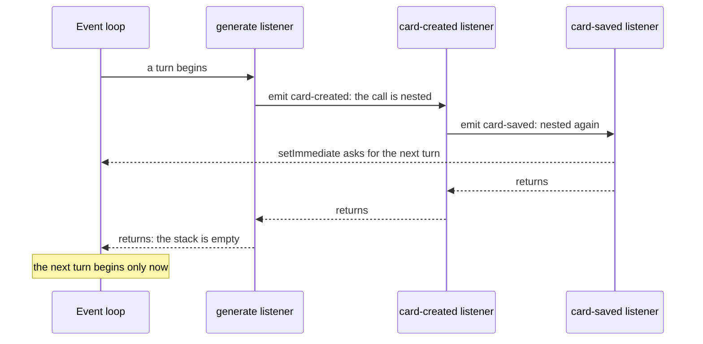

<!-- GENERATED by lessons/book/build.py from lessons/cs-source/ and the entries' frontmatter. Do not edit; edit the sources and run build.py. -->

# Events, callbacks and reactive control flow

Every entry in this book answers one question: **who chooses what runs next?** In a `for` loop, the loop chooses. In a lazy pipeline, whoever asks for the next value chooses. In this chapter, something else chooses: an *event*. A program registers small functions, and something else calls them when something happens. The program does not say when.

That sounds like a window with buttons, but it is a general way to build control flow, and this book has it in small, honest forms. [`javascript-events`](../../src/javascript-events/README.md) is built from nothing else: ten listeners on one emitter, and no loop statement. The other chapters show how code is chosen by a counter, a demand or a rewrite. This one shows what changes when a *notification* does the choosing.

## Who chooses what runs next?

Three answers appear in the entries for the same job (draw cards until the total passes 40):

- **The program chooses** (a loop). `while (total <= 40) { ... }`. The program asks itself the question before every card. [`javascript`](../../src/javascript/README.md) and [`cobol`](../../src/cobol/README.md) work this way.
- **The consumer chooses** (a pull). Nothing happens until someone asks for the next value. [`javascript-weird`](../../src/javascript-weird/README.md) and [`haskell`](../../src/haskell/README.md) work this way. The asking is the loop.
- **The producer chooses** (a push). Something announces "this happened", and every function that registered for it runs. [`javascript-events`](../../src/javascript-events/README.md) works this way, and so does [`tar-gnu-weird`](../../src/tar-gnu-weird/README.md): tar announces "one more record written", and a state machine takes one step.

The two ways to know that something happened are **polling** and **notification**. Polling is a loop that asks "is it there yet?" again and again. Notification is a registration: "call me when it is there". Polling costs time while nothing happens. Notification costs *structure*: the order of the program is now spread over the places where things are registered and announced.

## Three ways to run the same cards

| | A loop | A synchronous emitter | Scheduled events |
|---|---|---|---|
| Example | [`javascript`](../../src/javascript/README.md) | The same listeners, with `emit('generate')` in place of `later('generate')` | [`javascript-events`](../../src/javascript-events/README.md) |
| Who starts the next card | The `for` statement | The last listener, by calling `emit` | The last listener, by asking the event loop |
| The call stack between two cards | Empty | **Grows** by a few frames for every card | Empty |
| A run of a million cards | Fine | `RangeError: Maximum call stack size exceeded` | Fine |
| A listener that throws | Not applicable | The exception goes to the caller of `emit`, up through every card before it | The exception goes to the scheduled callback, so each listener catches its own |
| Who else can run between two cards | Nobody | Nobody | Anything on the event loop: timers, I/O, other listeners |

The middle column is the trap. It *looks* like events, and it behaves like a recursion. In Node, `EventEmitter.emit()` calls every listener of the event, in the order they were registered, **before it returns**. A listener that emits again makes the stack deeper. The event loop is not involved at all. Only a call to something like `setImmediate()` hands the next step to the event loop, and then the stack unwinds first.

## A trace you can read

One run of [`javascript-events`](../../src/javascript-events/README.md) with three cards of 19 hours, with `>name` where an `emit` starts and `<name` where it returns:

```text
>start <start                              <- turn 1: asks for the first card, returns
>generate >card-created >card-saved >total-updated
<total-updated <card-saved <card-created <generate     <- turn 2: card 1, then the stack is empty
>generate >card-created >card-saved >total-updated
<total-updated <card-saved <card-created <generate     <- turn 3: card 2
>generate >card-created >card-saved >total-updated >finished >done
<done <finished <total-updated <card-saved <card-created <generate   <- turn 4: card 3 (57 hours)
```

The nesting is the call stack. Inside one turn the events are *calls*: `card-created` runs inside `generate`, and `generate` cannot return until it has. Between turns the stack is empty, and the event loop is back in charge. The picture:



## Node's rules that matter here

The sources are the Node.js [`events` documentation](https://nodejs.org/api/events.html) and its guide to the [event loop, timers and `process.nextTick()`](https://nodejs.org/en/learn/asynchronous-work/event-loop-timers-and-nexttick).

- **`emit()` is synchronous.** Listeners run in registration order, before `emit` returns. This is documented, so it is a promise and not an accident.
- **The name `error` is special.** `emit('error', e)` with no listener *throws* `e`. Every other name with no listener does nothing.
- **A copy of the listener list is made for each `emit`.** A listener that removes listeners (or adds some) changes the *next* emit, not the one in flight.
- **Timers, immediates and microtasks have an order**, and it is not the order you might guess. After the current code finishes, Node runs `process.nextTick` callbacks, then promise callbacks (microtasks), and then goes round the event loop: expired timers, then I/O callbacks, then `setImmediate` callbacks, and so on. When `setTimeout(fn, 0)` and `setImmediate(fn)` are called from the main module, which runs first is *not promised*: it depends on how fast the process started. Inside an I/O callback, `setImmediate` always runs first. This is implementation-dependent behavior of the kind that [Hyrum's law](08-abstraction-leaks-and-implementation-dependence.md#hyrums-law) describes, so [`javascript-events`](../../src/javascript-events/README.md) uses `setImmediate` alone and never depends on the order between two of them.
- **An `async` listener's failure is not caught by a `try` around `emit`.** The listener returns a promise, and `emit` has already returned. The option `captureRejections` turns such a rejection into an `error` event.
- **Listeners need an owner.** A listener that nobody removes can keep a whole object alive. Node warns when one event has more than ten listeners, because that is usually a leak. A timer or an immediate left behind can keep the process from ending. [`javascript-events`](../../src/javascript-events/README.md) ends by removing every listener, and its lab checks that no timer or immediate is left.

## State machines, re-entrancy and ending

A program of listeners is a [Transition systems and state machines](02-what-counts-as-a-machine.md#transition-systems-and-state-machines): a state, and moves that events trigger. [`javascript-events`](../../src/javascript-events/README.md) keeps its state in one object that only listeners touch, and each listener is one transition. Two questions decide whether such a program is sound.

**Can a listener be called again while it is still running?** That is *re-entrancy*. A synchronous `emit` allows it: a listener emits an event whose listener emits the first event again. The synchronous column above is exactly that, and its price is the stack. The scheduled version cannot be re-entered, because the next card is a new turn.

**Does it end?** A chain of events that never stops is a loop that nobody can see. The program must have one listener that does *not* announce the next step, and it must tidy up: roll back what was not committed, close the database, remove the listeners and stop the timers. In [`javascript-events`](../../src/javascript-events/README.md) that is `finished` (or `failed`), and then `done` removes everything.

A listener cannot pause in the middle and be resumed, so a chain of listeners is not a [Coroutines](03-control-flow-and-continuations.md#coroutines). Each listener runs to its end and returns, and the next one starts fresh. State has to live outside them. The same is true for a [Closures and lexical environments](06-state-beyond-variables.md#closures-and-lexical-environments) used as a callback: it keeps variables, but not a *place* to resume.

## Backpressure, and when events are the wrong tool

An event source announces things at its own speed. Events have no way to say "slower". If the producer is faster than the consumer, the queue grows without a limit, or events are dropped. **Backpressure** is the way a consumer pushes back. A pull is the simplest form of it, because the consumer asks for one value when it is ready: [`javascript-weird`](../../src/javascript-weird/README.md) cannot be flooded, since nothing is drawn until `next()` is called. [`tar-gnu-weird`](../../src/tar-gnu-weird/README.md) shows the opposite. tar keeps writing records and calling the clock after the machine is done, and those ticks only count as idle.

[`javascript-events`](../../src/javascript-events/README.md) is safe from the flood for a plain reason: each card waits for the one before it, so the producer and the consumer are the same program. A real event source, such as a network socket, needs a bounded queue or a stream.

Events are also the wrong tool when:

- there is exactly one listener, and it is always the same one. A function call says the same thing, is shorter, and a debugger can step through it;
- the order must be obvious. With events it is in the names and in the order of registration;
- you need a result back. An event announces, and it does not answer.

## Events in this repository, and what is only a look-alike

Not every callback is an event, and not every window is event-driven. The table says what each entry really has.

| Entry | What it has | Is the program event-driven? |
|---|---|---|
| [`javascript-events`](../../src/javascript-events/README.md) | Ten listeners on one emitter; `setImmediate` between cards; a pulse timer | **Yes.** The listeners are the program |
| [`javascript`](../../src/javascript/README.md) | A `for` statement, then a `setInterval` callback for the pulse | Only the pulse. The cards are a loop |
| [`javascript-weird`](../../src/javascript-weird/README.md) | A pull pipeline, then the same timer | Only the pulse. The cards are pulled |
| [`tar-gnu-weird`](../../src/tar-gnu-weird/README.md) | tar runs a command at every checkpoint | **Yes.** A callback from outside moves a state machine one step. There is no loop in the program |
| [`regex-pcre2`](../../src/regex-pcre2/README.md) | The engine calls a function at every callout | A **callback**, but a synchronous one: it is a call from the engine, not a queued event |
| [`tcl-weird`](../../src/tcl-weird/README.md) | A trigger calls an SQL function, which calls Tcl | A **callback chain** on one call stack. The database dispatches, and nothing waits in a queue |
| [`ModernChallenge1`](../../src/ModernChallenge1/README.md), [`LinqChallenge1`](../../src/LinqChallenge1/README.md), [`xaml`](../../src/xaml/README.md) | A WPF window with its message loop (`Application.Run`) and an animation that is started by a `Loaded` trigger | **No.** The UI framework has an event loop, and an animation is declared, not subscribed to. The cards come from a `for` statement, a LINQ pipeline and a parser |
| [`PythonChallenge1`](../../src/PythonChallenge1/README.md), [`RustChallenge1`](../../src/RustChallenge1/README.md) | A Tk `mainloop` and a GLib `MainLoop`, with a timer that moves a color | **No.** The same: a window runs its own loop, and the cards are made before it opens |
| [`JavaChallenge1`](../../src/JavaChallenge1/README.md), [`KotlinChallenge1`](../../src/KotlinChallenge1/README.md), [`GoChallenge1`](../../src/GoChallenge1/README.md) | A modal Swing dialog with a timer that fades the colors (Java, Kotlin), and a page served to the browser (Go) | **No.** The window opens at the end, and the cards come from a `for` statement or a sequence |

An animation framework, data binding and a window's own loop are *mechanisms* that use events. They do not make the program that starts them event-driven. The test is simple: **does the card logic run because an event arrived?** If the answer is "no, a loop or a pipeline runs it, and then it opens a window", the entry is a loop with a window.

## Predict, then run

[Exercise B22](../exercises.md#b22-javascript-event-driven-predict-the-trace-then-remove-the-boundary-verified) asks you to write the trace of a run *before* you see it, to predict what `emit` and `setImmediate` print, and to remove the scheduling boundary and watch a million cards run out of stack. Do the prediction on paper first. The surprise is the point.

## Event-driven programming

In **event-driven programming** the program does not decide when its code runs. Something else produces *events*, and the program registers *callbacks* that run when one arrives. The flow of control is inverted: you do not call the framework, it calls you. Graphical interfaces, servers and timers work this way.

[`javascript-events`](../../src/javascript-events/README.md) is the plainest case in this repo: its ten listeners are the whole program, and each one emits the event that the next one waits for. [`tar-gnu-weird`](../../src/tar-gnu-weird/README.md) is the other plain case. tar writes an archive, and every 512 bytes it calls a command. The command has no loop and no idea how many times it will be called. It moves a state machine one step. Change the archive's layout, and the same program gets a different number of events. [`javascript`](../../src/javascript/README.md) and [`javascript-weird`](../../src/javascript-weird/README.md) show a small, real one: after all the cards are saved, a `setInterval` timer calls a function every 600 milliseconds to pulse the DEMO ONLY line. The calls only happen after the synchronous code has finished, because JavaScript runs on one thread and its **event loop** runs a callback only when nothing else is running. A redirected run starts no timer, so Node has no event to wait for and exits at once.

A window is not enough to make a program event-driven. The WPF, Tk, GLib and Swing entries start a UI loop, but their cards come from a `for` statement, a pipeline or a parser, so they are counterexamples.

- **Use it when:** the work is a reaction to things that arrive: clicks, requests, ticks, files.
- **Avoid it when:** the order matters and the callbacks hide it. A chain of callbacks is hard to read and harder to test.

**Read more:**

- [Event-driven programming](https://en.wikipedia.org/wiki/Event-driven_programming) (Wikipedia)
- [The event loop](https://developer.mozilla.org/en-US/docs/Web/JavaScript/Event_loop) (MDN)
- [Events: EventEmitter](https://nodejs.org/api/events.html) (Node.js documentation)

**In this repo:**

| Entry | Language | How it relates | What it teaches |
| --- | --- | --- | --- |
| [`javascript`](../../src/javascript/README.md) | JavaScript, SQLite | demonstrates | That a for statement is three expressions and an empty body, and that JavaScript's own evaluation order, truthiness and comma operator are enough to run a whole program from the three clauses. |
| [`javascript-events`](../../src/javascript-events/README.md) | JavaScript, SQLite | demonstrates | That a program can be a set of listeners, each doing one small thing and then emitting the event the next one waits for; and that emit() calls its listeners at once, so only an explicit scheduling boundary gives the event loop a turn. |
| [`javascript-weird`](../../src/javascript-weird/README.md) | JavaScript, SQLite | demonstrates | That a closure is a state machine: a function plus the variables it was made next to, pulled one step at a time by an iterator, with reduce as the one fold that cannot stop. |
| [`LinqChallenge1`](../../src/LinqChallenge1/README.md) | C#, LINQ | counterexample | LINQ method chains, end to end. |
| [`ModernChallenge1`](../../src/ModernChallenge1/README.md) | C# | counterexample | Runtime XAML, LINQ to Objects, EF Core, and WPF animation - all from inside a `for` statement that has no body. |
| [`PythonChallenge1`](../../src/PythonChallenge1/README.md) | Python | counterexample | A one-statement port in Python: `iter(step, False)` calls a function again and again until it returns `False`. |
| [`RustChallenge1`](../../src/RustChallenge1/README.md) | Rust | counterexample | Iterators and closures as control flow. |
| [`tar-gnu-weird`](../../src/tar-gnu-weird/README.md) | GNU tar, SQLite | demonstrates | That an archive's physical layout can set the pace of a program: tar's checkpoints are a clock, and each tick moves a state machine by one step. |
| [`xaml`](../../src/xaml/README.md) | XAML, C# | counterexample | How far a markup parser can be pushed before it stops describing a UI and starts *running* a program. |

## Callbacks

A **callback** is code that you give to someone else, to be called later. The caller decides when, and you decide what. It exists because a library or an engine often knows *when* something happens (a record was written, a match reached a point, a timer expired) and cannot know *what* you want to do about it. Callbacks are how a tool lets you in.

A callback can be called at once, before the function you handed it to returns (a *synchronous* callback), or later, from the event loop (an *asynchronous* one). The first is just a call with an indirection, and it runs on the same call stack. The second needs a queue. [`regex-pcre2`](../../src/regex-pcre2/README.md) has the first kind: at every callout, the matching engine calls a C function, waits for its answer (`0` to go on, `1` to fail this branch) and then decides. [`tar-gnu-weird`](../../src/tar-gnu-weird/README.md) hands tar a command to run at every checkpoint. [`tcl-weird`](../../src/tcl-weird/README.md) registers a Tcl command as an SQL function, so a database trigger can call back into the interpreter. In [`javascript`](../../src/javascript/README.md) and [`javascript-weird`](../../src/javascript-weird/README.md) the pulse is a timer callback, and in [`javascript-events`](../../src/javascript-events/README.md) the listeners are callbacks that call each other through an emitter.

- **Use it when:** a tool knows when and you know what.
- **Avoid it when:** the callbacks nest deeply ("callback hell"), or errors must travel back to the caller. A throw inside a callback goes to whoever *called* it, which may be code that is not waiting.

**Read more:**

- [Callback (computer programming)](https://en.wikipedia.org/wiki/Callback_(computer_programming)) (Wikipedia)
- [Events: EventEmitter](https://nodejs.org/api/events.html) (Node.js documentation)

**In this repo:**

| Entry | Language | How it relates | What it teaches |
| --- | --- | --- | --- |
| [`javascript`](../../src/javascript/README.md) | JavaScript, SQLite | demonstrates | That a for statement is three expressions and an empty body, and that JavaScript's own evaluation order, truthiness and comma operator are enough to run a whole program from the three clauses. |
| [`javascript-events`](../../src/javascript-events/README.md) | JavaScript, SQLite | demonstrates | That a program can be a set of listeners, each doing one small thing and then emitting the event the next one waits for; and that emit() calls its listeners at once, so only an explicit scheduling boundary gives the event loop a turn. |
| [`javascript-weird`](../../src/javascript-weird/README.md) | JavaScript, SQLite | demonstrates | That a closure is a state machine: a function plus the variables it was made next to, pulled one step at a time by an iterator, with reduce as the one fold that cannot stop. |
| [`regex-pcre2`](../../src/regex-pcre2/README.md) | C, PCRE2, Regular expressions | demonstrates | Regex callouts as a tiny instruction set. |
| [`regex-pcre2grep`](../../src/regex-pcre2grep/README.md) | PCRE2, Regular expressions | analogy | Program exit codes as control flow. |
| [`tar-gnu-weird`](../../src/tar-gnu-weird/README.md) | GNU tar, SQLite | demonstrates | That an archive's physical layout can set the pace of a program: tar's checkpoints are a clock, and each tick moves a state machine by one step. |
| [`tcl-weird`](../../src/tcl-weird/README.md) | Tcl, SQLite | demonstrates | That Tcl code is just strings, so it can live in a database and be fetched, defined and run on demand, with SQLite triggers as the control flow. |

## Publish and subscribe

In **publish and subscribe**, a *producer* announces that something happened, and any number of *consumers* that registered an interest are called. The producer does not know who they are, and the consumers do not know who produced the event. That is the whole point: the two sides can change independently. Message queues, browser events, and Node's `EventEmitter` all follow this shape.

The idea has two halves that are easy to confuse. *Who is called* is decided by registration (the table of listeners). *When they are called* is decided by the mechanism: an `EventEmitter` calls them at once and in order, and a message broker may deliver them later and somewhere else. [`javascript-events`](../../src/javascript-events/README.md) uses an emitter in the plainest way, with one listener per event, and its README says honestly that with exactly one listener the indirection buys nothing. A SQLite trigger in [`tcl-weird`](../../src/tcl-weird/README.md) is a subscription to "a row was inserted". The checkpoint action in [`tar-gnu-weird`](../../src/tar-gnu-weird/README.md) is a subscription with one subscriber.

- **Use it when:** more than one party may care, or the sender must not know who.
- **Avoid it when:** there is one receiver. A function call is shorter, and a debugger can step through it.

**Read more:**

- [Publish-subscribe pattern](https://en.wikipedia.org/wiki/Publish%E2%80%93subscribe_pattern) (Wikipedia)
- [Events: EventEmitter](https://nodejs.org/api/events.html) (Node.js documentation)

**In this repo:**

| Entry | Language | How it relates | What it teaches |
| --- | --- | --- | --- |
| [`javascript-events`](../../src/javascript-events/README.md) | JavaScript, SQLite | demonstrates | That a program can be a set of listeners, each doing one small thing and then emitting the event the next one waits for; and that emit() calls its listeners at once, so only an explicit scheduling boundary gives the event loop a turn. |
| [`tar-gnu-weird`](../../src/tar-gnu-weird/README.md) | GNU tar, SQLite | analogy | That an archive's physical layout can set the pace of a program: tar's checkpoints are a clock, and each tick moves a state machine by one step. |
| [`tcl-weird`](../../src/tcl-weird/README.md) | Tcl, SQLite | analogy | That Tcl code is just strings, so it can live in a database and be fetched, defined and run on demand, with SQLite triggers as the control flow. |

## The event loop and scheduling turns

An **event loop** is a loop that waits for something to happen and then runs the code registered for it, one piece at a time. It exists so that one thread can do many things without blocking: while one piece waits for a file or a timer, another can run. Each pass of the loop runs a callback to its end. That is a **turn**. The next turn starts only when the call stack is empty.

This is why `setImmediate()` is useful in [`javascript-events`](../../src/javascript-events/README.md). It does not call the function. It puts the function on the loop's queue, and Node runs it on a later turn, after the stack has unwound and after anything else that was waiting. Compare an `emit()`, which is a call on the *current* stack. The difference is what keeps a million cards from becoming a million nested calls. In [`javascript`](../../src/javascript/README.md) and [`javascript-weird`](../../src/javascript-weird/README.md), the loop is the reason a pulse timer runs *after* the synchronous work is done, and the reason a redirected run exits at once: with no timer registered, the loop has nothing to wait for.

User-interface toolkits run the same kind of loop. The WPF dispatcher (`Application.Run` in [`ModernChallenge1`](../../src/ModernChallenge1/README.md) and [`LinqChallenge1`](../../src/LinqChallenge1/README.md)), Tk's `mainloop` in [`PythonChallenge1`](../../src/PythonChallenge1/README.md) and GLib's `MainLoop` in [`RustChallenge1`](../../src/RustChallenge1/README.md) each wait for events and call handlers. In those entries the loop only displays the window. The cards were made before it started.

- **Use it when:** many slow, independent things must share a thread.
- **Avoid it when:** a callback runs for a long time. Nothing else runs on that thread while it does, so one slow turn stalls every other.

**Read more:**

- [Event loop](https://en.wikipedia.org/wiki/Event_loop) (Wikipedia)
- [The event loop](https://developer.mozilla.org/en-US/docs/Web/JavaScript/Event_loop) (MDN)
- [The Node.js event loop, timers and process.nextTick()](https://nodejs.org/en/learn/asynchronous-work/event-loop-timers-and-nexttick) (Node.js documentation)

**In this repo:**

| Entry | Language | How it relates | What it teaches |
| --- | --- | --- | --- |
| [`javascript`](../../src/javascript/README.md) | JavaScript, SQLite | demonstrates | That a for statement is three expressions and an empty body, and that JavaScript's own evaluation order, truthiness and comma operator are enough to run a whole program from the three clauses. |
| [`javascript-events`](../../src/javascript-events/README.md) | JavaScript, SQLite | demonstrates | That a program can be a set of listeners, each doing one small thing and then emitting the event the next one waits for; and that emit() calls its listeners at once, so only an explicit scheduling boundary gives the event loop a turn. |
| [`javascript-weird`](../../src/javascript-weird/README.md) | JavaScript, SQLite | demonstrates | That a closure is a state machine: a function plus the variables it was made next to, pulled one step at a time by an iterator, with reduce as the one fold that cannot stop. |
| [`LinqChallenge1`](../../src/LinqChallenge1/README.md) | C#, LINQ | demonstrates | LINQ method chains, end to end. |
| [`ModernChallenge1`](../../src/ModernChallenge1/README.md) | C# | demonstrates | Runtime XAML, LINQ to Objects, EF Core, and WPF animation - all from inside a `for` statement that has no body. |
| [`PythonChallenge1`](../../src/PythonChallenge1/README.md) | Python | demonstrates | A one-statement port in Python: `iter(step, False)` calls a function again and again until it returns `False`. |
| [`RustChallenge1`](../../src/RustChallenge1/README.md) | Rust | demonstrates | Iterators and closures as control flow. |

## Backpressure

**Backpressure** is how a slow consumer tells a fast producer to wait. An event source announces things at its own speed. If the consumer cannot keep up, either a queue grows without a limit until memory runs out, or events are dropped. Backpressure turns that into a conversation: a bounded buffer, a stream that pauses its source, or a *pull*, where the consumer asks for one value when it is ready.

A pull is the simplest backpressure, and [`javascript-weird`](../../src/javascript-weird/README.md) is one: it cannot be flooded, because nothing is drawn until something asks. [`javascript-events`](../../src/javascript-events/README.md) has no backpressure and does not need it: each card waits for the previous card, so producer and consumer are one program. [`tar-gnu-weird`](../../src/tar-gnu-weird/README.md) shows the missing half. tar keeps writing records, and so keeps calling the clock, after the machine is done. Those ticks only count as idle, because there is no way to ask tar to stop.

- **Use it when:** the producer's speed is not under your control.
- **Avoid it when:** the producer and consumer are one sequential program. A plain loop is enough.

**Read more:**

- [Back pressure](https://en.wikipedia.org/wiki/Back_pressure) (Wikipedia)

**In this repo:**

| Entry | Language | How it relates | What it teaches |
| --- | --- | --- | --- |
| [`javascript-events`](../../src/javascript-events/README.md) | JavaScript, SQLite | counterexample | That a program can be a set of listeners, each doing one small thing and then emitting the event the next one waits for; and that emit() calls its listeners at once, so only an explicit scheduling boundary gives the event loop a turn. |
| [`javascript-weird`](../../src/javascript-weird/README.md) | JavaScript, SQLite | analogy | That a closure is a state machine: a function plus the variables it was made next to, pulled one step at a time by an iterator, with reduce as the one fold that cannot stop. |
| [`tar-gnu-weird`](../../src/tar-gnu-weird/README.md) | GNU tar, SQLite | analogy | That an archive's physical layout can set the pace of a program: tar's checkpoints are a clock, and each tick moves a state machine by one step. |
