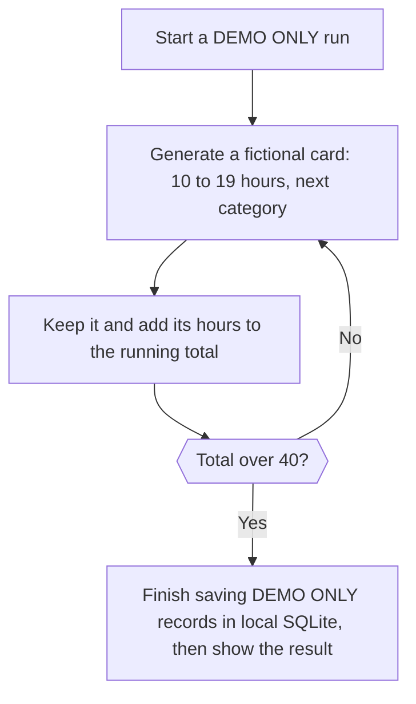

# Intro: why these lessons exist

You already know how to write a loop, query a database and call a function. You have read the tutorials. This is what comes after them.

The [code challenge](../README.md) asks one question in many accents: *how far can a language's own machinery be pushed before it starts acting like a general-purpose program?* The entries take on a small fictional time-card demo under an absurd constraint: one statement, no loop, no `IF`, nothing but a regex, nothing but a markup file.

The stunts are the door. These lessons are what is behind it.

For the purposes of this book, WEIRD stands for **Weird Execution, Indirect Results and Data**. It doesn't, of course. But it is a surprisingly serviceable description of what these programs are up to.

## What the challenge does

Start with a total of zero. Draw fictional time cards of 10–19 whole hours and cycle through Meetings, Coding, Debugging and Learning. Add the hours and keep the first card that takes the total over 40. Exactly 40 continues. That gives 3–5 cards and a final total of 41–59. Save the cards locally as **DEMO ONLY** records and show the result through the available interface. The picture shows the usual SQLite version of that task. Each program chooses when to persist the rows.

*How* it happens is what the entries disagree about. Each entry's README has a **Program Flow** section with its own picture, and the book shows it on the lesson page of that entry's language, under **How each program runs**. Those pictures are not all flowcharts, because the machines are not all alike. A COBOL program with a rewritten `GO TO` is a state that changes. A Haskell program is a demand that pulls. An m4 program is text that is read again. A Node program built from listeners is a conversation. If a picture could be pasted unchanged into ten entries, it would not be teaching anything.

### Where entries differ

| Entries | What differs from the usual run |
| --- | --- |
| [LINQ method chain](../src/LinqChallenge1/README.md) and [LINQ query syntax](../src/LinqChallenge2/README.md) | Five fixed 8-hour days end at 40.0 hours. These demos teach deferred execution with a fixed work week. |
| [XAML](../src/xaml/README.md) | Four copied passes can deal at most four cards. Four tens would reach 40 with no fifth pass available. On the shipped .NET runtime, seed 42 draws 16, 11, 11 and 15 for a total of 53. The strict variant saves XML, with SQLite used by the other variants. |
| [.NET regex](../src/regex-dotnet/README.md) | The numeric stop rule still applies. The host appends a TSV report from the successful match's captures and prints it. |
| [PCRE2 in C](../src/regex-pcre2/README.md) | The numeric stop rule still applies. Callouts write TSV during the match and close the file before deliberate match failure. |
| [Stock pcre2grep](../src/regex-pcre2grep/README.md) | The numeric stop rule still applies. Separate `sqlite3` invocations save cards as the match runs. The regex's `(*COMMIT)` prunes retries, and earlier writes survive the final failed match. |

The [shared output checker](tools/check-demo.sh) tests the numeric stop rule on a report, including the requirement to continue at 40. To see whether a report agrees with durable state, check the corresponding database or file as well.

## The teaching philosophy

> Teach the language by deliberately misusing it, then explain why the misuse works.

Most tutorials teach the idioms first: here is the right way to iterate, to hold state, to handle errors. These lessons start where the tutorials stop:

*You know the right way. Now find out what the language actually lets you do. Then ask why, although it is perfectly legal, it might be a terrible idea.*

The aim is to take your understanding up a level in two directions at once:

- **In a specific language.** You will learn what `ALTER`, `unsafeInterleaveIO`, `>in`, `include`, `CMAKE_MATCH_1` and `⎕FX`, `RT`, `unknown`, rescanning, method combination and a `find` that digs its own tree really do, which means you will learn how COBOL, Haskell, Forth, Make, CMake, APL, Common Lisp, m4, Tcl, AWK and find really work.
- **As concepts.** Control flow, state, evaluation order and side effects turn out to be separable things that different languages bolt together differently. Once you have seen control flow stored in a `GO TO`'s target, a parse position, a restarting build tool and a regex capture, you stop thinking of "the loop" as a given.

## The shape of every lesson

Each strange example is taught in the same five steps, whatever the language.

| Step | What happens |
| --- | --- |
| 1. **Behold the monstrosity** | The working program, and the command to run it ([in a container](exercises.md#running-things-safely)). Try to understand it *before* reading on. |
| 2. **How the hell does that work?** | The real semantics: what the compiler, interpreter, runtime or operating system actually does. The mechanism, not just the trick. |
| 3. **What did we just learn?** | The generalizable idea. Make is a dependency engine that can restart itself. COBOL's `ALTER` means a jump target is mutable state. LINQ is an execution pipeline, not just a query language. |
| 4. **Do this in production and you're fired** | The concrete failure modes: debugging, optimizers, concurrency, portability, security, testing, maintenance. Plus the honest cases where the technique is legitimate. |
| 5. **Now break it yourself** | An experiment that only works if you understood step 2. Predict, change, run, compare. See [exercises](exercises.md). |

Without step 5 this would be a museum of curiosities. The exercise is what turns curiosity into understanding.

## Three kinds of knowledge

Experienced programmers sometimes confuse "I've done this for twenty years" with "the language guarantees this." Ask which particular behavior is promised, by which specification or runtime manual, and which behavior you have only seen in a test.

| Tag | Meaning | Example |
| --- | --- | --- |
| **Guaranteed** | A named specification or documented API promises the behavior within its scope. | The .NET regex API documents balancing-group pops. That promise applies to the .NET regex engine. |
| **Implementation-permitted** | Works because of a particular compiler, runtime, platform or version. | GnuCOBOL still runs `ALTER`. `pcre2grep` callout scripts need a special build. |
| **Accidentally exploited** | A test may show it works, but the implementation makes no promise about the behavior. | A pre-order `find` may descend into a directory just created by its own `-exec`. POSIX leaves traversal of newly added files unspecified. |

An entry’s single assurance label records the weakest behavior its trick needs. A documented operation can sit right beside an undocumented assumption in the same program.

## The recurring question

Every lesson ends by asking:

> Under what circumstances would this terrible idea become a reasonable engineering decision?

Sometimes the answer is "never, given the alternatives." Sometimes it is "when you are writing a compiler, debugger, interpreter or test framework." Occasionally it is "when you are running a mainframe in 1978." A language feature is neither good nor bad in isolation: its value depends on the problem, the environment and the consequences. `ALTER` horrifies modern programmers, and it also served real purposes under real constraints. That does not mean we should revive it. It means we should understand why it worked, what it cost, and what changed.

## Weird next to boring

Pair each weird program with the small, idiomatic version of the same behavior (the repo has several: [`cobol`](../src/cobol/README.md) beside [`cobol-weird`](../src/cobol-weird/README.md), [`haskell`](../src/haskell/README.md) beside [`haskell-weird`](../src/haskell-weird/README.md), [`lisp`](../src/lisp/README.md) beside [`lisp-weird`](../src/lisp-weird/README.md), and so on). The point is not that the idiomatic one is morally superior. It is to see what got easier, what got harder, and what surprising capability the weird version revealed.

## Three ways in

- **By computer science concept**, if you want the theory first: [cs/](cs/README.md). Each idea gets a short explanation of why it exists, why people use it, when it fits and when it does not, with links to Wikipedia and other long-lived, freely reusable sources.
- **By language**, if you want to deepen the one you use: [languages/](languages/README.md).
- **By mechanism**, if you want to explore an unfamiliar way of computing: [patterns](patterns.md). A reader who arrives for C# may meet Haskell's laziness and realize both raise the same question: *when does the computation actually run?* One who arrives for COBOL's `ALTER` meets Make's restart machinery and CMake's regex registers, which are other ways of keeping control state outside ordinary variables. That cross-pollination is the point.

Then see [goals](goals.md), what was [overcome](problems-overcome.md), what is still [blocked](blocking-problems.md), and the [exercises](exercises.md).

## A word of caution

This is not a production style guide. Do not try any of it at work, and do not tell the boss. These programs work with **DEMO ONLY** data and local scratch storage. Run them in the [container or sandbox](exercises.md#running-things-safely).
