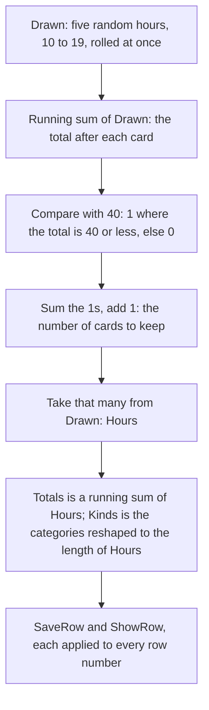
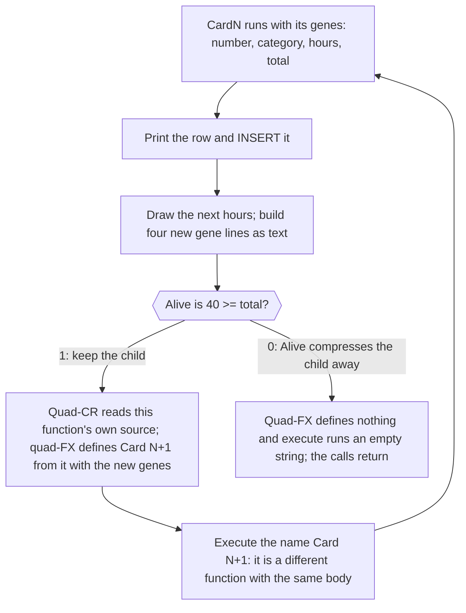

# APL

Entries: [`src/apl`](../../src/apl/README.md) (five rolls and one take-while) and [`src/apl-weird`](../../src/apl-weird/README.md) (functions that write their successors).

APL gets a page to itself, because it is the odd one out in the whole repo. Every other language here was built to *run* programs. APL began as a way to *describe* them.

## APL was meant for the whiteboard

Kenneth Iverson devised the notation in the late 1950s and published it in *A Programming Language* (1962) as a way to write down algorithms and, famously, to specify the architecture of computers. It was a **design language** first. Implementations came afterwards, once people realized the notation was executable. That origin explains everything odd about it:

- **Single-glyph primitives.** `⍴` (reshape), `⍳` (index generator), `+\` (running sum), `/` (compress): the symbols are the operations, because the notation was meant to be written by hand and read at a glance, the way mathematicians write.
- **No loops as the default.** Mathematical notation does not say "for i from 1 to n": it applies an operation to a whole vector. APL's primitives work on whole arrays for the same reason.
- **Right-to-left evaluation with no operator precedence.** Mathematical-notation habits (BODMAS) were deliberately set aside for one uniform rule.

Now imagine the thing you came here for: **whiteboarding in this.** Ask yourself:

- *What would you actually write?* Draw `Drawn←(10-⎕IO)+?5⍴10` on a whiteboard and you have a design in one line. Draw the same idea as a C-style loop and you have eight lines and an off-by-one risk.
- *What does a whiteboard hide?* Anything that requires a keyboard: the glyphs themselves, the dependence on `⎕IO`, whether `⊃` means "first" or "disclose" in your interpreter. APL on a whiteboard is concise and *ambiguous in exactly the ways a notation should not be*.
- *Who can read it?* The author, today. The [README's "Seeing the glyphs"](../../src/apl/README.md#seeing-the-glyphs) section exists because many fonts and terminals cannot even *display* the source.

The honest summary: APL is an astonishingly good *thinking* notation and an unforgiving *maintenance* language. The repo lets you feel both sides.

## 1. Array thinking replaces control flow (`apl`)

### Behold the monstrosity

```bash
sandbox/container/run-image.sh src/apl
```

The whole challenge ("add 10-19 hour cards until the total passes 40") is three array expressions: no loop and no `if`.

### How the hell does that work?

[`apl/timecards.apl` L30-39](../../src/apl/timecards.apl#L30-L39):

```apl
Drawn←(10-⎕IO)+?5⍴10
Hours←Drawn↑⍨1++/40≥+\Drawn
Totals←+\Hours
Kinds←(≢Hours)⍴Categories
```

Read each right to left.

1. **Draw everything up front.** `5⍴10` is five tens, `?` rolls each, and `10-⎕IO` shifts to 10..19. Why five? Every card is at least 10, so five always total at least 50. Five is a *bound that can never be too small*, not a loop count.
2. **Apply the stop rule as data.** `+\Drawn` is the running total; `40≥` turns it into `1 1 0 0 ...`; `+/` counts the 1s; `1+` adds the card that crosses; `↑⍨` takes that many.
3. **Derive the rest.** `⍴` *recycles* when the right argument is shorter than the target, so four category names reshaped to seven slots rotate without a modulo.

### What did we just learn?

- A loop with a stop condition can be replaced by **computing a prefix of a precomputed sequence.** Haskell's [`span` over a lazy list](haskell.md) does the same thing with laziness instead of a bound. The two languages disagree about *when* the list is made and agree about *what* it is.
- `⎕IO` (index origin) is a language-level setting. The straight entry never assumes it; the weird one sets `⎕IO←0` and relies on it.

Tags: array primitives are **guaranteed**. `⎕FIO` (file I/O) and the `⊃`/`↑` meanings are **implementation-specific**: in APL2-family interpreters (GNU APL) `⊃` *discloses* and `↑` is "first", and Dyalog swaps them.

## 2. Self-modifying functions (`apl-weird`)

### Behold the monstrosity

```bash
sandbox/container/run-image.sh src/apl-weird
```

The host defines exactly one function, `Card0`. Every other card is a function that the card before it **wrote**.

### How the hell does that work?

[`apl-weird/timecards.apl` L51-54](../../src/apl-weird/timecards.apl#L51-L54):

```apl
Genes←('N←',⍕N+1) ('C←',⍕4|C+1) ('H←',⍕D) ('T←',⍕T+D)
Alive←40≥T                                       ⍝ 1 until the total passes 40
Kid←⎕FX Alive/(⊂'Card',(⍕N+1),Locals),Genes,5↓⊂[1]⎕CR 'Card',⍕N
⍎Alive/'Card',⍕N+1
```

- `⎕CR 'Card',⍕N` returns *this function's own source* as a character matrix.
- `5↓⊂[1]` splits it into rows and drops the header and four "gene" lines, leaving the body.
- The new header and new gene lines (`N←2`, `C←1`, ...) are built **as text** and put in front.
- `Alive/` is the stop rule, a **compress**: a scalar 1 keeps every line and a scalar 0 keeps none, so the whole child is compressed away. `⎕FX` defines nothing from an empty list.
- `⍎Alive/'Card',⍕N+1` calls the child, or executes the empty string, a no-op. The same boolean controls both writing and calling.

The state of the program is not in variables. **It is in the program text.**

### What did we just learn?

- **Code is data**, in the strongest sense: a function can read, transform and define another function. Lisp programmers know this as homoiconicity; APL gets there by treating source as a character matrix.
- **A recursion can be a chain of different functions** instead of a function calling itself.
- **Compress is a conditional.** `0/x` is empty and `1/x` is `x`. "If" is a multiplication by a boolean.

### Do this in production and you're fired

- **Dynamic scope.** APL locals are visible to everything *called* from the function. Every generated card must declare `N;C;H;T;...` ([L36](../../src/apl-weird/timecards.apl#L36) `Locals`) or a child's genes would overwrite its parent's.
- **Silent structural failure.** The README's own war story: the first draft dropped four lines instead of five when copying the body, so every child kept its parent's `T←H` line and reset the running total. The stop rule never fired and the program recursed until killed. That is why [`check.sh`](../../src/apl-weird/check.sh) runs under `timeout`.
- **No `⎕IO` independence**: the weird version relies on `⎕IO←0`.
- **Debugging and security.** Behavior that depends on generated source defeats static tools, and `⍎` on assembled text is the classic injection shape. (Here, every value is a number the program computed.)

Legitimate uses: metaprogramming, interactive exploration, and code generation, where APL's workspace model (functions as editable data) is an actual strength.

### Break it yourself

See [exercises](../exercises.md#b6-apl-the-off-by-one-rewrite-verified).

## Quirks

- **Glyphs.** `⎕` is meant to be an empty box (it is "quad"). If other symbols appear as boxes, your font lacks the APL range. DejaVu Sans Mono and APL385 Unicode work; fonts installed inside WSL are not used by Windows programs.
- **Seeding.** GNU APL starts every session with `⎕RL` at 16807, so without seeding every run would draw identical cards ([`apl` L19](../../src/apl/timecards.apl)).
- **`_←` is a throwaway.** A bare expression prints its value, so `_←` swallows it.
- **`)OFF` is a system command, not APL code.** Without it `--script` sits at the prompt.
- **There is no formatter**; style (one statement per line, CamelCase names, aligned comments) is by hand.
- **`⍴` recycles**; a reshape longer than its source repeats it. A feature when you want a modulo, a bug when you did not.
- **`⎕FIO[22]` is `fprintf`**: the left argument is a format string followed by its values. `⎕FIO[24]` is `popen`, with `'w'` for a write pipe, which is how APL sends SQL to a real `sqlite3`.

## Weird next to boring

Both entries are APL, and neither is idiomatic in the sense a C programmer means it. The first says: *a loop was never needed.* The second says: *neither was a fixed program.* The interesting comparison is what each makes easy. The first is short, testable, and obvious once you read it right to left. The second proves that source text is a mutable value.

## Under what circumstances would this terrible idea become reasonable?

The first isn't a terrible idea; it is how APL programmers actually think. The second becomes reasonable when you are generating code from data in an environment designed for it. And as a *design* notation, APL's real home, it was reasonable from the start: it was meant for describing computation on a blackboard, long before anyone ran it.

<!-- BEGIN GENERATED program-flow:languages/apl.md -->
## How each program runs

Each picture below is the `## Program Flow` section of an entry's README, copied here by the build. It shows how that program makes the work happen: what the language, runtime or tool really does. [The introduction](../intro.md#what-the-challenge-does) has the one picture of what the challenge asks for, which is the same for every entry.

### Program flow of `apl`

From [`apl`](../../src/apl/README.md) ([source section](../../src/apl/README.md#program-flow)).



**What this shows:** no card is drawn *after* the stop rule is known. All five are drawn first, and the stop rule is arithmetic on whole arrays: a running sum, a comparison, a count. The only repetition is `¨` ("each"), and it visits rows that were already decided.

**Why this mechanism matters:** five is not a loop count. It is a bound that can never be too small, because five cards of at least 10 hours always pass 40. The program does its work as array operations, and an array operation takes the place of a loop. Compare [`apl-weird`](../../src/apl-weird/README.md), where the program writes itself.

### Program flow of `apl-weird`

From [`apl-weird`](../../src/apl-weird/README.md) ([source section](../../src/apl-weird/README.md#program-flow)).



**What this shows:** the recursion is a chain of different functions, not one function calling itself. Each `Card` function *writes* the next one as text and then calls it. The boolean `Alive` is both the stop rule and the guard on writing, because compressing with `0` removes every line of the child.

**Why this mechanism matters:** the program is self-modifying, and its state is source text: the "genes" are four lines that each child gets with new values. A broken stop rule does not fail. It recurses for ever, which is why the check runs the program under a timeout.
<!-- END GENERATED program-flow:languages/apl.md -->

## Computer science behind this page

<!-- BEGIN GENERATED concepts:languages/apl.md -->
The computer-science ideas behind this page: [Control flow](../cs/03-control-flow-and-continuations.md#control-flow), [Self-modifying code](../cs/03-control-flow-and-continuations.md#self-modifying-code), [Eager evaluation](../cs/04-evaluation-and-demand.md#eager-evaluation), [Referential transparency](../cs/04-evaluation-and-demand.md#referential-transparency), [Array programming](../cs/04-evaluation-and-demand.md#array-programming), [State](../cs/06-state-beyond-variables.md#state), [Scope and binding](../cs/06-state-beyond-variables.md#scope-and-binding), [Homoiconicity: code as data](../cs/06-state-beyond-variables.md#homoiconicity-code-as-data), [Reflection and metaprogramming](../cs/06-state-beyond-variables.md#reflection-and-metaprogramming), [Serialization, deserialization and object pickling](../cs/06-state-beyond-variables.md#serialization-deserialization-and-object-pickling).
<!-- END GENERATED concepts:languages/apl.md -->
