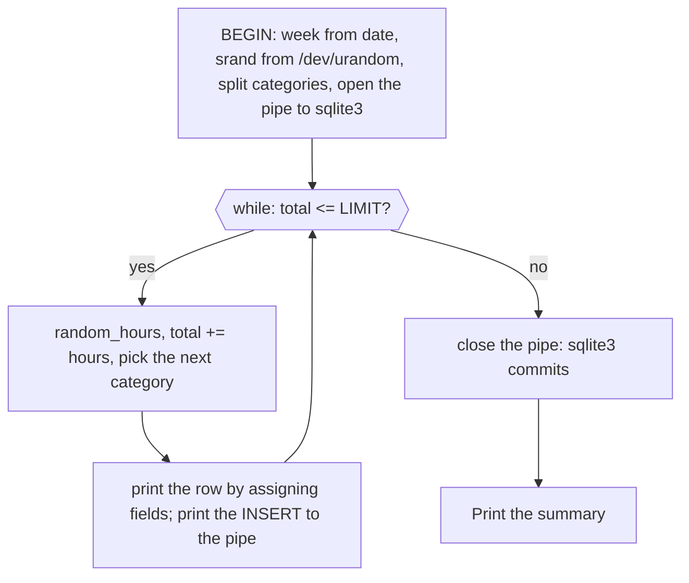
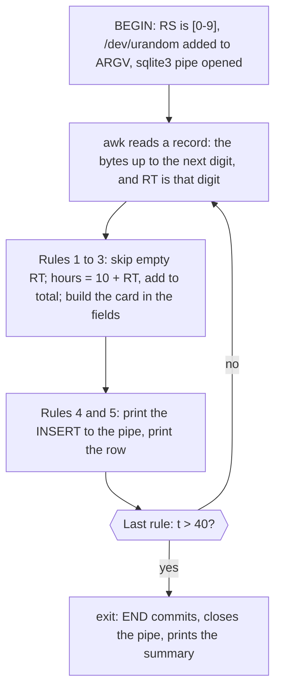

# AWK

Entries: [`src/awk`](../../src/awk/README.md) (portable POSIX awk, one `while` in a `BEGIN` block) and [`src/awk-weird`](../../src/awk-weird/README.md) (gawk: a stream of random bytes cut up by a regular expression, and no loop, `if`, function or random-number call).

## What makes AWK special

An awk program is a list of **pattern-action rules**, and the language runs them in a loop you never write: read a record, split it into fields, run every rule whose pattern matches, repeat. `BEGIN` runs before the first record and `END` after the last. Variables spring into existence as `""` or `0`, whichever the context wants. This is why awk programs are short, and why the "loop" in the weird entry is not in the program.

| Feature | Where | What it teaches |
| --- | --- | --- |
| Parameters as local variables | [`awk/timecards.awk` L14](../../src/awk/timecards.awk#L14): `function command_line(command,    line) {` | awk has no `local`. Extra parameters you do not pass are locals, by convention set apart by spaces. |
| Quoting by splitting | [L23](../../src/awk/timecards.awk#L23) `shell_quote` | `split(text, parts, "'")` makes quoting a path for the shell safe without regex tricks. |
| Assigning to a field rebuilds `$0` | [L44](../../src/awk/timecards.awk#L44) `print_row` | Set `OFS`, assign `$1 = $1`, and `$0` is rejoined with tabs. |
| A pipe is a file | [L84](../../src/awk/timecards.awk#L84): `print "BEGIN;" \| sqlite` | `print ... \| command` starts a process on first use; `close(command)` waits for it. |
| A plain loop, in `BEGIN` | [L93](../../src/awk/timecards.awk#L93): `while (total <= LIMIT) {` | The straight entry uses awk as a scripting language, not as a record processor. |
| `close()` is the error check | [L102](../../src/awk/timecards.awk#L102) | It returns the command's exit status in gawk and mawk, but `status * 256` in busybox and `0` in the one-true-awk. See below. |

## 1. A portable awk (`awk`)

The straight entry restricts itself to what POSIX awk guarantees, so it runs under gawk, mawk, the one-true-awk (BWK) and busybox awk. Its `check.sh` runs it under all four and lints it with `gawk --lint --posix`, which must be silent. This is the lesson: **portable awk is a real constraint**, and the four implementations disagree in small ways.

- **`close()` of a pipe returns different numbers per awk.** gawk and mawk return the exit status, busybox returns the status times 256, and the one-true-awk build tested returned 0 regardless. The entry treats "non-zero" as failure and does not depend on the value.
- **`srand`/`rand` are seeded from `od -An -N4 -tu4 /dev/urandom`** ([L70-71](../../src/awk/timecards.awk#L70-L71)): POSIX awk has no entropy source, and `srand()` with no argument is seeded by the time, which repeats within a second.
- **Function parameters must not share a name with a global** (`--lint` catches the shadowing).

## 2. Records from a random byte stream (`awk-weird`)

### Behold the monstrosity

```bash
sandbox/container/run-image.sh src/awk-weird
```

The header comment of [`timecards.awk`](../../src/awk-weird/timecards.awk#L17-L18) contains the whole challenge, minus the database, in one command:

```bash
gawk 'BEGIN{RS="[0-9]"; split("Meetings Coding Debugging Learning",C)}
      {printf "%s\t%d\t%d\n", C[(NR-1)%4+1], h=10+RT, t+=h} t>40{exit}' /dev/urandom
```

The program reads random bytes and prints timecards. There is no random-number call, no loop, no `if`.

### How the hell does that work?

**`RS` can be a regular expression (gawk).** POSIX awk says the record separator is one character. gawk also accepts a regex, and stores the text that matched in `RT`. [`RS = "[0-9]"`](../../src/awk-weird/timecards.awk#L34) says "a record ends at an ASCII digit". Read `/dev/urandom` with that and the stream is cut after every digit byte. About 10 in 256 bytes are digits, uniformly spread over 0-9, so **`RT` is a uniform random digit**. The record's own text (random junk before the digit) is ignored.

**A record is a card, a digit is a die.** `10 + RT` is 10 to 19 hours. awk's read-a-record loop, which you did not write, runs one pass per card. The rules ([L52-69](../../src/awk-weird/timecards.awk#L52-L69)):

```awk
RT == "" { next }                                   # not a die roll (see below)
{ t += h = 10 + RT }                                # the die, and the running total
{ $0 = C[n++ % 4 + 1] "," h "," t "," week }        # the card, as fields
{ print "INSERT INTO ..." | sql }                   # one INSERT to sqlite3
{ OFS = "\t"; $1 = $1; print $0, "DEMO ONLY" }      # the same row, for people
t > 40 { exit }                                     # the stop rule
```

Rule 3 assigns `$0`, which makes awk **re-split** the record into fields with `FS` (set to a comma in `BEGIN`), so `$1` is the category, `$2` the hours, `$3` the total. Rule 5 sets `OFS` and assigns `$1 = $1`, which rebuilds `$0` joined with tabs. The stop rule is a *pattern*: **`t > 40 { exit }`** matches once the total is over 40, and `exit` ends the main loop (`END` still runs, and commits).

**Making it read `/dev/urandom` with no `if`.** [`ARGV[ARGC] = "/dev/urandom"; ARGC += (ARGC < 2)`](../../src/awk-weird/timecards.awk#L39-L40) adds a file argument, then increments `ARGC` by `(ARGC < 2)`, which is 1 if no file was given and 0 if one was. A comparison is a number in awk, so a conditional is arithmetic.

**Order matters: `RS` applies to every read.** The week is fetched with `"date +%G-W%V" | getline week`. With `RS="[0-9]"` already set, `date`'s output would end at the first digit of the year and the week would be empty. The call is therefore made **before** `RS` is set in [`BEGIN`](../../src/awk-weird/timecards.awk#L25).

### What did we just learn?

- **awk's main loop is a loop you can aim.** Change `RS` and you change what a "record" is; change the input and you change how many times the loop runs. The program is the *body*.
- **Rules are conditionals.** A pattern is an `if`; `exit` is `break`; an empty pattern is "always". The six rules above are a straight-line program whose control flow is the pattern column.
- **A source of randomness can be any stream you slice.** Cutting a uniform byte stream at a class of bytes gives a uniform digit; no generator or seed is needed.
- **Implementations differ exactly where the standard stops.** `RT` is a gawk extension, so this program is a lesson in which part of awk is the language and which is gawk.

Tags: pattern-action rules, `BEGIN`/`END`, `$0` re-splitting, `getline` from a command and `exit` are **guaranteed** by POSIX. A multi-character `RS` as a regex is a **gawk extension** that mawk, the one-true-awk and busybox accept too. `RT`, `systime()` and `PROCINFO` are **gawk-only**. Reading `/dev/urandom` as a plain file is **implementation-permitted** (Linux/BSD).

### Do this in production and you're fired

- **It only works in gawk, and the failure under other awks is silent.** mawk has no `RT`, so `RT == ""` is *always* true, rule 1 skips every record, and the stop rule never fires. On `/dev/urandom` mawk reads until memory runs out; on a finite digit file it reports `total=0 entries=0`. (Try it, carefully, in [B13](../exercises.md#b13-awk-the-missing-rt-verified).)
- **The empty last record.** A file whose last character is not a digit leaves an empty final record with `RT == ""`. Without rule 1 that counts as a 10-hour card.
- **`RS` changes every read**, including `getline` from a command.
- **A directory name with a single quote** would break the shell command that makes the folder.
- **Nothing is testable in isolation**: the stream is the input, so the check feeds digit files in four shapes and compares them card by card with a bash reference.

Legitimate uses: a regex `RS` and `RT` are real tools for **parsing records that are not line-shaped** (multi-line records, tokens separated by a pattern, log entries). That *is* what they were added for.

### Now break it yourself

See [exercises](../exercises.md#b13-awk-the-missing-rt-verified). There is also an older awk exercise that needs no gawk: [C3](../exercises.md#c3-a-loop-whose-state-is-not-a-variable-verified), and a reference port to awk in [`solutions/awk-port`](../solutions/awk-port), which is a third design (the caller supplies the records with `seq 5`, and a `total <= 40` pattern is the stop rule).

## Quirks

- **Uninitialized variables are both `""` and `0`.** `t` needs no initialization, and `--lint` warns about it anyway: the straight entry initializes `total` and `cards` for that reason.
- **`print > "file"` truncates once, then appends** for the life of the program. A pipe is started once and reused until you `close` it.
- **`$(NF)` and `$NF`** differ, and `NF = 3` truncates a record. Fields are 1-based and `$0` is the whole record.
- **A comparison is 0 or 1**, which is why `ARGC += (ARGC < 2)` is legal.
- **`split(s, a, "'")` with a one-character separator** is literal; longer ones are regexes, a classic surprise.

## Weird next to boring

[`awk`](../../src/awk/README.md) uses awk as a scripting language: a `BEGIN` block, functions, a loop. [`awk-weird`](../../src/awk-weird/README.md) uses awk as a **record-processing machine**: no loop, the program is a column of patterns. The first is what a script author writes; the second is what the original design was for, aimed at a stream it was never meant to read. Compare [`haskell`](haskell.md#lazy-io-as-control-flow), where the data structure drives the evaluation, and [`regex-sed`](regex.md#gnu-sed), another small Unix tool with an implicit loop.

## Under what circumstances would this terrible idea become reasonable?

When the input *is* the loop. A regex record separator is the idiomatic way to read paragraphs, blocks of a config file or entries of a log. Slicing `/dev/urandom` for dice is a stunt, but the same mechanism (a pattern decides where a record ends; a pattern decides whether it matters) is what gives awk its reputation for doing in one line what takes a page elsewhere.

<!-- BEGIN GENERATED program-flow:languages/awk.md -->
## How each program runs

Each picture below is the `## Program Flow` section of an entry's README, copied here by the build. It shows how that program makes the work happen: what the language, runtime or tool really does. [The introduction](../intro.md#what-the-challenge-does) has the one picture of what the challenge asks for, which is the same for every entry.

### Program flow of `awk`

From [`awk`](../../src/awk/README.md) ([source section](../../src/awk/README.md#program-flow)).



**What this shows:** the idiomatic shape of an AWK generator. There is no input, so `BEGIN` does everything, and an ordinary `while` is the loop. The test comes before each draw, so the card that crosses 40 is the last one added.

**Why this mechanism matters:** the pipe is an output stream with a name. `print ... | sqlite` starts `sqlite3` once and streams SQL to it, and `close` is what flushes it and returns its exit status. AWK's real loop, the one over input records, is not used here. The weird sibling [`awk-weird`](../../src/awk-weird/README.md) uses it.

### Program flow of `awk-weird`

From [`awk-weird`](../../src/awk-weird/README.md) ([source section](../../src/awk-weird/README.md#program-flow)).



**What this shows:** the loop is the loop that every AWK program has: read a record, run every rule in order, read the next. The program has no `while` and no `if`. A record separator that is a regular expression turns the random bytes into dice, and the digit that ended the record (`RT`) is the die.

**Why this mechanism matters:** the stop rule is a bare pattern, `t > 40 { exit }`, and it is the last rule, so the crossing card has already passed through every earlier rule. The input is `/dev/urandom`, which never ends, so only `exit` can stop the loop. Compare [`awk`](../../src/awk/README.md), which loops in `BEGIN`.
<!-- END GENERATED program-flow:languages/awk.md -->

## Computer science behind this page

<!-- BEGIN GENERATED concepts:languages/awk.md -->
The computer-science ideas behind this page: [Control flow](../cs/03-control-flow-and-continuations.md#control-flow), [Regular expressions](../cs/05-formal-languages-as-computational-substrates.md#regular-expressions), [Declarative programming](../cs/05-formal-languages-as-computational-substrates.md#declarative-programming), [Domain-specific languages](../cs/05-formal-languages-as-computational-substrates.md#domain-specific-languages), [State](../cs/06-state-beyond-variables.md#state), [Portability](../cs/08-abstraction-leaks-and-implementation-dependence.md#portability).
<!-- END GENERATED concepts:languages/awk.md -->
