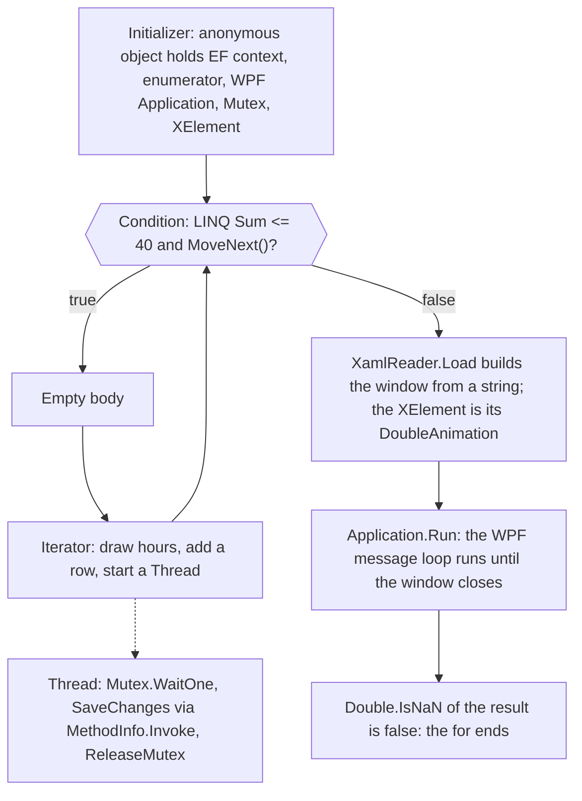
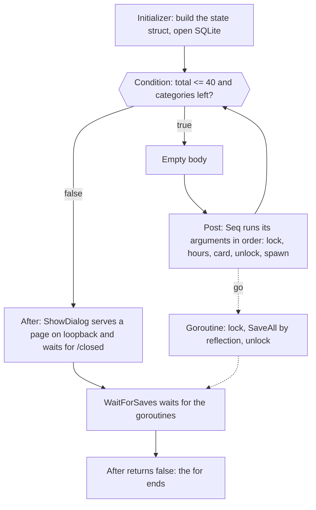
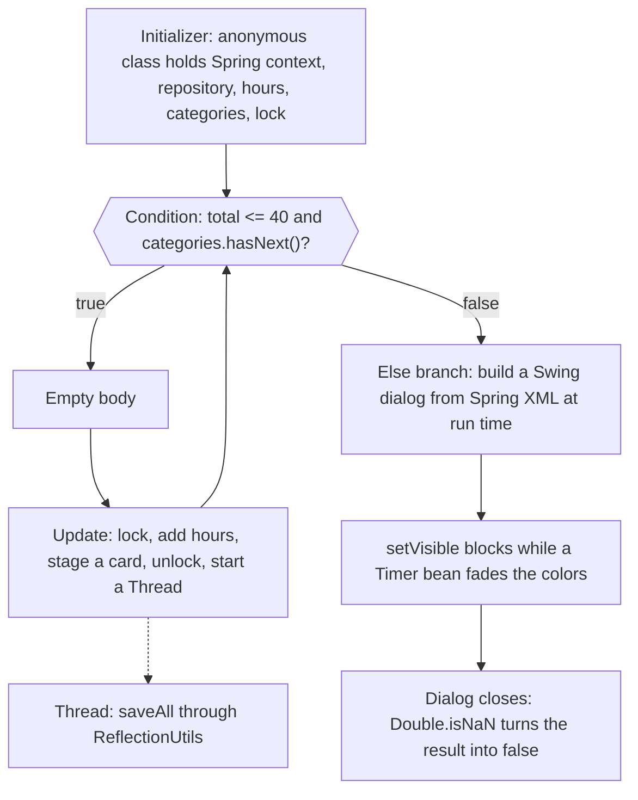
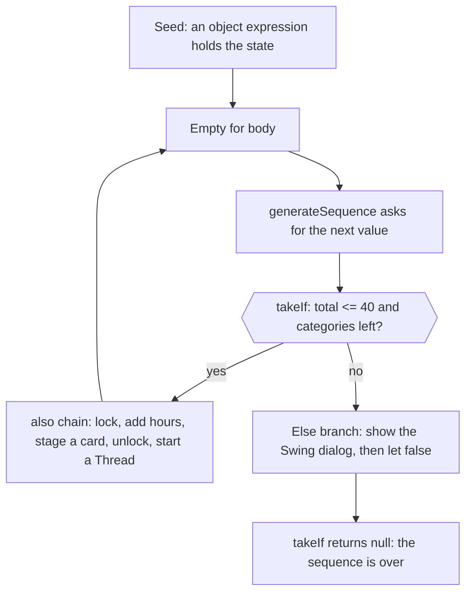
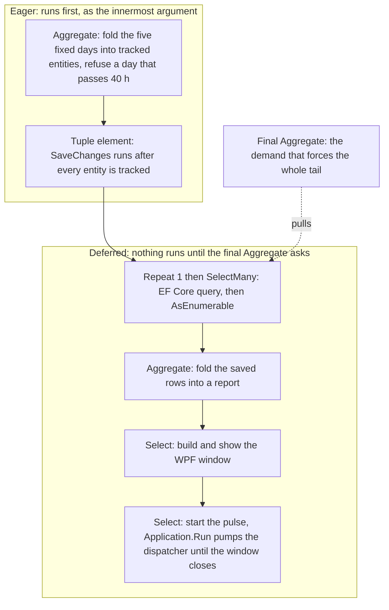
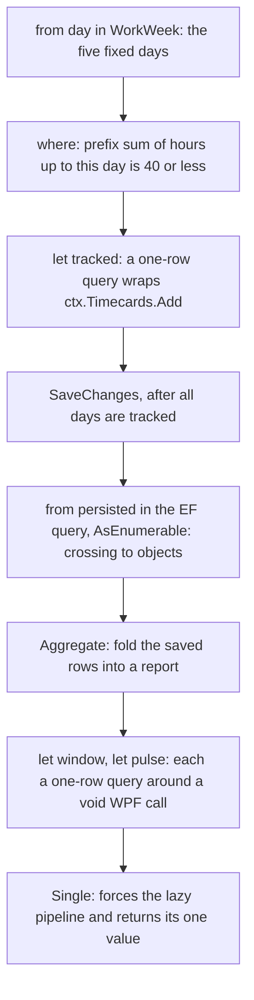
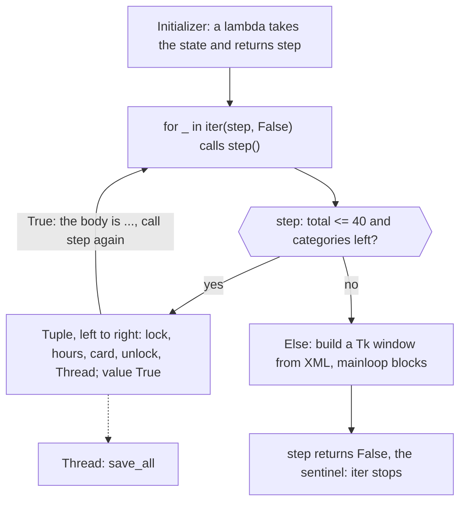
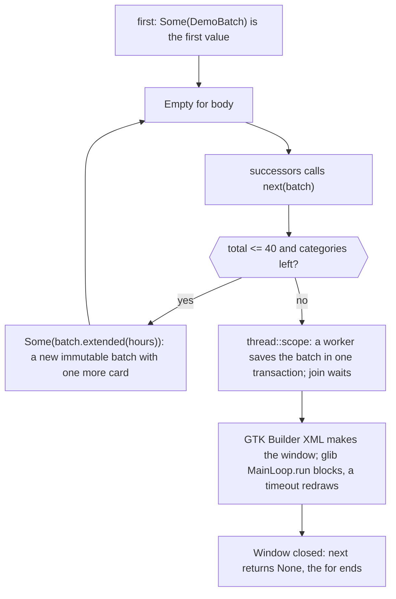
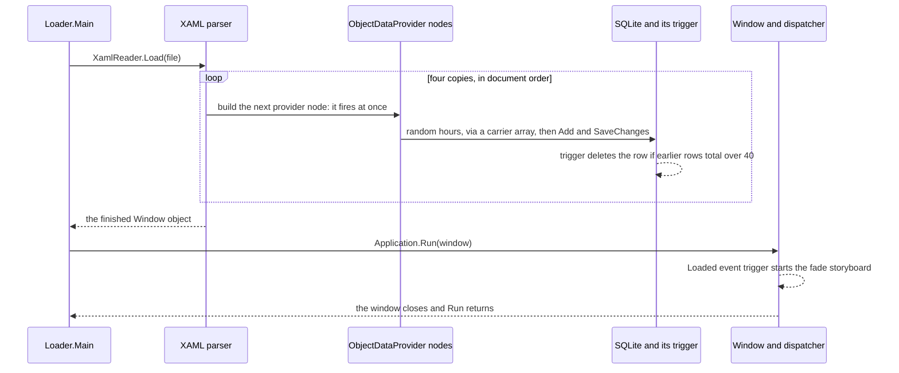

# C#, LINQ and XAML (plus the one-statement ports)

Entries: [`src/ModernChallenge1`](../../src/ModernChallenge1/README.md), [`src/LinqChallenge1`](../../src/LinqChallenge1/README.md), [`src/LinqChallenge2`](../../src/LinqChallenge2/README.md), [`src/xaml`](../../src/xaml/README.md) and the ports [`src/JavaChallenge1`](../../src/JavaChallenge1/README.md), [`src/KotlinChallenge1`](../../src/KotlinChallenge1/README.md), [`src/PythonChallenge1`](../../src/PythonChallenge1/README.md), [`src/GoChallenge1`](../../src/GoChallenge1/README.md), [`src/RustChallenge1`](../../src/RustChallenge1/README.md).

For an advanced reading path with traces and experiments, see the [C#, LINQ, XAML and ports study guide](../study-guides/languages/csharp-linq-xaml-and-ports.md).

C# is the *canonical* language of the repo: the challenge began as a 2008 classroom exercise showing off C# 3.0 and .NET 3.x features. It is also where the [blocking problems](../blocking-problems.md) are measured from.

This survey covers the original C# entry, the LINQ and XAML variants and the one-statement ports. The examples use the lesson steps that fit each mechanism.

## The original: ModernChallenge1

### Behold the monstrosity

```powershell
cd src\ModernChallenge1
dotnet run          # Windows + .NET 10; or: sandbox\windows\run.ps1 src\ModernChallenge1
```

A WPF window fades in and out. `Main` holds exactly one `for` whose body is empty ([`Program.cs` L132](../../src/ModernChallenge1/Program.cs#L132): `{ /* Intentionally empty. */ }`).

### How the hell does that work?

Read the `for` header as a tiny language of three slots.

| Clause | Where | What lives there |
| --- | --- | --- |
| **Initializer** | [L37-58](../../src/ModernChallenge1/Program.cs#L37-L58) | One `var i = new { ... }` anonymous object holding all state: EF Core context, `Random`, category enumerator, WPF `Application`, a `Mutex`, an `XElement` that becomes a `DoubleAnimation`. A `for` initializer allows one declaration, so the anonymous object is the one legal container. |
| **Condition** | [L66-98](../../src/ModernChallenge1/Program.cs#L66-L98) | `(from hours in i.totalHours select hours).Sum() <= 40d && i.categories!.MoveNext() ? true : new Func<bool>(() => Double.IsNaN(i.app.Run(...))).Invoke()`. While the total is 40 or less the loop continues. Once it is not, the condition builds and shows the window inline and returns false. |
| **Iterator** | [L106-130](../../src/ModernChallenge1/Program.cs#L106-L130) | Draws hours, adds a row to EF Core and starts a background `Thread` that calls `Mutex.WaitOne`, `SaveChanges` and `ReleaseMutex` *through `MethodInfo.Invoke`*. |

Each test of the `for` condition immediately needs a number. The LINQ projection can defer enumeration, and the terminal `Sum()` immediately enumerates it in the same condition test. The [Node port](javascript.md#the-bodiless-for-in-node) also computes its total eagerly, using `reduce` over the array.

The window is built from a string of raw XAML via `XamlReader.Load` at run time ([L77](../../src/ModernChallenge1/Program.cs#L77)).

### What did we just learn?

- `for` is three expressions plus a body, and the body is optional.
- An **anonymous type** is a way to pack mixed state into one expression.
- A `void` side effect can be turned into a value with a `Func<T>` invoked in place. That is the move every later entry reuses.

### Do this in production and you're fired

- **`DbContext` is not thread-safe.** The `Mutex` exists only to keep the thread-plus-reflection shape working at all ([README](../../src/ModernChallenge1/README.md#gotchas-worth-knowing)); it is a historical artifact.
- **Reflection and a thread add nothing.** They are a deliberate 2008-style time capsule; modern code would `await SaveChangesAsync()`.
- **WPF needs `[STAThread]`** and a single UI thread ([L30](../../src/ModernChallenge1/Program.cs#L30)).
- **Readability, testing, debugging**: nothing in that `for` header can be stepped through, unit-tested or reused.

Legitimate uses: none for the header as written. The *ideas* (state in an object, pure queries over a list, effects at the edge) are ordinary.

## Deferred execution and the void-to-value trick

A note before the code: the two LINQ entries are **not** the shared challenge. They draw no random hours. Their work week is five fixed 8-hour days, capped so that the total is exactly 40.0 hours and no card crosses the line, because they teach deferred execution rather than the stop rule.

### LinqChallenge1: one fluent chain

One `;`-terminated expression statement, built from LINQ calls, starting at [`Program.cs` L45](../../src/LinqChallenge1/Program.cs#L45) and ending in `.Aggregate(...)` that forces the lazy tail. Stages:

| Stage | Operator | Lesson |
| --- | --- | --- |
| 1 | `Aggregate` over a fixed work week, `ctx.Add(...)` inside `new Func<...>(() => {...}).Invoke()` | `Aggregate` is **eager**; it runs first. |
| tuple | `(..., ctx.SaveChanges())` ([L66-68](../../src/LinqChallenge1/Program.cs#L66-L68)) | Tuple elements evaluate **left to right**, which sequences the save after every entity is tracked. |
| 2 | `Enumerable.Repeat(x, 1).SelectMany(...)` and `.AsEnumerable()` ([L72-78](../../src/LinqChallenge1/Program.cs#L72-L78)) | The `IQueryable<T>` to `IEnumerable<T>` boundary: EF translates `Where/OrderBy/Select` to SQL, and `AsEnumerable()` is where it stops. |
| 3-5 | `Aggregate`, `Select` builds the WPF window, `Select` pulses and calls `Application.Run()` | Lazy `Select` stages do nothing until enumerated. |
| final | `.Aggregate(0, (count, _) => count + 1)` | An eager operator at the end drags the whole lazy pipeline through. |

Why two nested `Enumerable.Repeat(..., 1)`? C# allows only a few expression shapes as a statement (invocation, assignment, `await`...), not `x is var r && ...`. So each stage is nested directly as the argument to the next `Repeat`, which turns a single value back into a one-element sequence so the next step can stay a LINQ operator.

### LinqChallenge2: query syntax all the way down

[`LinqChallenge2/Program.cs` L53](../../src/LinqChallenge2/Program.cs#L53) onward is the same demo as nearly all `from`/`where`/`let`/`select`. Where a `let` has to smuggle in a `void` call ([L71-72](../../src/LinqChallenge2/Program.cs#L71-L72)), it is wrapped in a throwaway one-row query: `from _track in Enumerable.Repeat(0, 1) ...`. Turtles all the way down, on purpose. Things that cannot be query syntax (`Aggregate`, `Repeat`, `ToList`, `Sum`, `Single`, `AsEnumerable`) are listed in the [README](../../src/LinqChallenge2/README.md).

### What did we just learn?

- **LINQ is an execution pipeline, not just a query language.** Which stages are eager, which are lazy and which provider (SQL vs. objects) runs each one decide *when your side effects happen*. See the same question in [Haskell](haskell.md#lazy-io-as-control-flow).
- **Provider boundaries are real.** Everything before `AsEnumerable()` becomes SQL; everything after is C# running in your process.
- **Side effects in a lazy pipeline are a bug magnet**, and the entries make that visible.

Tags: deferred vs. immediate execution of each operator is **guaranteed** (documented). Tuple left-to-right evaluation is **guaranteed** by the C# spec. EF translating a given expression is **implementation-permitted** and depends on the provider.

### Do this in production and you're fired

- **Hidden mutation.** Both `Aggregate` accumulators are mutated in place (`list.Add`) - a pragmatic shortcut, not LINQ purity.
- **Re-enumeration runs the effects again.** A query with a side effect in a `Select` that is enumerated twice does the side effect twice.
- **UI thread affinity.** Building and pumping a WPF window from inside a `Select` lambda only works because of the STA thread and `Application.Run()`; `ShutdownMode` is `OnExplicitShutdown` so the animation's `Completed` handler, not "last window closed", ends the app.
- **Fixed data.** Both LINQ entries generate a *fixed* five 8-hour-day work week, not random 10 to 19 hour cards. See [blocking problems](../blocking-problems.md#c-and-linq).

### Now break it yourself

See [exercises](../exercises.md#b7-linq-enumerate-twice-verified).

## XAML

[`xaml/Loader.cs` L10-15](../../src/xaml/Loader.cs#L10-L15) is a single expression: `new Application().Run((Window)XamlReader.Load(File.OpenRead(args[0])))`. Everything else is in the `.xaml` file, and it runs **while the file is parsed**.

### How is that even possible?

| Mechanism | Role |
| --- | --- |
| `XamlReader.Load` | the interpreter: parsing *is* running |
| `ObjectDataProvider` | the instruction: constructs any object, calls any method, fires when parsed. Document order is the program counter. |
| "Carrier" arrays | the variables: one provider fills a `char[]` or `byte[]` in place, the next reads it back ([`efcore.xaml` L15-30](../../src/xaml/efcore.xaml#L15-L30) shows the chain `Next` -> `ToString` -> `CopyTo`) |
| Expression engines (`DataTable.Compute("Sum(h)")`, `DataView.RowFilter`, SQL) | the ALU and the conditionals |
| `Delegate.CreateDelegate` in markup | a `Thread`, built, started and joined from XAML |

### Honest fine print

- **The loop is unrolled**: four copy-pasted passes. "Four categories" is baked into the markup, so this entry can deal at most four cards. With the shipped seed (`Random(42)`: 16, 11, 11, 15 hours) it always deals four and ends at 53, so the case where four cards total exactly 40 (which should continue to a fifth) never arises. It is the only entry with that limit.
- **The branching is done by SQL or `DataTable`**, not by WPF triggers.
- **`Random(42)` is fixed-seeded** in the `.xaml` files, so the hours are the same on every run.
- **`XamlChallenge1.csproj` has `<Page Remove="**/*.xaml" />`**, so the files are loaded at run time, never compiled. That *is* the point.
- **Three flavors**: `strict.xaml` (only .NET types, saves XML), `sqlite.xaml`, `efcore.xaml`. The stop rule is a SQL `WHERE` clause or a SQLite trigger.

### What did we just learn?

XAML is supposed to *describe* a tree of objects. The parser does not enforce that: given `ObjectDataProvider` and a few built-in types, parsing and executing become the same act. A 2013 Web Forms [blog post](../../docs/stacked-bar-charts.md) pushed the same idea (a chart with no code-behind), so the lineage is real.

Tags: `ObjectDataProvider` calling methods on construction is **guaranteed** by WPF's documentation; relying on document-order evaluation and in-place carrier arrays is **accidentally exploited**.

**Fired in production**: arbitrary method invocation from a markup file is a code-execution surface. Loading untrusted XAML with `XamlReader.Load` is a well-known risk. Any tooling (designers, linters) assumes the file is data.

## The one-statement ports: same trick, different machinery

Ken's ports keep the bodiless-loop rule and swap in each language's own parts. A good exercise is to find each language's three clauses.

| Port | Header mechanism | Quirk worth stealing |
| --- | --- | --- |
| [Java](../../src/JavaChallenge1/README.md) | `for` header; anonymous class holds state; Swing window assembled from Spring XML with SpEL | A text block of XML as the UI; the README has a side-by-side of all four ports |
| [Kotlin](../../src/KotlinChallenge1/README.md) | `for (pass in generateSequence(...) {...})`; a null from `takeIf` ends the sequence | The body runs once before the first check, a documented difference |
| [Python](../../src/PythonChallenge1/README.md) | `for _ in iter(<lambda>, False): ...` | No `;` loops, so a tuple plus `[-1]` stands in for the comma operator; Tk widgets built from an XML string with `getattr(tk, e.tag)` |
| [Go](../../src/GoChallenge1/README.md) | a real three-clause `for`; helpers like `Seq` and `After` in `helpers.go` | Statement-only operations had to be hidden in a helper file, the stated cost of the Go version |
| [Rust](../../src/RustChallenge1/README.md) | `for _ in std::iter::successors(...) {}` ([`main.rs` L19](../../src/RustChallenge1/src/main.rs#L19)) | No `;`, `let` or `return` in `main`; `match x { name => ... }` stands in for `let`; a test scans the source to enforce it |

## Under what circumstances would this terrible idea become reasonable?

Putting everything in a `for` header: never. But knowing that LINQ is lazy, that `IQueryable` and `IEnumerable` are different worlds, that `DbContext` is not thread-safe and that XAML's parser can call methods are all things you want to learn *before* the production bug that teaches them.

<!-- BEGIN GENERATED program-flow:languages/csharp-linq-xaml.md -->
## How each program runs

Each picture below is the `## Program Flow` section of an entry's README, copied here by the build. It shows how that program makes the work happen: what the language, runtime or tool really does. [The introduction](../intro.md#what-the-challenge-does) shows what the challenge asks for and where entries differ.

### Program flow of `ModernChallenge1`

From [`ModernChallenge1`](../../src/ModernChallenge1/README.md) ([source section](../../src/ModernChallenge1/README.md#program-flow)).



**What this shows:** the original stunt. One `for` statement with an empty body, in which the condition and the iterator do all the work. While the total is 40 or less the condition is true. When it is not, the condition builds and shows the window, and the window's blocking call yields the `false` that ends the loop.

**Why this mechanism matters:** `Application.Run` is a UI framework's own loop, started from inside a loop condition. The animation fades the window by itself: nothing in `Program.cs` subscribes to an event to do it. See [`xaml`](../../src/xaml/README.md) for a stricter view of what that runtime parsing does.

### Program flow of `GoChallenge1`

From [`GoChallenge1`](../../src/GoChallenge1/README.md) ([source section](../../src/GoChallenge1/README.md#program-flow)).



**What this shows:** Go's `for` has the same three clauses as the C# original, but Go allows only simple statements there. So the work moves into helper functions, and `Seq(...)` runs its arguments in order in place of the comma list. The dashed edges are the concurrent part: each pass starts a goroutine, and the program must wait for all of them before it exits.

**Why this mechanism matters:** the loop ends through its condition, not through a `break`. The `||` makes the false branch do the final work (show the page, wait for the saves) and then yield `false`. The window is a browser page, because Go has no standard-library GUI.

### Program flow of `JavaChallenge1`

From [`JavaChallenge1`](../../src/JavaChallenge1/README.md) ([source section](../../src/JavaChallenge1/README.md#program-flow)).



**What this shows:** the literal three-clause `for (init; condition; update) { }`. The condition decides between "go round again" and "show the window, then say false". The window is built from Spring XML bean definitions when it is needed, and the modal dialog does not return until the user closes it.

**Why this mechanism matters:** this entry keeps control flow in the `for` and puts a framework's blocking call (a modal dialog with its own event handling) inside the condition. The dashed thread is the original's deliberately awkward background save.

### Program flow of `KotlinChallenge1`

From [`KotlinChallenge1`](../../src/KotlinChallenge1/README.md) ([source section](../../src/KotlinChallenge1/README.md#program-flow)).



**What this shows:** Kotlin has no three-clause `for`, so the loop iterates a sequence. The condition is `takeIf`, and "stop" is a `null`. The update is the chain of `?.also { ... }` calls that runs only when the condition passed. The body runs once before the first test, which makes no difference here because the body is empty.

**Why this mechanism matters:** it is the same three jobs as the Java port (initialize, test, update), carried by a lazy sequence that is pulled one value at a time. Ending the sequence is a value (`null`), not a statement.

### Program flow of `LinqChallenge1`

From [`LinqChallenge1`](../../src/LinqChallenge1/README.md) ([source section](../../src/LinqChallenge1/README.md#program-flow)).



**What this shows:** the whole program is one expression, so the order of work is the order of *evaluation*. The inner `Aggregate` is eager and runs first. Everything after it is a lazy chain of `LINQ` stages, and the last `Aggregate` is what makes them run. The dotted edge is demand, not data.

**Why this mechanism matters:** this is the difference between a query as a description and a query as an execution. `Enumerable.Repeat(…, 1)` turns one value into a one-element sequence so that each stage can stay a real `LINQ` operator. Every `void` call is wrapped to return a value, as the `void`-to-value trick (a section of this README) explains.

### Program flow of `LinqChallenge2`

From [`LinqChallenge2`](../../src/LinqChallenge2/README.md) ([source section](../../src/LinqChallenge2/README.md#program-flow)).



**What this shows:** the same data path as [`LinqChallenge1`](../../src/LinqChallenge1/README.md), written with query syntax. The `where` clause is the stop rule: it recomputes a prefix sum for each day instead of keeping a running total in a variable. Nothing runs until the closing `Single()`.

**Why this mechanism matters:** query syntax is only a way to write method calls. The compiler turns `where`, `let` and `select` into the same `Where`, `Select` and `SelectMany` calls, so the execution engine does not change. The one-row query around each `void` call is a joke that proves how far the syntax reaches.

### Program flow of `PythonChallenge1`

From [`PythonChallenge1`](../../src/PythonChallenge1/README.md) ([source section](../../src/PythonChallenge1/README.md#program-flow)).



**What this shows:** Python has no three-clause `for`, so the loop is `iter(step, False)`: call `step` until it returns the sentinel. One conditional expression is the test, and a tuple stands in for the comma list. Python evaluates the tuple's items in order, and the last item (`True`) is the value of the update.

**Why this mechanism matters:** the stop is a return value compared by `iter` with the sentinel, not a condition that the `for` itself checks. The window shows the same idea as the other ports: the final branch does the last work, then returns the value that ends the loop.

### Program flow of `RustChallenge1`

From [`RustChallenge1`](../../src/RustChallenge1/README.md) ([source section](../../src/RustChallenge1/README.md#program-flow)).



**What this shows:** `std::iter::successors(first, next)` carries the three jobs of a `for`: `first` is the initializer, `next` is both the condition and the update, and returning `None` is the stop. The state is never mutated. Each step builds a new `DemoBatch`.

**Why this mechanism matters:** saving is a joined, scoped thread, so the program never says "saved" before the transaction finished. The GTK window runs its own event loop (`MainLoop.run`) inside the `next` call, which is the last step before the loop ends.

### Program flow of `xaml`

From [`xaml`](../../src/xaml/README.md) ([source section](../../src/xaml/README.md#program-flow)).



**What this shows:** there is no loop and no stop rule in the markup's control flow. The parser walks the document once, from top to bottom, and each provider does its work at the moment it is built. The four passes are four copies, and the 40-hour limit is a trigger inside SQLite, which removes a row that comes too late.

**Why this mechanism matters:** the program counter is document order. The only event in the picture is the `Loaded` trigger, and it only starts an animation. The program's logic does not subscribe to anything. This is a parser used as an interpreter, not event-driven code. Shown here is `efcore.xaml`; `strict.xaml` and `sqlite.xaml` share the shape.
<!-- END GENERATED program-flow:languages/csharp-linq-xaml.md -->

## Computer science behind this page

<!-- BEGIN GENERATED concepts:languages/csharp-linq-xaml.md -->
The computer-science ideas behind this page: [Threat model](../cs/01-reading-an-adversarial-program.md#threat-model), [Arbitrary code execution](../cs/01-reading-an-adversarial-program.md#arbitrary-code-execution), [Computation versus orchestration](../cs/02-what-counts-as-a-machine.md#computation-versus-orchestration), [Control flow](../cs/03-control-flow-and-continuations.md#control-flow), [Evaluation strategies](../cs/04-evaluation-and-demand.md#evaluation-strategies), [Eager evaluation](../cs/04-evaluation-and-demand.md#eager-evaluation), [Lazy evaluation](../cs/04-evaluation-and-demand.md#lazy-evaluation), [Deferred execution](../cs/04-evaluation-and-demand.md#deferred-execution), [Iterators and generators](../cs/04-evaluation-and-demand.md#iterators-and-generators), [First-class and higher-order functions](../cs/04-evaluation-and-demand.md#first-class-and-higher-order-functions), [Monoids and folds](../cs/04-evaluation-and-demand.md#monoids-and-folds), [Dataflow programming](../cs/04-evaluation-and-demand.md#dataflow-programming), [Parsing](../cs/05-formal-languages-as-computational-substrates.md#parsing), [Declarative programming](../cs/05-formal-languages-as-computational-substrates.md#declarative-programming), [Domain-specific languages](../cs/05-formal-languages-as-computational-substrates.md#domain-specific-languages), [Markup languages](../cs/05-formal-languages-as-computational-substrates.md#markup-languages), [Language-theoretic security](../cs/05-formal-languages-as-computational-substrates.md#language-theoretic-security), [Weird machines](../cs/05-formal-languages-as-computational-substrates.md#weird-machines), [Interpreters and virtual machines](../cs/05-formal-languages-as-computational-substrates.md#interpreters-and-virtual-machines), [State](../cs/06-state-beyond-variables.md#state), [Closures and lexical environments](../cs/06-state-beyond-variables.md#closures-and-lexical-environments), [Reflection and metaprogramming](../cs/06-state-beyond-variables.md#reflection-and-metaprogramming), [Serialization, deserialization and object pickling](../cs/06-state-beyond-variables.md#serialization-deserialization-and-object-pickling), [Side effects](../cs/07-effects-errors-and-commitment.md#side-effects), [Thread safety and thread affinity](../cs/07-effects-errors-and-commitment.md#thread-safety-and-thread-affinity), [The event loop and scheduling turns](../cs/10-events-callbacks-and-reactive-control-flow.md#the-event-loop-and-scheduling-turns).
<!-- END GENERATED concepts:languages/csharp-linq-xaml.md -->
