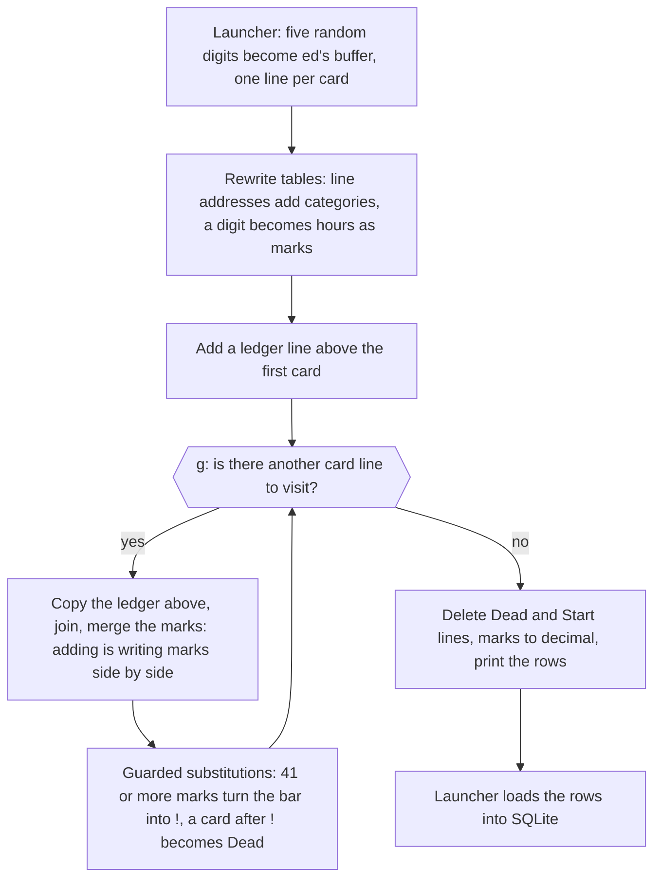
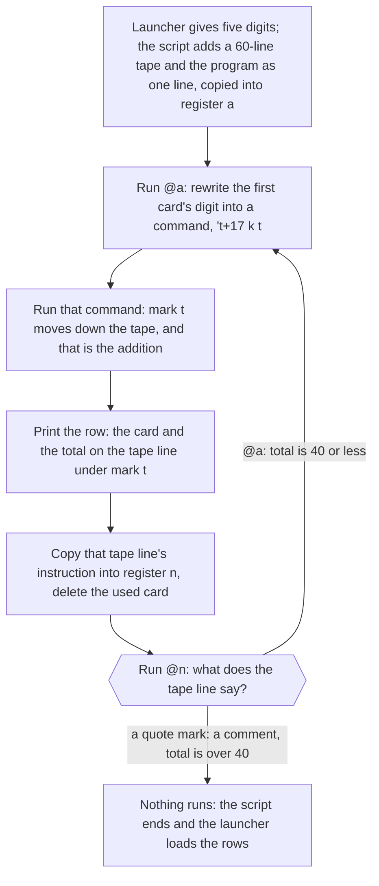

# ed and Ex

Entries: [`src/ed-weird`](../../src/ed-weird/README.md) (the buffer is the machine) and [`src/ex-weird`](../../src/ex-weird/README.md) (a program you can edit). `ed` is the original Unix line editor, from 1969 to 1971. You tell it which lines (an *address*) and what to do to them (a *command*). It has no screen. Everything it does to a file, it does to a **buffer** of lines in memory, one command at a time. The commands are so general that the program in this book is made of nothing else. `ex` is its bigger descendant: the command language of `vi`. It adds registers, marks, `@` and the bar.

## What makes ed special

| Feature | What it teaches |
| --- | --- |
| Addresses: `3`, `.`, `$`, `.-1`, `/re/` | A line is reached by number, by position or by pattern. An address is a reference into the data, as a pointer or an index is. |
| `s/re/text/` | Substitution is a conditional rewrite. If the pattern matches, the text changes. If not, nothing happens. |
| `g/re/command-list` | The global command marks every line that matches, then runs the commands for each one, in order. It is the only loop ed has. |
| `t`, `m`, `j`, `d` | Copy, move, join and delete whole lines: ed's way to build and tear down data. |
| No arithmetic and no variables | Numbers must be written as text. In the entry they are rows of marks. |

## The buffer is the machine

### 1. Behold the monstrosity

```bash
sandbox/container/run-image.sh src/ed-weird
```

Seventy lines of ed commands. A launcher that supplies five random digits and stores the answer. All the computing is the editor changing text.

### 2. How the hell does that work?

- **The category order is addressing.** `1s/^/Meetings /` puts a name on line 1, `2s/^/Coding /` on line 2.
- **A rewrite table does the lookup.** There are ten rules, `g/x7$/s/7$/xxxxxxx/` and nine more. A digit becomes that many marks.
- **Adding is writing marks side by side.** `-t.` copies the line above (the total so far), `-,.j` joins it to the card, and one `s` puts the two sets of marks together.
- **A failed `s` is an `if`.** Inside a global command it does nothing, and does not stop the list. So each substitution means "if the line looks like this, rewrite it".
- **The stop rule is a regular expression.** `x\{41,\}` is "41 or more marks". The bar before the marks becomes a bang, and the next card sees the bang and turns into a `Dead` line.

The [README](../../src/ed-weird/README.md#how-the-stunt-works) has the full table.

**A rewrite system with a different control.** [`regex-sed`](regex.md#gnu-sed) also rewrites text, but sed has a branch command and can loop until no rule applies. ed cannot. Its only repeat is `g`, and its only choice is a substitution that may not match.

### 3. What did we just learn?

- **Numbers can be text.** Unary marks make addition a matter of concatenation. The price is the length of the string.
- **A guard is a conditional.** "Rewrite only if it matches" is `if` in a language that has none.
- **Data can carry control.** A bar or a bang in a line says whether the machine is still running. The state travels with the data.
- **Standards and implementations differ.** busybox ed is an `ed`, and it cannot run this program: no `g`, no `t`, no `j`, no `#`, and no empty match.
- **A wall is a result.** Nested `g` is refused. A blank line is a command. We kept a test for each.

Tags: the commands `s`, `g`, `t`, `j`, `d` and `0a` are in POSIX. That a failed `s` inside `g` is silent is **accidentally exploited** knowledge: GNU ed 1.20.1 does it, and its manual does not say so. `#` comments are a GNU extension.

### 4. Do this in production and you're fired

- **Unary does not scale.** One million is a million characters.
- **The program depends on positions.** One extra line between a card and its ledger breaks every total.
- **Nobody can debug ten rewrite rules by eye.** The entry has a test that compares it with a short model.

Legitimate uses: `ed` and `ex` in scripts for exact, scriptable edits (`ed -s file < commands`), such as a build step that must change one line of a config file.

### 5. Now break it yourself

See [exercise B18](../exercises.md#b18-ed-move-the-stop-rule-and-break-the-cleanup-verified).

## A program you can edit

### 1. Behold the monstrosity

```bash
sandbox/container/run-image.sh src/ex-weird
```

A script of about 100 lines, most of it a table of sixty numbered lines. The program itself is **one line of text**.

### 2. How the hell does that work?

- **A mark is a register.** `k t` puts a mark on a line. `'t+17k t` moves it seventeen lines down. That is `t = t + 17`.
- **The tape is the number line.** Sixty lines, each `total instruction`. Where the mark stands *is* the running total, and the text of the line is that total as digits.
- **The program writes its own command.** A substitution turns the card `Meetings 7` into the text `'t+17k t`. The program copies that text into a register and runs it with `@d`.
- **The loop is a register that runs itself.** The program copies the *instruction* from the tape line into register `n` and runs it. Up to 40 it is `@a`, which is the program again. Above 40 it is a quote mark, which is a comment, so nothing runs.
- **Nothing in the program says 40.** The limit is where `@a` stops on the tape.

The [README](../../src/ex-weird/README.md#how-the-stunt-works) has the step table, the comparison with the ed entry, and the five places where nvi and Vim disagree.

### 3. What did we just learn?

- **Code is text, so it can be built.** A program can write a command as a string and run it. That is `eval`.
- **Editor state is state.** The current line, the marks and the registers are memory, outside the text of the buffer.
- **A jump table is data.** The next step is looked up by address, in a table, and the table holds the stop rule.
- **There is no one Ex.** nvi and Vim disagree on register order, nested global commands, printing, errors and backward ranges. The program was written around all five.
- **Batch is not interactive.** The same commands, with no one watching, must be right the first time.

Tags: the commands `@`, `k`, `ya`, `t`, `j`, `s`, the bar and the `"` comment are described for Ex in POSIX (we read it; we did not run a conformance suite). That the program runs the same on nvi 1.81.6 and Vim 9.1 is **implementation-permitted**: we checked two, and did not check conformance.

### 4. Do this in production and you're fired

- **A register that runs data is `eval`.** If the tape came from a stranger, the stranger would write your program. Here the tape is fixed, and the digits are checked before they get anywhere near a command.
- **Marks are fragile.** A mark on a deleted line is gone, and so is your counter.
- **The script depends on the Ex you have.** A script that works in one may not work in the other. Test with both.

Legitimate uses: `ex -s` in scripts for exact edits, and registers as a small macro system for repeated edits in `vi`.

### 5. Now break it yourself

See [exercise B19](../exercises.md#b19-ex-move-the-limit-on-the-tape-and-cut-the-loop-verified).

<!-- BEGIN GENERATED program-flow:languages/editors.md -->
## How each program runs

Each picture below is the `## Program Flow` section of an entry's README, copied here by the build. It shows how that program makes the work happen: what the language, runtime or tool really does. [The introduction](../intro.md#what-the-challenge-does) has the one picture of what the challenge asks for, which is the same for every entry.

### Program flow of `ed-weird`

From [`ed-weird`](../../src/ed-weird/README.md) ([source section](../../src/ed-weird/README.md#program-flow)).



**What this shows:** `ed` has one loop, the global command `g`, and it has no `if`. A substitution that finds nothing to replace does nothing, so each guarded substitution means "if the line has this pattern, rewrite it". The state is text: marks that are added by writing them side by side.

**Why this mechanism matters:** the stop rule is a regex over the ledger (41 or more marks), and it runs *after* the card is written, so the crossing card is kept. The `!` that it writes is a state that later cards read. It is the whole memory of "we are over".

### Program flow of `ex-weird`

From [`ex-weird`](../../src/ex-weird/README.md) ([source section](../../src/ex-weird/README.md#program-flow)).



**What this shows:** Ex keeps state outside the text, in marks, and it can run a register as a command. The position of mark `t` on a tape *is* the running total. The tape line under it holds the next instruction: `@a`, which means "go round again", or a quote mark, which Ex reads as a comment.

**Why this mechanism matters:** this is self-modifying code. The program writes the command that does its arithmetic, and the stop rule is the place on the tape where `@a` turns into a comment. Nothing in the program says "40" anywhere except in how the tape is laid out.
<!-- END GENERATED program-flow:languages/editors.md -->

## Computer science behind this page

<!-- BEGIN GENERATED concepts:languages/editors.md -->
The computer-science ideas behind this page: [Specification versus implementation](../cs/01-reading-an-adversarial-program.md#specification-versus-implementation), [Capability and authority](../cs/01-reading-an-adversarial-program.md#capability-and-authority), [Transition systems and state machines](../cs/02-what-counts-as-a-machine.md#transition-systems-and-state-machines), [Representing state](../cs/02-what-counts-as-a-machine.md#representing-state), [Register machines and counter machines](../cs/02-what-counts-as-a-machine.md#register-machines-and-counter-machines), [Markov algorithms](../cs/02-what-counts-as-a-machine.md#markov-algorithms), [Operational semantics](../cs/02-what-counts-as-a-machine.md#operational-semantics), [Computation versus orchestration](../cs/02-what-counts-as-a-machine.md#computation-versus-orchestration), [The program counter](../cs/03-control-flow-and-continuations.md#the-program-counter), [Self-modifying code](../cs/03-control-flow-and-continuations.md#self-modifying-code), [Regular expressions](../cs/05-formal-languages-as-computational-substrates.md#regular-expressions), [Term and string rewriting](../cs/05-formal-languages-as-computational-substrates.md#term-and-string-rewriting), [Weird machines](../cs/05-formal-languages-as-computational-substrates.md#weird-machines), [Interpreters and virtual machines](../cs/05-formal-languages-as-computational-substrates.md#interpreters-and-virtual-machines), [State](../cs/06-state-beyond-variables.md#state), [Homoiconicity: code as data](../cs/06-state-beyond-variables.md#homoiconicity-code-as-data), [Reflection and metaprogramming](../cs/06-state-beyond-variables.md#reflection-and-metaprogramming), [Portability](../cs/08-abstraction-leaks-and-implementation-dependence.md#portability), [Hyrum's law](../cs/08-abstraction-leaks-and-implementation-dependence.md#hyrums-law).
<!-- END GENERATED concepts:languages/editors.md -->
