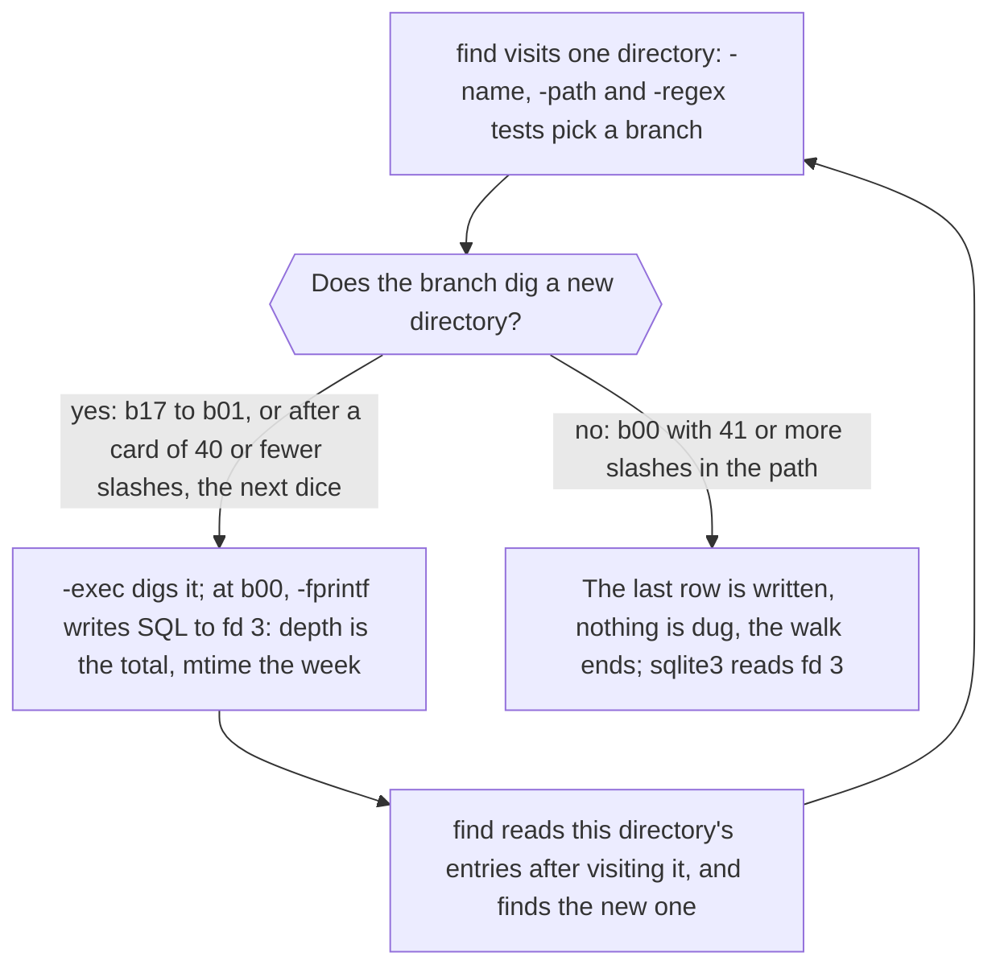
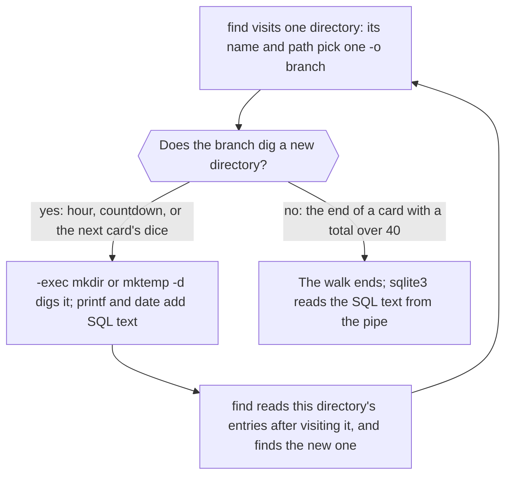

# find

Entries: [`src/find-posix`](../../src/find-posix/README.md) (portable) and [`src/find-gnu`](../../src/find-gnu/README.md) (every GNU extra). `find` is a file search tool. Here it is asked to run a program, and the only thing it is allowed to be is a file search tool: one command, four primaries, no variables.

## What makes find special

A `find` command is an **expression**. It is evaluated once for every file in a tree, left to right, and it stops early, like `&&` and `||` do. Tests (`-name`, `-path`) return true or false. Actions (`-exec`, `-print`) do something and also return true or false. That is all find has: booleans, patterns, side effects, and a walk.

| Feature | What it teaches |
| --- | --- |
| `-a` (and) is implied and binds tighter than `-o` (or) | `A -a B -o C -a D` is "if A and B, else if C and D". A chain of `-o` branches is a `case` statement, with short-circuit evaluation for free. |
| `-exec` returns the program's exit status | A command is also a test. A `mkdir` that fails makes the rest of the `-a` chain false. Control flow by error code. |
| `-path` patterns are globs where `*` crosses `/` | `-path '*/0/*/0/*'` means "the path has at least two directories named `0`". The path is a string, and a glob is a way to count in it. |
| The walk visits a directory before it reads its entries | If `-exec` makes a directory inside the one being visited, the walk goes into it next. This is the loop. POSIX does not promise it. |

## A tree walk that digs its own tree

### 1. Behold the monstrosity

```bash
sandbox/container/run-image.sh src/find-posix
```

One `find`, about 5.7 KB long, no `-delete`, no `-printf`, no `-regex`, and no shell, `awk` or `expr` anywhere in it. It draws random hours, adds them, decides when to stop, and prints SQL.

### 2. How the hell does that work?

- **The loop is the walk.** Each directory the walk visits makes the next one with `-exec mkdir {}/...`, and the walk then visits that one. Stopping means the expression just stops making directories.
- **The path is the call stack, and the names are the registers.** A one-character name is an hour, and it counts 1 to 9 and 0 again, so it is the last digit of the running total. A name like `b07` is a countdown. A six-character name from `mktemp` is the dice. Nothing is added or subtracted. The *next* name is written in the expression as a literal, one branch per value.
- **The tens digit is a glob.** The digits cycle, so the number of directories named exactly `0` in the path is the tens digit of the total. `-path '*/0/*/0/*'` reads it.
- **Randomness is a name.** `mktemp -d` makes a directory with a random name, and a `-name` or `-path` pattern reads its last character. mktemp has 62 characters, so 60 of them make ten groups of six, and `Y` and `Z` are rolled again.
- **Output is SQL text.** find prints an `INSERT` statement piece by piece. mktemp also prints the path it made, and the line turns that into an SQL comment by printing ` -- ` first.

The [README](../../src/find-posix/README.md#how-the-stunt-works) has the full table of jobs, and [`build-line.py`](../../src/find-posix/build-line.py) shows the tables in readable form.

**The GNU version lets find do the arithmetic.** [`find-gnu`](../../src/find-gnu/README.md) uses the same walk, but GNU find can measure things for you. `%d` prints the depth of a directory, and one directory is one hour, so the depth *is* the running total. `%TG-W%TV` prints the ISO week of the new directory's modification time. `-regex` replaces the glob tables with `([^/]*/){41}.*` ("at least 41 slashes", the stop rule). `-fprintf /dev/fd/3` sends the SQL to its own file descriptor. The line is about 3 KB instead of 5.7 KB.

**The optimizer has nothing to move.** `-O3` reorders tests, but never across a side effect. In this program every branch is a test followed by an effect, so the expression tree at `-O0` and at `-O3` is identical, and `-D rates` (find's own profile) shows why the optimizer's flat 80% guesses are wrong here.

### 3. What did we just learn?

- **A traversal order is a contract, or it is a habit.** Here it is a habit. It works on GNU find, bfs and busybox, and POSIX does not say it must.
- **A path pattern is a tiny parser.** With one wildcard that crosses `/`, you can count, look up and test the last segment.
- **Make the names carry the state.** In a language with no variables, the file system is the memory.
- **Short-circuit evaluation is a program counter.** Which branch runs next is decided by which test failed.
- **A tool's own measurements can be your values.** Depth and file time did, in one directive each, what ten-row tables did in the portable version.
- **An optimizer's promise is cheap to test.** Run at every level and compare. Here the promise held, and nothing moved.

Tags: `-fprintf`, `%d`, `%T`, `-regex` and `-D` are **GNU extensions**. The `-a`/`-o` precedence, `-name`, `-path` and `-exec` are **guaranteed** by POSIX. Walking into a directory that `-exec` just made is **accidentally exploited**. `{}` inside a longer argument is **implementation-permitted**: POSIX leaves it unspecified, and GNU find, bfs and busybox all replace it. `mktemp` is **not in POSIX**, but is on every BSD and Linux system.

### 4. Do this in production and you're fired

- **A finished run leaves a path more than a hundred names deep.** The entry makes it in a scratch folder and removes the folder on exit, even on Ctrl-C.
- **`*` crossing `/` is a trap.** The first version matched `*/1/b*` against an earlier `1/b...` in the same path, and the digit stuck. Patterns must end on a fixed-width name.
- **A walk that changes what it walks is hard to reason about.** The result depends on which directory entries are read before and after each visit.
- **The line is 5.7 KB.** Nobody can review that by eye. That is why [`build-line.py`](../../src/find-posix/build-line.py) exists, and why `check.sh` makes sure the two agree.

Legitimate uses: `find ... -exec ... {} +` and `-prune` are everyday tools. Changing the tree while find walks it is the thing the manuals warn you about.

### 5. Now break it yourself

See [exercises](../exercises.md#b14-find-rig-the-dice-verified) and [B15](../exercises.md#b15-gnu-find-move-the-stop-rule-read-the-profile-verified).

<!-- BEGIN GENERATED program-flow:languages/find.md -->
## How each program runs

Each picture below is the `## Program Flow` section of an entry's README, copied here by the build. It shows how that program makes the work happen: what the language, runtime or tool really does. [The introduction](../intro.md#what-the-challenge-does) has the one picture of what the challenge asks for, which is the same for every entry.

### Program flow of `find-gnu`

From [`find-gnu`](../../src/find-gnu/README.md) ([source section](../../src/find-gnu/README.md#program-flow)).



**What this shows:** the same trick as [`find-posix`](../../src/find-posix/README.md), with GNU extras that remove bookkeeping. `-fprintf` can write to its own file descriptor, `%d` is the directory depth, and `%TG-W%TV` formats the modification time as the ISO week. So the depth *is* the total, and no digit-by-digit arithmetic is needed.

**Why this mechanism matters:** the stop rule is a regular expression on the path, "at least 41 slashes". GNU find also has an optimizer that may reorder tests. An effect pins the order, so the program gives the same answer at every optimization level. That is tested, not promised.

### Program flow of `find-posix`

From [`find-posix`](../../src/find-posix/README.md) ([source section](../../src/find-posix/README.md#program-flow)).



**What this shows:** the loop is a tree walk that keeps growing. find reads a directory's entries *after* it visits the directory, so a directory that `-exec` makes inside the current one is walked next. The path from the start is the history, and the directory name is the state. It is the call stack of a recursion, drawn on the file system.

**Why this mechanism matters:** the stop rule is the absence of a new child: at the end of a card, five `0` hour-digits in the path (or four and a nonzero last digit) mean the total is over 40, and no branch digs. The running total is the number of hour directories in the path, and no arithmetic exists anywhere. This relies on the order in which find reads and visits, which is accidental to find, not promised by POSIX.
<!-- END GENERATED program-flow:languages/find.md -->
