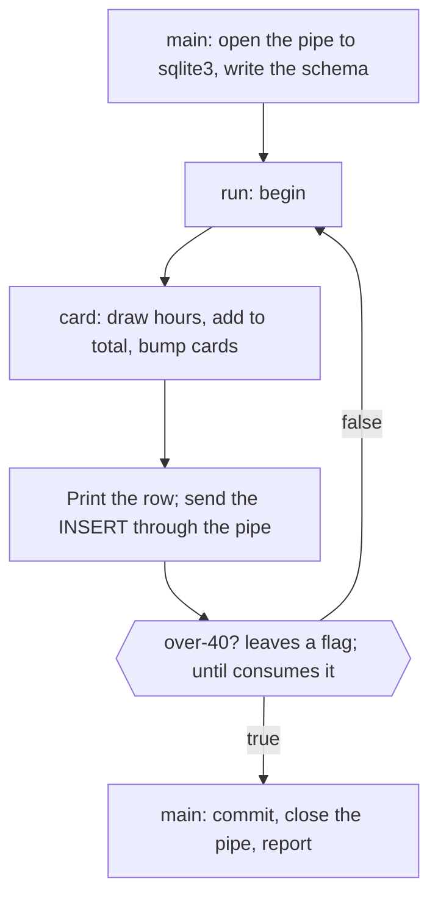
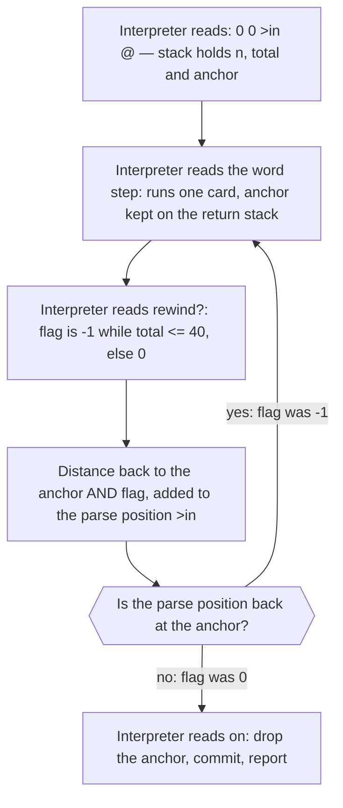

# Forth

Entries: [`src/forth`](../../src/forth/README.md) (one `begin ... until`) and [`src/forth-weird`](../../src/forth-weird/README.md) (no loop word, no variable).

For an advanced reading path with traces and experiments, see the [Forth study guide](../study-guides/languages/forth.md).

## What makes Forth special

Forth has almost no syntax: the interpreter reads a space-delimited word, looks it up, runs it. Words pass values on a **stack**, and every definition carries a stack comment like `( hours -- )`. The language is small enough that you can reach into the interpreter itself.

| Feature | Where | What it teaches |
| --- | --- | --- |
| A switch is an array of functions | [`forth/timecards.fs` L34-36](../../src/forth/timecards.fs#L34-L36): `create categories ' meetings , ...` and `: category$ ( n -- c-addr u ) 4 mod cells categories + @ execute ;` | `'` ("tick") gives a word's execution token; tokens are data. |
| Output redirection as a feature | [L68](../../src/forth/timecards.fs#L68): `: >sqlite ( xt -- ) sqlite outfile-execute ;` | `outfile-execute` redirects all output to a pipe for the duration. `.schema` and `.insert` are ordinary words that print text, and the pipe turns the text into SQL. |
| One loop word | [L108](../../src/forth/timecards.fs#L108): `: run ( -- ) begin card over-40? until ;` | `until` consumes a flag and repeats until it is true. |

## The parse position as a program counter

### 1. Behold the monstrosity

```bash
sandbox/container/run-image.sh src/forth-weird
```

The whole program's loop is one line at the top level ([L101](../../src/forth-weird/timecards.fs#L101)):

```forth
0 0 >in @ step rewind?                                     \ <== THE LOOP  ( n total anchor )
```

### 2. How the hell does that work?

The text interpreter is a loop you never see. `>in` holds *how far it has read the current line*; `>in @` reads it and `>in !` sets it. Set it to an earlier value and the interpreter reads the same words again.

- `0 0` is the starting state (card 0, total 0). `>in @` pushes the position as an **anchor**: the place to jump back to.
- `step` ([L88](../../src/forth-weird/timecards.fs#L88)) is `>r card r>`: it parks the anchor on the return stack, runs one card, restores it.
- `rewind?` ([L92-94](../../src/forth-weird/timecards.fs#L92-L94)) ends with `over >in @ - and >in @ + >in !`. A Forth flag is **-1** (all bits set) for true and **0** for false, so it works as a bit mask. `anchor - >in` is the distance back; `and` with the flag keeps the distance if true and zeroes it if false; adding it to `>in` gives either the anchor or "stay here". There is no `if`. The jump is arithmetic.

The memory is the data stack: there is not one `variable` in the file. The program counter is `>in`.

### 3. What did we just learn?

- **An interpreter's position can be a program counter.** If you can read and write it, you have goto.
- **Booleans as bit masks** are a respectable old trick, and why Forth's true is -1.
- **State on a stack** is a complete model of memory. (Compare [COBOL's mutable jump](cobol.md#alter), [Make's file-existence state](make-cmake.md#gnu-make) and [CMake's registers](make-cmake.md#cmake).)

Tags: stack effects and flags are **guaranteed** by standard Forth. `>in` manipulation is **guaranteed** to exist in ISO Forth but its effect in a definition vs. at top level is **implementation-sensitive**. `outfile-execute`, `open-pipe` and `utime` are **Gforth extensions**.

### 4. Do this in production and you're fired

- **It only works at the top level, or in `evaluate`d / `included` text.** `>in` is the parse position of the current input line. Compile the loop *into* a word and there is no line to rewind.
- **Moving one token breaks it silently.** If the `0 0` moves to *after* the `>in @` (`>in @ 0 0 step rewind?`), the anchor is now before the state, so every rewind pushes a fresh `0 0`: the total resets every pass and the program never stops (verified: hundreds of rows, no `# committed` line). A correct-looking program, a runaway loop. Moving `0 0` to the previous line is harmless, because the anchor is still after it.
- **No tooling will understand it.** Linters, tracers and humans all assume that parse position is not state.
- **Portability.** Gforth-specific words; `3dup` is not in Gforth 0.7.3, so the file defines it with `2 pick` three times ([L37](../../src/forth-weird/timecards.fs#L37)).

Legitimate uses: interpreters, debuggers, and parsing words, where manipulating the input stream is the job.

### 5. Now break it yourself

See [exercises](../exercises.md#b3-forth-move-the-anchor-verified).

## Quirks

- **Control words only work inside definitions** in standard Forth. Typing `begin ... until` at the top level is an error, so `run` is a word. The weird version cheats the other way.
- **`s"` strings can be temporary**: some interpreters return a buffer overwritten by the next one, so the category words are definitions.
- **`random` is `0..n-1`**, so `10 random 10 +` gives 10..19.
- **`close-pipe` returns the exit status**; `close-sqlite` turns a non-zero status into an abort so a failed `sqlite3` is not ignored.
- **Stack comments are the type system.** Nothing enforces `( n total -- n' total' )`; it is convention.

## Weird next to boring

[`forth`](../../src/forth/README.md) is a clean stack program: small words, one loop. [`forth-weird`](../../src/forth-weird/README.md) replaces every `variable` and control word with stack position and a rewound parser. The first is what Forth programmers write; the second is what Forth *permits*.

## Under what circumstances would this terrible idea become reasonable?

When you are writing the interpreter, a parsing word or a debugger. Rewinding the parser is a stunt in a loop; it is a tool in a language implementer's kit.

<!-- BEGIN GENERATED program-flow:languages/forth.md -->
## How each program runs

Each picture below is the `## Program Flow` section of an entry's README, copied here by the build. It shows how that program makes the work happen: what the language, runtime or tool really does. [The introduction](../intro.md#what-the-challenge-does) has the one picture of what the challenge asks for, which is the same for every entry.

### Program flow of `forth`

From [`forth`](../../src/forth/README.md) ([source section](../../src/forth/README.md#program-flow)).



**What this shows:** Forth has one ordinary loop, `begin ... until`. The loop body runs `card`, and then `over-40?` leaves a flag on the stack for `until` to take. The state lives in two variables, `total` and `cards`, and the data stack carries values between words.

**Why this mechanism matters:** the stop rule is a flag, not a condition in the loop's header. The flag is computed after the card, so the crossing card is kept. The weird sibling [`forth-weird`](../../src/forth-weird/README.md) has no `begin` and no `until`.

### Program flow of `forth-weird`

From [`forth-weird`](../../src/forth-weird/README.md) ([source section](../../src/forth-weird/README.md#program-flow)).



**What this shows:** the loop is the text interpreter, the loop you never see, and the jump is a change to `>in`, the number that says how far it has read. Setting `>in` to an earlier value makes the interpreter read the same words again. There is no `if`: a Forth flag is `-1` or `0`, so `AND` turns the distance back into either itself or nothing.

**Why this mechanism matters:** the program counter is a variable, and a program can rewrite it. The state is two numbers on the data stack, and they survive the rewind because nothing else touches them. This works because the words are read from an input line, and it does not work the same way in a definition. See [`forth`](../../src/forth/README.md) for the ordinary loop.
<!-- END GENERATED program-flow:languages/forth.md -->

## Computer science behind this page

<!-- BEGIN GENERATED concepts:languages/forth.md -->
The computer-science ideas behind this page: [Stack machines](../cs/02-what-counts-as-a-machine.md#stack-machines), [Register machines and counter machines](../cs/02-what-counts-as-a-machine.md#register-machines-and-counter-machines), [Control flow](../cs/03-control-flow-and-continuations.md#control-flow), [The program counter](../cs/03-control-flow-and-continuations.md#the-program-counter), [Parsing](../cs/05-formal-languages-as-computational-substrates.md#parsing), [State](../cs/06-state-beyond-variables.md#state), [The stack as a data structure](../cs/06-state-beyond-variables.md#the-stack-as-a-data-structure), [Reflection and metaprogramming](../cs/06-state-beyond-variables.md#reflection-and-metaprogramming), [Transactions](../cs/07-effects-errors-and-commitment.md#transactions).
<!-- END GENERATED concepts:languages/forth.md -->
