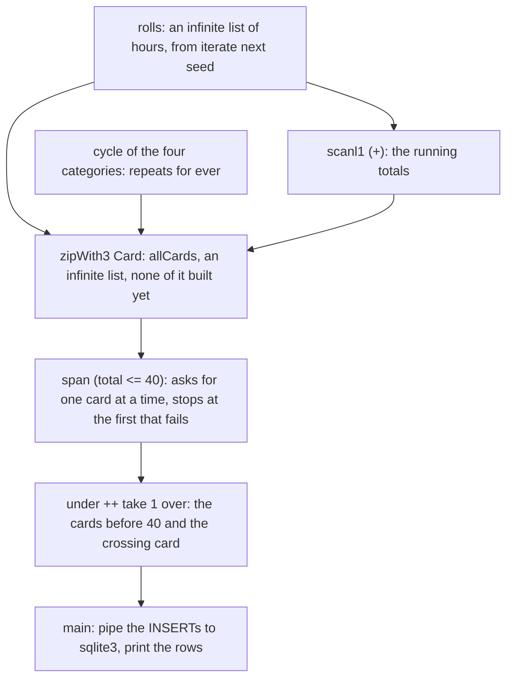
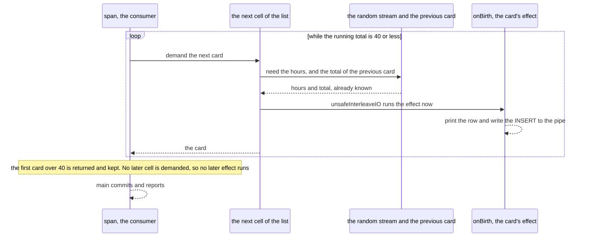

# Haskell

Entries: [`src/haskell`](../../src/haskell/README.md) (one pure function) and [`src/haskell-weird`](../../src/haskell-weird/README.md) ("Haskell on drugs": reading the list does the work).

For an advanced reading path with traces and experiments, see the [Haskell study guide](../study-guides/languages/haskell.md).

## What makes Haskell special

Haskell is **lazy**: a value is computed only when something demands it. The straight entry uses that for a stop rule that is not a loop condition at all, but *how much of a list you choose to read*.

| Feature | Where | What it teaches |
| --- | --- | --- |
| Infinite lists as descriptions | [`haskell/timecards.hs` L41](../../src/haskell/timecards.hs#L41): `rolls = map toHours . tail . iterate next` | `iterate` produces an endless stream. It is a recipe, not data. |
| Running sums over a stream | [L49](../../src/haskell/timecards.hs#L49): `zipWith3 Card (cycle [minBound ..]) hs (scanl1 (+) hs)` | `scanl1 (+)` is a running total; `cycle [minBound ..]` repeats the categories because the type derives `Enum` and `Bounded`. |
| The stop rule is a split | [L56-59](../../src/haskell/timecards.hs#L56-L59): `under ++ take 1 over where (under, over) = span ((<= 40) . runningTotal) (allCards seed)` | `span` reads one card at a time and stops at the first that fails. `takeWhile` would drop the crossing card; `span` hands back both halves. |
| Wrapping arithmetic is a feature | `rolls` uses a 64-bit LCG on `Word64` | "mod 2^64" is free, because `Word64` wraps. |

## Lazy IO as control flow

### 1. Behold the monstrosity

```bash
sandbox/container/run-image.sh src/haskell-weird
```

An infinite list of cards. *Forcing the n-th cell prints card n and sends its `INSERT` to `sqlite3`.* Nothing else writes a row. No loop, accumulator, counter or explicit recursion.

### 2. How the hell does that work?

Three tricks stacked.

1. **A list defined in terms of itself.** [L53](../../src/haskell-weird/timecards.hs#L53): `rolls seed = map toHours (tail (fix (\xs -> seed : map next xs)))`. `fix f = f (fix f)` hands a function its own result, so `xs = seed : map next xs`. It works because `map` needs only one element at a time.
2. **A knot through the cards.** [L75-78](../../src/haskell-weird/timecards.hs#L75-L78): `sheet onBirth seed = fixIO $ \cards -> let before = 0 : map runningTotal cards ...`. Card n's total is its hours plus the total *read off card n-1, an element of the list under construction*. `fixIO` is `fix` for IO.
3. **Effects that wait to be asked for.** [L62-64](../../src/haskell-weird/timecards.hs#L62-L64): `lazily = fix $ \self actions -> unsafeInterleaveIO $ case actions of ...`. Ordinary `sequence` runs every action first, which never finishes on an infinite list. `unsafeInterleaveIO` means "run this only when its result is demanded". After `sheet` returns, nothing has run; each cell is a promise.

The stop rule is [`untilOver40` (L82-83)](../../src/haskell-weird/timecards.hs#L82-L83): `under ++ take 1 over`. Reading card n runs `onBirth` for card n, so total reads equal total `INSERT`s by construction.

### 3. What did we just learn?

- **Evaluation order is part of a program's meaning once effects are involved.** In a pure program it does not matter. Put IO behind a lazy cell and it decides *which rows exist*.
- **Referential transparency is a contract, and `unsafe...` is where you stop honoring it.**
- **"When does this run?" is the same question** as LINQ's deferred execution (see [C#](csharp-linq-xaml.md#deferred-execution-and-the-void-to-value-trick)). Both are cases where a description is separated from its execution.

Tags: `span` laziness is **guaranteed** by the language semantics. `unsafeInterleaveIO` ordering is **implementation-permitted**: the program is correct because card n cannot be forced before card n-1, not because the evaluator promises an order.

### 4. Do this in production and you're fired

- **The README's own war story.** The first draft counted with `let entries = length cards`, and the program printed `# committed total=Meetings 12 12 ...` then crashed with "handle is closed". A lazy `let` meant nothing forced the cards until the summary was printed, after the pipe was closed. The cards' effects fired *during the output of `show`*. The fix: [L144](../../src/haskell-weird/timecards.hs#L144) `entries <- evaluate (length cards)`.
- **`lazily` must defer its own pattern match.** If the `case` runs before `unsafeInterleaveIO`, forcing it needs `before`, which needs `cards`, which does not exist yet: `<<loop>>`.
- **`take 1 over` fires one more effect.** The crossing card has to be read to see that it crosses, so its row is written. Laziness makes the off-by-one visible.
- **Testing and concurrency.** Effects whose timing depends on the consumer cannot be tested without the consumer, and cannot be shared safely.

Legitimate uses: lazy IO exists for streaming (`getContents` over a large input) and the same hazards are why people moved to streaming libraries. Knot-tying (`fix`) is a respectable technique for self-referential data, such as circular structures and memo tables.

### 5. Now break it yourself

See [exercises](../exercises.md#b2-haskell-break-the-laziness-verified): replace `unsafeInterleaveIO` with plain IO, or move the `evaluate`, and predict the output.

## Quirks

- **`takeWhile` is not enough**: it drops the crossing card. `span` keeps both halves.
- **Partial functions.** `head`, `last` and `!!` crash on an empty list; neither program uses them.
- **`Int` vs `Integer` vs `Word64`.** The generator wants exactly 64 unsigned bits, so `Word64`, whose wraparound is the feature.
- **No random package ships with GHC.** Both entries hand-roll a linear congruential generator (Knuth's MMIX constants), using the high bits.
- **`hGetContents`-style surprises.** The weird entry turns Haskell's most notorious lazy-IO surprise into the algorithm.
- **Style tools.** The source is laid out by hand in Ormolu style and compiles clean under `-Wall -Wcompat`, but was *not* run through `ormolu` or `hlint`.
- **`check.sh` as a constraint.** [`haskell-weird/check.sh`](../../src/haskell-weird/check.sh) bans `scanl iterate foldr foldl unfoldr until go mapM forM forever replicateM foldM zipWithM sequence`, requires `fixIO $ \cards ->` and exactly one `unsafeInterleaveIO`.

## Weird next to boring

[`haskell`](../../src/haskell/README.md) is a pure function plus plumbing: easy to test, easy to reason about. [`haskell-weird`](../../src/haskell-weird/README.md) puts the effects inside the data structure. The weird version reveals something the idiomatic one hides: a lazy list is a *program waiting to be read*.

## Under what circumstances would this terrible idea become reasonable?

Inside a library that implements lazy streaming and has been carefully tested for ordering. Not in application code, where `evaluate`, strict IO and streaming libraries give the same results without the surprises.

<!-- BEGIN GENERATED program-flow:languages/haskell.md -->
## How each program runs

Each picture below is the `## Program Flow` section of an entry's README, copied here by the build. It shows how that program makes the work happen: what the language, runtime or tool really does. [The introduction](../intro.md#what-the-challenge-does) shows what the challenge asks for and where entries differ.

### Program flow of `haskell`

From [`haskell`](../../src/haskell/README.md) ([source section](../../src/haskell/README.md#program-flow)).



**What this shows:** the lists are descriptions, not data. Nothing is computed until `span` asks for a card, and `span` stops asking at the first card that fails the test. So only a handful of cards are ever built, even though the lists are infinite.

**Why this mechanism matters:** the stop rule is not a loop condition. It is *how much of a list you choose to read*. Demand flows backwards, from `span` to the lists, while the data flows forwards. This is lazy evaluation as a way to write a loop without one.

### Program flow of `haskell-weird`

From [`haskell-weird`](../../src/haskell-weird/README.md) ([source section](../../src/haskell-weird/README.md#program-flow)).



**What this shows:** the effects are tied to the *reading* of the list. The list is built so that nothing runs when it is made. Each cell holds a promise, and forcing the cell runs that card's `onBirth`. So the number of rows printed equals the number of `INSERT`s, equals the number of cards read.

**Why this mechanism matters:** this is demand-driven control flow with side effects, and it is only safe because of how the cells are linked. `unsafeInterleaveIO` is called *unsafe* for a reason: the order of effects now depends on the order of demand. The same laziness without effects is in the plain [`haskell`](../../src/haskell/README.md) entry.
<!-- END GENERATED program-flow:languages/haskell.md -->

## Computer science behind this page

<!-- BEGIN GENERATED concepts:languages/haskell.md -->
The computer-science ideas behind this page: [Control flow](../cs/03-control-flow-and-continuations.md#control-flow), [Evaluation strategies](../cs/04-evaluation-and-demand.md#evaluation-strategies), [Lazy evaluation](../cs/04-evaluation-and-demand.md#lazy-evaluation), [Iterators and generators](../cs/04-evaluation-and-demand.md#iterators-and-generators), [Referential transparency](../cs/04-evaluation-and-demand.md#referential-transparency), [First-class and higher-order functions](../cs/04-evaluation-and-demand.md#first-class-and-higher-order-functions), [Monoids and folds](../cs/04-evaluation-and-demand.md#monoids-and-folds), [State](../cs/06-state-beyond-variables.md#state), [Side effects](../cs/07-effects-errors-and-commitment.md#side-effects), [Monads and effect systems](../cs/07-effects-errors-and-commitment.md#monads-and-effect-systems).
<!-- END GENERATED concepts:languages/haskell.md -->
